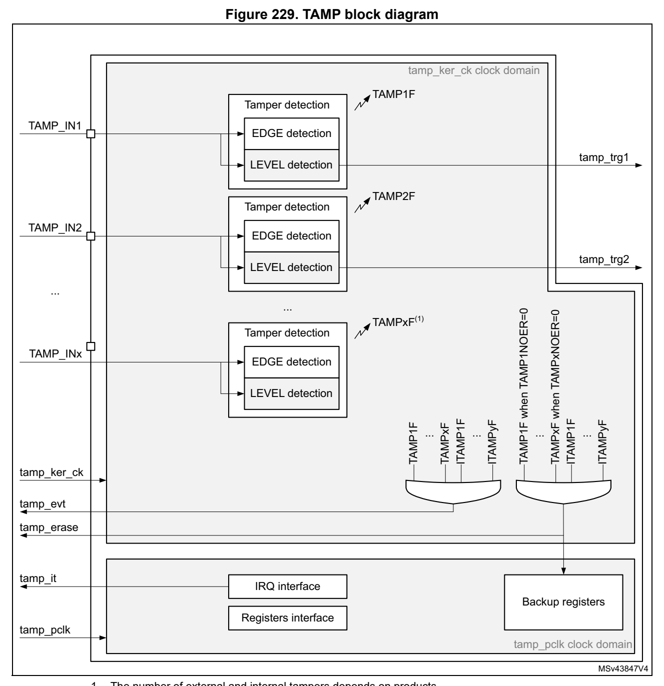

# 24 Tamper and backup registers (TAMP) (pp. 689-703)

## 24 Tamper and backup registers (TAMP) (p. 689)

### 24.1 Introduction (p. 689)

5 32-bit backup registers are retained in all low-power modes a nd also in V BAT mode. They can be used to store sensitive data as t heir content is protected by an tamper detection circuit. Up to 3 tamper pins and 4 internal tampers are availab le for anti-tamper detection. The external tamper pins can be configured for edge detection, or level detection with or without filtering.

### 24.2 TAMP main features (p. 689)

- 5 backup registers: – the backup registers (TAMP_BKPxR) are implemented in the RTC d omain that remains powered-on by V BAT when the V DD power is switched off.

- Up to 3 external tamper detection events. – External passive tampers with co nfigurable filter and internal pull-up.

- 4 internal tamper events.

- Any tamper detection can gen erate a RTC ti mestamp event.

- Any tamper detection can erase the backup registers.

### 24.3 TAMP functional description (p. 690)

#### 24.3.1 TAMP block diagram (p. 690)

*Figure 229. TAMP block diagram (p. 690)*

#### 24.3.2 TAMP pins and internal signals (p. 691)

**Table 96. TAMP input/output pins (p. 691)**

| Col 1 | Pin name Signal type Description |
| --- | --- |
| TAMP_INx (x = pin inde | x) Input Tamper input pin |

**Table 97. TAMP internal input/output signals (p. 691)**

| Col 1 | Internal signal name Signal type Description | Col 3 |
| --- | --- | --- |
| tamp_ker_ck Input |  | TAMP kernel clock, connected to rtc_ker_ck and also named RTCCLK in this document |
|  | tamp_pclk Input TAMP APB clock, connected to rtc_pclk |  |
| tamp_itamp[y] (y = signal index) |  | Inputs Internal tamper event sources |
| tamp_evt Output |  | Tamper event detection ( internal or external) The tamp_evt is used to generate a RTC timestamp event |
| tamp_erase Output |  | Device secrets erase request following tamper event detection (internal or external) |
| tamp_it Output |  | TAMP interrupt (refer to Section 24.5: TAMP interrupts for details) |
| tamp_trg[x] (x = signal index) | Output Tamper detection trigger | Output Tamper detection trigger |

The TAMP kernel clock is usually the LSE at 32.768 kHz although it is possible to select other clock sources in the RCC (refer to RCC for more details). Some detections modes are not available in some low-power modes or V BAT when the selected clock is not LSE (refer to Section 24.4: TAMP low-power modes for more details.

**Table 98. TAMP interconnection (p. 691)**

| Col 1 | Signal name Source/Destination |
| --- | --- |
|  | tamp_evt rtc_tamp_evt used to generate a timestamp event |
| tamp_erase | The tamp_erase signal is used to erase the device secrets liste d hereafter: backup registers |
|  | tamp_itamp3 LSE monitoring |
|  | tamp_itamp4 HSE monitoring |
|  | tamp_itamp5 RTC calendar overflow (rtc_calovf) |
|  | tamp_itamp6 ST manufacturer readout |

#### 24.3.3 TAMP registe r write protection (p. 691)

After system reset, th e TAMP registers (including backup registers) are protected against parasitic write access by the DB P bit in the power control peri pheral (refer to the PWR power control section). DBP bit must be se t in order to enable TAMP registers write access.

#### 24.3.4 Tamper detection (p. 692)

The tamper detection can be configured for the following purpos es:

- erase the backup registers (default configuration)

- generate an interrupt, capable to wakeup from Stop and Standby mode

- generate a hardware trigger for the low-power timers

TAMP backup registers

The backup registers (TAMP_BKPxR) are not reset b y system reset or when the device wakes up from Standby mode.

The backup registers are reset w hen a tamper detection event occurs except if the TAMPxNOER bit is set, or if the TAMPxMSK is set in the TAMP_CR2 register.

Note: The backup registers are also erased when the readout protection of the flash is changed from level 1 to level 0.

Tamper detection initialization

Each input can be enabled by setting the corresponding TAMPxE b its to 1 in the TAMP_CR register.

Each TAMP_INx tamper detection input is associated with a flag TAMPxF in the TAMP_SR register.

When TAMPxMSK is cleared:

The TAMPxF flag is asserted after the tamper event on the pin, with the latency provided below:

- 3 ck_apre cycles when TAMPFLT differs from 0x0 (level detection with filtering)

- 3 ck_apre cycles when TAMPTS = 1 (timestamp on tamper event)

- No latency when TAMPFLT = 0x0 ( edge detection) and TAMPTS = 0

A new tamper occurring on the same pin during this period and a s long as TAMPxF is set cannot be detected.

When TAMPxMSK is set:

A new tamper occurring on the same pin cannot be detected durin g the latency described above and 2.5 ck_rtc additional cycles.

By setting the TAMPxIE bit in t he TAMP_IER register, an interru pt is generated when a tamper detection event occurs (when TAMPxF is set). Setting TAM PxIE is not allowed when the corresponding TAMPxMSK is set.

Trigger output generation on tamper event

The tamper event detection can be used as trigger input by the low-power timers.

When TAMPxMSK bit in cleared in TAMP_CR register, the TAMPxF fl ag must be cleared by software in order to allow a new tamper detection on the same p in.

When TAMPxMSK bit is set, the TA MPxF flag is masked, and kept c leared in TAMP_SR register. This configuration allows to trig automatically the l ow-power timers in Stop mode, without requiring the system wakeu p to perform the TAMPxF clearing. In this case, the backup registers a re not cleared.

This feature is availa ble only when the tamp er is configured in the Level detection with filtering on tamper inputs (passive mode) mode (TAMPFLT ≠ 00 an d active mode is not selected).

Timestamp on tamper event

With TAMPTS set to 1 in the RTC_C R, any tamper event causes a t imestamp to occur. In this case, either the TSF bit or the TSOVF bit is set in RTC_SR, in the same manner as if a normal timestamp event occurs. The affected tamper flag registe r TAMPxF is set in the TAMP_SR at the same time that TS F or TSOVF is set in the RTC_SR.

Edge detection on tamper inputs (passive mode)

If the TAMPFLT bits are 00, the TAMP_INx pins generate tamper d etection events when either a rising edge/high level or a fa lling edge/low level is observed depending on the corresponding TAMPxTRG bit. The internal pull-up resistors on t he TAMP_INx inputs are deactivated when edge detection is selected.

Caution: When using the edge detection, it is recommended to check by software the tamper pin level just after enab ling the tamper detection (by reading the GPIO registers), and before writing sensitive values in the backup registers, to ensure tha t an active edge did not occur before enabling the tamper event detection. When TAMPFLT = 00 and TAMPxTRG = 0 (rising edge detection), a tamper event may be detected by hardware if the tamper input is already at high level before enabling the tamper detection.

After a tamper event has been detected and cleared, the TAMP_IN x should be disabled and then re-enabled (TAMPxE set to 1) before re-programming the bac kup registers (TAMP_BKPxR). This prevents the application from writing to the backup registers while the TAMP_INx input value still indica tes a tamper detection. This i s equivalent to a level detection on the TAMP_INx input.

Note: Tamper detection is still active when V DD power is switched off. To avoid unwanted resetting of the backup registers, the pin to which the TAMPx is mapped should be externally tied to the correct level.

Level detection with filtering on tamper inputs (passive mode)

Level detection with filtering is performed by setting TAMPFLT to a non-zero value. A tamper detection event is generated wh en either 2, 4, or 8 (depending on TAMPFLT) consecutive samples are observed at the leve l designated by the TAMPxTRG bi ts.

The TAMP_INx inputs are precharg ed through the I/O internal pul l-up resistance before its state is sampled, unle ss disabled by setting TAMPPUDIS to 1. Th e duration of the precharge is determined by the TAMPPRCH bits, allowing for larg er capacitances on the TAMP_INx inputs.

The trade-off between tamper detection latency and power consum ption through the pull-up can be optimized by using TAMPFREQ to determine the frequency of the sampling for level detection.

Note: Refer to the datasheet for the electrical characteristics of the pull-up resistors.

### 24.4 TAMP low-power modes (p. 694)

**Table 99. Effect of low-power modes on TAMP (p. 694)**

| Col 1 | Mode Description |
| --- | --- |
| Sleep | No effect. TAMP interrupts cause the device to exit the Sleep mode. |
| Stop | No effect on all features, except for level detection with filtering mode which remain active only when the cloc k source is LSE or LSI. Tamper events cause the device to exit the Stop mode. |
| Standby | No effect on all features, except for level detection with filtering mode which remain active only when the clock source is LSE or LSI.Tamper events cause the device to exit the Standby mode. |

### 24.5 TAMP interrupts (p. 694)

The interrupt channel is set in the interrupt status register. The interrupt output is also activated.

**Table 100. Interrupt requests (p. 694)**

| Interrupt acronym | Interrupt event | Event flag (1) | Enable control bit (2) | Interrupt clear method | Exit from Sleep mode | Exit from Stop and Standby modes |
| --- | --- | --- | --- | --- | --- | --- |
| TAMP | Tamper x (3) | TAMPxF TAMPxIE | TAMPxF TAMPxIE | Write 1 in CTAMPxF | Yes Yes | (4) |
| TAMP | Internal tamper y (3) | ITAMPyF ITAMPyIE | ITAMPyF ITAMPyIE | Write 1 in CITAMPxF | Yes Yes | (4) |

1. The event flags are in the TAMP_SR register. 2. The interrupt masked flags (re sulting from event flags AND en able control bits) are in the TAMP_MISR register. 3. The number of tampers and internal tampers events depend on p roducts. 4. In case of level detection wi th filtering passive tamper mode, wakeup from Stop and Standby modes is possible only when the TAMP clock source is LSE or LSI.

### 24.6 TAMP registers (p. 694)

Refer to Section 1.2 on page 39 of the reference manual for a list of abbreviations used in register descriptions. The peripheral registers can be accessed by words (32-bit).

### 24.6.1 [TAMP.TAMP_CR1] Offset: 0x00 | Reset: 0xFFFF0000 (p. 695)

Address offset: 0x00

Backup domain reset value: 0xFFFF 0000

System reset: not affected

E E E

rw rw rw

Bits 31:24 Reserved, must be kept at reset value.

Bit 23 Reserved, must be kept at reset value.

Bit 22 Reserved, must be kept at reset value.

Bit 21 ITAMP6E: Internal tamper 6 enable: ST manufacturer readout 0: Internal tamper 6 disabled. 1: Internal tamper 6 enabled: a tamper is generated in case of ST manufacturer readout.

Bit 20 ITAMP5E: Internal tamper 5 enable: RTC calendar overflow 0: Internal tamper 5 disabled. 1: Internal tamper 5 enabled: ast tamper is generated when the RT C calendar reaches its maximum value, on the 31 of December 99, at 23:59:59. T he calendar is then frozen and cannot overflow.

Bit 19 ITAMP4E: Internal tamper 4 enable: HSE monitoring 0: Internal tamper 4 disabled. 1: Internal tamper 4 enabled. a tamper is generated when the HS E frequency is below or above thresholds.

Bit 18 ITAMP3E: Internal tamper 3 enable: LSE monitoring 0: Internal tamper 3 disabled. 1: Internal tamper 3 enabled: a tamper is generated when the LS E frequency is below or above thresholds.

Bit 17 Reserved, must be kept at reset value.

Bit 16 Reserved, must be kept at reset value.

Bits 15:3 Reserved, must be kept at reset value.

Bit 2 TAMP3E: Tamper detection on TAMP_IN3 enable 0: Tamper detection on TAMP_IN3 is disabled. 1: Tamper detection on TAMP_IN3 is enabled.

Bit 1 TAMP2E: Tamper detection on TAMP_IN2 enable 0: Tamper detection on TAMP_IN2 is disabled. 1: Tamper detection on TAMP_IN2 is enabled.

Bit 0 TAMP1E: Tamper detection on TAMP_IN1 enable 0: Tamper detection on TAMP_IN1 is disabled. 1: Tamper detection on TAMP_IN1 is enabled.

### 24.6.2 [TAMP.TAMP_CR2] Offset: 0x04 | Reset: 0x00000000 (p. 696)

Address offset: 0x04

Backup domain reset value: 0x0000 0000

System reset: not affected

NOER NOER NOER

rw rw rw

Bits 31:27 Reserved, must be kept at reset value.

Bit 26 TAMP3TRG: Active level for tamper 3 input (active mode disabled) 0:If TAMPFLT ≠ 00 Tamper 3 input staying low triggers a tamper detection event. If TAMPFLT = 00 Tamper 3 input rising edge and high level trigg ers a tamper detection event. 1:If TAMPFLT ≠ 00 Tamper 3 inpu t staying high triggers a tamper detection event. If TAMPFLT = 00 Tamper 3 input falling edge and low level trigg ers a tamper detection event.

Bit 25 TAMP2TRG: Active level for tamper 2 input (active mode disabled) 0:If TAMPFLT ≠ 00 Tamper 2 input staying low triggers a tamper detection event. If TAMPFLT = 00 Tamper 2 input rising edge and high level trigg ers a tamper detection event. 1:If TAMPFLT ≠ 00 Tamper 2 inpu t staying high triggers a tamper detection event. If TAMPFLT = 00 Tamper 2 input falling edge and low level trigg ers a tamper detection event.

Bit 24 TAMP1TRG: Active level for tamper 1 input (active mode disabled) 0:If TAMPFLT ≠ 00 Tamper 1 input staying low triggers a tamper detection event. If TAMPFLT = 00 Tamper 1 input rising edge and high level trigg ers a tamper detection event. 1:If TAMPFLT ≠ 00 Tamper 1 inpu t staying high triggers a tamper detection event. If TAMPFLT = 00 Tamper 1 input falling edge and low level trigg ers a tamper detection event.

Bit 23 Reserved, must be kept at reset value.

Bits 22:19 Reserved, must be kept at reset value.

Bit 18 TAMP3MSK: Tamper 3 mask 0: Tamper 3 event generates a trigger event and TAMP3F must be cleared by software to allow next tamper event detection. 1: Tamper 3 event generates a tri gger event. TAMP3F is masked a nd internally cleared by hardware. The backup registers are not erased. The tamper 3 interrupt must not be enabled when TAMP3MSK is set.

Bit 17 TAMP2MSK: Tamper 2 mask 0: Tamper 2 event generates a trigger event and TAMP2F must be cleared by software to allow next tamper event detection. 1: Tamper 2 event generates a tri gger event. TAMP2F is masked a nd internally cleared by hardware. The backup registers are not erased. The tamper 2 interrupt must not be enabled when TAMP2MSK is set.

Bit 16 TAMP1MSK: Tamper 1 mask 0: Tamper 1 event generates a trigger event and TAMP1F must be cleared by software to allow next tamper event detection. 1: Tamper 1 event generates a tri gger event. TAMP1F is masked a nd internally cleared by hardware. The backup registers are not erased. The tamper 1 interrupt must not be enabled when TAMP1MSK is set.

Bits 15:3 Reserved, must be kept at reset value.

Bit 2 TAMP3NOER: Tamper 3 no erase 0: Tamper 3 event erases the backup registers. 1: Tamper 3 event does not erase the backup registers.

Bit 1 TAMP2NOER: Tamper 2 no erase 0: Tamper 2 event erases the backup registers. 1: Tamper 2 event does not erase the backup registers.

Bit 0 TAMP1NOER: Tamper 1 no erase 0: Tamper 1 event erases the backup registers. 1: Tamper 1 event does not erase the backup registers.

### 24.6.3 [TAMP.TAMP_FLTCR] Offset: 0x0C | Reset: 0x00000000 (p. 697)

Address offset: 0x0C

Backup domain reset value: 0x0000 0000

System reset: not affected

Bits 31:8 Reserved, must be kept at reset value.

Bit 7 TAMPPUDIS: TAMP_INx pull-up disable This bit determines if each of t he TAMPx pins are precharged before each sample. 0: Precharge TAMP_INx pins before sampling (enable internal pul l-up) 1: Disable precharge of TAMP_INx pins.

Bits 6:5 TAMPPRCH[1:0]: TAMP_INx precharge duration These bit determines the duratio n of time during which the pull -up/is activated before each sample. TAMPPRCH is valid for each of the TAMP_INx inputs. 0x0: 1 RTCCLK cycle 0x1: 2 RTCCLK cycles 0x2: 4 RTCCLK cycles 0x3: 8 RTCCLK cycles

Bits 4:3 TAMPFLT[1:0]: TAMP_INx filter count These bits determines the number of consecutive samples at the specified level (TAMP*TRG) needed to activate a ta mper event. TAMPFLT is valid for each of the TAMP_INx inputs. 0x0: Tamper event is activated on edge of TAMP_INx input transi tions to the active level (no internal pull-up on TAMP_INx input). 0x1: Tamper event is activated after 2 consecutive samples at t he active level. 0x2: Tamper event is activated after 4 consecutive samples at t he active level. 0x3: Tamper event is activated after 8 consecutive samples at t he active level.

Bits 2:0 TAMPFREQ[2:0]: Tamper sampling frequency Determines the frequency at which each of the TAMP_INx inputs a re sampled. 0x0: RTCCLK / 32768 (1 Hz when RTCCLK = 32768 Hz) 0x1: RTCCLK / 16384 (2 Hz when RTCCLK = 32768 Hz) 0x2: RTCCLK / 8192 (4 Hz when RTCCLK = 32768 Hz) 0x3: RTCCLK / 4096 (8 Hz when RTCCLK = 32768 Hz) 0x4: RTCCLK / 2048 (16 Hz when RTCCLK = 32768 Hz) 0x5: RTCCLK / 1024 (32 Hz when RTCCLK = 32768 Hz) 0x6: RTCCLK / 512 (64 Hz when RTCCLK = 32768 Hz) 0x7: RTCCLK / 256 (128 Hz when RTCCLK = 32768 Hz)

Note: This register concerns only the tamper inputs in passive mode.

### 24.6.4 [TAMP.TAMP_IER] Offset: 0x2C | Reset: 0x00000000 (p. 698)

Address offset: 0x2C

Backup domain reset value: 0x0000 0000

System reset: not affected

3IE 2IE 1IE

rw rw rw

Bits 31:24 Reserved, must be kept at reset value.

Bit 23 Reserved, must be kept at reset value.

Bit 22 Reserved, must be kept at reset value.

Bit 21 ITAMP6IE: Internal tamper 6 interrupt enable: ST manufacturer readout 0: Internal tamper 6 i nterrupt disabled. 1: Internal tamper 6 interrupt enabled.

Bit 20 ITAMP5IE: Internal tamper 5 interrupt enable: RTC calendar overflow 0: Internal tamper 5 i nterrupt disabled. 1: Internal tamper 5 interrupt enabled.

Bit 19 ITAMP4IE: Internal tamper 4 interrupt enable: HSE monitoring 0: Internal tamper 4 i nterrupt disabled. 1: Internal tamper 4 interrupt enabled.

Bit 18 ITAMP3IE: Internal tamper 3 interrupt enable: LSE monitoring 0: Internal tamper 3 i nterrupt disabled. 1: Internal tamper 3 interrupt enabled.

Bit 17 Reserved, must be kept at reset value.

Bit 16 Reserved, must be kept at reset value.

Bits 15:3 Reserved, must be kept at reset value.

Bit 2 TAMP3IE: Tamper 3 interrupt enable 0: Tamper 3 interrupt disabled. 1: Tamper 3 interrupt enabled..

Bit 1 TAMP2IE: Tamper 2 interrupt enable 0: Tamper 2 interrupt disabled. 1: Tamper 2 interrupt enabled.

Bit 0 TAMP1IE: Tamper 1 interrupt enable 0: Tamper 1 interrupt disabled. 1: Tamper 1 interrupt enabled.

### 24.6.5 [TAMP.TAMP_SR] Offset: 0x30 | Reset: 0x00000000 (p. 699)

Address offset: 0x30

Backup domain reset value: 0x0000 0000

System reset: not affected

3F 2F 1F

r rr

Bits 31:24 Reserved, must be kept at reset value.

Bit 23 Reserved, must be kept at reset value.

Bit 22 Reserved, must be kept at reset value.

Bit 21 ITAMP6F: ST manufacturer readout tamper detection flag This flag is set by hardware wh en a tamper detection event is d etected on the internal tamper 6.

Bit 20 ITAMP5F: RTC calendar overflow tamper detection flag This flag is set by hardware wh en a tamper detection event is d etected on the internal tamper 5.

Bit 19 ITAMP4F: HSE monitoring tamper detection flag This flag is set by hardware wh en a tamper detection event is d etected on the internal tamper 4.

Bit 18 ITAMP3F: LSE monitoring tamper detection flag This flag is set by hardware wh en a tamper detection event is d etected on the internal tamper 3.

Bit 17 Reserved, must be kept at reset value.

Bit 16 Reserved, must be kept at reset value.

Bits 15:3 Reserved, must be kept at reset value.

Bit 2 TAMP3F: TAMP3 detection flag This flag is set by hardware wh en a tamper detection event is d etected on the TAMP3 input.

Bit 1 TAMP2F: TAMP2 detection flag This flag is set by hardware wh en a tamper detection event is d etected on the TAMP2 input.

Bit 0 TAMP1F: TAMP1 detection flag This flag is set by hardware wh en a tamper detection event is d etected on the TAMP1 input.

### 24.6.6 [TAMP.TAMP_MISR] Offset: 0x34 | Reset: 0x00000000 (p. 700)

Address offset: 0x34

Backup domain reset value: 0x0000 0000

System reset: not affected

3MF 2MF 1MF

r rr

Bits 31:24 Reserved, must be kept at reset value.

Bit 23 Reserved, must be kept at reset value.

Bit 22 Reserved, must be kept at reset value.

Bit 21 ITAMP6MF: ST manufacturer readout tam per interrupt masked flag This flag is set by hardware when the internal tamper 6 interru pt is raised.

Bit 20 ITAMP5MF: RTC calendar overflow tamper interrupt masked flag This flag is set by hardware when the internal tamper 5 interru pt is raised.

Bit 19 ITAMP4MF: HSE monitoring tamper interrupt masked flag This flag is set by hardware when the internal tamper 4 interru pt is raised.

Bit 18 ITAMP3MF: LSE monitoring tamper interrupt masked flag This flag is set by hardware when the internal tamper 3 interru pt is raised.

Bit 17 Reserved, must be kept at reset value.

Bit 16 Reserved, must be kept at reset value.

Bits 15:3 Reserved, must be kept at reset value.

Bit 2 TAMP3MF: TAMP3 interrupt masked flag This flag is set by hardware when the tamper 3 interrupt is rai sed.

Bit 1 TAMP2MF: TAMP2 interrupt masked flag This flag is set by hardware when the tamper 2 interrupt is rai sed.

Bit 0 TAMP1MF: TAMP1 interrupt masked flag This flag is set by hardware when the tamper 1 interrupt is rai sed.

### 24.6.7 [TAMP.TAMP_SCR] Offset: 0x3C | Reset: 0x00000000 (p. 701)

Address offset: 0x3C

System reset value: 0x0000 0000

3F 2F 1F

www

Bits 31:24 Reserved, must be kept at reset value.

Bit 23 Reserved, must be kept at reset value.

Bit 22 Reserved, must be kept at reset value.

Bit 21 CITAMP6F: Clear ITAMP6 detection flag Writing 1 in this bit clears the ITAMP6F bit in the TAMP_SR reg ister.

Bit 20 CITAMP5F: Clear ITAMP5 detection flag Writing 1 in this bit clears the ITAMP5F bit in the TAMP_SR reg ister.

Bit 19 CITAMP4F: Clear ITAMP4 detection flag Writing 1 in this bit clears the ITAMP4F bit in the TAMP_SR reg ister.

Bit 18 CITAMP3F: Clear ITAMP3 detection flag Writing 1 in this bit clears the ITAMP3F bit in the TAMP_SR reg ister.

Bit 17 Reserved, must be kept at reset value.

Bit 16 Reserved, must be kept at reset value.

Bits 15:3 Reserved, must be kept at reset value.

Bit 2 CTAMP3F: Clear TAMP3 detection flag Writing 1 in this bit clears the TAMP3F bit in the TAMP_SR regi ster.

Bit 1 CTAMP2F: Clear TAMP2 detection flag Writing 1 in this bit clears the TAMP2F bit in the TAMP_SR regi ster.

Bit 0 CTAMP1F: Clear TAMP1 detection flag Writing 1 in this bit clears the TAMP1F bit in the TAMP_SR regi ster.

### 24.6.8 [TAMP.TAMP_BKPxR] Offset: 0x100 | Reset: 0x00000000 (p. 702)

Address offset: 0x100 + 0x04 * x, (x = 0 to 4)

Backup domain reset value: 0x0000 0000

System reset: not affected

Bits 31:0 BKP[31:0] The application can write or read data to and from these registers. They are powered-on by V BAT when V DD is switched off, so that the y are not reset by System reset, and their contents remai n valid when the device operates in low-power mode. In the default configuration thi s register is reset on a tamper detection event. It is forced to reset value as long as there is at least one internal or extern al tamper flag being set. This register is also reset when the readout protection (RDP) is dis abled.

#### 24.6.9 TAMP register map (p. 703)

**Table 101. TAMP register map and reset values (p. 703)**

| Col 1 | Offset Register | 31 | 30 | 29 | 28 | 27 | 26 | 25 | 24 | 23 | 22 | 21 | 20 | 19 | 18 | 17 | 16 | 15 | 14 | 13 | 12 | 11 | 10 | 9 | 8 | 7 | 6 | 5 | 4 | 3 | 2 | 1 | 0 |
| --- | --- | --- | --- | --- | --- | --- | --- | --- | --- | --- | --- | --- | --- | --- | --- | --- | --- | --- | --- | --- | --- | --- | --- | --- | --- | --- | --- | --- | --- | --- | --- | --- | --- |
| 0x00 | TAMP_CR1 | Res. | Res. | Res. | Res. | Res. | Res. | Res. | Res. | Res. | Res. | ITAMP6E | ITAMP5E | ITAMP4E | ITAMP3E | Res. | Res. | Res. | Res. | Res. | Res. | Res. | Res. | Res. | Res. | Res. | Res. | Res. | Res. | Res. | TAMP3E | TAMP2E | TAMP1E |

Reset value 1 1 1 1 0 0 0 0x04 TAMP_CR2 Res. Res. Res. Res. Res. TAMP3TRG TAMP2TRG TAMP1TRG Res. Res. Res. Res. Res. TAMP3MSK TAMP2MSK TAMP1MSK Res. Res. Res. Res. Res. Res. Res. Res. Res. Res. Res. Res. Res. TAMP3NOER TAMP2NOER TAMP1NOER Reset value 000 000 000 0x0C TAMP_FLTCR Res. Res. Res. Res. Res. Res. Res. Res. Res. Res. Res. Res. Res. Res. Res. Res. Res. Res. Res. Res. Res. Res. Res. Res. TAMPPUDIS TAMPPRCH[1:0]. TAMPFLT[1:0]. TAMPFREQ[2:0] Reset value 00000000 0x2C TAMP_IER Res. Res. Res. Res. Res. Res. Res. Res. Res. Res. ITAMP6IE ITAMP5IE ITAMP4IE ITAMP3IE Res. Res. Res. Res. Res. Res. Res. Res. Res. Res. Res. Res. Res. Res. Res. TAMP3IE TAMP2IE TAMP1IE Reset value 0 0 0 0 0 0 0 0x30 TAMP_SR Res. Res. Res. Res. Res. Res. Res. Res. Res. Res. ITAMP6F ITAMP5F ITAMP4F ITAMP3F Res. Res. Res. Res. Res. Res. Res. Res. Res. Res. Res. Res. Res. Res. Res. TAMP3F TAMP2F TAMP1F Reset value 0 0 0 0 0 0 0 0x34 TAMP_MISR Res. Res. Res. Res. Res. Res. Res. Res. Res. Res. ITAMP6MF ITAMP5MF ITAMP4MF ITAMP3MF Res. Res. Res. Res. Res. Res. Res. Res. Res. Res. Res. Res. Res. Res. Res. TAMP3MF TAMP2MF TAMP1MF Reset value 0 0 0 0 0 0 0 0x3C TAMP_SCR Res. Res. Res. Res. Res. Res. Res. Res. Res. Res. CITAMP6F CITAMP5F CITAMP4F CITAMP3F Res. Res. Res. Res. Res. Res. Res. Res. Res. Res. Res. Res. Res. Res. Res. CTAMP3F CTAMP2F CTAMP1F Reset value 0 0 0 0 0 0 0 0x100 + 0x04*x, TAMP_BKPxR BKP[31:0] (x = 0 to 4) Reset value 0 0 0 0 0 0 0 0 0 0 0 0 0 0 0 0 0 0 0 0 0 0 0 0 0 0 0 0 0 0 0 0

Refer to Section 2.2 on page 44 for the register boundary addresses.
