# 25 Inter-integrated circuit (I2C) interface (pp. 704-774)

## 25 Inter-integrated circuit (I2C) interface (p. 704)

### 25.1 Introduction (p. 704)

The I2C (inter-integrated circuit) bus2 interface handles communicatio ns between the 2 microcontroller and the serial I C bus. It provides multimaster capability, and controls all I C bus-specific sequencin g, protocol, arbitration and timing. It s upports Standard-mode (Sm), Fast-mode (Fm) and Fa st-mode Plus (Fm+).

It is also SMBus (system management bus) and PMBus (power manag ement bus) compatible.

DMA can be used to reduce CPU overload.

### 25.2 I2C main features (p. 704)

- I2C bus specification rev03 compatibility: – Slave and master modes – Multimaster capability – Standard-mode (up to 100 kHz) – Fast-mode (up to 400 kHz) – Fast-mode Plus (up to 1 MHz) – 7-bit and 10-bit addressing mode – Multiple 7-bit slave addresses (2 addresses, 1 with configurab le mask) – All 7-bit addresses acknowledge mode – General call – Programmable setup and hold times – Easy to use eve nt management – Optional clock stretching – Software reset

- 1-byte buffer with DMA capability

- Programmable analog and digital noise filters

The following additional features are also available depending on the product implementation (see Section 25.3: I2C implementation):

- SMBus specification rev 3.0 compatibility: – Hardware PEC (Packet Error Checking) generation and verificati on with ACK control – Command and data a cknowledge control – Address resolution pro tocol (ARP) support – Host and Device support – SMBus alert – Timeouts and idle condition detection

- PMBus rev 1.3 stand ard compatibility

- Independent clock: a c hoice of independent clock sources allowi ng the I2C communication speed to be indepe ndent from the PCLK reprogrammi ng

- Wakeup from Stop mode on address match.

### 25.3 I2C implementation (p. 705)

The devices incorporate up to three I²C-bus controllers, I2C1, I2C2, and I2C3, with full or limited feature sets as shown in the following table.

**Table 102. STM32G0x0 I2C implementation (p. 705)**

| I2C features (1) | I2C1 I2C2 I2C3 | (2) |
| --- | --- | --- |
| 7-bit addressing mode X X X |  |  |
| 10-bit addressing mode X X X |  |  |
| Standard mode (up to 100 kbit/s) X X X |  |  |
| Fast mode (up to 400 kbit/s) X X X |  |  |
| Fast-mode Plus with 20mA output drive I/Os (up to 1 Mbit/s) | XXX |  |
| Independent clock X X | (2) | / - - |
| Wakeup from Stop mode X X | (2) | / - - |
| SMBus/PMbus X X | (2) | / - - |

1. X = supported. 2. STM32G0B0xx devices only.

### 25.4 I2C functional description (p. 705)

In addition to receiving and transmitting data, this interface converts it from serial to parallel format and vice versa.2 The interrupts are enabled or disabled by software. The interface is connected to the I C bus by a data pin (SDA) and by a clock pin (SCL). It can be connected with a standard (up to 100 kHz), F2 ast-mode (up to 400 kHz) or F ast-mode Plus (up to 1 MHz) I C bus.

This interface can also be connected to a SMBus w ith the data p in (SDA) and clock pin (SCL).

If SMBus feature is supported: the additional optional SMBus Al ert pin (SMBA) is also available.

#### 25.4.1 I2C1 block diagram (p. 706)

The block diagram of the I2 C1 interface is shown in Figure 230.

*Figure 230. I2C1 block diagram (p. 706)*

The I2C1 is clocked by an inde pendent clock source which allows the I2C to operate independently from the PCLK frequency.

For I2C I/Os supporting 20 mA output current drive for Fast-mod e Plus operation, the driving capability is enabled through control bits in the system config uration controller (SYSCFG). Refer to Section 25.3: I2C implementation.

#### 25.4.2 I2C2 block diagram (p. 707)

The block diagram of the I2 C2 interface i s shown in Figure 231.

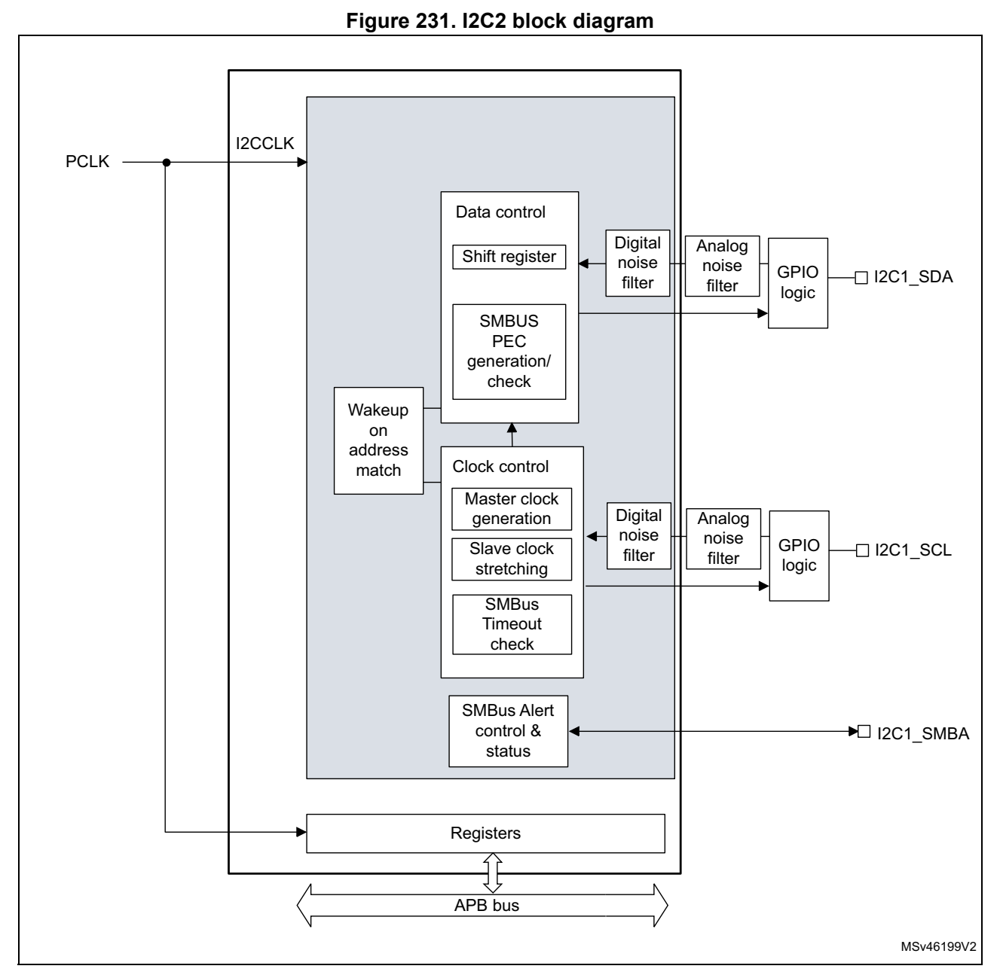
*Figure 231. I2C2 block diagram (p. 707)*

For I2C I/Os supporting 20 mA output current drive for Fast-mod e Plus operation, the driving capability is enabled through control bits in the system config uration controller (SYSCFG). Refer to Section 25.3: I2C implementation.

#### 25.4.3 I2C pins and internal signals (p. 708)

**Table 103. I2C in put/output pins (p. 708)**

| Pin name Signal t | Col 2 | ype Description |
| --- | --- | --- |
|  | I2C_SDA Bidirectional I2C data |  |
|  | I2C_SCL Bidirectional I2C clock |  |
|  | I2C_SMBA Bidirectional SMBus Alert |  |

**Table 104. I2C internal input/output signals (p. 708)**

| Col 1 | Internal signal name Signal type Description | Col 3 |
| --- | --- | --- |
| i2c_ker_ck Input |  | I2C kernel clock, also named I2CCLK in this document |
|  | i2c_pclk Input I2C APB clock |  |
| i2c_it Output |  | I2C interrupts, refer to Table 118: I2C Interrupt requests for the full list of interrupt sources |
|  | i2c_rx_dma Output I2C Receive Data DMA request (I2C_RX) |  |
|  | i2c_tx_dma Output I2C Transmi | t Data DMA request (I2C_TX) |

#### 25.4.4 I2C clock requirements (p. 708)

The I2C kernel is clocked by I2CCLK.

The I2CCLK period t I2CCLK must respect the fo llowing conditions:

t I2CCLK < (t LOW - t filters) / 4 and t I2CCLK < t HIGH

with:

t LOW: SCL low time and t HIGH: SCL high time

t filters: when enabled, sum of the delays brought by the analog filter an d by the digital filter.

Analog filter delay is maximum 260 ns. Digital filter delay is DNF x t I2CCLK.

The PCLK clock period t PCLK must respect the following condition:

t PCLK < 4/3 t SCL

with t SCL: SCL period

Caution: When the I2C kernel is clocked by PCLK, this clock must respect the conditions for t I2CCLK.

#### 25.4.5 Mode selection (p. 708)

The interface can operate in one of the four following modes:

- Slave transmitter

- Slave receiver

- Master transmitter

- Master receiver

By default, it operates in slave mode. The interface automatica lly switches from slave to master when it generates a START condition, and from master to slave if an arbitration loss or a STOP generation occurs, a llowing multimaster capability.

Communication flow

In Master mode, the I2 C interface initiates a data transfer and generates the clock signal. A serial data transfer always begins with a START condition and e nds with a STOP condition. Both START and STOP conditions are generated in master mode by software.

In Slave mode, the interface is capable of recogni zing its own addresses (7 or 10-bit), and the General Call address. The Ge neral Call address detection ca n be enabled or disabled by software. The reserved SMBus addresses can also be enabled by software.

Data and address es are transferred as 8-b it bytes, MSB first. T he first byte(s) following the START condition contain the address (one in 7-bit mode, two in 10-bit mode). The address is always transmitted in Master mode.

A 9th clock pulse follows the 8 clock cycles of a byte transfer, during which the receiver must send an acknowledge bit to the transmitter. Refer to the follow ing figure.

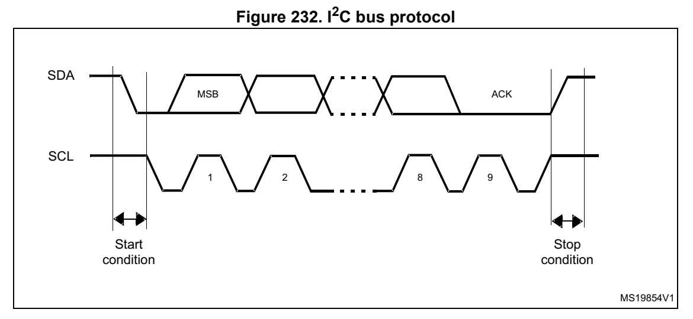
*Figure 232. I C bus protocol (p. 709)*

Acknowledge can be enabled or disabled by software. The I2C interface addresses can be selected by software.

#### 25.4.6 I2C initialization (p. 709)

Enabling and disabling the peripheral

The I2C peripheral clock must be configured and enabled in the clock controller.

Then the I2C can be enabled by setting the PE bit in the I2C_CR 1 register. When the I2C is dis abled (PE=0), the I2C performs a software reset. Refer to Section 25.4.7: Software reset for more details.

Noise filters

Before enabling the I2C peripheral by setting the PE bit in I2C_CR1 register, the user must configure the noise filters, if needed. By default, an analog n2 oise filter is present on the SDA and SCL inputs. This analog filter is compli ant with the I C specification wh ich requires the

suppression of spikes with a pulse width up to 50 ns in Fast-mo de and Fast-mode Plus. The user can disable this analog filter by setting the ANFOFF bit, and/or select a digital filter by configuring the DNF [3:0] bit in the I2C_CR1 register.

When the digital filter is enabl ed, the level of the SCL or the SDA line is internally changed only if it remains stab le for more than DNF x I2CCLK periods. T his allows spikes with a programmable length of 1 to 15 I2 CCLK periods to be suppressed.

**Table 105. Comparison of a nalog vs. digital filters (p. 710)**

| - | Col 2 | Analog filter Digital filter |
| --- | --- | --- |
| Pulse width of suppressed spikes | ≥ 50 ns | Programmable length from 1 to 15 I2C peripheral clocks |
|  | Benefits Available in Stop mode | – Programmable length: extra filtering capability vs. standard requirements – Stable length |
| Drawbacks | Variation vs. temperature, voltage, process | Wakeup from Stop mode on address match is not available when digital filter is enabled |

Caution: Changing the filter configurati on is not allowed when the I2C i s enabled.

I2C timings

The timings must be configured in order to guarantee a correct data hold and setup time, used in master and slave modes. This is done by programming the PRESC[3:0], SCLDEL[3:0] and SDADEL[3:0] bits in the I2C_TIMINGR register.

The STM32CubeMX tool calculates and provides the I2C_TIMINGR co ntent in the I2C configuration window

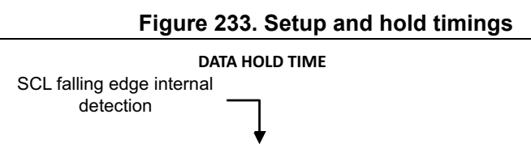
*Figure 233. Setup and hold timings (p. 711)*

tt SYNC1SYNC1 SDADEL: SCL stretched low by the I2CSDADEL: SCL stretched low by the I2C

SDA output delaySDA output delay SCLSCL

SDASDA

tt HD;DATHD;DAT Data hold time: in case of transmission, the data is sent on SDA output afterData hold time: in case of transmission, the data is sent on SDA output after the SDADEL delay, if it is already available in I2C_TXDR.the SDADEL delay, if it is already available in I2C_TXDR.

DATA SETUP TIMEDATA SETUP TIME

SCLDELSCLDEL SCL stretched low by the I2CSCL stretched low by the I2C

SCLSCL

SDASDA

tt SU;DATSU;STA Data setup time: in case of transmission, the SCLDEL counter startsData setup time: in case of transmission, the SCLDEL counter starts when the data is sent on SDA output.when the data is sent on SDA output. MSv40108V1MS49608V1

- When the SCL falling edge is inte rnally detected, a delay is in serted before sending SDA output. This delay is t SDADEL = SDADEL x t PRESC + t I2CCLK where t PRESC = (PRESC+1) x t I2CCLK. T SDADEL impacts the hold time t HD;DAT. The total SDA output delay is:

t SYNC1 + {[SDADEL x (PR ESC+1) + 1] x t I2CCLK}

t SYNC1 duration depends on these parameters: – SCL falling slope – When enabled, input delay bro ught by the analog filter: t AF(min) < t AF < t AF(max) – When enabled, input delay bro ught by the digital filter: t DNF = DNF x t I2CCLK – Delay due to SCL synchronization to I2CCLK clock (2 to 3 I2CCL K periods)

In order to bridge the undefined region of the SCL falling edge, the user mu st program SDADEL in such a way that:

{t f (max) +t HD;DAT (min) -t AF(min) - [( DNF +3) x t I2CCLK]} / {(PRESC +1) x t I2CCLK} ≤ SDADEL SDADEL ≤ {t HD;DAT (max) -t AF(max) - [( DNF+4) x t I2CCLK]} / {(PRESC +1) x t I2CCLK} Note: t AF(min) / t AF(max) are part of the equation only when th e analog filter is enabled. Refer to device datasheet for t AF values.

The maximum t HD;DAT can be 3.45 µs, 0.9 µs and 0.45 µs for Standard-mode, Fast-mod e and Fast-mode Plus, but must b e less than the maximum of t VD;DAT by a transition time. This maximum must only be met if the device does not stretch th e LOW period (t LOW) of the SCL signal. If the clock stretc hes the SCL, the data must be va lid by the set- up time before it releases the clock.

The SDA rising edge is usually t he worst case, so in this case the previous equation becomes:

SDADEL ≤ {t VD;DAT (max) -t r (max) - 260 ns - [( DNF+4) x t I2CCLK]} / {(PRESC +1) x t I2CCLK}. Note: This condition can be violated when NOSTRETCH=0, because the device stretches SCL low to guarantee the set-up time, according to the SCLDEL value.

Refer to Table 106: I2C-SMBus specification data setup and hold times for t f, t r, t HD;DAT and t standard values. VD;DAT

- After t SDADEL delay, or after sending SDA out put in case the s lave had to st retch the clock because the data was not yet written in I2C_TXDR register, SCL line is kept at low level during the setup time. This setup time is t SCLDEL = (SCLDEL+1) x t PRESC where t PRESC = (PRESC+1) x t I2CCLK. t SCLDEL impacts the setup time t SU;DAT . In order to bridge the undefined region of the SDA transition ( rising edge usually worst case), the user must program SCLDEL in such a way that:

{[t r (max) + t SU;DAT (min)] / [ (PRESC+1)] x t I2CCLK]} - 1 <= SCLDEL Refer to Table 106: I2C-SMBus specification data setup and hold times for t r and t SU;DAT standard values.

The SDA and SCL transition time values to be used are the ones in the application. Using the maximum values fro m the standard increases the constraints for the SDADEL and SCLDEL calculation, but ensures the feature whatever the application.

Note: At every clock pulse, after SCL falling edge detection, the I2C master or slave stretches SCL low during at least [(SDADEL+S CLDEL+1) x (PRESC+1) + 1] x t I2CCLK, in both transmission and reception modes. In transmission mode, in case the data is not yet written in I2C_TXDR when SDADEL counter is finished, the I2C keeps on stretching SCL low until the next data is written. Then new data MSB is sent on SDA output, and SCLDEL counter starts, continuing stretching SCL low to guarantee the data setup time.

If NOSTRETCH=1 in slave mode, the SCL is not stretched. Consequ ently the SDADEL must be programmed in such a way to guarantee also a sufficient setup time.

**Table 106. I C-SMBus specification d ata setup and hold times (p. 713)**

| Col 1 | Symbol Parameter | Standard-mode (Sm) | Fast-mode (Fm) | Fast-mode (Fm) | Fast-mode Plus (Fm+) | Fast-mode Plus (Fm+) | SMBus | SMBus | Unit |
| --- | --- | --- | --- | --- | --- | --- | --- | --- | --- |
|  |  |  |  |  | Min. Max Min. Max Min. Max Min. Max |  |  |  |  |
| t HD;DAT | Data hold time |  |  |  | 0 - 0 - 0 - 0.3 - |  |  |  | µs |
| t VD;DAT | Data valid time |  |  |  | - 3.45 - 0.9 - 0.45 - - |  |  |  | µs |
| t SU;DAT | Data setup time |  |  | 250 - 100 - 50 - 250 - | 250 - 100 - 50 - 250 - |  |  |  |  |
| t r | Rise time of both SDA and SCL signals |  |  |  | - 1000 - 300 - 120 - 1000 |  |  |  | ns |
| t f | Fall time of both SDA and SCL signals |  |  |  | - 300 - 300 - 120 - 300 |  |  |  |  |

Additionally, in master mode, the SCL clock high and low levels must be configured by programming the PRESC[3:0], SCLH[7:0] and SCLL[7:0] bits in the I2C_TIMINGR register.

- When the SCL falling edge is inte rnally detected, a delay is in serted before releasing the SCL output. This delay is t SCLL = (SCLL+1) x t PRESC where t PRESC = (PRESC+1) x t I2CCLK. t SCLL impacts the SCL low time t LOW .

- When the SCL rising edge is inte rnally detected, a delay is ins erted before forcing the SCL output to low level. This delay is t SCLH = (SCLH+1) x t PRESC where t PRESC = (PRESC+1) x t I2CCLK. t SCLH impacts the SCL high time t HIGH .

Refer to I2C master initialization for more details.

Caution: Changing the timing configuratio n is not allowed when the I2C i s enabled.

The I2C slave NOSTRETCH mode must also be configured before ena bling the peripheral. Refer to I2C slave initialization for more details.

Caution: Changing the NOSTRETCH configuration is not allowed when the I2 C is enabled.

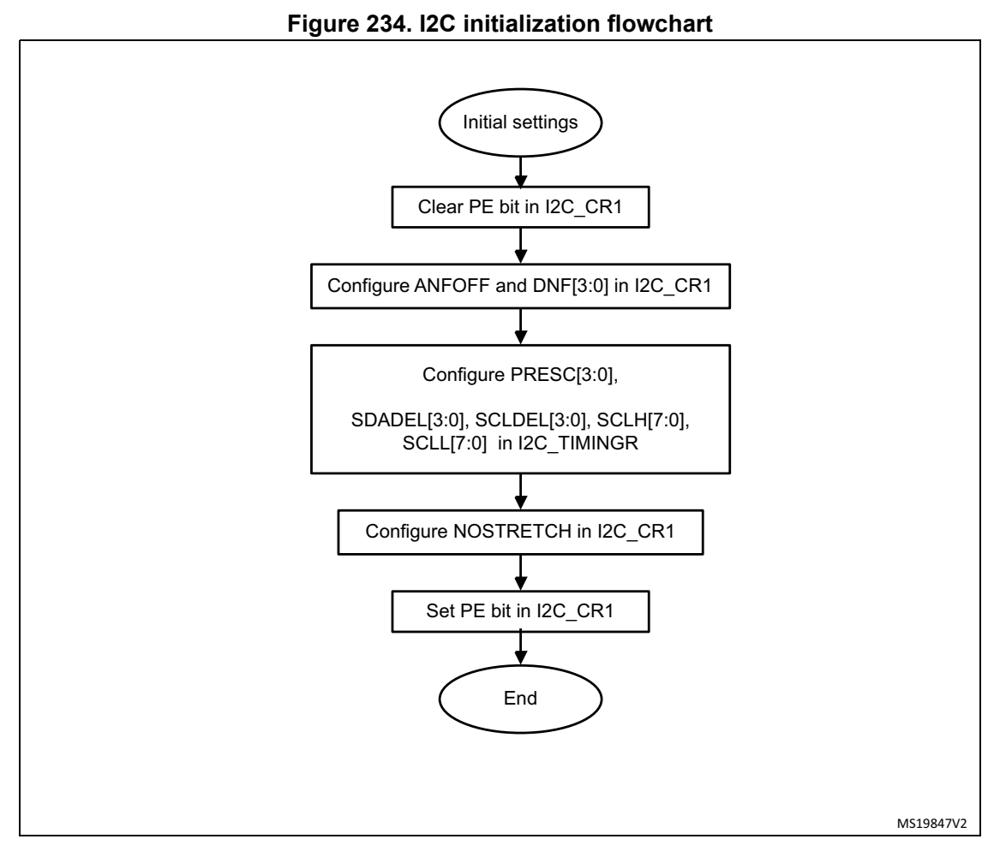
*Figure 234. I2C initia lization flowchart (p. 714)*

#### 25.4.7 Software reset (p. 714)

A software reset can be performe d by clearing the PE bit in the I2C_CR1 register. In that case I2C lines SCL and SDA are rel eased. Internal states machin es are reset and communication control bits, as well as status bits come back to their reset value. The configuration registers are not impacted.

Here is the list of im pacted register bits: 1. I2C_CR2 register: START, STOP, NACK 2. I2C_ISR register: BUSY, TXE, TXIS, RXNE, ADDR, NACKF, TCR, T C, STOPF, BERR, ARLO, OVR

and in addition when the SM Bus feature is supported: 1. I2C_CR2 regis ter: PECBYTE 2. I2C_ISR register: PECERR, TIMEOUT, ALERT

PE must be kept low during at l east 3 APB clock cycles in order to perform the software reset. This is ensured by writi ng the following software sequen ce: - Write PE=0 - Check PE=0 - Write PE=1.

#### 25.4.8 Data transfer (p. 715)

The data transfer is managed through transmit and receive data registers and a shift register.

Reception

The SDA input fills the shift register. After the 8th SCL pulse (when the complete data byte is received), the shift register is copied in to I2C_RXDR register if it is empty (RXNE=0). If RXNE=1, meaning that the previous received data byte has not yet been read, the SCL line is stretched low until I2C_RXDR is read. The stretch is inserte d between the 8 th and 9th SCL pulse (before the Acknowledge pulse).

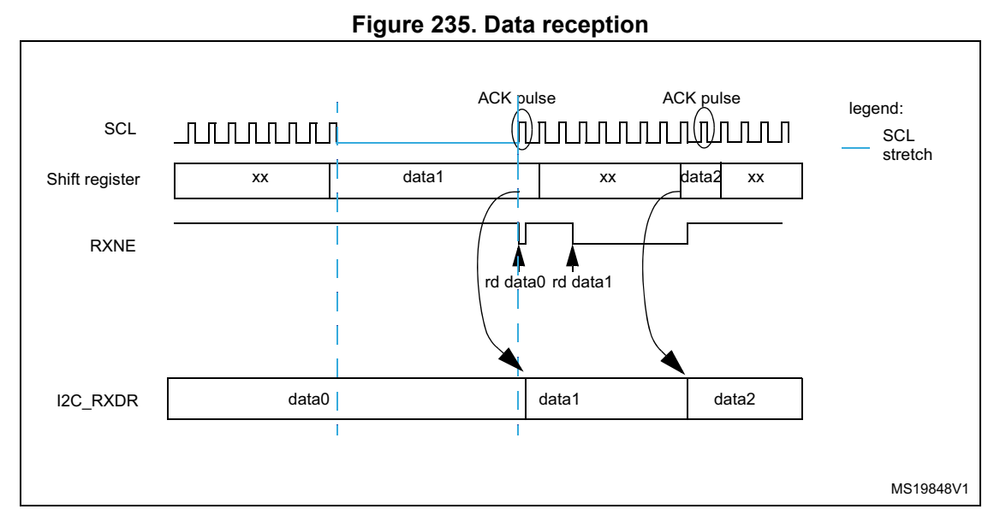
*Figure 235. Data reception (p. 715)*

Transmission

If the I2C_TXDR register is not e mpty (TXE=0), its content is copied into the shift register after the 9th SCL pulse (the Ackn owledge pulse). Then the shift register content is shifted out on SDA line. If TXE=1, meani ng that no data is written yet in I2C_TXDR, SCL line is stretched low until I2 C_TXDR is written. T he stretch is done after the 9th SCL pulse.

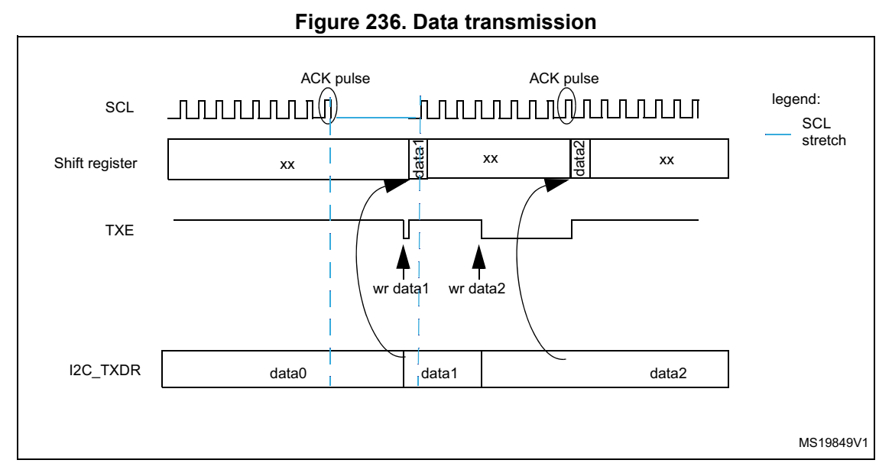
*Figure 236. Data transmission (p. 716)*

Hardware transfer management

The I2C has a byte counter embedd ed in hardware in order to man age byte transfer and to close the communication in various modes such as: – NACK, STOP and ReSTART generation in master mode – ACK control in slave receiver mode – PEC generation/checking when SMBus feature is supported

The byte counter is always used in master mode. By default it i s disabled in slave mode, but it can be enabled by software by setting the SBC (Slave Byte Co ntrol) bit in the I2C_CR2 register.

The number of bytes to be transfe rred is programmed in the NBYT ES[7:0] bit field in the I2C_CR2 register. If the number of bytes to be transferred (NBYTES) is greater than 255, or if a receiver wants to control the acknowledge value of a recei ved data byte, the reload mode must be selected by setting the RELOAD bit in the I2C_CR2 register. In this mode, TCR flag is set when the number of bytes programmed in NBYTES h as been transferred, and an interrupt is generated if TCIE is set. SCL is stretched as long as TCR flag is set. TCR is cleared by software when NBYT ES is written to a non-zero val ue.

When the NBYTES counter is reloaded with the last number of bytes, RELOAD bit must be cleared.

When RELOAD=0 in master mode, th e counter can be used in 2 mode s:

- Automatic end mode (AUTOEND = ‘1’ in the I2C_CR2 register). In this mode, the master automatically s ends a STOP condition once the number of bytes programmed in the NBYTES[7:0] bit field has been transferred.

- Software end mode (AUTOEND = ‘0’ in the I2C_CR2 register). In this mode, software action is expected once the numbe r of bytes programmed in the N BYTES[7:0] bit field has been transferred; the TC flag is set and an interrupt is ge nerated if the TCIE bit is set. The SCL signal is stretched as long as the TC flag is set. The TC flag is cleared by software when the START or STOP bit is set in the I2C_CR2 regis ter. This mode must be used when the master wants to send a RESTART condition.

Caution: The AUTOEND bit has no effect when the RELOAD bit is set.

**Table 107. I2C configuration (p. 717)**

| Function SBC bit RE | Function SBC bit RE | Col 3 | LOAD bit AUTOEND bit |
| --- | --- | --- | --- |
|  | Master Tx/Rx NBYTES + STOP x 0 1 |  |  |
|  | Master Tx/Rx + NBYTES + RESTART x 0 0 |  |  |
| Slave Tx/Rx all received bytes ACKed |  | 0 xx |  |
|  | Slave Rx with ACK control 1 1 x |  |  |

#### 25.4.9 I2C slave mode (p. 717)

I2C slave initialization

In order to work in slave mode, the user must enable at least o ne slave address. Two registers I2C_OAR1 and I2C_OAR2 are available in order to program the slave own addresses OA1 and OA2.

- OA1 can be configured either in 7-bit mode (by default) or in 1 0-bit addressing mode by setting the OA1MODE bit in the I2C_OAR1 register. OA1 is enabled by setting the OA 1EN bit in the I2C_OAR1 registe r.

- If additional slave addresses are required, the 2nd slave addre ss OA2 can be configured. Up to 7 OA2 LSB can be masked by configuring the OA2MSK[2:0] bits in the I2C_OAR2 register. Therefore for OA2MSK configured from 1 to 6, only OA2[7:2], OA2[7:3], OA2[7:4], OA2[7:5], OA2 [7:6] or OA2[7] are compared w ith the received address. As soon as OA2MSK is not equal to 0, the address compa rator for OA2 excludes the I2C rese rved addresses (0000 XXX and 1111 XXX), wh ich are not acknowledged. If OA2MSK=7, all re ceived 7-bit addresses are ack nowledged (except reserved addresses). OA2 is always a 7-bit address. These reserved addresses can be acknowledged if they are enable d by the specific enable bit, if they are programme d in the I2C_OAR1 or I2C_OAR2 register with OA2MSK=0. OA2 is enabled by setting the OA2EN bit in the I2C_OAR2 registe r.

- The General Call address is enab led by setting t he GCEN bit in the I2C_CR1 register.

When the I2C is selected by one of its enabled addresses, the A DDR interrupt status flag is set, and an interrupt is generated if the ADDRIE bit is set.

By default, the slave uses its clock stretching capability, whi ch means that it stretches the SCL signal at low level when ne eded, in order to perform softwa re actions. If the master does not support clock stretchi ng, the I2C must be configured w ith NOSTRETCH=1 in the I2C_CR1 register.

After receiving an ADDR interrupt, if several addresses are ena bled the user must read the ADDCODE[6:0] bits in the I2C_ISR register in order to check whi ch address matched. DIR flag must also be checked in o rder to know the transfer directi on.

Slave clock stretching (NOSTRETCH = 0)

In default mode, the I2C slave st retches the SCL clock in the following situations:

- When the ADDR flag is set: the received address matches with on e of the enabled slave addresses. This stretch is released when the ADDR flag is cleared by software setting the ADDRCF bit.

- In transmission, if t he previous data transmission is completed and no new data is written in I2C_TXDR register, or if the first data byte is not written when the ADDR flag is cleared (TXE=1). Th is stretch is released when the data is w ritten to the I2C_TXDR register.

- In reception when the I2C_RXDR register is not read yet and a n ew data reception is completed. This stretch is released when I2C_RXDR is read.

- When TCR = 1 in Slave Byte Cont rol mode, reload mode (SBC=1 and RELOAD=1), meaning that the last data byte has been transferred. This stre tch is released when then TCR is cleared by writing a non-zero value in the NBYTES[7:0] field.

- After SCL falling edge detection, the I2C stretches SCL low dur ing [(SDADEL+SCLDEL+1) x (PRESC+1) + 1] x t I2CCLK.

Slave without clock stretching (NOSTRETCH = 1)

When NOSTRETCH = 1 in the I2C_CR 1 register, the I2C slave does not stretch the SCL signal.

- The SCL clock is not stretch ed while the ADDR flag is set.

- In transmission, the data must be written in the I2C_TXDR register before the first SCL pulse corresponding to its transfer occurs. If not, an underrun occurs, the OVR flag is set in the I2C_ISR register and an interrupt is generated if th e ERRIE bit is set in the I2C_CR1 register. The OVR flag is also set when the first data transmission starts and the STOPF bit is still set (has n ot been cleared). Therefore, i f the user clears the STOPF flag of the previous transfer only after writing the firs t data to be transmitted in the next transfer, he ensures th at the OVR status is provided, even for the first data to be transmitted.

- In reception, the data must be read from the I2C_RXDR register before the 9th SCL pulse (ACK pulse) of the next d ata byte occurs. If not an overrun occurs, the OVR flag is set in the I2C_ISR register and an interrupt is generated if the ERRIE bit is set in the I2C_CR1 register.

Slave Byte Control mode

In order to allow byte ACK control in slave reception mode, Slave Byte Control mode must be enabled by setting the SBC bit in the I2C_CR1 register. This is required to be compliant with SMBus standards.

Reload mode must be selected in order to allow byte ACK control in slave reception mode (RELOAD=1). To get control of ea ch byte, NBYTES must be initial ized to 0x1 in the ADDR interrupt subroutine, and reloade d to 0x1 after ea ch received b yte. When the byte is received, the TCR bit is set, st retching the SCL signal low between the 8th and 9th SCL pulses. The user can read the da ta from the I2C_RXDR register, and then decide to acknowledge it or not by configuring the ACK bit in the I2C_CR2 register. The SCL stretch is released by programming NBYTES to a non-zero value: the acknowl edge or not-acknowledge is sent and next byte can be received.

NBYTES can be loaded with a value greater than 0x1, and in this case, the reception flow is continuous during NBYTES data reception.

Note: The SBC bit must be configured when the I2C is disabled, or when the slave is not addressed, or when ADDR=1. The RELOAD bit value can be changed when ADDR=1, or when TCR=1.

Caution: Slave Byte Control mode is not co mpatible with NO STRETCH mode. Setting SBC when NOSTRETCH=1 is not allowed.

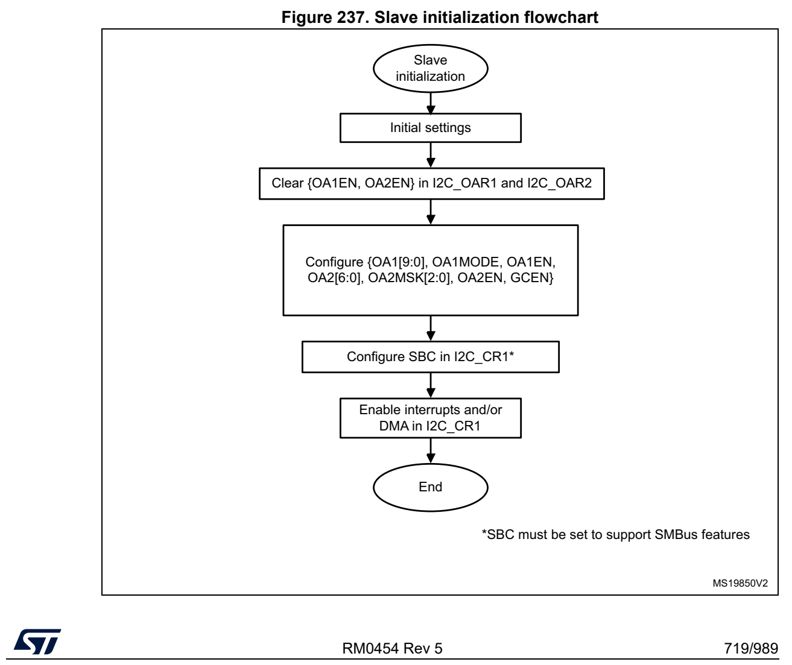
*Figure 237. Slave init ialization flowchart (p. 719)*

Slave transmitter

A transmit interrupt status (TXIS) is generated when the I2C_TX DR register becomes empty. An interrupt is generated if the TXIE bit is set in the I2C_CR1 register.

The TXIS bit is cleared when the I2C_TXDR register is written w ith the next data byte to be transmitted.

When a NACK is received, the NACK F bit is set in the I2C_ISR re gister and an interrupt is generated if the NACKIE bit is set in the I2C_CR1 register. The slave automatically releases the SCL and SDA lines in order to let the master perform a STOP or a RESTART condition. The TXIS bit is not set when a NACK is received.

When a STOP is received and the S TOPIE bit is set in the I2C_CR 1 register, the STOPF flag is set in the I2C_ISR register and an interrupt is generated. In most applications, the SBC bit is usually programmed to ‘0’. In this case, If TXE = 0 when the slave address is received (ADDR=1), the user can choose either to send the conte nt of the I2C_TXDR register as the first data byte, or to flush the I2C_TXDR register by setting the TXE bit in order to program a new data byte.

In Slave Byte Control mode (SBC=1), the number of bytes to be t ransmitted must be programmed in NBYTES in the addre ss match interrupt subroutine (ADDR=1). In this case, the number of TXIS events during the transfer corresponds to th e value programmed in NBYTES.

Caution: When NOSTRETCH=1, the SCL clock is not stretched while the ADDR flag is set, so the user cannot flush the I2C_TXDR register content in the ADDR sub routine, in order to program the first data byte. The first data byte to be sent must be previously programmed in the I2C_TXDR register:

- This data can be the data written in the last TXIS event of the previous transmission message.

- If this data byte is not the one to be sent, the I2C_TXDR register can be flushed by setting the TXE bit in order to program a new data byte. The STOPF bit must be cleared only after these actions, in order to guarantee that th ey are executed before the first data transmission starts, following the address acknowled ge. If STOPF is still set when the first data transmission starts, an underrun error is generated (the OVR flag is set). If a TXIS event is needed, (Tran smit Interrupt or Transmit DMA request), the user must set the TXIS bit in addition to t he TXE bit, in order to genera te a TXIS event.

Figure 238. Transfer sequence flowchart for I2C slave transmitter, NOSTRETCH= 0

Slave transmission

Slave initialization

No

I2C_ISR.ADDR =1?

Yes SCL stretched Read ADDCODE and DIR in I2C_ISR Optional: Set I2C_ISR.TXE = 1 Set I2C_ICR.ADDRCF

No I2C_ISR.TXIS =1?

Yes

Write I2C_TXDR.TXDATA

MS19851V2

Figure 239. Transfer sequence flowchart for I2C slave transmitter, NOSTRETCH= 1

Slave transmission

Slave initialization

No No I2C_ISR.TXIS I2C_ISR.STOPF =1? =1?

Yes Yes

Write I2C_TXDR.TXDATA Optional: Set I2C_ISR.TXE = 1 and I2C_ISR.TXIS=1

Set I2C_ICR.STOPCF

MS19852V2

Figure 240. Transfer bus diagrams for I2C slave transmitter

Example I2C slave transmitter 3 bytes with 1st data flushed, legend: NOSTRETCH=0: transmission ADDR TXIS TXIS TXIS TXIS reception

SCL stretch S Address A data1 A data2 A data3 NA P

EV1 EV2 EV3 EV4 EV5

TXE

EV1: ADDR ISR: check ADDCODE and DIR, set TXE, set ADDRCF EV2: TXIS ISR: wr data1 EV3: TXIS ISR: wr data2 EV4: TXIS ISR: wr data3 EV5: TXIS ISR: wr data4 (not sent)

Example I2C slave transmitter 3 bytes without 1st data flush, legend : NOSTRETCH=0: transmission ADDR TXIS TXIS TXIS reception

SCL stretch S Address A data1 A data2 A data3 NA P

EV1 EV2 EV3 EV4

TXE

EV1: ADDR ISR: check ADDCODE and DIR, set ADDRCF EV2: TXIS ISR: wr data2 EV3: TXIS ISR: wr data3 EV4: TXIS ISR: wr data4 (not sent)

Example I2C slave transmitte r 3 bytes, NOSTRETCH=1: legend: transmission TXIS TXIS TXIS STOPF reception

S Address data1 A data2 data3A A NA P SCL stretch

EV1 EV2 EV3 EV4 EV5

TXE

EV1: wr data1 EV2: TXIS ISR: wr data2 EV3: TXIS ISR: wr data3 EV4: TXIS ISR: wr data4 (not sent) EV5: STOPF ISR: (optional: set TXE and TXIS), set STOPCF

MS19853V2

Slave receiver

RXNE is set in I2C_ISR when the I2C_RXDR is full, and generates an interrupt if RXIE is set in I2C_CR1. RXNE is cle ared when I2C_RXDR is read.

When a STOP is received and STOPIE is set in I2C_CR1, STOPF is set in I2C_ISR and an interrupt is generated.

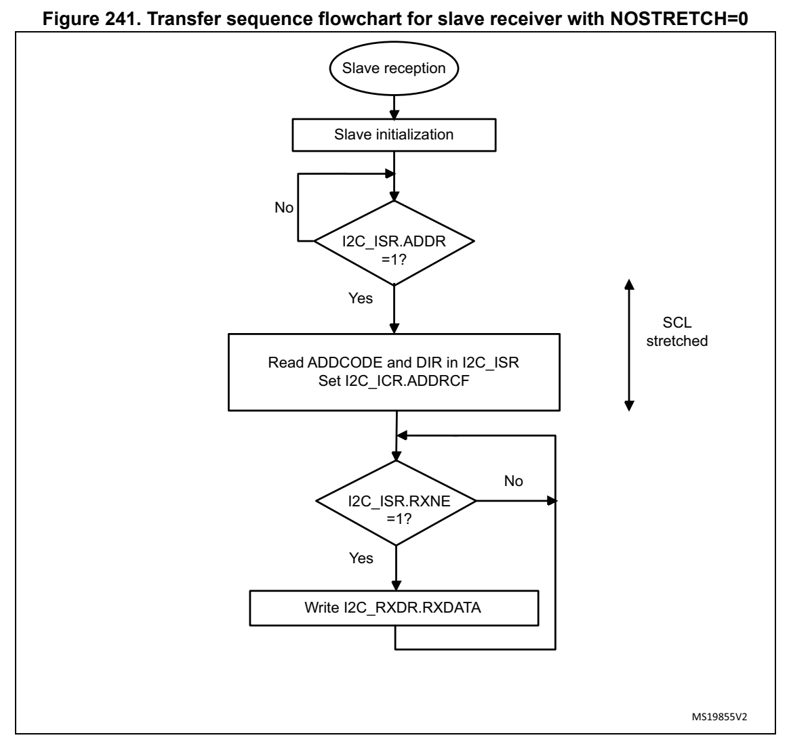
*Figure 241. Transfer sequence flowchart for slave receiver with NOSTRETCH=0 (p. 724)*

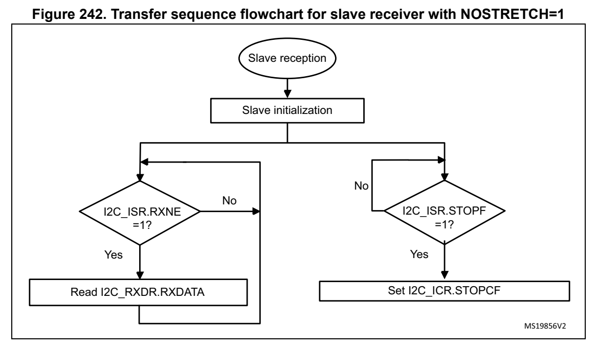
*Figure 242. Transfer sequence flowchart for slave receiver with NOSTRETCH=1 (p. 725)*

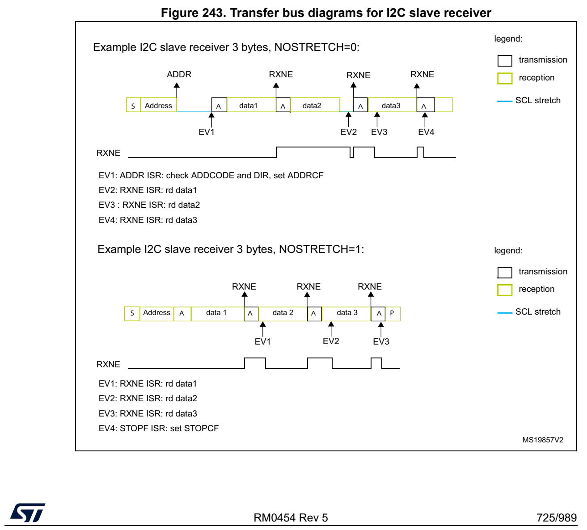
*Figure 243. Transfer bus diagrams for I2C slave receiver (p. 725)*

#### 25.4.10 I2C master mode (p. 726)

I2C master initialization

Before enabling the peripheral, th e I2C master clock must be co nfigured by setting the SCLH and SCLL bits in th e I2C_TIMINGR register.

The STM32CubeMX tool calculates and provides the I2C_TIMINGR co ntent in the I2C Configuration window.

A clock synchronization mechanism is implemented in order to su pport multi-master environment and slave clock stretching.

In order to allow cloc k synchronization:

- The low level of the clock is counted using the SCLL counter, starting from the SCL low level internal detection.

- The high level of the clock is counted using the SCLH counter, starting from the SCL high level internal detection.

The I2C detects its own SCL low level after a t SYNC1 delay depending on the SCL falling edge, SCL input noise filters (a nalog + digital) and SCL synchronization to the I2CxCLK clock. The I2C releases SCL to h igh level once t he SCLL counter reaches the value programmed in the SCLL[7:0] bits in the I2C_TIMINGR register.

The I2C detects its own SCL high level after a t SYNC2 delay depending on the SCL rising edge, SCL input noise filters (a nalog + digital) and SCL synchronization to I2CxCLK clock. The I2C ties SCL to low level once the SCLH counter is reached reaches the value programmed in the SCLH[7:0] bits in the I2C_TIMINGR register.

Consequently the master clock period is:

t SCL = t SYNC1 + t SYNC2 + {[(SCLH+1) + (SCLL+1)] x (PRESC+1) x t I2CCLK}

The duration of t SYNC1 depends on these parameters: – SCL falling slope – When enabled, input delay i nduced by the analog filter. – When enabled, input delay induced by the digital filter: DNF x t I2CCLK – Delay due to SCL synchronization with I2CCLK clock (2 to 3 I2C CLK periods)

The duration of t SYNC2 depends on these parameters: – SCL rising slope – When enabled, input delay i nduced by the analog filter. – When enabled, input delay induced by the digital filter: DNF x t I2CCLK – Delay due to SCL synchronization with I2CCLK clock (2 to 3 I2C CLK periods)

Figure 244. Master clock generation

SCL master clock generation

SCL high level detected SCLH counter starts

t SYNC2 SCLH SCLL t SYNC1 SCL

SCL low level detected SCL released SCLL counter starts

SCL driven low

SCL master clock synchronization

SCL high level detected SCL high level detected SCL high level detected SCLH counter starts SCLH counter starts SCLH counter starts

SCLH SCLH SCLH

SCLL SCLL

SCL driven low by SCL driven low by another device another device SCL low level detected SCLL counter starts

SCL low level detected SCLL counter starts SCL released

MS19858V1

Caution: In order to be I2C or SMBus compliant, the master clock must respect the timings given the table below.

**Table 108. I C-SMBus specification clock timings (p. 728)**

| Col 1 | Symbol Parameter | Standard-mode (Sm) | Standard-mode (Sm) | Fast-mode (Fm) | Fast-mode (Fm) | Fast-mode Plus (Fm+) | Fast-mode Plus (Fm+) | SMBus | SMBus | Unit |
| --- | --- | --- | --- | --- | --- | --- | --- | --- | --- | --- |
|  |  |  |  |  | Min Max Min Max Min Max Min Max | Min Max Min Max Min Max Min Max |  |  |  |  |
| f SCL |  |  | SCL clock frequency - 100 - 400 - 1000 - 100 kHz |  |  |  |  |  |  |  |
| t HD:STA |  |  | Hold time (repeated) START condition 4.0 - 0.6 - 0.26 - 4.0 - µs |  |  |  |  |  |  |  |
| t SU:STA | Set-up time for a repeated START condition |  |  |  |  | 4.7 - 0.6 - 0.26 - 4.7 - µs |  |  |  |  |
| t SU:STO |  |  | Set-up time for STOP condition 4.0 - 0.6 - 0.26 - 4.0 - µs |  |  |  |  |  |  |  |
| t BUF | Bus free time between a STOP and START condition |  |  |  |  | 4.7 - 1.3 - 0.5 - 4.7 - µs |  |  |  |  |
| t LOW |  |  | Low period of the SCL clock 4.7 - 1.3 - 0.5 - 4.7 - µs |  |  |  |  |  |  |  |
| t HIGH |  |  | Period of the SCL clock 4.0 - 0.6 - 0.26 - 4.0 50 µs |  |  |  |  |  |  |  |
| t r |  |  | Rise time of both SDA and SCL signals - 1000 - 300 - 120 - 1000 ns |  |  |  |  |  |  |  |
| t f |  |  | Fall time of both SDA and SCL signals - 300 - 300 - 120 - 300 ns |  |  |  |  |  |  |  |

Note: SCLL is also used to generate the t BUF and t SU:STA timings. SCLH is also used to generate the t HD:STA and t SU:STO timings.

Refer to Section 25.4.11: I2C_ TIMINGR register configuration examples for examples of I2C_TIMINGR se ttings vs. I2CCLK frequency.

Master communication initialization (address phase)

In order to initiate the communi cation, the user must program t he following parameters for the addressed slave in the I2C_CR2 register:

- Addressing mode (7-bit or 10-bit): ADD10

- Slave address to be sent: SADD[9:0]

- Transfer direction: RD_WRN

- In case of 10-bit address read: HEAD10R bit. HEAD10R must be co nfigure to indicate if the complete address sequence must be sent, or only the head er in case of a direction change.

- The number of bytes to be transfe rred: NBYTES[7:0]. If the numb er of bytes is equal to or greater t han 255 bytes, NBYTES[7:0] must initially be filled with 0xFF.

The user must then set the START bit in I2C_CR2 register. Chang ing all the above bits is not allowed when START bit is set.

Then the master automatically sends the START condition followe d by the slave address as soon as it detects tha t the bus is free (BU SY = 0) and after a delay of t BUF.

In case of an arbitration loss, the master automatically switch es back to slave mode and can acknowledge its own address i f it is addressed as a slave.

Note: The START bit is reset by hardware when the slave address has been sent on the bus, whatever the received acknowledge value. The START bit is also rese t by hardware if an arbitration loss occurs. In 10-bit addressing mode, when the Slave Address first 7 bits is NACKed by the slave, the

master re-launches automatically the slave address transmission until ACK is received. In this case ADDRCF must be set if a NACK is received from the slave, in order to stop sending the slave address. If the I2C is addressed as a slave (ADDR=1) wh ile the START bit is set, the I2C switches to slave mode and the START bit is cleared, when the ADDRCF bit is set.

Note: The same procedure is applied for a Repeated Start condition. In this case BUSY=1.

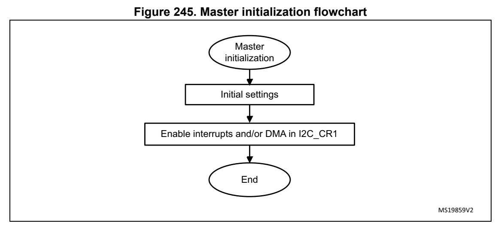
*Figure 245. Master init ialization flowchart (p. 729)*

Initialization of a master receiver addressing a 10-bit address slave

- If the slave address is in 10-bit format, the user can choose to send the complete read sequence by clearing the HEAD10 R bit in the I2C_CR2 register. I n this case the master automatically sends the following complete sequence after the S TART bit is set: (Re)Start + Slave address 10-bit header Write + Slave address 2 nd byte + REStart + Slave address 10-bit header Read

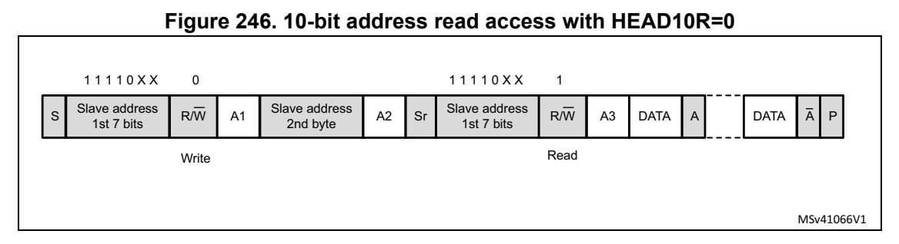
*Figure 246. 10-bit address read access with HEAD10R=0 (p. 729)*

- If the master addresses a 10-bit address slave, transmits data to this slave and then reads data from the same slave, a master transmission flow must be done first. Then a repeated start is set with the 10 bit slave address configured with HEAD10R=1. In this case the master sends this sequen ce: ReStart + Slave address 10 -bit header Read.

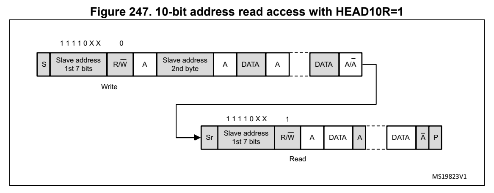
*Figure 247. 10-bit address read access with HEAD10R=1 (p. 730)*

Master transmitter

In the case of a write transfer, the TXIS flag is set after eac h byte transmission, after the 9th SCL pulse when an ACK is received.

A TXIS event generates an interrupt if the TXIE bit is set in t he I2C_CR1 register. The flag is cleared when the I2C_TXDR register is written with the next data byte to be transmitted.

The number of TXIS events during the transfer corresponds to th e value programmed in NBYTES[7:0]. If the total number of data bytes to be sent is greater than 255, reload mode must be selected by setting the RELOAD bit in the I2C_CR2 regis ter. In this case, when NBYTES data have been transferred, the TCR flag is set and the SCL line is stretched low until NBYTES[7:0] is wri tten to a non-zero value.

The TXIS flag is not set when a NACK is received.

- When RELOAD=0 and NBYTES data have been transferred: – In automatic end mode (AUTOEND= 1), a STOP is automatically sen t. – In software end mode (AUTOEND=0), the TC flag is set and the S CL line is stretched low in order to perform software actions: A RESTART condition can be reque sted by setting the START bit i n the I2C_CR2 register with the proper slave address configuration, and numbe r of bytes to be transferred. Setting the START b it clears the TC flag and the S TART condition is sent on the bus. A STOP condition can be requeste d by setting the STOP bit in th e I2C_CR2 register. Setting the STOP bit clears the TC flag and the STOP condition is sent on the bus.

- If a NACK is received: the TXIS flag is not set, and a STOP con dition is automatically sent after the NACK reception. the NACKF flag is set in the I2C_ISR register, and an interrupt is generated if the NACKIE bit is set.

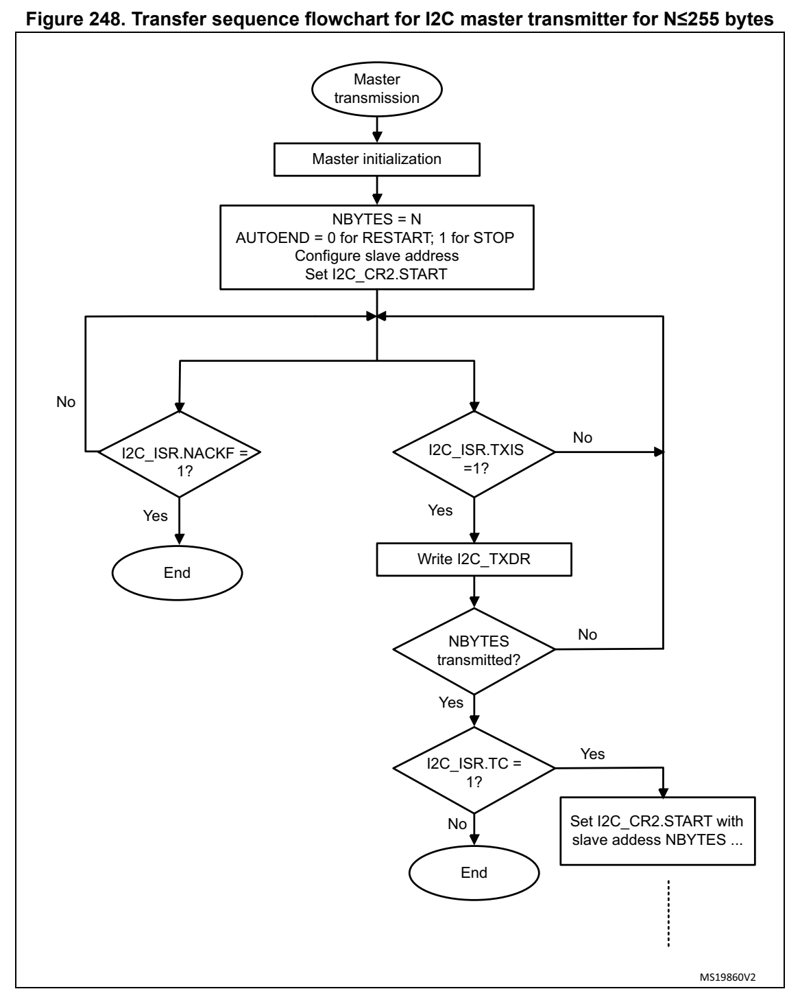
*Figure 248. Transfer sequence flowchart for I2C master transmitter for N≤255 bytes (p. 731)*

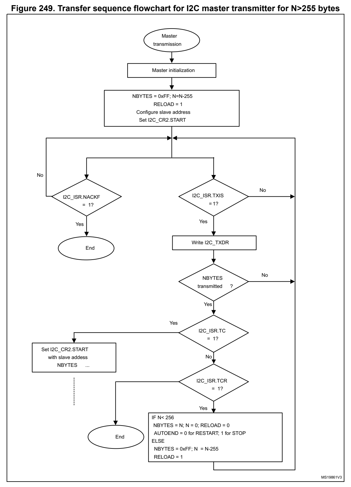
*Figure 249. Transfer sequence flowchart for I2C master transmitter for N>255 bytes (p. 732)*

Figure 250. Transfer bus diagra ms for I2C master transmitter

Example I2C master transmitter 2 bytes, automatic end mode (STOP) legend:

TXIS TXIS transmission

reception S Address A data1 A data2 AP SCL stretch INIT EV1 EV2

TXE

NBYTES xx 2

INIT: program Slave address, program NBYTES = 2, AUTOEND=1, set START EV1: TXIS ISR: wr data1 EV2: TXIS ISR: wr data2

Example I2C master transmitter 2 bytes, software end mode (RESTART)

TXIS TXIS TC legend:

transmission S Address A data1 A data2 ReS AddressA reception

INIT EV1 EV2 EV3 SCL stretch

TXE

NBYTES xx 2

INIT: program Slave address, program NBYTES = 2, AUTOEND=0, set START EV1: TXIS ISR: wr data1 EV2: TXIS ISR: wr data2 EV3: TC ISR: program Slave address, program NBYTES = N, set START

MS19862V2

Master receiver

In the case of a read transfer, the RXNE flag is set after each byte reception, after the 8th SCL pulse. An RXNE event generates an interrupt if the RXIE bit is set in the I2C_CR1 register. The flag is cleared when I2C_RXDR is read.

If the total number of data bytes to be received is greater tha n 255, reload mode must be selected by setting the RELOAD bit in the I2C_CR2 register. In this case, when NBYTES[7:0] data have been transferred, the TCR flag is set and the SCL line is stretched low until NBYTES[7:0] is written to a non-zero value.

- When RELOAD=0 and NBYTES[7:0] data have been transferred: – In automatic end mode (AUTOEND= 1), a NACK and a STOP are autom atically sent after the last received byte. – In software end mode (AUTOEND=0), a NACK is automatically sent after the last received byte, the TC flag is s et and the SCL line is stretched low in order to allow software actions: A RESTART condition can be reque sted by setting the START bit i n the I2C_CR2 register with the proper slave address configuration, and numbe r of bytes to be transferred. Setting the START b it clears the TC flag and the S TART condition, followed by slave address, are s ent on the bus. A STOP condition can be requeste d by setting the STOP bit in th e I2C_CR2 register. Setting the STOP bit clears the TC flag and the STOP condition is sent on the bus.

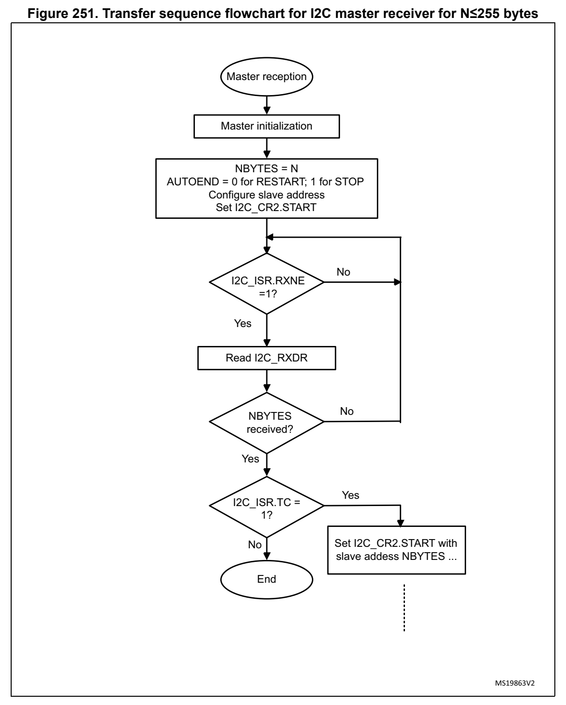
*Figure 251. Transfer sequence fl owchart for I2C master receiver for N≤255 bytes (p. 735)*

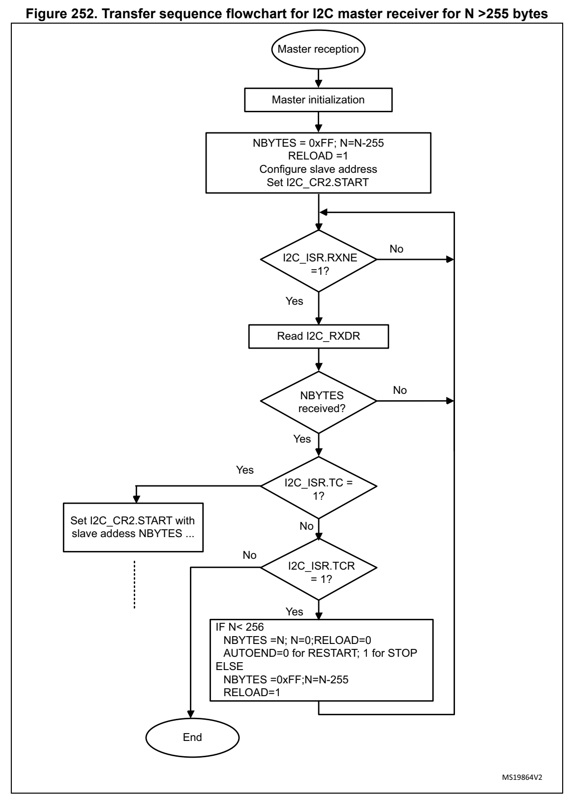
*Figure 252. Transfer sequence fl owchart for I2C master receiver for N >255 bytes (p. 736)*

Figure 253. Transfer bus diagrams for I2C master receiver

Example I2C master receiver 2 bytes, automatic end mode (STOP)

RXNE RXNE legend:

transmission S Address A data1 A data2 NA P reception INIT EV1 EV2 SCL stretch xx 2 NBYTES

INIT: program Slave address, program NBYTES = 2, AUTOEND=1, set START EV1: RXNE ISR: rd data1 EV2: RXNE ISR: rd data2

Example I2C master receiver 2 bytes, software end mode (RESTART)

RXNE RXNE TC legend:

transmission S A data1 data2 NA ReS AddressAddress A reception

INIT EV1 EV2 SCL stretch

NBYTES

xx 2 N

INIT: program Slave address, program NBYTES = 2, AUTOEND=0, set START EV1: RXNE ISR: rd data1 EV2: RXNE ISR: read data2 EV3: TC ISR: program Slave address, program NBYTES = N, set START

MS19865V1

#### 25.4.11 I2C_TIMINGR regis ter configuration examples (p. 738)

The tables below provide examples of how to program the I2C_TIM2 INGR to obtain timings compliant with the I C specification. In order to get more accurate configuration va lues, the STM32CubeMX tool (I2C Configuration window) must be used.

**Table 109. Examples of timing settings for f I2CCLK = 8 MHz (p. 738)**

| Parameter | Col 2 | Standard-mode (Sm) Fast-mod | Col 4 | e (Fm) Fast-mode Plus (Fm+) |
| --- | --- | --- | --- | --- |
| Parameter |  | 10 kHz 100 kHz 400 kHz 500 kHz | 10 kHz 100 kHz 400 kHz 500 kHz |  |
|  |  | PRESC 1 1 0 0 |  |  |
|  |  | SCLL 0xC7 0x13 0x9 0x6 |  |  |
| t SCLL | 200x250 ns = 50 µs 20x250 ns = 5.0 µ |  | s 10x125 ns = 1250 ns 7x125 ns = 87 | 5 ns |
|  |  | SCLH 0xC3 0xF 0x3 0x3 |  |  |
| t SCLH | 196x250 ns = 49 µs 16x250 ns = 4.0µs | 196x250 ns = 49 µs 16x250 ns = 4.0µs | 4x125 ns = 500 ns 4x125 ns = 500 n | s |
| t SCL (1) | ~100 µs (2) | ~10 µs (2) | ~2500 ns (3) | ~2000 ns (4) |
|  |  | SDADEL 0x2 0x2 0x1 0x0 |  |  |
| t SDADEL | 2x250 ns = 500 ns 2x250 ns = |  | 500 ns 1x125 ns = 125 ns 0 ns |  |
|  |  | SCLDEL 0x4 0x4 0x3 0x1 |  |  |
| t SCLDEL | 5x250 ns = 1250 ns 5x | 250 ns = 1250 ns 4x125 n | s = 500 ns 2x125 ns = | s = 500 ns 2x125 ns = 250 ns |

1. SCL period t SCL is greater than t SCLL + t SCLH due to SCL internal detection delay. Values provided for t SCL are examples only. 2. t SYNC1 + t SYNC2 minimum value is 4 x t I2CCLK = 500 ns. Example with t SYNC1 + t SYNC2 = 1000 ns. 3. t SYNC1 + t SYNC2 minimum value is 4 x t I2CCLK = 500 ns. Example with t SYNC1 + t SYNC2 = 750 ns. 4. t SYNC1 + t SYNC2 minimum value is 4 x t I2CCLK = 500 ns. Example with t SYNC1 + t SYNC2 = 655 ns.

**Table 110. Examples of timings settings for f I2CCLK = 16 MHz (p. 738)**

| Parameter | Col 2 | Standard-mode (Sm) Fast-mod | Col 4 | e (Fm) Fast-mode Plus (Fm+) |
| --- | --- | --- | --- | --- |
| Parameter |  |  | 10 kHz 100 kHz 400 kHz 1000 kHz |  |
|  |  | PRESC 3 3 1 0 |  |  |
|  |  | SCLL 0xC7 0x13 0x9 0x4 |  |  |
| t SCLL | 200 x 250 ns = 50 µs 20 | x 250 ns = 5.0 µs 10 | x 125 ns = 1250 ns 5 | x 62.5 ns = 312.5 ns |
|  |  | SCLH 0xC3 0xF 0x3 0x2 |  |  |
| t SCLH | 196 x 250 ns = 49 µs | 16 x 250 ns = 4.0 µs 4 | x 125 ns = 500 ns 3 x | 62.5 ns = 187.5 ns |
| t SCL (1) | ~100 µs (2) | ~10 µs (2) | ~2500 ns (3) | ~1000 ns (4) |
|  |  | SDADEL 0x2 0x2 0x2 0x0 |  |  |
| t SDADEL | 2 x 250 ns = 500 ns 2 x 250 ns = |  | 500 ns 2 x 125 ns = 250 ns 0 ns |  |
|  |  | SCLDEL 0x4 0x4 0x3 0x2 |  |  |
| t SCLDEL | 5 x 250 ns = 1250 ns | 5 x 250 ns = 1250 ns 4 | x 125 ns = 500 ns 3 x | 62.5 ns = 187.5 ns |

1. SCL period t SCL is greater than t SCLL + t SCLH due to SCL internal detection delay. Values provided for t SCL are examples only.

2. t SYNC1 + t SYNC2 minimum value is 4 x t I2CCLK = 250 ns. Example with t SYNC1 + t SYNC2 = 1000 ns. 3. t SYNC1 + t SYNC2 minimum value is 4 x t I2CCLK = 250 ns. Example with t SYNC1 + t SYNC2 = 750 ns. 4. t SYNC1 + t SYNC2 minimum value is 4 x t I2CCLK = 250 ns. Example with t SYNC1 + t SYNC2 = 500 ns.

**Table 111. Examples of t imings settings for f I2CCLK = 48 MHz (p. 739)**

| Parameter | Col 2 | Standard-mode (Sm) Fast-mod | Col 4 | e (Fm) Fast-mode Plus (Fm+) |
| --- | --- | --- | --- | --- |
| Parameter |  |  | 10 kHz 100 kHz 400 kHz 1000 kHz |  |
|  |  | PRESC 0xB 0xB 5 5 |  |  |
|  |  | SCLL 0xC7 0x13 0x9 0x3 |  |  |
| t SCLL | 200 x 250 ns = | 50 µs 20 x 250 ns = 5.0 µs | 10 x 125 ns = 1250 ns 4 | x 125 ns = 500 ns |
|  |  | SCLH 0xC3 0xF 0x3 0x1 |  |  |
| t SCLH | 196 x 250 ns = | 49 µs 16 x 250 ns = 4.0 µs | 4 x 125 ns = 500 ns 2 x | 125 ns = 250 ns |
| t SCL (1) | ~100 µs (2) | ~10 µs (2) | ~2500 ns (3) | ~875 ns (4) |
|  |  | SDADEL 0x2 0x2 0x3 0x0 |  |  |
| t SDADEL | 2 x 250 ns = 500 ns 2 x 250 ns = |  | 500 ns 3 x 125 ns = 375 ns 0 ns |  |
|  |  | SCLDEL 0x4 0x4 0x3 0x1 |  |  |
| t SCLDEL | 5 x 250 ns = 1250 ns 5 x | 250 ns = 1250 ns 4 x | 125 ns = 500 ns 2 x | 125 ns = 250 ns |

1. The SCL period t SCL is greater than t SCLL + t SCLH due to the SCL internal detection delay. Values provided for t SCL are only examples. 2. t SYNC1 + t SYNC2 minimum value is 4x t I2CCLK = 83.3 ns. Example with t SYNC1 + t SYNC2 = 1000 ns 3. t SYNC1 + t SYNC2 minimum value is 4x t I2CCLK = 83.3 ns. Example with t SYNC1 + t SYNC2 = 750 ns 4. t SYNC1 + t SYNC2 minimum value is 4x t I2CCLK = 83.3 ns. Example with t SYNC1 + t SYNC2 = 250 ns

#### 25.4.12 SMBus specific features (p. 739)

This section is relevant only w hen SMBus feature is supported. Refer to Section 25.3: I2C implementation.

Introduction

The System Management Bus (SMBus) is a two-wire interface throu gh which various 2 devices can communicate with each other and with the rest of th e system. It is based on I C principles of operation. SMBus p rovides a control bus for syste m and power management related tasks.

This peripheral is compatible wit h the SMBus specification (htt p://smbus.org).

The System Management Bus Specifi cation refers to three types of devices.

- A slave is a device that recei ves or responds to a command.

- A master is a device that issue s commands, generates the clocks and terminates the transfer.

- A host is a specialized master th at provides the main interface to the system’s CPU. A host must be a master- slave and must support the SMBus host not ify protocol. Only one host is allowed in a system.

This peripheral can be configured as master or slave device, an d also as a host.

Bus protocols

There are eleven possible comman d protocols for any given device. A device may use any or all of the eleven protocols to communicate. The protocols are Quick Command, Send Byte, Receive Byte, Write Byte, Write Word, Read Byte, Read Word, Process Call, Block Read, Block Write and Block Write-Block Read Process Call. Thes e protocols should be implemented by the user software.

For more details of these protocols, refer to SMBus specificati on (http://smbus.org).

Address resolution protocol (ARP)

SMBus slave address conflicts can be resolved by dynamically as signing a new unique address to each slave device. In order to provide a mechanism to isolate each device for the purpose of address assignment eac h device must implement a uniq ue device identifier (UDID). This 128-bit number is implemented by software.

This peripheral supports the Address Resolution Protocol (ARP). The SMBus Device Default Address (0b1100 001) is enabled by setting SMBDEN bit i n I2C_CR1 register. The ARP commands should be imple mented by the user software.

Arbitration is also performed in slave mode for ARP support.

For more details of the SMBus Ad dress Resolution Protocol, refe r to SMBus specification (http://smbus.org).

Received Command and Data acknowledge control

A SMBus receiver must be able to NACK each received command or data. In order to allow the ACK control in slave mode, th e Slave Byte Control mode must be enabled by setting SBC bit in I2C_CR1 register. Refer to Slave Byte Control mode on page 719 for more details.

Host Notify protocol

This peripheral supports the Host Notify protocol by setting th e SMBHEN bit in the I2C_CR1 register. In this case the host a cknowledges the SMBus Host Add ress (0b0001 000).

When this protocol is u sed, the device acts as a master and the host as a slave.

SMBus alert

The SMBus ALERT optional signal is supported. A slave-only devi ce can signal the host through the SMBALERT# pin that it wants to talk. The host proce sses the interrupt and simultaneously accesses all SMBAL ERT# devices through the Alert Response Address (0b0001 100). Only the device(s) which pulled SMBALERT# low ack nowledges the Alert Response Address.

When configured as a slave device(SMBHEN=0), the SMBA pin is pu lled low by setting the ALERTEN bit in the I2C_CR1 register. The Alert Response Address is enabled at the same time.

When configured as a host (SMBHEN= 1), the ALERT flag is set in the I2C_ISR register when a falling edge is detected on the SMBA pin and ALERTEN=1. An interrupt is generated if the ERRIE bit is set in the I2C_CR1 register. When ALERTEN=0, the ALERT line is considered high even i f the external SMBA pin is low.

If the SMBus ALERT pin is not needed, the SMBA pin can be used as a standard GPIO if ALERTEN=0.

Packet error checking

A packet error checking mechanis m has been introduced in the SM Bus specification to improve reliability and communication robu stness. Packet Error Checking is implemented by appending a Packet Error Code (PEC) at the end of each messa2 ge transfer. The PEC is calculated by using the C(x) = x 8 + x + x + 1 CRC-8 polynomial on all the me ssage bytes (including addresses and read/write bits).

The peripheral embeds a hardware PEC calculator and allows a Not Acknowledge to be sent automatically when the recei ved byte does not match with t he hardware calculated PEC.

Timeouts

This peripheral embeds hardware timers in order to be compliant with the 3 timeouts defined in SMBus specification.

**Table 112. SMBus timeout specifications (p. 741)**

| Col 1 | Symbol Parameter | Limits Min Max | Limits Min Max | Unit |
| --- | --- | --- | --- | --- |
| t TIMEOUT | Detect clock low timeout 25 35 ms |  |  |  |
| t LOW:SEXT(1) | Cumulative clock low extend time (slave device) - 25 ms |  |  |  |
| t LOW:MEXT(2) | Cumulative clock low extend | time (master device) - 10 ms |  |  |

1. t LOW:SEXT is the cumulative time a given slave device is allowed to exte nd the clock cycles in one message from the initial START to the STOP. It is possible that, anothe r slave device or the master also extends the clock causing the combined cloc k low extend time to be greater than t LOW:SEXT. Therefore, this parameter is measured with the slave device as the sole target of a full-spe ed master. 2. t LOW:MEXT is the cumulative time a maste r device is allowed to extend its clock cycles within each byte of a message as defined from START-to-ACK, ACK-to-ACK, or ACK-to-STO P. It is possible that a slave device or another master also extends the clock causing the combined c lock low time to be greater than t LOW:MEXT on a given byte. Therefore, this parameter is measured with a full speed slave device as the sole target of the master.

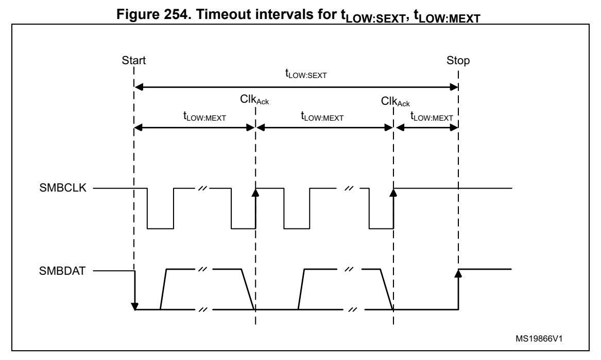
*Figure 254. Timeout intervals for t LOW:SEXT, t LOW:MEXT. (p. 742)*

Bus idle detection

A master can assume that the bus is free if it detects that the clock and data signals have been high for t IDLE greater than t HIGH, MAX. (refer to Table 106: I2C-SMBus specification data setup and hold times)

This timing parameter covers the condition where a master has b een dynamically added to the bus and may not have detected a state transition on the SMB CLK or SMBDAT lines. In this case, the master must wait long enough to ensure that a transfer is not currently in progress. The peripheral supports a hardware bus idle detection.

#### 25.4.13 SMBus initialization (p. 742)

This section is relevant only w hen SMBus feature is supported. Refer to Section 25.3: I2C implementation.

In addition to I2C in itialization, some ot her specific initiali zation must be d one in order to perform SMBus communication:

Received Command and Data Acknowledge control (Slave mode)

A SMBus receiver must be able to NACK each received command or data. In order to allow ACK control in slave m ode, the Slave Byte C ontrol mode must be enabled by setting the SBC bit in the I2C_CR1 register. Refer to Slave Byte Control mode on page 719 for more details.

Specific address (Slave mode)

The specific SMBus addresses mus t be enabled if needed. Refer to Bus idle detection on page 742 for more details.

- The SMBus Device Default Address (0b1100 001) is enabled by setting the SMBDEN bit in the I2C_CR1 register.

- The SMBus Host Address (0b0001 000) is enabled by setting the S MBHEN bit in the I2C_CR1 register.

- The Alert Response Address (0b0001100) is enabled by setting the ALERTEN bit in the I2C_CR1 register.

Packet error checking

PEC calculation is enabled by setting the PECEN bit in the I2C_CR1 register. Then the PEC transfer is managed with the help of a hardware byte counter: N BYTES[7:0] in the I2C_CR2 register. The PECEN bit must be configured before enabling the I2C.

The PEC transfer is managed with the hardware byte counter, so the SBC bit must be set when interfacing the SMBus in slave mode. The PEC is transferre d after NBYTES-1 data have been transferred when the PECBYTE bit is se t and the RELOA D bit is cleared. If RELOAD is set, PECBYTE has no effect.

Caution: Changing the PECEN configuration is not allowed when the I2C is enabled.

**Table 113. SMBus with PEC configuration (p. 743)**

| Col 1 | Col 2 | Mode SBC bit RELOAD bit AUTOEND bit PECBYTE bit |
| --- | --- | --- |
|  | Master Tx/Rx NBYTES + PEC+ STOP x 0 1 1 |  |
| Master Tx/Rx NBYTES |  | + PEC + ReSTART x 0 0 1 |
|  | Slave Tx/Rx with PEC 1 0 x 1 |  |

Timeout detection

The timeout detection is enabled by setting the TIMOUTEN and TEXTEN bits in the I2C_TIMEOUTR register. The timers must be programmed in such a way that they detect a timeout before the maxi mum time given in t he SMBus specificatio n.

- t TIMEOUT check In order to enable the t TIMEOUT check, the 12-bit TIMEOUTA[11:0] bits must be programmed with the timer reload value in order to check the t TIMEOUT parameter. The TIDLE bit must be configured to ‘0’ in order to detect the SCL low level timeout. Then the timer is enabled by setti ng the TIMOUTEN in the I2C_TI MEOUTR register. If SCL is tied low for a time greater than (TIMEOUTA+1) x 2048 x t I2CCLK, the TIMEOUT flag is set in the I2C_ISR register. Refer to Table 114: Examples of TIMEOUTA settings for various I2CCLK frequencies (max t TIMEOUT = 25 ms).

Caution: Changing the TIMEOUTA[11:0] bits and TIDLE bit configuration is not allowed when the TIMEOUTEN bit is set.

- t LOW:SEXT and t LOW:MEXT check Depending on if the peripheral is configured as a master or as a slave, The 12-bit TIMEOUTB timer must be configured in order to check t LOW:SEXT for a slave and

t LOW:MEXT for a master. As the standard specifies only a maximum, the use r can choose the same value for the both. Then the timer is enabled by setting the TEXTEN bit in the I2C_TIMEOUTR register. If the SMBus peripheral performs a cumulative SCL stretch for a time greater than (TIMEOUTB+1) x 2048 x t I2CCLK, and in the timeout in terval described in Bus idle detection on page 742 section, the TIMEOUT flag is s et in the I2C_ISR register. Refer to Table 115: Examples of TIMEOUTB settings for various I2CCLK frequencies

Caution: Changing the TIMEOUTB configuration is not allowed when the TEXTEN bit is set.

Bus Idle detection

In order to enable the t IDLE check, the 12-bit TIMEOUTA[11:0] field must be programmed with the timer reload value in order to obtain the t IDLE parameter. The TI DLE bit must be configured to ‘1 in o rder to detect both SC L and SDA high level timeout.

Then the timer is enabled by se tting the TIMOUTEN bit in the I2 C_TIMEOUTR register.

If both the SCL and SDA lines rem ain high for a time greater th an (TIMEOUTA+1) x 4 x t I2CCLK, the TIMEOUT flag is set in the I2C_ISR register.

Refer to Table 116: Examples of TIMEOUTA settings for various I2CCLK frequencies (max t IDLE = 50 µs)

Caution: Changing the TIMEOUTA and TIDLE configuration is not allowed wh en the TIMEOUTEN is set.

#### 25.4.14 SMBus: I2C_TIMEOUTR register configuration examples (p. 744)

This section is relevant only w hen SMBus feature is supported. Refer to Section 25.3: I2C implementation.

- Configuring the maximum duration of t TIMEOUT to 25 ms:

(max t TIMEOUT = 25 ms)

**Table 114. Examples of TIMEOUTA settings for various I2CCLK frequencies (p. 744)**

| f I2CCLK | TIMEOUTA[11:0] bits TIDLE bit TIMEOUTEN bit | Col 4 | t TIMEOUT |
| --- | --- | --- | --- |
|  | 8 MHz 0x61 0 1 98 x 2048 x 125 ns = 25 ms | 8 MHz 0x61 0 1 98 x 2048 x 125 ns = 25 ms |  |
|  | 16 MHz 0xC3 0 1 196 x 2 |  | 048 x 62.5 ns = 25 ms |
|  |  | 48 MHz 0x249 0 1 586 x 2048 x 20.08 ns = 25 ms |  |

- Configuring the maximum duration of t LOW:SEXT and t LOW:MEXT to 8 ms:

**Table 115. Examples of TIMEOUTB settings for various I2CCLK frequencies (p. 744)**

| f I2CCLK | TIMEOUTB[11:0] bits TEXTEN bit | Col 4 | t LOW:EXT |
| --- | --- | --- | --- |
|  |  | 8 MHz 0x1F 1 32 x 2048 x 125 ns = 8 ms |  |
|  |  | 16 MHz 0x3F 1 64 x 2048 x 62.5 ns = 8 ms |  |
|  | 48 MHz 0xBB 1 188 x 2048 |  | x 20.08 ns = 8 ms |

- Configuring the maximum duration of t IDLE to 50 µs

(max t IDLE = 50 µs)

**Table 116. Examples of TIMEOUTA settings for various I2CCLK frequencies (p. 745)**

| f I2CCLK | TIMEOUTA[11:0] bits TIDLE bit TIMEOUTEN bit | t TIDLE |
| --- | --- | --- |
|  | 8 MHz 0x63 1 1 100 x 4 x 125 ns = 50 µs |  |
|  | 16 MHz 0xC7 1 1 200 x | 4 x 62.5 ns = 50 µs |
|  | 48 MHz 0x257 1 1 600 x 4 | x 20.08 ns = 50 µs |

#### 25.4.15 SMBus slave mode (p. 745)

This section is relevant only w hen SMBus feature is supported. Refer to Section 25.3: I2C implementation.

In addition to I2C slave transfer management (refer to Section 25.4.9: I2C slave mode) some additional software flowcharts are provided to support SMB us.

SMBus Slave transmitter

When the IP is used in SMBus, SBC must be programmed to ‘1’ in order to allow the PEC transmission at the end of the programmed number of data bytes. When the PECBYTE bit is set, the number of bytes programmed in NBYTES[7:0] includes the PEC transmission. In that case the total nu mber of TXIS interrupts is NBYTES-1 and t he content of the I2C_PECR register is automatica lly transmitted if the master re quests an extra byte after the NBYTES-1 data transfer.

Caution: The PECBYTE bit has no effect w hen the RELOAD bit is set.

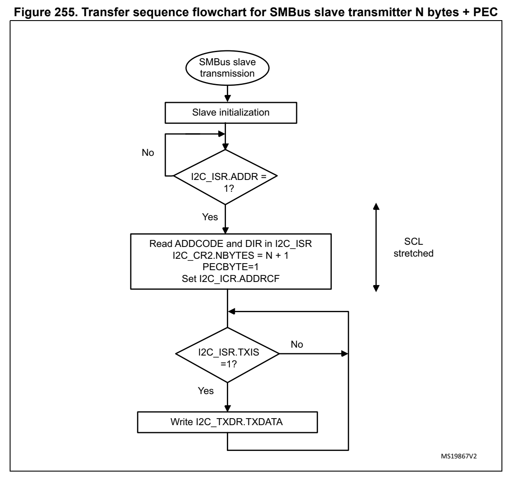
*Figure 255. Transfer sequence flowchart for SMBus slave transmi tter N bytes + PEC (p. 746)*

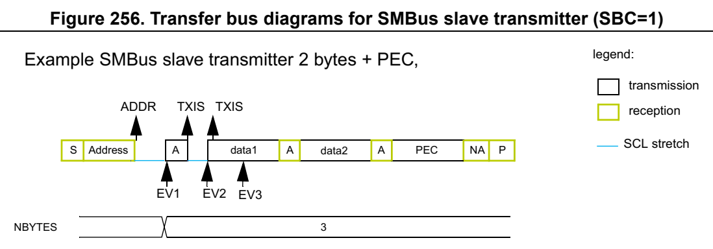
*Figure 256. Transfer bus diagrams for SMBus slave transmitter ( SBC=1) (p. 746)*

EV1: ADDR ISR: check ADDCODE, program NBYTES=3, set PECBYTE, set ADDRCF EV2: TXIS ISR: wr data1 EV3: TXIS ISR: wr data2

MS19869V2

SMBus Slave receiver

When the I2C is used in SMBus mode, SBC must be programmed to ‘ 1’ in order to allow the PEC checking at the end of the programmed number of data bytes. In order to allow the ACK control of each byte, the re load mode must be selected (REL OAD=1). Refer to Slave Byte Control mode on page 719 for more details.

In order to check the PEC byte, the RELOAD bit must be cleared and the PECBYTE bit must be set. In this case, after NBYTES-1 data have been received, the next received byte is compared with the internal I2 C_PECR register content. A NACK is automatically generated if the com parison does not match, and an ACK is autom atically generated if the comparison matches, whatever the ACK bit value. Once the PEC byte is received, it is copied into the I2C_RXDR register like any other data, and the RXNE flag is set.

In the case of a PEC m ismatch, the PECERR flag is set and an in terrupt is generated if the ERRIE bit is set in the I2C_CR1 register.

If no ACK software control is needed, the user can program PECB YTE=1 and, in the same write operation, program NBYTES with the number of bytes to be received in a continuous flow. After NBYTES-1 are received, the next received byte is ch ecked as being the PEC.

Caution: The PECBYTE bit has no effect w hen the RELOAD bit is set.

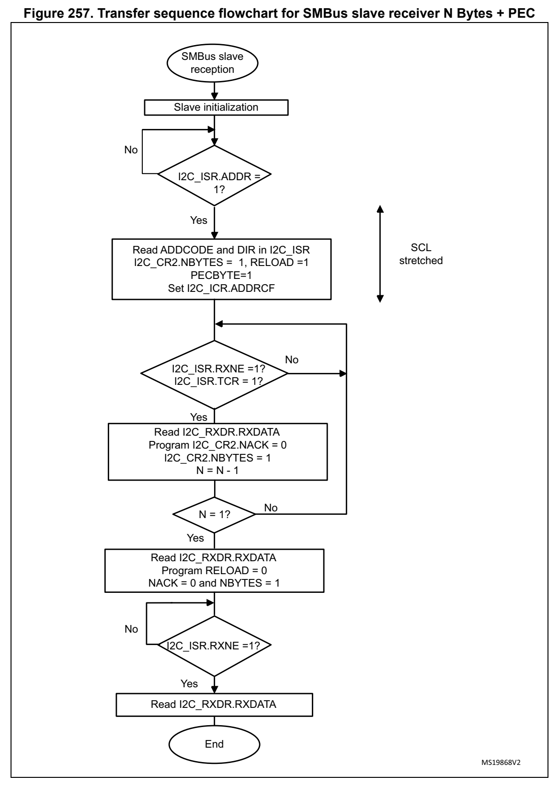
*Figure 257. Transfer sequence flowchart for SMBus slave receive r N Bytes + PEC (p. 748)*

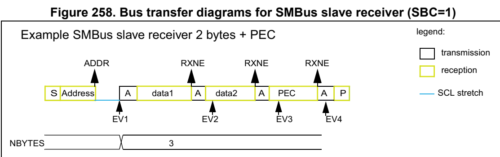
*Figure 258. Bus transfer diagram s for SMBus slave receiver (SBC =1) (p. 749)*

EV1: ADDR ISR: check ADDCODE and DIR, prog ram NBYTES = 3, PECBYTE=1, RELOAD=0, set ADDRCF EV2: RXNE ISR: rd data1 EV3: RXNE ISR: rd data2 EV4: RXNE ISR: rd PEC

Example SMBus slave receiver 2 bytes + PEC, with ACK control legend : (RELOAD=1/0) transmission ADDR RXNE,TCR RXNE,TCR RXNE reception

S Address A data1 A data2 A PEC A P SCL stretch

EV 1 EV2 EV3 EV4

NBYTES 1

EV1: ADDR ISR: check ADDCODE and DIR, program NBYTES = 1, PECBYTE=1, RELOAD=1, set ADDRCF EV2: RXNE-TCR ISR: rd data1, program NACK=0 and NBYTES = 1 EV3: RXNE-TCR ISR: rd data2, program NACK=0, NBYTES = 1 and RELOAD=0 EV4: RXNE-TCR ISR: rd PEC

MS19870V2

This section is relevant only w hen SMBus feature is supported. Refer to Section 25.3: I2C implementation.

In addition to I2C master transfer management (refer to Section 25.4.10: I2C master mode) some additional software flowcharts are provided to support SMB us.

SMBus Master transmitter

When the SMBus master wants to transmit the PEC, the PECBYTE bi t must be set and the number of bytes must be program med in the NBYTES[ 7:0] field, before setting the START bit. In this case the total numb er of TXIS interrupts is NBYTES -1. So if the PECBYTE bit is set when NBYTES=0x1, the content of the I2C_PECR register is au tomatically transmitted.

If the SMBus master wants to sen d a STOP condition after the PE C, automatic end mode must be selected (AUTOEND=1). In this case, the STOP condition automatically follows the PEC transmission.

When the SMBus master wants to sen d a RESTART condition after t he PEC, software mode must be selected (AUTOEND= 0). In this case, once NBYTES-1 have been transmitted, the I2C_PECR register content is transmitted and t he TC flag is set after the PEC transmission, stretching the SCL line low. The RESTART cond ition must be programmed in the TC i nterrupt subroutine.

Caution: The PECBYTE bit has no effect w hen the RELOAD bit is set.

Figure 259. Bus transfer diagrams for SMBus master transmitter

Example SMBus master transmitter 2 byte s + PEC, automatic end mode (STOP)

TXIS TXIS legend:

S Address A data1 A data2 A PEC A P transmission reception INIT EV1 EV2 SCL stretch TXE

NBYTES xx 3

INIT: program Slave address, program NBYTES = 3, AUTOEND=1, set PECBYTE, set START EV1: TXIS ISR: wr data1 EV2: TXIS ISR: wr data2

Example SMBus master transmitter 2 byte s + PEC, software end mode (RESTART)

TC legend: TXIS TXIS transmission S Address A data1 A data2 A PEC A Rstart Address reception

INIT EV1 EV2 EV3 SCL stretch

xx 3 N

NBYTES

INIT: program Slave address, program NBYTES = 3, AUTOEND=0, set PECBYTE, set START EV1: TXIS ISR: wr data1 EV2: TXIS ISR: wr data2 EV3: TC ISR: program Slave addres s, program NBYTES = N, set START

MS19871V2

SMBus Master receiver

When the SMBus master wants to receive the PEC followed by a STOP at the end of the transfer, automatic end mode can be selected (AUTOEND=1). The P ECBYTE bit must be set and the slave address must be programmed, before setting th e START bit. In this case, after NBYTES-1 data have been re ceived, the next received byte is automatically checked versus the I2C_PECR register content. A NACK response is given to the PEC byte, followed by a STOP condition.

When the SMBus master receiver wants to receive the PEC byte fo llowed by a RESTART condition at the end of the tran sfer, software mode must be sel ected (AUTOEND=0). The PECBYTE bit must be set and the s lave address must be programme d, before setting the START bit. In this case, after NBYTES-1 data have been received, the next received byte is automatically checked versus t he I2C_PECR register content. The TC flag is set after the PEC byte reception, stretching the SCL line low. The RESTART co ndition can be programmed in the TC i nterrupt subroutine.

Caution: The PECBYTE bit has no effect w hen the RELOAD bit is set.

Figure 260. Bus transfer diagrams for SMBus master receiver

Example SMBus master receiver 2 byte s + PEC, automatic end mode (STOP)

RXNE RXNE RXNE legend:

S Address A data1 A data2 A PEC NA P transmission reception INIT EV 1 EV2 EV3 SCL stretch NBYTES xx 3

INIT: program Slave address, program NBYTES = 3, AUTOEND=1, set PECBYTE, set START EV1: RXNE ISR: rd data1 EV2: RXNE ISR: rd data2 EV3: RXNE ISR: rd PEC

Example SMBus master receiver 2 bytes + PEC, software end mode (RESTART)

RXNE RXNE RXNE TC legend:

transmission S Address A data1 A data2 A PEC NA Restart Address reception

INIT EV1 EV2 EV3 EV4 SCL stretch

NBYTES

xx 3 N

INIT: program Slave address, program NBYTES = 3, AUTOEND=0, set PECBYTE, set START EV1: RXNE ISR: rd data1 EV2: RXNE ISR: rd data2 EV3: RXNE ISR: read PEC EV4: TC ISR: program Slave address, program NBYTES = N, set START

MS19872V2

#### 25.4.16 Wakeup from Stop mode on address match (p. 753)

This section is relevant only w hen Wakeup from Stop mode feature is supported. Refer to Section 25.3: I2C implementation.

The I2C is able to wakeup the M CU from Stop mode (APB clock is off), when it is addressed. All addressing modes are supported.

Wakeup from Stop mode is enabled by setting the WUPEN bit in th e I2C_CR1 register. The HSI16 oscillator must be selected as the clock s ource for I2CCL K in order to allow wakeup from Stop mode.

During Stop mode, the HSI16 is switched off. When a START is de tected, the I2C interface switches the HSI16 on, and stre tches SCL low until HSI16 is woken up.

HSI16 is then used for t he address reception.

In case of an address match, the I2C stretches SCL low during M CU wakeup time. The stretch is released when ADDR fl ag is cleared by software, and the transfer goes on normally.

If the address does no t match, the HSI16 is switched off again and the MCU is not woken up.

Note: If the I2C clock is the system clock, or if WUPEN = 0, the HSI16 is not switched on after a START is received.

Only an ADDR interrupt can wakeup the MCU. Therefore do not enter Stop mode when the I2C is performing a transfer as a master, or as an addressed slave after the ADDR flag is set. This can be managed by clearing SLEEPDEEP bit in the ADDR interrupt routine and setting it again only afte r the STOPF flag is set.

Caution: The digital filter is not compatible with the wakeup from Stop mode feature. If the DNF bit is not equal to 0, se tting the WUPEN bit has no effect.

Caution: This feature is availa ble only when the I2C clock source is the HSI16 oscillator.

Caution: Clock stretching must be enabled (NOSTRETCH=0) to ensure proper operation of the wakeup from Stop mode feature.

Caution: If wakeup from Stop mo de is disabled (WUPEN =0), the I2C periphe ral must be disabled before entering Stop mode (PE=0).

#### 25.4.17 Error conditions (p. 753)

The following errors are the error conditions which may cause communication to fail.

Bus error (BERR)

A bus error is detected when a S TART or a STOP condition is detected and is not located after a multiple of 9 SCL clock pulses. A START or a STOP condi tion is detected when a SDA edge occurs while SCL is high.

The bus error flag is set only if the I2C is involved in the transfer as master or addressed slave (i.e not during the address phase in slave mode).

In case of a misplaced START or RESTART detection in slave mode, the I2C enters address recognition state like for a correct START condition.

When a bus error is detected, the BERR flag is set in the I2C_I SR register, and an interrupt is generated if the ERRIE bit is set in the I2C_CR1 register.

Arbitration lost (ARLO)

An arbitration loss is detected when a high level is sent on th e SDA line, but a low level is sampled on the SCL rising edge.

- In master mode, arbitration loss is detected during the address phase, data phase and data acknowledge phase. In this case, the SDA and SCL lines are released, the START control bit is cleared by hardware and the master switche s automatically to slave mode.

- In slave mode, arbitration loss is detected duri ng data phase a nd data acknowledge phase. In this case, the transfe r is stopped, and the SCL and S DA lines are released.

When an arbitration loss is detected, the ARLO flag is set in t he I2C_ISR register, and an interrupt is generated if the ERRIE bit is set in the I2C_CR1 register.

Overrun/underrun error (OVR)

An overrun or underrun error is d etected in slave mode when NOS TRETCH=1 and:

- In reception when a new byte is received and the RXDR register has not been read yet. The new received byte is lost, an d a NACK is automatically sent as a response to the new byte.

- In transmission: – When STOPF=1 and the first data byte should be sent. The conte nt of the I2C_TXDR register is sen t if TXE=0, 0xFF if not. – When a new byte must be sent and the I2C_TXDR register has not been written yet, 0xFF is sent.

When an overrun or underrun error is detected, the OVR flag is set in the I2C_ISR register, and an interrupt is generated i f the ERRIE bit is set in the I2 C_CR1 register.

Packet Error Checking Error (PECERR)

This section is relevant only w hen the SMBus feature is supported. Refer to Section 25.3: I2C implementation.

A PEC error is detected when the received PEC byte does not match with the I2C_PECR register content. A NACK is auto matically sent after the wrong PEC reception.

When a PEC error is detected, t he PECERR flag is set in the I2C_ISR register, and an interrupt is generated if the ERRIE bit is set in the I2C_CR1 register.

Timeout Error (TIMEOUT)

This section is relevant only w hen the SMBus feature is supported. Refer to Section 25.3: I2C implementation.

A timeout error occurs for any of these conditions:

- TIDLE=0 and SCL remained low for the time defined in the TIMEOU TA[11:0] bits: this is used to detect a SMBus timeout.

- TIDLE=1 and both SDA and SCL remained high for the time defined in the TIMEOUTA [11:0] bits: this is used to detect a bus idle condition.

- Master cumulative clock low exte nd time reached the time define d in the TIMEOUTB[11:0] bits (SMBus t LOW:MEXT parameter)

- Slave cumulative clock low exten d time reached the time defined in TIMEOUTB[11:0] bits (SMBus t LOW:SEXT parameter)

When a timeout violation is detected in master mode, a STOP con dition is automatically sent.

When a timeout violation is detected in slave mode, SDA and SCL lines are automatically released.

When a timeout error is detected, the TIMEOUT flag is set in th e I2C_ISR register, and an interrupt is generated if the ERRIE bit is set in the I2C_CR1 register.

Alert (ALERT)

This section is relevant only w hen the SMBus feature is supported. Refer to Section 25.3: I2C implementation.

The ALERT flag is set when the I2 C interface is configured as a Host (SMBHEN=1), the alert pin detection is enabled (ALERTEN=1) and a falling edge i s detected on the SMBA pin. An interrupt is generated if t he ERRIE bit is set in the I2C_CR 1 register.

#### 25.4.18 DMA requests (p. 755)

Transmission using DMA

DMA (Direct Memory Access) can be enabled for transmission by s etting the TXDMAEN bit in the I2C_CR1 register. Data is loaded from an S RAM area confi gured using the DMA peripheral (see Section 9: Direct memory access controller (DMA)) to the I2C_TXDR register whenever th e TXIS bit is set.

Only the data are transferred with DMA.

- In master mode: the in itialization, the sla ve address, directio n, number of bytes and START bit are programmed by software (the transmitted slave add ress cannot be transferred with DMA). When all data are transferred using DMA, the DMA must be initialized before setting the START bit. The end of transfer i s managed with the NBYTES counter. Refer to Master transmitter on page 730.

- In slave mode: – With NOSTRETCH=0, when all data are transferred using DMA, the DMA must be initialized before the address match event, or in ADDR interrupt subroutine, before clearing ADDR. – With NOSTRETCH=1, the DMA must be initializ ed before the addre ss match event.

- For instances supporting SMBus: th e PEC transfer is managed wit h NBYTES counter. Refer to SMBus Slave transmitter on page 745 and SMBus Master transmitter on page 749.

Note: If DMA is used for transmission, the TXIE bit does not need to be enabled.

Reception using DMA

DMA (Direct Memory Access) can be enabled for reception by sett ing the RXDMAEN bit in the I2C_CR1 register. Data is l oaded from the I2C_RXDR register to an SRAM area configured using the DMA peripheral (refer to Section 9: Direct memory access controller (DMA) on page 213) whenever the RXNE bit is set. O nly the data (including PEC) a re transferred with DMA.

- In master mode, the in itialization, the sla ve address, directio n, number of bytes and START bit are programmed by software. When all data are transfe rred using DMA, the

DMA must be initialized before setting the START bit. The end of transfer is managed with the NBYTES counter.

- In slave mode with NOSTRETCH=0, w hen all data are transferred u sing DMA, the DMA must be initialized before the address match event, or in t he ADDR interrupt subroutine, before cl earing the ADDR flag.

- If SMBus is supported (see Section 25.3: I2C implementation): the PEC transfer is managed with the NBYTES counter. Refer to SMBus Slave receiver on page 747 and SMBus Master receiver on page 751.

Note: If DMA is used for reception, the RXIE bit does not need to be enabled.

#### 25.4.19 Debug mode (p. 756)

When the microcontroller enters d ebug mode (core halted), the S MBus timeout either continues to work normally or stop s, depending on the DBG_I2Cx_SMBUS_TIMEOUT configuration bits in the DBG module.

### 25.5 I2C low-power modes (p. 756)

**Table 117. Effect of low-power modes on the I2C (p. 756)**

| Col 1 | Mode Description |
| --- | --- |
|  | Sleep No effect. I2C interrupts cause the device to exit the Sle ep mode. |
| Stop (1) | The I2C registers content is kept. If WUPEN = 1 and I2C is cloc ked by an internal oscillator (HSI16): the address recognition is functional. The I2C address match condition causes the device to exit the Stop mode. If WUPEN=0: the I2C must be disabled before entering Stop mode |
| Standby | The I2C peripheral is powered dow n and must be re initialized after exiting Standby mode. |

1. Refer to Section 25.3: I2C implementation for information about the Stop modes supported by each instance. If wakeup from a specific Stop mode is not supported, the instance must be disabled before entering this Stop mode.

### 25.6 I2C interrupts (p. 757)

The table below gives the lis t of I2C interrupt requests.

**Table 118. I2C Interrupt requests (p. 757)**

| Col 1 | Interrupt acronym | Interrupt event | Event flag | Enable control bit | Interrupt clear method | Exit the Sleep mode | Exit the Stop mode | Exit the Standby modes |
| --- | --- | --- | --- | --- | --- | --- | --- | --- |
|  |  | Receive buffer not empty | RXNE RXIE | RXNE RXIE | Read I2C_RXDR register |  |  |  |
|  |  | Transmit buffer interrupt status | TXIS TXIE | TXIS TXIE | Write I2C_TXDR register |  |  |  |
|  |  | Stop detection interrupt flag | STOPF STOPIE | STOPF STOPIE | Write STOPCF=1 |  |  |  |
|  |  | Transfer Complete Reload | TCR | TCIE | Write I2C_CR2 with NBYTES[7:0] ≠ 0 | Yes | No |  |
|  | I2C_EV | Transfer complete | TC |  | Write START=1 or STOP=1 | Yes |  | No |
|  |  | Address matched |  | ADDR ADDRIE | Write ADDRCF=1 |  | Yes (1) |  |
|  |  | NACK reception | NACKF NACKIE | NACKF NACKIE | Write NACKCF=1 |  | No |  |
| I2C |  | Bus error BERR |  |  | Write BERRCF=1 |  |  |  |
|  |  | Arbitration loss ARLO |  |  | Write ARLOCF=1 |  |  |  |
|  | I2C_ER | Overrun/Under run |  | OVR Write OVRCF=1 ERRIE |  | Yes | No No | No No |
|  | I2C_ER | PEC error PECERR |  | ERRIE | Write PECERRCF=1 |  | No No | No No |
|  |  | Timeout/t LOW error | TIMEOUT |  | Write TIMEOUTCF=1 |  |  |  |
|  |  | SMBus Alert ALERT |  |  | Write ALERTCF=1 |  |  |  |

1. The ADDR match event can wake up the device from Stop mode on ly if the I2C instance supports the Wakeup from Stop mode feature. Refer to Section 25.3: I2C implementation.

### 25.7 I2C registers (p. 758)

Refer to Section 1.2 on page 39 for a list of abbre viations used in register descriptions.

The peripheral registers are accessed by words (32-bit).

### 25.7.1 [I2C.I2C_CR1] Offset: 0x00 | Reset: 0x00000000 (p. 758)

Address offset: 0x00

Reset value: 0x0000 0000

Access: No wait states, except i f a write access occurs while a write access to this register is ongoing. In this case, wait states are inserted in the second w rite access until the previous one is completed. The latency of the second write access can be up to 2 x PCLK1 + 6 x I2CCLK.

Bits 31:24 Reserved, must be kept at reset value.

Bit 23 PECEN: PEC enable 0: PEC calculation disabled 1: PEC calculation enabled Note: If the SMBus feature is not supported, this bit is reserved and forced by hardware to ‘0’. Refer to Section 25.3: I2C implementation.

Bit 22 ALERTEN: SMBus alert enable 0: The SMBus alert pin (SMBA) is not supported in host mode (SM BHEN=1). In device mode (SMBHEN=0), the SMBA pin is released and the Alert Response Add ress header is disabled (0001100x followed by NACK). 1: The SMBus alert pin is supported in host mode (SMBHEN=1). In device mode (SMBHEN=0), the SMBA pin is driven low and the Alert Response Address header is enabled (0001100x followed by ACK). Note: When ALERTEN=0, the SMBA pin can be used as a standard GPIO. If the SMBus feature is not supported, this bit is reserved and forced by hardware to ‘0’. Refer to Section 25.3: I2C implementation.

Bit 21 SMBDEN: SMBus Device Default Address enable 0: Device Default Address disabled. Address 0b1100001x is NACKe d. 1: Device Default Address enabled. Address 0b1100001x is ACKed. Note: If the SMBus feature is not supported, this bit is reserved and forced by hardware to ‘0’. Refer to Section 25.3: I2C implementation.

Bit 20 SMBHEN: SMBus Host Address enable 0: Host Address disabled. Address 0b0001000x is NACKed. 1: Host Address enabled. Address 0b0001000x is ACKed. Note: If the SMBus feature is not supported, this bit is reserved and forced by hardware to ‘0’. Refer to Section 25.3: I2C implementation.

Bit 19 GCEN: General call enable 0: General call disabled. Address 0b00000000 is NACKed. 1: General call enabled. Address 0b00000000 is ACKed.

Bit 18 WUPEN: Wakeup from Stop mode enable 0: Wakeup from Stop mode disable. 1: Wakeup from Stop mode enable. Note: If the Wakeup from Stop mode feature is no t supported, this bit is reserved and forced by hardware to ‘0’. Refer to Section 25.3: I2C implementation. Note: WUPEN can be set only when DNF = ‘0000’

Bit 17 NOSTRETCH: Clock stretching disable This bit is used to disable clock stretching in slave mode. It must be kept cleared in master mode. 0: Clock stretching enabled 1: Clock stretching disabled Note: This bit can only be programmed when the I2C is disabled (PE = 0).

Bit 16 SBC: Slave byte control This bit is used to enable hardware byte control in slave mode. 0: Slave byte control disabled 1: Slave byte control enabled

Bit 15 RXDMAEN: DMA reception requests enable 0: DMA mode disabled for reception 1: DMA mode enabled for reception

Bit 14 TXDMAEN: DMA transmission requests enable 0: DMA mode disabled for transmission 1: DMA mode enabled for transmission

Bit 13 Reserved, must be kept at reset value.

Bit 12 ANFOFF: Analog noise filter OFF 0: Analog noise filter enabled 1: Analog noise filter disabled Note: This bit can only be programmed when the I2C is disabled (PE = 0).

Bits 11:8 DNF[3:0]: Digital noise filter These bits are used to configure the digital noi se filter on SDA and SCL input. The digital filter, filters sp ikes with a length of up to DNF[3:0] * t I2CCLK 0000: Digital filter disabled 0001: Digital filter enabled and filtering capability up to 1 t I2CCLK

... 1111: digital filter enabled and filtering capab ility up to15 t I2CCLK Note: If the analog filter is also enabled, the digital filter is added to the analog filter. This filter can only be programmed when the I2C is disabled (PE = 0).

Bit 7 ERRIE: Error interrupts enable 0: Error detection interrupts disabled 1: Error detection interrupts enabled Note: Any of these errors generate an interrupt: Arbitration Loss (ARLO) Bus Error detection (BERR) Overrun/Underrun (OVR) Timeout detection (TIMEOUT) PEC error detection (PECERR) Alert pin event detection (ALERT)

Bit 6 TCIE: Transfer Complete interrupt enable 0: Transfer Co mplete interrupt disabled 1: Transfer Complete interrupt enabled Note: Any of these events generate an interrupt: Transfer Complete (TC) Transfer Complete Reload (TCR)

Bit 5 STOPIE: Stop detection Interrupt enable 0: Stop detection (STOPF) interrupt disabled 1: Stop detection (STOPF) interrupt enabled

Bit 4 NACKIE: Not acknowledge received Interrupt enable 0: Not acknowledge (NACKF) received interrupts disabled 1: Not acknowledge (NACKF) received interrupts enabled

Bit 3 ADDRIE: Address match Interrupt enable (slave only) 0: Address match (ADDR) interrupts disabled 1: Address match (ADDR) interrupts enabled

Bit 2 RXIE: RX Interrupt enable 0: Receive (RXNE) interrupt disabled 1: Receive (RXNE) interrupt enabled

Bit 1 TXIE: TX Interrupt enable 0: Transmit (TXIS) interrupt disabled 1: Transmit (TXIS) interrupt enabled

Bit 0 PE: Peripheral enable 0: Peripheral disable 1: Peripheral enable Note: When PE=0, the I2C SCL and SDA lines are released. Internal state machines and status bits are put back to their reset value. When cleared, PE must be kept low for at least 3 APB clock cycles.

### 25.7.2 [I2C.I2C_CR2] Offset: 0x04 | Reset: 0x00000000 (p. 761)

Address offset: 0x04

Reset value: 0x0000 0000

Access: No wait states, except i f a write access occurs while a write access to this register is ongoing. In this case, wait states are inserted in the second w rite access until the previous one is completed. The latency of the second write access can be up to 2 x PCLK1 + 6 x I2CCLK.

Bits 31:27 Reserved, must be kept at reset value.

Bit 26 PECBYTE: Packet error checking byte This bit is set by software, and cleared by hardware when the P EC is transferred, or when a STOP condition or an Address matc hed is received, also when PE= 0. 0: No PEC transfer. 1: PEC transmission/reception is requested Note: Writing ‘0’ to this bit has no effect. This bit has no effect when RELOAD is set. This bit has no effect is slave mode when SBC=0. If the SMBus feature is not supported, this bit is reserved and forced by hardware to ‘0’. Refer to Section 25.3: I2C implementation.

Bit 25 AUTOEND: Automatic end mode (master mode) This bit is set and cleared by software. 0: software end mode: TC flag is set when NBYTES data are transferred, stretching SCL low. 1: Automatic end mode: a STOP co ndition is automatically sent w hen NBYTES data are transferred. Note: This bit has no effect in slave mode or when the RELOAD bit is set.

Bit 24 RELOAD: NBYTES reload mode This bit is set and cleared by software. 0: The transfer is com pleted after the NBYTES data transfer (STOP or RESTART follows). 1: The transfer is not completed after the NBYTES data transfer (NBYTES is reloaded). TCR flag is set when NBYT ES data are transferred, stretching SCL low.

Bits 23:16 NBYTES[7:0]: Number of bytes The number of bytes to be transmi tted/received is programmed th ere. This field is don’t care in slave mode with SBC=0. Note: Changing these bits when the START bit is set is not allowed.

Bit 15 NACK: NACK generation (slave mode) The bit is set by software, cl eared by hardware when the NACK i s sent, or when a STOP condition or an Address match ed is received, or when PE=0. 0: an ACK is sent after c urrent received byte. 1: a NACK is sent after current received byte. Note: Writing ‘0’ to this bit has no effect. This bit is used in slave mode only: in master receiver mode, NACK is automatically generated after last byte preceding STOP or RESTART condition, whatever the NACK bit value. When an overrun occurs in slave receiver NOSTRETCH mode, a NACK is automatically generated whatever the NACK bit value. When hardware PEC checking is enabled (PECBYTE=1), the PEC acknowledge value does not depend on the NACK value.

Bit 14 STOP: Stop generation (master mode) The bit is set by software, cleared by hardware when a STOP con dition is detected, or when PE = 0. In Master Mode: 0: No Stop generation. 1: Stop generation after current byte transfer. Note: Writing ‘0’ to this bit has no effect.

Bit 13 START: Start generation This bit is set by software, and cleared by hardware after the Start followed by the address sequence is sent, by an arbitration loss, by a timeout error detection, or when PE = 0. It can also be cleared by software by writing ‘1’ to the ADDRCF bit in the I2C_ICR register. 0: No Start generation. 1: Restart/Start generation: If the I2C is already in master m ode with AUTOEND = 0, setting this bit generates a Repeated Start condition when R ELOAD=0, after the end of the NBYTES transfer. Otherwise setting this bit generates a START condition once the bus is free. Note: Writing ‘0’ to this bit has no effect. The START bit can be set even if the bus is BUSY or I2C is in slave mode. This bit has no effect when RELOAD is set.

Bit 12 HEAD10R: 10-bit address header only read direction (master receiver mode) 0: The master sends the complete 10 bit slave address read sequ ence: Start + 2 bytes 10bit address in write direction + Restart + 1st 7 bits of the 10 bit address in read direction. 1: The master only sends the 1st 7 bits of the 10 bit address, followed by Read direction. Note: Changing this bit when the START bit is set is not allowed.

Bit 11 ADD10: 10-bit addressing mode (master mode) 0: The master operates in 7-bit addressing mode, 1: The master operates in 10-bit addressing mode Note: Changing this bit when the START bit is set is not allowed.

Bit 10 RD_WRN: Transfer direction (master mode) 0: Master requests a write transfer. 1: Master requests a read transfer. Note: Changing this bit when the START bit is set is not allowed.

Bits 9:0 SADD[9:0]: Slave address (master mode) In 7-bit addressing mode (ADD10 = 0): SADD[7:1] should be written with the 7-bit slave address to be sent. The bits SADD[9], SADD[8] and SADD[0] are don't care. In 10-bit addressi ng mode (ADD10 = 1): SADD[9:0] should be written with the 10-bit slave address to be sent. Note: Changing these bits when the START bit is set is not allowed.

### 25.7.3 [I2C.I2C_OAR1] Offset: 0x08 | Reset: 0x00000000 (p. 764)

Address offset: 0x08

Reset value: 0x0000 0000

Access: No wait states, except i f a write access occurs while a write access to this register is ongoing. In this case, wait states are inserted in the second w rite access until the previous one is completed. The latency of the second write access can be up to 2 x PCLK1 + 6 x I2CCLK.

Bits 31:16 Reserved, must be kept at reset value.

Bit 15 OA1EN: Own Address 1 enable 0: Own address 1 disabled. The re ceived slave address OA1 is NACKed. 1: Own address 1 enabled. The received slave address OA1 is ACKed.

Bits 14:11 Reserved, must be kept at reset value.

Bit 10 OA1MODE: Own Address 1 10-bit mode 0: Own address 1 is a 7-bit address. 1: Own address 1 is a 10-bit address. Note: This bit can be written only when OA1EN=0.

Bits 9:0 OA1[9:0]: Interface own slave address 7-bit addressing mode: OA1[7:1] contains the 7-bit own slave ad dress. The bits OA1[9], OA1[8] and OA1[0] are don't care. 10-bit addressing mode: OA1[9:0] contains the 10-bit own slave address. Note: These bits can be written only when OA1EN=0.

### 25.7.4 [I2C.I2C_OAR2] Offset: 0x0C | Reset: 0x00000000 (p. 765)

Address offset: 0x0C

Reset value: 0x0000 0000

Access: No wait states, except i f a write access occurs while a write access to this register is ongoing. In this case, wait states are inserted in the second w rite access until the previous one is completed. The latency of the second write access can be up to 2 x PCLK1 + 6 x I2CCLK.

Bits 31:16 Reserved, must be kept at reset value.

Bit 15 OA2EN: Own Address 2 enable 0: Own address 2 disabled. The re ceived slave address OA2 is NACKed. 1: Own address 2 enabled. The received slave address OA2 is ACKed.

Bits 14:11 Reserved, must be kept at reset value.

Bits 10:8 OA2MSK[2:0]: Own Address 2 masks 000: No mask 001: OA2[1] is masked and don’t care. Only OA2[7:2] are compare d. 010: OA2[2:1] are maske d and don’t care. Only OA2[7:3] are comp ared. 011: OA2[3:1] are masked and don’ t care. Only OA2[7:4] are comp ared. 100: OA2[4:1] are maske d and don’t care. Only OA2[7:5] are comp ared. 101: OA2[5:1] are maske d and don’t care. Only OA2[7:6] are comp ared. 110: OA2[6:1] are masked and don’ t care. Only OA2[7] is compare d. 111: OA2[7:1] are masked and don’ t care. No comparison is done, and all (except reserved) 7-bit received addresses are acknowledged. Note: These bits can be written only when OA2EN=0. As soon as OA2MSK is not equal to 0, the reserved I2C addresses (0b0000xxx and 0b1111xxx) are not acknowledged even if the comparison matches.

Bits 7:1 OA2[7:1]: Interface address 7-bit addressing mode: 7-bit address Note: These bits can be written only when OA2EN=0.

Bit 0 Reserved, must be kept at reset value.

### 25.7.5 [I2C.I2C_TIMINGR] Offset: 0x10 | Reset: 0x00000000 (p. 766)

Address offset: 0x10

Reset value: 0x0000 0000

Access: No wait states

Bits 31:28 PRESC[3:0]: Timing prescaler This field is used to prescale I2CCLK in order to generate the clock period t PRESC used for data setup and hold counters (refer to I2C timings on page 711) and for SCL high and low level counters (refer to I2C master initialization on page 726). t PRESC = (PRESC+1) x t I2CCLK

Bits 27:24 Reserved, must be kept at reset value.

Bits 23:20 SCLDEL[3:0]: Data setup time This field is used to generate a delay t SCLDEL between SDA edge and SCL rising edge. In master mode and in slave mode with NOSTRETCH = 0, the SCL line is stretched low during t SCLDEL. t SCLDEL = (SCLDEL+1) x t PRESC Note: t SCLDEL is used to generate t SU:DAT timing.

Bits 19:16 SDADEL[3:0]: Data hold time This field is used to generate the delay t SDADEL between SCL falling edge and SDA edge. In master mode and in slave mode with NOSTRETCH = 0, the SCL line is stretched low during t SDADEL. t SDADEL = SDADEL x t PRESC Note: SDADEL is used to generate t HD:DAT timing.

Bits 15:8 SCLH[7:0]: SCL high period (master mode) This field is used to generate t he SCL high period in master mo de. t SCLH = (SCLH+1) x t PRESC Note: SCLH is also used to generate t SU:STO and t HD:STA timing.

Bits 7:0 SCLL[7:0]: SCL low period (master mode) This field is used to generate t he SCL low period in master mod e. t SCLL = (SCLL+1) x t PRESC Note: SCLL is also used to generate t BUF and t SU:STA timings.

Note: This register must be configured when the I2C is disabled (PE = 0).

Note: The STM32CubeMX tool calculates and provides the I2C_TIMINGR content in the I2C Configuration window.

### 25.7.6 [I2C.I2C_TIMEOUTR] Offset: 0x14 | Reset: 0x00000000 (p. 767)

Address offset: 0x14

Reset value: 0x0000 0000

Access: No wait states, except i f a write access occurs while a write access to this register is ongoing. In this case, wait states are inserted in the second w rite access until the previous one is completed. The latency of the second write access can be up to 2 x PCLK1 + 6 x I2CCLK.

Bit 31 TEXTEN: Extended clock timeout enable 0: Extended clock timeout detection is disabled 1: Extended clock timeout detect ion is enabled. When a cumulati ve SCL stretch for more than t LOW:EXT is done by the I2C interface, a ti meout error is detected (TIME OUT=1).

Bits 30:28 Reserved, must be kept at reset value.

Bits 27:16 TIMEOUTB[11:0]: Bus timeout B This field is used to configure the cumulative clock extension timeout: In master mode, the master cumulative clock low extend time (t LOW:MEXT) is detected In slave mode, the slave cumula tive clock low extend time (t LOW:SEXT) is detected t LOW:EXT = (TIMEOUTB+1) x 2048 x t I2CCLK Note: These bits can be written only when TEXTEN=0.

Bit 15 TIMOUTEN: Clock timeout enable 0: SCL timeout detection is disabled 1: SCL timeout detecti on is enabled: when S CL is low for more t han t TIMEOUT (TIDLE=0) or high for more than t IDLE (TIDLE=1), a timeout error is detected (TIMEOUT=1).

Bits 14:13 Reserved, must be kept at reset value.

Bit 12 TIDLE: Idle clock timeout detection 0: TIMEOUTA is used to detect SCL low timeout 1: TIMEOUTA is used to detect both SCL and SDA high timeout (bu s idle condition) Note: This bit can be written only when TIMOUTEN=0.

Bits 11:0 TIMEOUTA[11:0]: Bus Timeout A This field is used to configure: The SCL low timeout condition t TIMEOUT when TIDLE=0 t TIMEOUT = (TIMEOUTA+1) x 2048 x t I2CCLK The bus idle condition (both SCL and SDA high) when TIDLE=1 t IDLE = (TIMEOUTA+1) x 4 x t I2CCLK Note: These bits can be written only when TIMOUTEN=0.

Note: If the SMBus feature is not supported, this register is reserved and forced by hardware to “0x00000000”. Refer to Section 25.3: I2C implementation.

### 25.7.7 [I2C.I2C_ISR] Offset: 0x18 | Reset: 0x00000001 (p. 768)

Address offset: 0x18

Reset value: 0x0000 0001

Access: No wait states

Bits 31:24 Reserved, must be kept at reset value.

Bits 23:17 ADDCODE[6:0]: Address match code (Slave mode) These bits are updated with the received address when an addres s match event occurs (ADDR = 1). In the case of a 10-bit address, ADDCODE provides the 10-bit he ader followed by the 2 MSBs of the address.

Bit 16 DIR: Transfer direction (Slave mode) This flag is updated when an address match event occurs (ADDR=1). 0: Write transfer, slave enters receiver mode. 1: Read transfer, slave enters transmitter mode.

Bit 15 BUSY: Bus busy This flag indicates that a commu nication is in progress on the bus. It is set by hardware when a START condition is detected. It is cleared by hardware w hen a STOP condition is detected, or when PE=0.

Bit 14 Reserved, must be kept at reset value.

Bit 13 ALERT: SMBus alert This flag is set by hardware w hen SMBHEN=1 (SMBus host configuration), ALERTEN=1 and a SMBALERT event (falling edge) is detected on SMBA pin. It is cleared by software by setting the ALERTCF bit. Note: This bit is cleared by hardware when PE=0. If the SMBus feature is not supported, this bit is reserved and forced by hardware to ‘0’. Refer to Section 25.3: I2C implementation.

Bit 12 TIMEOUT: Timeout or t LOW detection flag This flag is set by hardware when a timeout or extended clock t imeout occurred. It is cleared by software by setting the TIMEOUTCF bit. Note: This bit is cleared by hardware when PE=0. If the SMBus feature is not supported, this bit is reserved and forced by hardware to ‘0’. Refer to Section 25.3: I2C implementation.

Bit 11 PECERR: PEC Error in reception This flag is set by hardware w hen the received P EC does not match with the PEC register content. A NACK is automatically sent after the wrong PEC recep tion. It is cleared by software by setting the PECCF bit. Note: This bit is cleared by hardware when PE=0. If the SMBus feature is not supported, this bit is reserved and forced by hardware to ‘0’. Refer to Section 25.3: I2C implementation.

Bit 10 OVR: Overrun/Underrun (slave mode) This flag is set by hardware in slave mode with NOSTRETCH=1, wh en an overrun/underrun error occurs. It is cleared by software by setting the OVRCF bi t. Note: This bit is cleared by hardware when PE=0.

Bit 9 ARLO: Arbitration lost This flag is set by hardware in case of arbitration loss. It is cleared by software by setting the ARLOCF bit. Note: This bit is cleared by hardware when PE=0.

Bit 8 BERR: Bus error This flag is set by hardware wh en a misplaced Start or STOP con dition is detected whereas the peripheral is involved in the transfer. The flag is not set during the address phase in slave mode. It is cleared by s oftware by setting BERRCF bit. Note: This bit is cleared by hardware when PE=0.

Bit 7 TCR: Transfer Complete Reload This flag is set by hardware when RELOAD=1 and NBYTES data have been transferred. It is cleared by software when NBYTES is written to a non-zero value. Note: This bit is cleared by hardware when PE=0. This flag is only for master mode, or for slave mode when the SBC bit is set.

Bit 6 TC: Transfer Complete (master mode) This flag is set by hardware w hen RELOAD=0, AUTOEND=0 and NBYTE S data have been transferred. It is cleared by software when START bit or STOP b it is set. Note: This bit is cleared by hardware when PE=0.

Bit 5 STOPF: Stop detection flag This flag is set by hardware when a STOP condition is detected on the bus and the peripheral is involved in this transfer: – either as a master, provided that the STOP condition is genera ted by the peripheral. – or as a slave, provided that the peripheral has been addressed previously during this transfer. It is cleared by software by setting the STOPCF bit. Note: This bit is cleared by hardware when PE=0.

Bit 4 NACKF: Not Acknowledge received flag This flag is set by hardware when a NACK is received after a byte transmission. It is cleared by software by setti ng the NACKCF bit. Note: This bit is cleared by hardware when PE=0.

Bit 3 ADDR: Address matched (slave mode) This bit is set by hardware as s oon as the received slave addre ss matched with one of the enabled slave addresses. It is cl eared by software by setting ADDRCF bit. Note: This bit is cleared by hardware when PE=0.

Bit 2 RXNE: Receive data register not empty (receivers) This bit is set by hardware when the received data is copied in to the I2C_RXDR register, and is ready to be read. It is c leared when I2C_RXDR is read. Note: This bit is cleared by hardware when PE=0.

Bit 1 TXIS: Transmit interrupt status (transmitters) This bit is set by hardware when the I2C_TXDR register is empty and the da ta to be transmitted must be written in t he I2C_TXDR register. It is cle ared when the next data to be sent is written in t he I2C_TXDR register. This bit can be written to ‘1’ by software when NOSTRETCH=1 onl y, in order to generate a TXIS event (interrupt if TXIE=1 or DMA request if TXDMAEN=1). Note: This bit is cleared by hardware when PE=0.

Bit 0 TXE: Transmit data register empty (transmitters) This bit is set by hardware when the I2C_TXDR register is empty. It is cleared when the next data to be sent is written in the I2C_TXDR register. This bit can be written to ‘1’ by software in order to flush th e transmit data register I2C_TXDR. Note: This bit is set by hardware when PE=0.

### 25.7.8 [I2C.I2C_ICR] Offset: 0x1C | Reset: 0x00000000 (p. 770)

Address offset: 0x1C

Reset value: 0x0000 0000

Access: No wait states

Bits 31:14 Reserved, must be kept at reset value.

Bit 13 ALERTCF: Alert flag clear Writing 1 to this bit clears the ALERT flag in the I2C_ISR regi ster. Note: If the SMBus feature is not supported, this bit is reserved and forced by hardware to ‘0’. Refer to Section 25.3: I2C implementation.

Bit 12 TIMOUTCF: Timeout detection flag clear Writing 1 to this bit clears th e TIMEOUT flag in the I2C_ISR re gister. Note: If the SMBus feature is not supported, this bit is reserved and forced by hardware to ‘0’. Refer to Section 25.3: I2C implementation.

Bit 11 PECCF: PEC Error flag clear Writing 1 to this bit clears the PECERR flag in the I2C_ISR reg ister. Note: If the SMBus feature is not supported, this bit is reserved and forced by hardware to ‘0’. Refer to Section 25.3: I2C implementation.

Bit 10 OVRCF: Overrun/Underrun flag clear Writing 1 to this bit clears th e OVR flag in the I2C_ISR register.

Bit 9 ARLOCF: Arbitration lost flag clear Writing 1 to this bit clears th e ARLO flag in the I2C_ISR regis ter.

Bit 8 BERRCF: Bus error flag clear Writing 1 to this bit clears th e BERRF flag in the I2C_ISR regi ster.

Bits 7:6 Reserved, must b e kept at reset value.

Bit 5 STOPCF: STOP detection flag clear Writing 1 to this bit clears th e STOPF flag in the I2C_ISR regi ster.

Bit 4 NACKCF: Not Acknowledge flag clear Writing 1 to this bit clears th e NACKF flag in I2C_ISR register.

Bit 3 ADDRCF: Address matched flag clear Writing 1 to this bit clears the ADDR flag in the I2C_ISR regis ter. Writing 1 to this bit also clears the START bit in the I2C_CR2 register.

Bits 2:0 Reserved, must b e kept at reset value.

### 25.7.9 [I2C.I2C_PECR] Offset: 0x20 | Reset: 0x00000000 (p. 771)

Address offset: 0x20

Reset value: 0x0000 0000

Access: No wait states

Bits 31:8 Reserved, must be kept at reset value.

Bits 7:0 PEC[7:0] Packet error checking register This field contains the in ternal PEC when PECEN=1. The PEC is cleared by hardware when PE=0.

Note: If the SMBus feature is not supported, this register is reserved and forced by hardware to “0x00000000”. Refer to Section 25.3: I2C implementation.

### 25.7.10 [I2C.I2C_RXDR] Offset: 0x24 | Reset: 0x00000000 (p. 772)

Address offset: 0x24

Reset value: 0x0000 0000

Access: No wait states

Bits 31:8 Reserved, must be kept at reset value.

Bits 7:0 RXDATA[7:0] 8-bit receive data Data byte received from the I2C bus

### 25.7.11 [I2C.I2C_TXDR] Offset: 0x28 | Reset: 0x00000000 (p. 772)

Address offset: 0x28

Reset value: 0x0000 0000

Access: No wait states

Bits 31:8 Reserved, must be kept at reset value.

Bits 7:0 TXDATA[7:0] 8-bit transmit data Data byte to be transmitted to the I2C bus Note: These bits can be written only when TXE=1.

#### 25.7.12 I2C register map (p. 773)

The table below provides the I2C register map and reset values.

**Table 119. I2C register map and reset values (p. 773)**

| Offset | Register name | 31 | 30 | 29 | 28 | 27 | 26 | 25 | 24 | 23 | 22 | 21 | 20 | 19 | 18 | 17 | 16 | 15 | 14 | 13 | 12 | 11 | 10 | 9 | 8 | 7 | 6 | 5 | 4 | 3 | 2 | 1 | 0 |
| --- | --- | --- | --- | --- | --- | --- | --- | --- | --- | --- | --- | --- | --- | --- | --- | --- | --- | --- | --- | --- | --- | --- | --- | --- | --- | --- | --- | --- | --- | --- | --- | --- | --- |
| 0x0 | I2C_CR1 | Res. | Res. | Res. | Res. | Res. | Res. | Res. | Res. | PECEN | ALERTEN | SMBDEN | SMBHEN | GCEN | WUPEN | NOSTRETCH | SBC | RXDMAEN | TXDMAEN | Res. | ANFOFF |  | DNF[3:0] | DNF[3:0] |  | ERRIE | TCIE | STOPIE | NACKIE | ADDRIE | RXIE | TXIE | PE |

Reset value 0 0 0 0 0 0 0 0 0 0 0 0 0 0 0 0 0 0 0 0 0 0 0

0x4 I2C_CR2 Res. Res. Res. Res. Res. PECBYTE AUTOEND RELOAD NBYTES[7:0] NACK STOP START HEAD10R ADD10 RD_WRN SADD[9:0]

Reset value 0 0 0 0 0 0 0 0 0 0 0 0 0 0 0 0 0 0 0 0 0 0 0 0 0 0 0

0x8 I2C_OAR1 Res. Res. Res. Res. Res. Res. Res. Res. Res. Res. Res. Res. Res. Res. Res. Res. OA1EN Res. Res. Res. Res. OA1MODE OA1[9:0]

Reset value 0 0 0 0 0 0 0 0 0 0 0 0

0xC I2C_OAR2 Res. Res. Res. Res. Res. Res. Res. Res. Res. Res. Res. Res. Res. Res. Res. Res. OA2EN Res. Res. Res. Res. OA2MSK [2:0] OA2[7:1] Res.

Reset value 0 0 0 0 0 0 0 0 0 0 0

TIMINGRI2C_ PRESC[3:0] Res. Res. Res. Res. SCLDEL[3:0] SDADEL[3:0] SCLH[7:0] SCLL[7:0] 0x10

Reset value 0 0 0 0 0 0 0 0 0 0 0 0 0 0 0 0 0 0 0 0 0 0 0 0 0 0 0 0

0x14 TIMEOUTRI2C_ TEXTEN Res. Res. Res. TIMEOUTB[11:0] TIMOUTEN Res. Res. TIDLE TIMEOUTA[11:0]

Reset value 0 0 0 0 0 0 0 0 0 0 0 0 0 0 0 0 0 0 0 0 0 0 0 0 0 0 0

0x18 I2C_ISR Res. Res. Res. Res. Res. Res. Res. Res. ADDCODE[6:0] DIR BUSY Res. ALERT TIMEOUT PECERR OVR ARLO BERR TCR TC STOPF NACKF ADDR RXNE TXIS TXE

Reset value 0 0 0 0 0 0 0 0 0 0 0 0 0 0 0 0 0 0 0 0 0 0 1

0x1C I2C_ICR Res. Res. Res. Res. Res. Res. Res. Res. Res. Res. Res. Res. Res. Res. Res. Res. Res. Res. ALERTCF TIMOUTCF PECCF OVRCF ARLOCF BERRCF Res. Res. STOPCF NACKCF ADDRCF Res. Res. Res.

Reset value 0 0 0 0 0 0 0 0 0

I2C_PECR Res. Res. Res. Res. Res. Res. Res. Res. Res. Res. Res. Res. Res. Res. Res. Res. Res. Res. Res. Res. Res. Res. Res. Res. PEC[7:0] 0x20

Reset value 00000000

I2C_RXDR Res. Res. Res. Res. Res. Res. Res. Res. Res. Res. Res. Res. Res. Res. Res. Res. Res. Res. Res. Res. Res. Res. Res. Res. RXDATA[7:0] 0x24

Reset value 00000000

**Table 119. I2C register map a nd reset values (continued) (p. 774)**

| Offset | Register name | 31 | 30 | 29 | 28 | 27 | 26 | 25 | 24 | 23 | 22 | 21 | 20 | 19 | 18 | 17 | 16 | 15 | 14 | 13 | 12 | 11 | 10 | 9 | 8 | 7 | 6 | 5 | 4 | 3 | 2 | 1 | 0 |
| --- | --- | --- | --- | --- | --- | --- | --- | --- | --- | --- | --- | --- | --- | --- | --- | --- | --- | --- | --- | --- | --- | --- | --- | --- | --- | --- | --- | --- | --- | --- | --- | --- | --- |
| 0x28 | I2C_TXDR | Res. | Res. | Res. | Res. | Res. | Res. | Res. | Res. | Res. | Res. | Res. | Res. | Res. | Res. | Res. | Res. | Res. | Res. | Res. | Res. | Res. | Res. | Res. | Res. |  |  |  | TXDATA[7:0] | TXDATA[7:0] |  |  |  |

Reset value 00000000

Refer to Section 2.2 on page 44 for the register boundary addresses.
