# 26 Universal synchonous receiver transmitter (USART) (pp. 775-862)

## 26 Universal synchonous receiver transmitter (USART) (p. 775)

This section describes the universal synchronous asynchronous receiver transmitter (USART).

### 26.1 USART introduction (p. 775)

The USART offers a flexible means to perform Full- duplex data exchange with external equipments requiring an industry standard NRZ asynchronous seri al data format. A very wide range of baud rates can be achieved through a fractional b aud rate generator.

The USART supports both synchronous one-way and Half-duplex Sin gle-wire communications, as well as LIN ( local interconnection network), Smartcard pro tocol, IrDA (infrared data association) SIR ENDEC specifications, and Modem operations (CTS/RTS). Multiprocessor communications are also supported.

High-speed data communications are possible by using the DMA (d irect memory access) for multibuffer configuration.

### 26.2 USART main features (p. 776)

- Full-duplex asynchronous communication

- NRZ standard format (mark/space)

- Configurable oversampling method by 16 or 8 to achieve the best compromise between speed and clock tolerance

- Baud rate generator systems

- Two internal FIFOs for t ransmit and receive data Each FIFO can be enabl ed/disabled by software and come with a status flag.

- A common programmable transmit and receive baud rate

- Dual clock domain with dedicate d kernel clock for peripherals i ndependent from PCLK

- Auto baud rate detection

- Programmable data word length (7, 8 or 9 bits)

- Programmable data order with M SB-first or LSB-first shifting

- Configurable stop bits (1 or 2 stop bits)

- Synchronous master/slave mode an d clock output/input for synchronous communications

- SPI slave transmission underrun error flag

- Single-wire Half-duplex communications

- Continuous communications using DMA

- Received/transmitted bytes are buffered in reserved SRAM using centralized DMA.

- Separate enable bits for transmitter and receiver

- Separate signal polarity control for transmission and reception

- Swappable Tx/Rx pin configuration

- Hardware flow control for mo dem and RS-485 transceiver

- Communication control/error detection flags

- Parity control: – Transmits parity bit – Checks parity of received data byte

- Interrupt sources with flags

- Multiprocessor communications: wakeup from Mute mode by idle li ne detection or address mark detection

- Wakeup from Stop mode

### 26.3 USART extended features (p. 777)

- LIN master synchronous break s end capability and LIN slave brea k detection capability – 13-bit break generation and 10/1 1 bit break detection when USA RT is hardware configured for LIN

- IrDA SIR encoder decoder supporting 3/16 bit duration for norma l mode

- Smartcard mode – Supports the T = 0 and T = 1 asynchronous protocols for smartcards as defined in the ISO/IEC 7816-3 standard – 0.5 and 1.5 stop bits for Smartcard operation

- Support for Modbus communication – Timeout feature – CR/LF character recognition

### 26.4 USART implementation (p. 777)

The table below describes USART implementation on STM32G0x0 dev ices..

**Table 120. STM32G0x0 features (p. 777)**

| USART instances | STM32G030xx STM32G050xx | STM32G070xx STM32G0B0xx | STM32G070xx STM32G0B0xx |
| --- | --- | --- | --- |
|  | USART1 FULL FULL FULL |  |  |
|  | USART2 BASIC FULL FULL |  |  |
|  | USART3 - BASIC FULL |  |  |
|  | USART4 - BASIC BASIC |  |  |
|  | USART5 - - BASIC |  |  |
|  | USART6 - - BASIC |  |  |

**Table 121. USART features (p. 778)**

| USART modes/features (1) | Full feature set | Basic feature set | Low-power feature set |
| --- | --- | --- | --- |
| Hardware flow cont | rol for modem X X X |  |  |
| Continuous communication using DMA X X X |  |  |  |
| Multiprocessor communication X X X |  |  |  |
| Synchronous mode (Master/Slave) X X - |  |  |  |
| Smartcard mode X - - |  |  |  |
| Single-wire Half-duplex communication X X X |  |  |  |
| IrDA SIR ENDEC block X - - |  |  |  |
| LIN mode X - - |  |  |  |
| Dual clock domain and wakeup from low-power mode X - X |  |  |  |
| Receiver timeout interrupt X - - |  |  |  |
| Modbus communication X - - |  |  |  |
| Auto baud rate detection X - - |  |  |  |
| Driver Enable X X X |  |  |  |
| USART data length 7, 8 and 9 bits |  |  |  |
| Tx/Rx FIFO X - X |  |  |  |
| Tx/Rx FIFO size 8 - 8 |  |  |  |
| Prescaler X - X |  |  |  |
| 1. X = supported. |  |  |  |

### 26.5 USART functional description (p. 779)

#### 26.5.1 USART block diagram (p. 779)

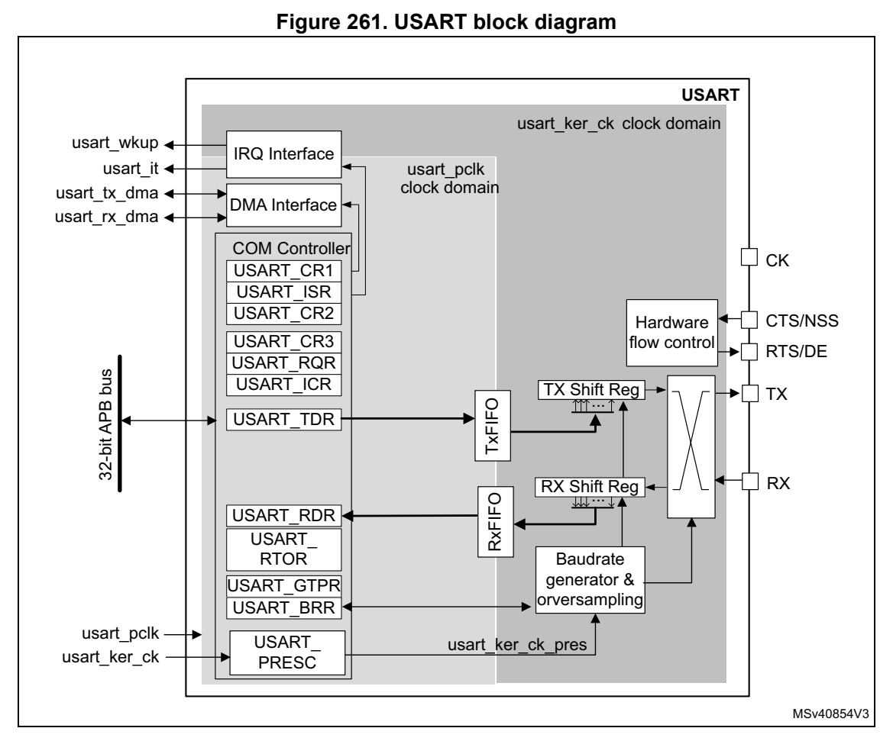
*Figure 261. USART block diagram (p. 779)*

The simplified block diagram given in Figure 261 shows two fully-independent clock domains:

- The usart_pclk clock domain The usart_pclk clock signal feeds the peripheral bus interface. It must be act ive when accesses to the USART registers are required.

- The usart_ker_ck kernel clock domain. The usart_ker_ck is the USART clock source. It is independent from usart_pclk and delivered by the RCC. The USART registers can consequently be w ritten/read even when the usart_ker_ck clock is stopped. When the dual clock domain feature is disabled, the usart_ker_ck clock is the same as the usart_pclk clock.

There is no constraint between usart_pclk and usart_ker_ck: usart_ker_ck can be faster or slower than usart_pclk. The only limitation is the s oftware ability to manage the communication fast enough.

When the USART operates in SPI slave mode, it handles data flow using the serial interface clock derived from the external SCLK signal provided by the external master SPI device. The usart_ker_ck clock must be at least 3 times faster t han the clock on the CK input.

#### 26.5.2 USART signals (p. 780)

USART bidirectional communications

USART bidirectional communicatio ns require a minimum of two pin s: Receive Data In (RX) and Transmit Data Out (TX):

- RX (Receive Data Input) RX is the serial data input. Oversampling techniques are used for data recovery. They discriminate between valid incoming data and noise.

- TX (Transmit Data Output) When the transmitter is disabled, the output pin returns to its I/O port configuration. When the transmitter is enabled and no data needs to be transmi tted, the TX pin is High. In Single-wire and Smartcard modes, this I/O is used to t ransmit and receive data.

RS232 Hardware flow control mode

The following pins are required in RS232 Hardware flow control mode:

- CTS (Clear To Send) When driven high, this signal blo cks the data transmission at t he end of the current transfer.

- RTS (Request To Send) When it is low, this signal indicates that the USART is ready to receive data.

RS485 Hardware control mode

The following pin is required in RS485 Hardware control mode:

- DE (Driver Enable) This signal activates the transmission mode of the external tra nsceiver.

Note: DE and RTS share the same pin.

Synchronous master/slave mode and Smartcard mode

The following pin is required in synchronous master/slave mode and Smartcard mode:

- CK This pin acts as Clock output in S ynchronous master and Smartca rd modes. It acts as Clock input is Synchronous slave mode. In Synchronous Master mode, thi s pin outputs the transmitter data clock for synchronous transmission corresponding to SPI master mode (no c lock pulses on start bit and stop bit, and a software option to send a clock pulse o n the last data bit). In parallel, data can be received synchronousl y on RX pin. This me chanism can be used to control peripherals featuring shift registers (e.g. LCD drivers). The clock phase and polarity are software programmable. In Smartcard mode, CK output provides the clock to the smartcard.

- NSS This pin acts as Slave Select input in Synchronous slave mode.

Note: NSS and CTS share the same pin.

#### 26.5.3 USART character description (p. 781)

The word length can be set to 7, 8 or 9 bi ts, by programming th e M bits (M0: bit 12 and M1: bit 28) in the USART_CR1 register (see Figure 262):

- 7-bit character len gth: M[1:0] = ‘10’

- 8-bit character len gth: M[1:0] = ‘00’

- 9-bit character len gth: M[1:0] = ‘01’

Note: In 7-bit data length mode, the Smartcard mode, LIN master mode and Auto baud rate (0x7F and 0x55 frames detection) are not supported.

By default, the signal (TX or RX) is in low state during the start bit. It is in high state during the stop bit.

These values can be inverted, sep arately for each signal, throu gh polarity configuration control.

An Idle character is interpreted as an entire fram e of “1”s (the number of “1”s includes the number of stop bits).

A Break character is interpreted on rece iving “0”s for a frame period. At the end of the break frame, the transmitter inserts 2 stop bits.

Transmission and reception are driven by a common baud rate gen erator. The transmission and reception clock are generated when the enable bit is set fo r the transmitter and receiver, respectively.

A detailed description of e ach block is given below.

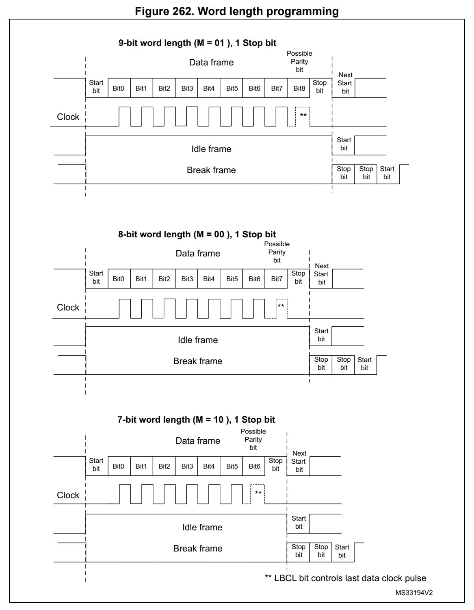
*Figure 262. Word length programming (p. 782)*

#### 26.5.4 USART FIFOs and thresholds (p. 783)

The USART can operate in FIFO mode.

The USART comes with a Transmit F IFO (TXFIFO) and a Receive FIF O (RXFIFO). The FIFO mode is enabled by setting FIFOEN in USART_CR1 register (b it 29). This mode is supported only in UART, SPI and Smartcard modes.

Since the maximum data word leng th is 9 bits, the TXFIFO is 9-b it wide. However the RXFIFO default width is 12 bits. This is due to the fact that t he receiver does not only store the data in the FIFO, but also t he error flags associated to ea ch character (Parity error, Noise error and Framing error flags).

Note: The received data is stored in the RXFIFO together with the corresponding flags. However, only the data are read when reading the RDR. The status flags are available in the USART_ISR register.

It is possible to configure the TXFIFO and RXFIFO levels at whi ch the Tx and RX interrupts are triggered. These thresholds are programmed through RXFTCFG and TXFTCFG bitfields in USART_CR3 control register.

In this case:

- The RXFT flag is set in the USART_ISR register and the correspo nding interrupt (if enabled) is generated, when the n umber of received data in the RXFIFO reaches the threshold programmed in t he RXFTCFG bits fields. This means that the RXFIFO is filled until the number of data i n the RXFIFO is equal to the programmed threshold. RXFTCFG data have been received: one data in USART_RDR and (RXF TCFG - 1) data in the RXFIFO. As an example, when the RXFTCFG is programm ed to ‘101’, the RXFT flag is set when a number of data corresponding to the FIF O size has been received (FIFO size -1 data in th e RXFIFO and 1 d ata in the USA RT_RDR). As a result, the next received da ta is not set t he overrun flag.

- The TXFT flag is set in the USART_ISR register and the correspo nding interrupt (if enabled) is generated when the number of empty locations in th e TXFIFO reaches the threshold programmed in t he TXFTCFG bits fields. This means that the TXFIFO is e mptied until the number of empty locations in the TXFIFO is equal to the programmed threshold.

#### 26.5.5 USART transmitter (p. 783)

The transmitter can send data words of either 7 or 8 or 9 bits, depending on the M bit status. The Transmit Enable bit (TE) must be set in order to activate t he transmitter function. The data in the transmit s hift register is out put on the TX pin whi le the corresponding clock pulses are output on the SCLK pin.

Character transmission

During an USART transmission, da ta shifts out the least signifi cant bit first (default configuration) on the TX pin. In this mode, the USART_TDR regis ter consists of a buffer (TDR) between the internal bus and the transmit shift register. When FIFO mode is enabled, the data written to the transmit data register (USART_TDR) are queued in the TXFIFO.

Every character is preceded by a start bit which corresponds to a low logic level for one bit period. The character is terminated by a configurable number of stop bits.

The number of stop bits can be configured to 0.5, 1, 1.5 or 2.

Note: The TE bit must be set before writing the data to be transmitted to the USART_TDR. The TE bit should not be reset during data transmission. Resetting the TE bit during the transmission corrupts th e data on the TX pin as the baud rate counters get frozen. The current data being transmitted are then lost. An idle frame is sent when the TE bit is enabled.

Configurable stop bits

The number of stop bi ts to be transmitted with every character can be programmed in USART_CR2, bits 13,12.

- 1 stop bit: This is the default value of number of stop bits.

- 2 stop bits: This is supported by normal USART, Single-wire a nd Modem modes.

- 1.5 stop bits: To be used in Smartcard mode.

An idle frame transmission includes the stop bits.

A break transmission features 10 low bits (when M[1:0] = ‘00’) or 11 low bits (when M[1:0] = ‘01’) or 9 low bits (when M[1:0] = ‘10’) followed by 2 stop bits (see Figure 263). It is not possible to transmit long brea ks (break of length greater t han 9/10/11 low bits).

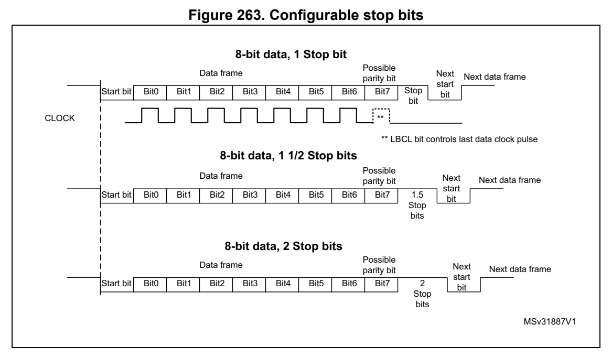
*Figure 263. Configurable stop bits (p. 784)*

Character transmission procedure

To transmit a character, follow the sequence below: 1. Program the M bits in USART_CR1 to define the word length. 2. Select the desired baud rate using the USART_BRR register. 3. Program the number of stop bits in USART_CR2. 4. Enable the USART by writing t he UE bit in USART_CR1 register to 1. 5. Select DMA enable (DMAT) in USART_CR3 if multibuffer communi cation must take place. Configure the DMA register as explained in Section 26.5.10: USART multiprocessor communication. 6. Set the TE bit in USART_CR1 to send an idle frame as first t ransmission. 7. Write the data to send in the USART_TDR register. Repeat thi s for each data to be transmitted in case of single buffer. – When FIFO mode is disabled, writi ng a data to the USART_TDR cl ears the TXE flag. – When FIFO mode is enabled, writ ing a data to th e USART_TDR add s one data to the TXFIFO. Write operations to th e USART_TDR are performed whe n TXFNF flag is set. This fla g remains set until the TXFIFO is full. 8. When the last data is written to the USART_TDR register, wai t until TC = 1. – When FIFO mode is disabled, this indicates that the transmissi on of the last frame is complete. – When FIFO mode is enabled, this indicates that both TXFIFO and shift register are empty. This check is required to avoid corrupting the last transmissio n when the USART is disabled or enters Halt mode.

Single byte communication

- When FIFO mode is disabled Writing to the transmit data regi ster always clears the TXE bit. The TXE flag is set by hardware. It indicates that: – the data have been moved from the USART_TDR register to the sh ift register and the data transmission has started; – the USART_TDR register is empty; – the next data can be written to the USART_TDR register without overwriting the previous data. This flag generates an interrupt if the TXEIE bit is set. When a transmission is ongoing, a write instruction to the USART_TDR register stores the data in the TDR buffer. It is then copied in the shift regi ster at the end of the current transmission. When no transmission is ongoing, a write instruction to the USA RT_TDR register places the data in the shift register, the data transmission starts, and the TXE bit is set.

- When FIFO mode is enabled, the TX FNF (TXFIFO not full) flag is set by hardware to indicate that: – the TXFIFO is not full; – the USART_TDR register is empty; – the next data can be written to the USART_TDR register without overwriting the previous data. When a transmissio n is ongoing, a write operatio n to the USART_TDR register stores the da ta in the TXFIFO. Data are copi ed from the TXFIFO to the shift register at the end of the current transmis sion. When the TXFIFO is not full, the TXFNF flag stays at ‘1’ even after a write operation to USART_TDR register. It is cleared when the TXFIFO is full. This flag generates an interrupt if the TXFNFIE bit is set. Alternatively, interrupts can be generated and data can be written to the FIFO when the TXFIFO threshold is reached. In this case, the CPU can write a block of data defined by the programmed trigger level. If a frame is transmitted (after the stop bit) and the TXE flag (TXFE in case of FIFO mode) is set, the TC flag goes high. An interrupt is generated if the TCIE bit is set in the USART_CR1 register.

After writing the last data to the USART_TDR register, it is ma ndatory to wait until TC is set before disabling the USART or causing the device to enter the l ow-power mode (see Figure 264: TC/TXE behavior when transmitting).

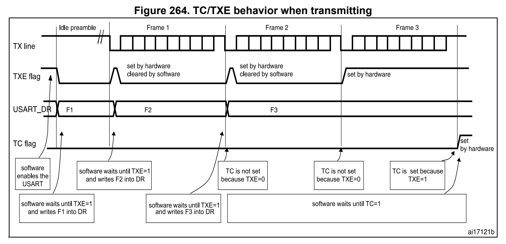
*Figure 264. TC/TXE beh avior when transmitting (p. 787)*

Note: When FIFO management is enabled, the TXFNF flag is used for data transmission.

Break characters

Setting the SBKRQ bit transmits a break character. The break frame length depends on the M bit (see Figure 262).

If a ‘1’ is written to the SBKRQ b it, a break character is sent on the TX line after completing the current character transmissi on. The SBKF bit is set by the write operation and it is reset by hardware when the break character is completed (during the s top bits afte r the break character). The USART inserts a logic 1 signal (stop) for the d uration of 2 bits at the end of the break frame to guarantee the recognition of the start bit of the next frame.

When the SBKRQ bit is s et, the bre ak character is sent at the e nd of the current transmission.

When FIFO mode is enabled, sending the break character has prio rity on sending data even if the TXFIFO is full.

Idle characters

Setting the TE bit drives the U SART to send an idle frame before the first data frame.

#### 26.5.6 USART receiver (p. 787)

The USART can receive data words of either 7 or 8 or 9 bits dep ending on the M bits in the USART_CR1 register.

Start bit detection

The start bit detection sequence is the same wh en oversampling by 16 or by 8.

In the USART, the start bit is detected when a specific sequence of samples is recognized. This sequence is: 1 1 1 0 X 0 X 0X 0X 0 X 0X 0.

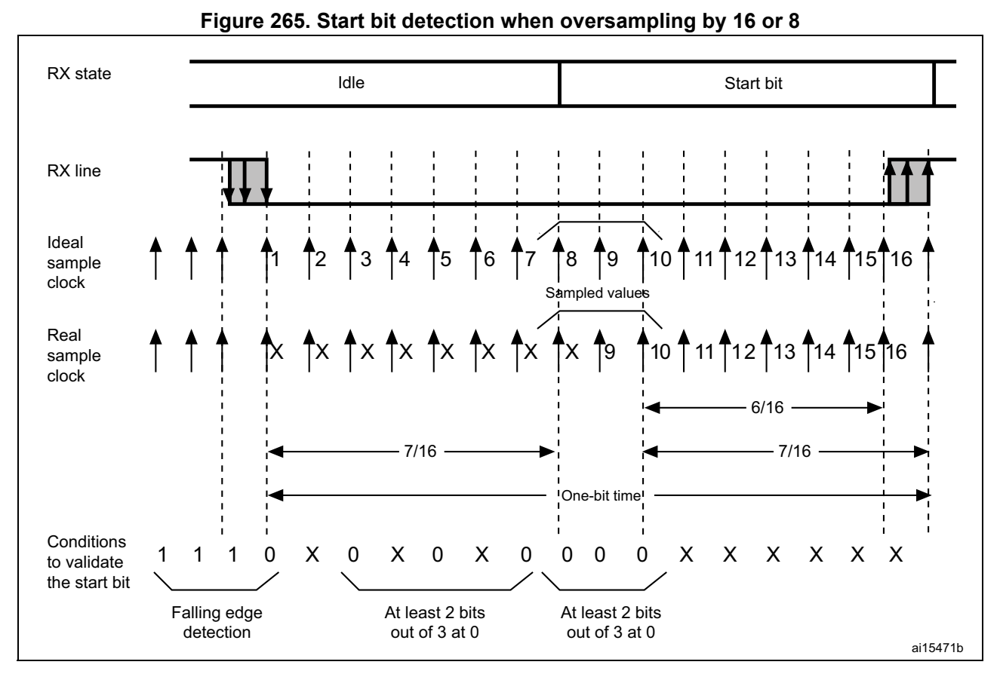
*Figure 265. Start bit detecti on when oversampling by 16 or 8 (p. 788)*

Note: If the sequence is not complete, the start bit detection aborts and the receiver returns to the idle state (no flag is set), wh ere it waits for a falling edge.

The start bit is confirmed (RXN E flag set and interrupt generated if RXNEIE = 1, or RXFNE flag set and interrupt generated if RXFNEIE = 1 if FIFO mode enab led) if the 3 sampled bits are at ‘0’ (first sampling on the 3rd, 5th and 7th bits finds t he 3 bits at ‘0’ and second sampling on the 8th, 9 th and 10th bits als o finds the 3 bits at ‘0’).

The start bit is validated but the NE noise flag is set if, a) for both samplings, 2 out of the 3 sampled bits are at ‘0’ ( sampling on t he 3rd, 5th and 7th bits and sampling on t he 8th, 9th and 10th bits) or b) for one of the samplings (sampling on the 3rd, 5th and 7th b its or sampling on the 8th, 9th and 10th bits), 2 out of the 3 bits are found at ‘0’. If neither of the above conditions are met, the start detection aborts and the receiver returns to the idle state (no flag is set).

Character reception

During an USART reception, data are shifted out least significa nt bit first (default configuration) through the RX pin.

Character reception procedure

To receive a character, follow the sequence below: 1. Program the M bits in USART_CR1 to define the word length. 2. Select the desired baud rate using the baud rate register USART_BRR 3. Program the number of stop bits in USART_CR2. 4. Enable the USART by writing t he UE bit in USART_CR1 register to ‘1’. 5. Select DMA enable (DMAR) in USART_CR3 if multibuffer communi cation is to take place. Configure the DMA register as explained in Section 26.5.10: USART multiprocessor communication. 6. Set the RE bit USART_CR1. This enables the receiver which be gins searching for a start bit.

When a character is received:

- When FIFO mode is disabled, the RXNE bit is set to indicate tha t the content of the shift register is transferred to the RDR. In other words, data have been received and can be read (as well as their associated error flags).

- When FIFO mode is enabled, the RXFNE bit is set to indicate that the RXFIFO is not empty. Reading the USART_RDR returns the oldest data entered in the RXFIFO. When a data is receive d, it is stored in t he RXFIFO together wi th the corresponding error bits.

- An interrupt is generated if the RXNEIE (RXFNEIE when FIFO mode is enabled) bit is set.

- The error flags can be set if a frame error, noise, parity or a n overrun error was detected during reception.

- In multibuffer communication mode: – When FIFO mode is disabled, the RXNE flag is set after every byte reception. It is cleared when the DMA reads the Receive data Register. – When FIFO mode is enabled, the RXFNE flag is set when the RXFI FO is not empty. After every DMA request, a data is retrieved from the RX FIFO. A DMA request is triggered when the RX FIFO is not empty i.e. when the re are data to be read from the RXFIFO.

- In single buffer mode: – When FIFO mode is disabled, clearing the RXNE fla g is done by performing a software read from the USART_RDR register. The RXNE flag can al so be cleared by programming RXFRQ bit to ‘1’ in the USART_RQR register. The RXNE flag must be cleared before the end of the reception of the next cha racter to avoid an overrun error. – When FIFO mode is enabled, the RXFNE is set when the RXFIFO is not empty. After every read operation from USART_RDR, a data is retrieved from the RXFIFO. When the RXFIFO is empty, the RXFNE flag is cleared. Th e RXFNE flag can also be cleared by programming RXFRQ bit to ‘1’ in USART_RQ R. When the RXFIFO is full, the first entry in the RXFIFO must be read befo re the end of the reception of the next character, to avoid an overrun error. The RXFNE flag generates an interrupt if the RX FNEIE bit is set. Alternatively, interrupts can be

generated and data can be read from RXFIFO when the RXFIFO thre shold is reached. In this case, the CPU ca n read a block of data defined by the programmed threshold.

Break character

When a break characte r is received, the USART handles it as a framing error.

Idle character

When an idle frame is detected, it is handled in the same way a s a data character reception except that an interrupt is generated if the IDLEIE bit is set.

Overrun error

- FIFO mode disabled An overrun error occurs if a character is received and RXNE has not been reset. Data can not be transfe rred from the shift register to the RDR register until the RXNE bit is cleared. The RXN E flag is set after every byte receptio n. An overrun error occurs if RXNE flag is s et when the next data is received or the previous DMA request has not been serviced. When an overrun error occurs: – the ORE bit is set; – the RDR content is not lost. Th e previous data is available by reading the USART_RDR register. – the shift register is overwritten. After th at, any data received during overrun is lost. – an interrupt is generated if eit her the RXNEIE or the EIE bit is set.

- FIFO mode enabled An overrun error occurs when the shift reg ister is ready to be transferred and the receive FIFO is full. Data can not be transfe rred from the shift register to the USART_RDR register until there is one free loca tion in the RXFIFO. The RXFNE flag is set when the RXFIFO is not empty. An overrun error occurs if the RXFIFO is full and the shift reg ister is ready to be transferred. When an overrun error occurs: – The ORE bit is set. – The first entry in the RXFIFO i s not lost. It is available by reading the USART_RDR register. – The shift register is overwritte n. After that point, any data received during overrun is lost. – An interrupt is generated if eit her the RXFNEIE or EIE bit is set.

The ORE bit is reset by setting the ORECF bit in the USART_ICR register.

Note: The ORE bit, when set, indicates that at least 1 data has been lost. When the FIFO mode is disabled, there are two possibilities

- if RXNE = 1, then the last valid data is stored in the receive register (RDR) and can be read,

- if RXNE = 0, the last valid data has already been read and there is nothing left to be read in the RDR register. This case can occur when the last valid da ta is read in the RDR register at the same time as th e new (and lost) data is received.

Selecting the clock source and the appropriate oversampling met hod

The choice of the clock source is done through the Clock Contro l system (see Section Reset and clock control (RCC)). The clock source must be sele cted through the UE bit before enabling the USART.

The clock source must be selected according to two criteria:

- Possible use of the USART in low-power mode

- Communication speed.

The clock source freque ncy is usart_ker_ck.

When the dual clock domain and the wakeup from low-power mode features are supported, the usart_ker_ck clock source can be configurable in the RCC (s ee Section Reset and clock control (RCC)). Otherwise the usart_ker_ck cl ock is the same as usart_pclk.

The usart_ker_ck clock can be divided by a programmable factor, defined in the USART_PRESC register.

Figure 266. usart_ker_ck cloc k divider block diagram

usart_ker_ck_pres USARTx_BRR register usart_ker_ck USARTx_PRESC[3:0] and oversampling

MSv40855V1

Some usart_ker_ck sources enable the USART to receive data whil e the MCU is in low-power mode. Depending on the received data and wakeup mode sele cted, the USART wakes up the MCU, when needed, i n order to transfer the receive d data, by performing a software read to the USART_RDR register or by DMA.

For the other clock so urces, the system mus t be active to enabl e USART communications.

The communication speed range (spe cially the maximum communicat ion speed) is also determined by th e clock source.

The receiver implements differen t user-configurable oversamplin g techniques (except in synchronous mode) for data recovery by discriminating between valid incoming data and noise. This enables obtaining t he best a trade-off between the maximum communication speed and noise/clock inaccuracy immunity.

The oversampling method can be selected by programming the OVER8 bit in the USART_CR1 register either to 16 or 8 times the baud rate clock (see Figure 267 and Figure 268).

Depending on your application:

- select oversampling by 8 (OVER8 = 1) to achieve highe r speed (up to usart_ker_ck_pres/8). In this case the maximum receiver toleran ce to clock deviation is reduced (refer to Section 26.5.8: Tolerance of the USAR T receiver to clock deviation on page 795)

- select oversampling by 16 (OVER8 = 0) to increase the tolerance of the receiver to clock deviations. In this case, the maximum speed is limited to maximum

usart_ker_ck_pres/16 (where usart_ker_ck_pres is the USART inpu t clock divided by a prescaler).

Programming the ONEBIT bit in th e USART_CR3 register selects th e method used to evaluate the logic level. Two options a re available:

- The majority vote of the three sa mples in the center of the received bit. In this case, when the 3 samples used for the majority vote are not equal, th e NE bit is set.

- A single sample in the center of the received bit Depending on your application: – select the three sample maj ority vote method (ONEBIT = 0) when operating in a noisy environment and reject the data when a noise is detected (refer to Figure 122) because this indicates that a g litch occurred during the samp ling. – select the single s ample method (ONEBIT = 1) when the line is noise-free to increase the receiver tolerance to clock deviations (see Section 26.5.8: Tolerance of the USART receiver to clock deviation on page 795). In this case the NE bit is never set.

When noise is detected in a frame:

- The NE bit is set at the rising e dge of the RXNE bit (RXFNE in case of FIFO mode enabled).

- The invalid data is transferred from the Shift register to the USART_RDR register.

- No interrupt is generated in ca se of single byte communication. However this bit rises at the same time as the RXNE bit (RXFNE in case of FIFO mode en abled) which itself generates an interrupt. In case of multibuffer communication an interrupt is issued if the EIE bit is set in the USART_CR3 register.

The NE bit is reset by setting NE CF bit in USART_ICR register.

Note: Noise error is not supported in SPI mode. Oversampling by 8 is not available in the Smartcard, IrDA and LIN modes. In those modes, the OVER8 bit is forced to ‘0 ’ by hardware.

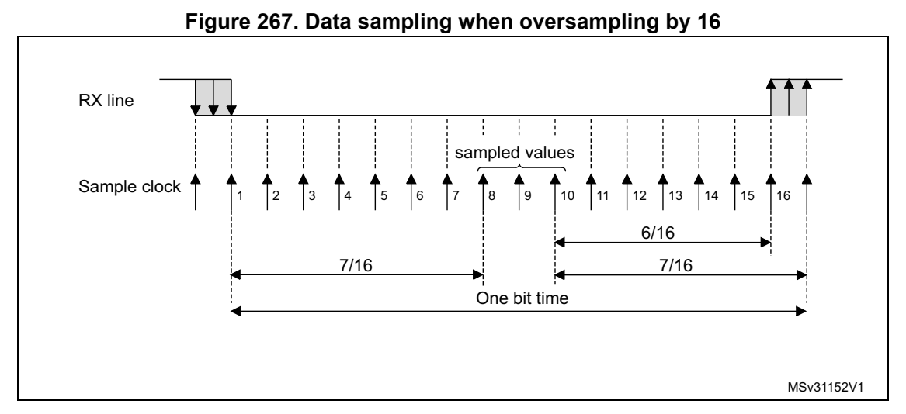
*Figure 267. Data sampling when oversampling by 16 (p. 792)*

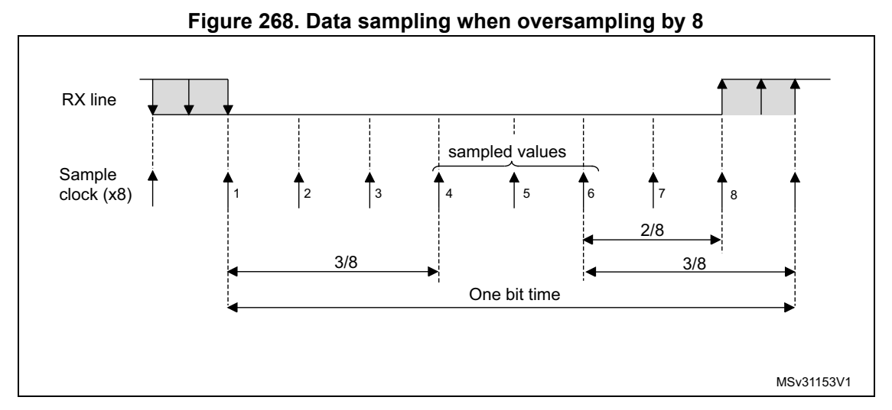
*Figure 268. Data sampling when oversampling by 8 (p. 793)*

Table 122. Noise detection from sampled data

Sampled value NE status Received bit value

000 0 0

001 1 0

010 1 0

011 1 1

100 1 0

101 1 1

110 1 1

111 0 1

Framing error

A framing error is detected when the stop bit is not recognized on reception at the expected time, following either a de-sync hronization or excessive noise.

When the framing error is detected:

- the FE bit is set by hardware;

- the invalid data is transferred from the Shift register to the USART_RDR register (RXFIFO in case FI FO mode is enabled).

- no interrupt is generated in case of single byte communication. However this bit rises at the same time as the RXNE bit (RXFNE in case FIFO mode is enabl ed) which itself generates an interrupt. In case of multibuffer communication an interrupt is issued if the EIE bit is set in the USART_CR3 register.

The FE bit is reset by writing ‘ 1’ to the FECF in the USART_ICR register.

Note: Framing error is not supported in SPI mode.

Configurable stop bits during reception

The number of stop bi ts to be received can be configured throug h the control bits of USART_CR: it can be either 1 or 2 in normal mode and 0.5 or 1.5 in Smartcard mode.

- 0.5 stop bit (reception in Smartcard mode): no sampling is done for 0.5 stop bit. As a consequence, no framing error a nd no break frame can be detecte d when 0.5 stop bit is selected.

- 1 stop bit: sampling for 1 stop bit is done on the 8th, 9th and 10th samp les.

- 1.5 stop bits (Smartcard mode) When transmitting in Smartcard mode, the device must check that the data are correctly sent. The re ceiver block must consequently be enabled (RE = 1 in USART_CR1) and the stop bit is checked to test if the Smartcard has detected a parity error. In the event of a parity error, the Smartcard forces the data s ignal low during the sampling (NACK signal), which is flagged as a framing error. Th e FE flag is then set through RXNE flag (RXFNE if the FIFO mode is enabled) at the en d of the 1.5 stop bit. Sampling for 1.5 stop bits is don e on the 16th, 17 th and 18th s amples (1 baud clock period after the beginning of t he stop bit). The 1.5 stop bit can be broken into 2 parts: one 0.5 baud clock period during which nothing happens, followe d by 1 normal stop bit period during which sampling occurs halfway through (refer to Section 26.5.16: USART receiver timeout on page 809 for more details).

- 2 stop bits Sampling for 2 stop b its is done on the 8th, 9th and 10th sampl es of the first stop bit. The framing error flag is set if a framing error is detected du ring the first stop bit. The second stop bit is not checked for framing error. The RXNE flag (RXFNE if the FIFO mode is enabled) is set at t he end of the fi rst stop bit.

#### 26.5.7 USART baud rate generation (p. 794)

The baud rate for the receiver and transmitter (Rx and Tx) are both set to the value programmed in the USART_BRR register.

Equation 1: baud rate for standa rd USART (SPI mode included) (OVER8 = ‘0’ or ‘1’)

In case of oversampling by 16, t he baud rate is given by the fo llowing formula: Tx/Rx baud = -----------------------------------------------usart_ker_ckpres USARTDIV

In case of oversamplin g by 8, the baud rate is given by the fol lowing formula:

Tx/Rx baud = 2 usart_ker_ckpres--------------------------------------------------------× - USARTDIV

Equation 2: baud rate in Smartcard, LIN and IrDA modes (OVER8 = 0)

The baud rate is given by the following formula:

Tx/Rx baud = -----------------------------------------------usart_ker_ckpres USARTDIV

USARTDIV is an unsigned fixed point number that is coded on the USART_BRR register.

- When OVER8 = 0, BRR = USARTDIV.

- When OVER8 = 1 – BRR[2:0] = USARTDIV[3:0] s hifted 1 bit to the right. – BRR[3] must be kept cleared. – BRR[15:4] = USARTDIV[15:4]

Note: The baud counters are updated to the new value in the baud registers after a write operation to USART_BRR. Hence the baud rate register value should not be changed during communication.

In case of oversampling by 16 and 8, USARTDIV must be greater than or equal to 16.

How to derive USARTDIV from USART_BRR register values

Example 1

To obtain 9600 baud with usart_ker_ck_pres = 8 MHz:

- In case of oversampling by 16: USARTDIV = 8 000 000/9600 BRR = USARTDIV = 0d833 = 0x0341

- In case of oversampling by 8: USARTDIV = 2 * 8 000 000/9600 USARTDIV = 1666,66 (0d1667 = 0x683) BRR[3:0] = 0x3 >> 1 = 0x1 BRR = 0x681

Example 2

To obtain 921.6 Kbaud with usart_ker_ck_pres = 48 MHz:

- In case of oversampling by 16: USARTDIV = 48 000 000/921 600 BRR = USARTDIV = 0d52 = 0x34

- In case of oversampling by 8: USARTDIV = 2 * 48 000 000/921 600 USARTDIV = 104 (0d104 = 0x68) BRR[3:0] = USARTDIV[3:0] >> 1 = 0x8 >> 1 = 0x4 BRR = 0x64

#### 26.5.8 Tolerance of the USART receiver to clock deviation (p. 795)

The USART asynchronous receiver operates correctly only if the total clock system deviation is less than the tolerance of the USART receiver.

The causes which contribute to the total deviation are:

- DTRA: deviation due to the transm itter error (which also includ es the deviation of the transmitter’s lo cal oscillator)

- DQUANT: error due to the baud rate quantization of the receiver

- DREC: deviation of the receiver l ocal oscillator

- DTCL: deviation due to the transmission line (generally due to the transceivers which can introduce an asymmetry betwee n the low-to-high transition t iming and the high-to-low transition timing)

DTRA DQUANT DREC DTCL DWU+ + ++ < USART receiver tolerance

where DWU is the error due to sampling point deviation when the wakeu p from low-power mode is used. when M[1:0] = 01:

t DWU = ---------------------------WUUSART 11 Tbit×

when M[1:0] = 00:

t DWU = ---------------------------WUUSART 10 Tbit×

when M[1:0] = 10:

t DWU = ---------------------------WUUSART 9 Tbit×

t WUUSART is the time between the detection of the start bit falling edg e and the instant when the clock (requested by the peripheral) is ready a nd reaching the peripheral, and the regulator is ready.

The USART receiver can receive d ata correctly at up to the maxi mum tolerated deviation specified in Table 123, Table 124, depending on the fo llowing settings:

- 9-, 10- or 11-bit character length defined by the M bits in the USART_CR1 register

- Oversampling by 8 or 16 defined by the OVER8 bit in the USART_C R1 register

- Bits BRR[3:0] of USART_BRR register are equal to or different from 0000.

- Use of 1 bit or 3 bits to sample the data, depending on the val ue of the ONEBIT bit in the USART_CR3 register.

**Table 123. Tolerance of the USART receiver when BRR [3:0] = 000 0 (p. 796)**

| M bits | OVER8 bit = 0 OVER8 bit = 1 | OVER8 bit = 0 OVER8 bit = 1 |
| --- | --- | --- |
| M bits | ONEBIT = 0 ONEBIT = 1 ONEBIT = 0 ONEBIT = 1 | ONEBIT = 0 ONEBIT = 1 ONEBIT = 0 ONEBIT = 1 |
|  | 00 3.75% 4.375% 2.50% 3.75% |  |
|  | 01 3.41% 3.97% 2.27% 3.41% |  |
|  | 10 4.16% 4.86% 2.77% 4.16% |  |

**Table 124. Tolerance of the USART receiver when BRR[3:0] is different from 0000 (p. 797)**

| M bits | OVER8 bit = 0 OVER8 bit = 1 | OVER8 bit = 0 OVER8 bit = 1 |
| --- | --- | --- |
| M bits | ONEBIT = 0 ONEBIT = 1 ONEBIT = 0 ONEBIT = 1 | ONEBIT = 0 ONEBIT = 1 ONEBIT = 0 ONEBIT = 1 |
|  | 00 3.33% 3.88% 2% 3% |  |
|  | 01 3.03% 3.53% 1.82% 2.73% |  |
|  | 10 3.7% 4.31% 2.22% 3.33% |  |

Note: The data specified in Table 123 and Table 124 may slightly differ in the special case when the received frames contain some Idle frames of exactly 10-bit times when M bits = 00 (11-bit times when M = 01 or 9- bit times when M = 10).

#### 26.5.9 USART Auto baud rate detection (p. 797)

The USART can detect and automatically set the USART_BRR register value based on the reception of one character. Auto matic baud rate detection is us eful under two circumstances:

- The communication speed of the system is not known in advance.

- The system is using a relative ly low accuracy clock source and this mechanism enables the correct baud rate to be obtained without measuring the clock deviation.

The clock source frequency must b e compatible with the expected communication speed.

- When oversampling by 16, the baud rate ranges from usart_ker_ck_pres/65535 and usart_ker_ck_pres/16.

- When oversampling by 8, the baud rate ranges from usart_ker_ck_pres/65535 and usart_ker_ck_pres/8.

Before activating the auto baud rate detection, the auto baud rate detection mode must be selected through the ABRMOD[1:0] field in the USART_CR2 registe r. There are four modes based on different character patterns. In these auto baud rate modes, the baud rate is measured several times during the synchronization data receptio n and each measurement is compared to the previous one.

These modes are the following:

- Mode 0: Any character starti ng with a bit at ‘1’. In this case the USART measures t he duration of the start bit (falling edge to rising edge).

- Mode 1: Any character starting with a 10xx bit pattern. In this case, the USART measures the duration of the Start and of the 1st data bit. The measurement is done falling edge to falling edge, to ensure a b etter accuracy in the case of slow signal slopes.

- Mode 2: A 0x7F character frame (it may be a 0x7F character in LSB first mode or a 0xFE in MSB first mode). In this case, the baud rate is updated first at the end of the start bit (BRs), then at the end of bit 6 (based on the measurement done from falling edge to falling edge: BR6). Bit0 to bit6 are sampled at BRs while further bits of the chara cter are sampled at BR6.

- Mode 3: A 0x55 character frame. In this case, the baud rate is updated first at the end of the start bit (BRs), then at the end of bit0 (b ased on the measurement d one from fa lling edge to falling edge: BR0), and finally at the end of bit6 (BR6). Bit 0 is sampled at BRs, bit 1 to bit 6 are sampled at BR0, and further bits of the character are sampled at BR6. In parallel, another check is performed for each intermediate RX line transition. An error is generated if the transitions on RX are not sufficiently synchronized with the re ceiver (the receiver being based on the baud rate calculated on bit 0).

Prior to activating the auto bau d rate detection, the USART_BRR register must be initialized by writing a non-zero baud rate value.

The automatic baud rate detection is activated by setting the A BREN bit in the USART_CR2 register. The USART then waits fo r the first chara cter on the RX line. The auto baud rate operation completion is indica ted by the setting of the ABRF fl ag in the USART_ISR register. If the line is noisy, th e correct baud rate detection cannot be guaranteed. In this case the BRR value may be corrupted and the ABRE error flag is set. This also happens if the communication speed is not compatible with the automatic ba ud rate detection range (bit duration not between 16 and 65536 clock periods (oversampl ing by 16) and not between 8 and 65536 clock periods (oversampling by 8)).

The auto baud rate detection can be re-launched later by resett ing the ABRF flag (by writing a ‘0’).

When FIFO management is disabled and an auto baud rate error occurs, the ABRE flag is set through RXNE and FE bits.

When FIFO management is enabled an d an auto baud rate error occ urs, the ABRE flag is set through RXFNE and FE bits.

If the FIFO mode is enabled, the auto baud rate detection shoul d be made using the data on the first RXFIFO location. So, p rior to launching the auto baud rate detection, make sure that the RXFIFO is empty by che cking the RXFNE flag in USART_IS R register.

Note: The BRR value might be corrupted if the USART is disabled (UE = 0) during an auto baud rate operation.

#### 26.5.10 USART multiprocessor communication (p. 799)

It is possible to perform USART mu ltiprocessor communications (with several USARTs connected in a network). For instance one of the USARTs can be the master with its TX output connected to the RX inputs of the other USARTs, while th e others are slaves with their respective TX outputs logi cally ANDed together and connected to the RX input of the master.

In multiprocessor configurations, it is often desirable that on ly the intended message recipient actively receives the full message contents, thus red ucing redundant USART service overhead for all non addressed receivers.

The non-addressed devices can be placed in M ute mode by means of the muting function. To use the Mute mode fe ature, the MME bit m ust be set in the USART_CR1 register.

Note: When FIFO management is enabled and MME is already set, MME bit must not be cleared and then set again quickly (within two usart_ ker_ck cycles), otherwise Mute mode might remain active.

When the Mute mode is enabled:

- none of the reception status bits can be set;

- all the receive interrupts are inhibited;

- the RWU bit in USART_ISR register is set to ‘1’. RWU can be con trolled automatically by hardware or by software, through the MMRQ bit in the USART_RQR register, under certain conditions.

The USART can enter or exit from Mute mode using one of two met hods, depending on the WAKE bit in the U SART_CR1 register:

- Idle Line detection if the WAKE bit is reset,

- Address Mark detection if the WAKE bit is set.

Idle line detection (WAKE = 0)

The USART enters Mute mode when the MMRQ bit is written to ‘1’ and the RWU is automatically set.

The USART wakes up when an Idle frame is detected. The RWU bit is then cleared by hardware but the IDLE bit is not set in the USART_ISR register. An example of Mute mode behavior using Idle line detection is given in Figure 269.

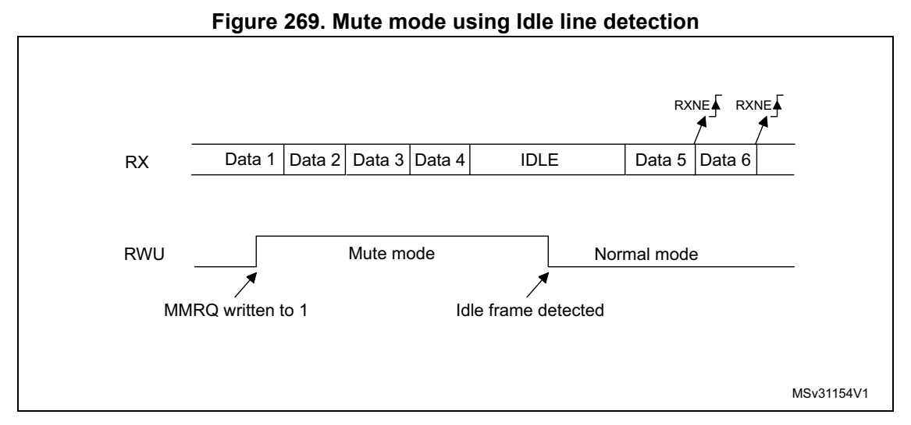
*Figure 269. Mute mode usi ng Idle line detection (p. 800)*

Note: If the MMRQ is set while the IDLE character has already elapsed, Mute mode is not entered (RWU is not set). If the USART is activated while the line is IDLE, the idle state is detected after the duration of one IDLE frame (not only after the reception of one character frame).

4-bit/7-bit address mark detection (WAKE = 1)

In this mode, bytes are recogniz ed as addresses if their MSB is a ‘1’, otherwise they are considered as data. In an address byte, the address of the targ eted receiver is put in the 4 or 7 LSBs. The choice of 7 or 4 bit address detection is done u sing the ADDM7 bit. This 4-bit/7-bit word is compared by the receiver with its own address which is programmed in the ADD bits in the USART_CR2 register.

Note: In 7-bit and 9-bit data modes, address detection is done on 6-bit and 8-bit addresses (ADD[5:0] and ADD[7:0]) respectively.

The USART enters Mute mode when an address character is receive d which does not match its programmed address. In this case, the RWU bit is set by hardware. The RXNE flag is not set for this address byte and no interrupt or DMA request is issued when the USART enters Mute mode. When FIF O management is enabled, the software should ensure that there is at least one empty location in the RXFIFO before entering Mute mode.

The USART also enters Mute mode when the MMRQ bit is written to 1. The RWU bit is also automatically set in this case.

The USART exits from Mute mode w hen an address character is received which matches the programmed address. Then th e RWU bit is cleared and subsequ ent bytes are received normally. The RXNE/RXFNE bit is set for the address character s ince the RWU bit has been cleared.

Note: When FIFO management is enabled, when MMRQ is set while the receiver is sampling last bit of a data, this data may be received before effectively entering in Mute mode

An example of Mute mode behavior using address ma rk detection i s given in Figure 270.

Figure 270. Mute mode usi ng address mark detection

In this example, the current address of the receiver is 1 (programmed in the USART_CR2 register) RXNE RXNE RXNE

RX IDLE Addr=0 Data 1 Data 2 IDLE Addr=1 Data 3 Data 4 Addr=2 Data 5

RWU Mute mode Mute modeNormal mode

MMRQ written to 1 Matching address Non-matching address (RXNE was cleared)

Non-matching address MSv31155V1

#### 26.5.11 USART Modbus communication (p. 801)

The USART offers basic support fo r the implementation of Modbus/RTU and Modbus/ASCII protocols. Modbus/RTU is a Half-duplex, block-transfer protocol. The control part of the protocol (address recognition, b lock integrity control and comm and interpretation) must be implemented in software.

The USART offers basic support fo r the end of the block detecti on, without software overhead or other resources.

Modbus/RTU

In this mode, the end of one block is recognized by a “silence” (idle line) for more than 2 character times. This function i s implemented through the programmable timeout function.

The timeout function and interru pt must be activated, through t he RTOEN bit in the USART_CR2 register and the RTOIE in the USART_CR1 register. The value corresponding to a timeout of 2 character times (for example 22 x bit time) m ust be programmed in the RTO register. When the receive line is idle for this duration, after the last stop bit is received, an interrupt is generated, info rming the software that the current block reception is completed.

Modbus/ASCII

In this mode, the end of a block is recogniz ed by a specific (C R/LF) character sequence. The USART manages this mechanism using the character match function.

By programming the LF ASCII code in the ADD[7:0] field and by a ctivating the character match interrupt (CMIE = 1), the software is informed when a LF has been received and ca n check the CR/LF in the DMA buffer.

#### 26.5.12 USART parity control (p. 802)

Parity control (generation of par ity bit in transmission and pa rity checking in reception) can be enabled by setting the PCE bi t in the USART_CR1 register. De pending on the frame length defined by the M bits, the possible USART frame formats are as listed in Table 125.

**Table 125. USART frame formats (p. 802)**

| Col 2 | M bits PCE bit USART frame (1) |
| --- | --- |
|  | 00 0 \| SB \| 8 bit data \| STB \| |
|  | 00 1 \| SB \| 7-bit data \| PB \| STB \| |
|  | 01 0 \| SB \| 9-bit data \| STB \| |
| 01 1 \| SB \| 8-bit | data PB \| STB \| |
| 10 0 \| SB \| 7bit | data \| STB \| |
|  | 10 1 \| SB \| 6-bit data \| PB \| STB \| |

1. Legends: SB: start bit, STB: stop bit, PB: parity bit. In the data register, the PB is always taking the MSB position (8th or 7th, depending on the M bit value).

Even parity

The parity bit is calculated to obtain an even number of “1s” i nside the frame of the 6, 7 or 8 LSB bits (depending on M bit values) and the parity bit.

As an example, if data = 00110101 and 4 bits are set, the parity bit is equal to 0 if even parity is selected (PS bit i n USART_CR1 = 0).

Odd parity

The parity bit is calculated to obtain an odd number of “1s” in side the frame made of the 6, 7 or 8 LSB bits (depending on M bi t values) and the parity bit.

As an example, if data = 00110101 and 4 bits set, then the parity bit is equal to 1 if o dd parity is selected (PS bit i n USART_CR1 = 1).

Parity checking in reception

If the parity check fa ils, the PE flag is set in the USART_ISR register and an interrupt is generated if PEIE is set in the USART_CR1 register. The PE flag is cleared by software writing 1 to the PECF in the USART_ICR register.

Parity generation in transmission

If the PCE bit is set in USART_CR1, then the MSB bit of the dat a written in the data register is transmitted but is changed by the parity bit (even number of “1s” if even parity is selected (PS = 0) or an odd number of “1s” if o dd parity is selected (PS=1).

#### 26.5.13 USART LIN (local interconnection network) mode (p. 803)

This section is relevant only w hen LIN mode is supported. Refer to Section 26.4: USART implementation on page 777.

The LIN mode is selected by sett ing the LINEN bit in the USART_CR2 register. In LIN mode, the following bits must be kept cleared:

- CLKEN in the USART_CR2 register,

- STOP[1:0], SCEN, HDSEL and IREN in the USART_CR3 register.

LIN transmission

The procedure described in Section 26.5.4 has to be applied for LIN Master transmission. It must be the same as for normal U SART transmission with the foll owing differences:

- Clear the M bit to configure 8-bit word length.

- Set the LINEN bit to en ter LIN mode. In this case, setting the SBKRQ bit sends 13 ‘0 bits as a break character. Then two bits of value ‘1 are sent to enable the next start detection.

LIN reception

When LIN mode is enabled, the break detection circuit is activa ted. The detection is totally independent from the normal USART receiver. A break can be dete cted whenever it occurs, during Idle state o r during a frame.

When the receiver is enabled (RE = 1 in USART_CR1), the circui t looks at the RX input for a start signal. The method for de tecting start bits is the same when searching break characters or data. After a start bit has been detected, the ci rcuit samples the next bits exactly like for the data (on the 8th, 9th and 10th samples). I f 10 (when the LBDL = 0 in USART_CR2) or 11 (when LBDL = 1 in USART_CR2) consecutive bits are detected as ‘0, and are followed by a delimiter character, the LBDF flag is set in USART_ISR. If the LBDIE bit = 1, an interrupt is generated. Before validating the break, the delimiter is checked for as it signifies that the RX line has returned to a high level.

If a ‘1 is sampled before the 10 or 11 have occurred, the break detection circuit cancels the current detection and searches for a start bit again.

If the LIN mode is disabled (LINEN = 0), the receiver continues working as normal USART, without taking into accoun t the break detection.

If the LIN mode is enabled (LINEN = 1), as soon as a framing error occurs (i.e. stop bit detected at ‘0, which is the case for any break frame), the receiver stops until the break detection circuit receives either a ‘1, if the break word was n ot complete, or a delimiter character if a break has been detected.

The behavior of the break detecto r state machine and the break flag is shown on the Figure 271: Break detection in LIN mode (11-bit break length - LBDL bit is set) on page 804.

Examples of break frames are given on Figure 272: Break detection in LIN mode vs. Framing error detection on page 805.

Figure 271. Break detection in LIN mode (11-bit break length - LBDL bit is set)

Case 1: break signal not long enough => break discarded, LBDF is not set

Break frame RX line

Capture strobe

Break state Idle Bit0 Bit1 Bit2 Bit3 Bit4 Bit5 Bit6 Bit7 Bit8 Bit9 Bit10 Idle machine

Read samples 0 0 00 0 00 0 0 01

Case 2: break signal just long enough => break detected, LBDF is set

Break frame RX line Delimiter is immediate Capture strobe

Break state Idle Bit0 Bit1 Bit2 Bit3 Bit4 Bit5 Bit6 Bit7 Bit8 Bit9 B10 Idle machine

Read samples 0 0 0 0 0 0 0 0 0 00

LBDF

Case 3: break signal long enough => break detected, LBDF is set

Break frame RX line

Capture strobe

Break state Idle Bit0 Bit1 Bit2 Bit3 Bit4 Bit5 Bit6 Bit7 Bit8 Bit9 Bit10 wait delimiter Idle machine

Read samples 0 0 00 0 00 0 0 0 0

LBDF

MSv31156V1

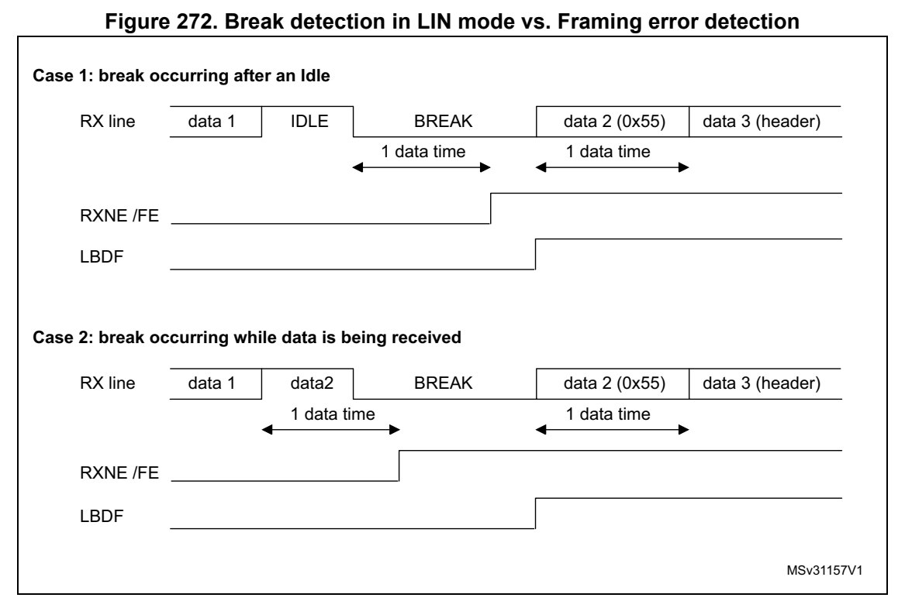
*Figure 272. Break detection in L IN mode vs. Framing error detection (p. 805)*

#### 26.5.14 USART synchronous mode (p. 805)

Master mode

The synchronous master mode is s elected by programming the CLKE N bit in the USART_CR2 register to ‘1’. In syn chronous mode, the following b its must be kept cleared:

- LINEN bit in the USART_CR2 register,

- SCEN, HDSEL and IREN bits i n the USART_CR3 register.

In this mode, the USART can be used to control bidirectional sy nchronous serial communications in master mode. The SCLK pin is the output of th e USART transmitter clock. No clock pulses are sent to the SCLK pin during start bi t and stop bit. Depending on the state of the LBCL bit in the USART_CR2 register, clock puls es are, or are not, generated during the last valid data bit (address mark). The CPOL bit in the USART_CR2 register is used to select the clock polarity, and the CPHA bit in the USART_CR2 register is used to select the phase of the external clock (see Figure 273, Figure 274 and Figure 275).

During the Idle state, preamble and send break, the external SC LK clock is not activated.

In synchronous master mode, the USART transmitter operates exactly like in asynchronous mode. However, since SCLK is syn chronized with TX (according to CPOL and CPHA), the data on TX is synchronous.

In synchronous master mode, the U SART receiver operates in a di fferent way compared to asynchronous mode. If RE is set to 1, the data are sampled on S CLK (rising or falling edge, depending on CPOL and CPHA), wit hout any oversampling. A given setup and a hold time must be respected (which depends on the baud rate: 1/16 bit tim e).

Note: In master mode, the SCLK pin operates in conjunction with the TX pin. Thus, the clock is provided only if the transmitter is enabled (TE = 1) and data are being transmitted (USART_TDR data register written). This me ans that it is not possible to receive synchronous data without transmitting data.

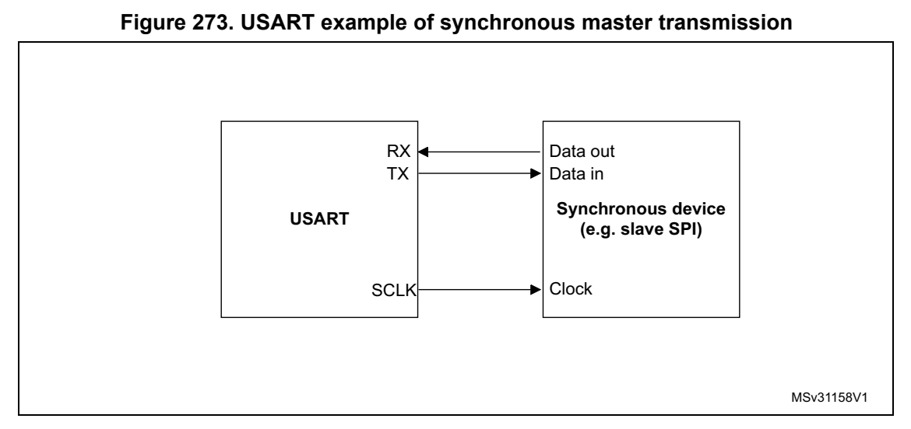
*Figure 273. USART exam ple of synchronous master transmission (p. 806)*

Figure 274. USART data clock timing diagram in synchronous master mode (M bits = 00)

Idle or preceding M bits = 00 (8 data bits) Idle or next transmission Start Stop transmission

Clock (CPOL=0, CPHA=0) *

Clock (CPOL=0, CPHA=1) *

* Clock (CPOL=1, CPHA=0)

* Clock (CPOL=1, CPHA=1)

Data on TX 0 1 2 3 4 5 6 7 (from master) Start LSB MSB Stop Data on RX 0 1 2 3 4 5 6 7 (from slave) LSB MSB * Capture strobe *LBCL bit controls last data pulse

MSv34709V2

Figure 275. USART data clock timing diagram in synchronous master mode (M bits = 01)

Idle or Idle or next preceding Start StopM bits =01 (9 data bits) transmission transmission

Clock (CPOL=0, * CPHA=0) Clock (CPOL=0, CPHA=1) *

Clock (CPOL=1, * CPHA=0) Clock (CPOL=1, * CPHA=1)

Data on TX 0 1 2 3 4 5 6 7 8 (from master) Start LSB MSB Stop Data on RX 0 1 2 3 4 5 6 7 8 (from slave) LSB MSB * Capture strobe *LBCL bit controls last data pulse

MSv34710V1

Slave mode

The synchronous slave mode is se lected by programming the SLVEN bit in the USART_CR2 register to ‘1’. In synchronous slave mode, the following bits must be kept cleared:

- LINEN and CLKEN bits in t he USART_CR2 register,

- SCEN, HDSEL and IREN bits i n the USART_CR3 register.

In this mode, the USART can be used to control bidirectional sy nchronous serial communications in slave mode. Th e SCLK pin is the input of the USART in slave mode.

Note: When the peripheral is used in SPI slave mo de, the frequency of peripheral clock source (usart_ker_ck_pres) must be greater than 3 times the CK input frequency.

The CPOL bit and the CPHA bit in the USART_CR2 register are use d to select the clock polarity and the phase of the external clock, respectively (see Figure 276).

An underrun error flag is available in slave transmission mode. This flag is set when the first clock pulse for data transmission appears while the software ha s not yet loaded any value to USART_TDR.

The slave supports the hardware and software NSS management.

Figure 276. USART data clock ti ming diagram in synchronous slave mode (M bits = 00)

M bits = 00 (8 data bits)

NSS (from Master)

Clock (CPOL=0, CPHA=0)

Clock (CPOL=0, CPHA=1)

Clock (CPOL=1, CPHA=0)

Clock (CPOL=1, CPHA=1)

Data on TX 0 1 2 3 4 5 6 7 (from slave) LSB MSB Data on RX 0 1 2 3 4 5 6 7 (from master) LSB MSB

Capture strobe

MSv45359V1

Slave Select (NSS) pin management

The hardware or softwa re slave select man agement can be set through the DIS_NSS bit in the USART_CR2 register:

- Software NSS manage ment (DIS_NSS = 1) The SPI slave is always selected and NSS input pin is ignored. The external NSS pin remains free for other application uses.

- Hardware NSS manage ment (DIS_NSS = 0) The SPI slave selection depends on NSS input pin. The slave is selected when NSS is low and deselected when NSS is high.

Note: The LBCL (used only on SPI master mode), CPOL and CPHA bits have to be selected when the USART is disabled (UE = 0) to ensure that the clock pulses function correctly. In SPI slave mode, the USART must be enabled before starting the master communications (or between frames while the clock is stable). Otherwise, if the USART slave is enabled while the master is in the middle of a frame, it becomes desynchronized with the master. The data register of the slave needs to be ready before the first edge of the communication clock or before the end of the ongoing comm unication, otherwise the SPI slave transmits zeros.

SPI Slave underrun error

When an underrun error occurs, the UDR flag is set in the USART_ISR register, and the SPI slave goes on sending the last data until the underrrun error flag is cleared by software.

The underrun flag is set at the b eginning of the frame. An unde rrun error interrupt is triggered if EIE bit is set i n the USART_CR3 register.

The underrun error flag is cleared by setting bit UDRCF in the USART_ICR register.

In case of underrun error, it is still po ssible to write to the TDR register. Clearing the underrun error enables sending new data.

If an underrun error occurred and there is no new data written in TDR, then the TC flag is set at the end of the frame.

Note: An underrun error may occur if the moment the data is written to the USART_TDR is too close to the first SCLK transmission edge. To avoid this underrun error, the USART_TDR should be written 3 usart_ker_ck cycles before the first SCLK edge.

#### 26.5.15 USART single-wire Half-duplex communication (p. 809)

Single-wire Half-duplex mode i s selected by setting the HDSEL b it in the USART_CR3 register. In this mode, the fo llowing bits must be kept cleared:

- LINEN and CLKEN bits in t he USART_CR2 register,

- SCEN and IREN bits in the USART_CR3 register.

The USART can be configured to follow a Single-wire Half-duplex protocol where the TX and RX lines are internally conne cted. The selection between ha lf- and Full-duplex communication is made with a control bit HDSEL in USART_CR3.

As soon as HDSEL is written to ‘1’:

- The TX and RX lines are internally connected.

- The RX pin is no longer used.

- The TX pin is always released when no data is transmitted. Thus, it acts as a standard I/O in idle or in reception. It means that the I /O must be configured so that TX is configured as alternate function open-drain with an external pu ll-up.

Apart from this, the communicati on protocol is similar to norma l USART mode. Any conflict on the line must be managed by s oftware (for instance by using a centralized arbiter). In particular, the transmission is never blocked by hardware and continues as soon as data are written in the data register while the TE bit is set.

#### 26.5.16 USART receiver timeout (p. 809)

The receiver timeout feature is enabled by setting the RTOEN bi t in the USART_CR2 control register.

The timeout duration is programm ed using the RTO bitfields in t he USART_RTOR register.

The receiver timeout counter starts counting:

- from the end of the stop bit i f STOP = ‘00’ or STOP = ‘11’

- from the end of the second stop bit if STOP = ‘10’.

- from the beginning of the stop bit if STOP = ‘01’.

When the timeout duration has e lapsed, the RTOF flag in the USA RT_ISR register is set. A timeout is generated if RTOIE bit in USART_CR1 register is set.

#### 26.5.17 USART Smartcard mode (p. 810)

This section is relevant only w hen Smartcard mode is supported. Refer to Section 26.4: USART implementation on page 777.

Smartcard mode is selected by se tting the SCEN bit in the USART_CR3 register. In Smartcard mode, the following bits must be kept cleared:

- LINEN bit in the USART_CR2 register,

- HDSEL and IREN bits in the USART_CR3 register.

The CLKEN bit can also be set to p rovide a clock to the Smartca rd.

The Smartcard interface is desig ned to support asynchronous Sma rtcard protocol as defined in the ISO 781 6-3 standard. Both T = 0 (character mode) and T = 1 (block mode) are supported.

The USART should be configured as:

- 8 bits plus parity: M = 1 and PCE = 1 in the USART_CR1 register

- 1.5 stop bits when transmitting and receiving data: STOP = ’11’ in the USART_CR2 register. It is also possible to choose 0.5 stop bit for recept ion.

In T = 0 (character) mode, the parity e rror is indicated at the end of each character during the guard time period.

Figure 277 shows examples of what can be seen on the data line with and w ithout parity error.

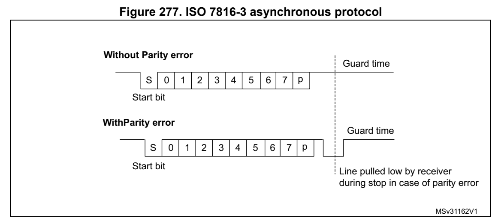
*Figure 277. ISO 7816-3 asynchronous protocol (p. 810)*

When connected to a Smartcard, the TX output of the USART drive s a bidirectional line that is also driven by the Smartcard. The TX pin must be configured as open drain.

Smartcard mode implements a si ngle wire half duplex communicati on protocol.

- Transmission of data from the transmit shift register is guaran teed to be delayed by a minimum of 1/2 baud clock. In normal operation a full transmit shift register starts shifting on the next baud clock edge. In Smartcard mode this transmission is further delayed by a guaranteed 1/2 baud clock.

- In transmission, if the Smartcard detects a parity error, it si gnals this condition to the USART by driving the line low (N ACK). This NACK signal (pulling transmit line low for 1 baud clock) causes a framing erro r on the transmitter side (con figured with 1.5 stop bits). The USART can handle auto matic re-sending of data accord ing to the protocol.

The number of retries is progra mmed in the SCARCNT bitfield. If the USART continues receiving the NACK after the programmed number of retries, it stops transmitting and signals the error as a framing e rror. The TXE bit (TXFNF bit in case FIFO mode is enabled) may be set using the TXFRQ bit in the USART_RQR register.

- Smartcard auto-retry in transmi ssion: A delay of 2.5 baud perio ds is inserted between the NACK detection by the USART and the start bit of the repeated character. The TC bit is set immediately at the end of reception of the last repe ated character (no guardtime). If the software wants to repeat it again, it must i nsure the minimum 2 baud periods required by the standard.

- If a parity error is d etected during reception of a frame programmed with a 1.5 stop bit period, the transmit line is pu lled low for a baud clock period after the completion of the receive frame. This is to indica te to the Smartcard that the da ta transmitted to the USART has not been correctly received. A parity error is NACKed by the receiver if the NACK control bit is set, otherwise a NACK is not transmitted (to be used in T = 1 mode). If the received c haracter is erroneou s, the RXNE (RXFNE in case FIFO mode is enabled)/receive DMA request is not activated. According to the protocol specification, the Smartcard must resend the same character. If the received character is still erroneous after the maximum number of retries specifie d in the SCARCNT bitfield, the USART stops transmitting the NACK and signals the error as a parity error.

- Smartcard auto-retry in reception: the BUSY flag remains set if the USART NACKs the card but the card doesn’t repeat the character.

- In transmission, the USART inserts the Guard Time (as programme d in the Guard Time register) between two successive characters. As the Guard Time is measured after the stop bit of the previo us character, the GT[7:0] register must b e programmed to the desired CGT (Character Guard Time, as defined by the 7816-3 spe cification) minus 12 (the duration of one character).

- The assertion of the TC flag can be delayed by programming the Guard Time register. In normal operation, TC is asserted when the tra nsmit shift reg ister is emp ty and no further transmit requests are ou tstanding. In Smartcard mode an empty transmit shift register triggers the Guard Time counter to count up to the pro grammed value in the Guard Time register. TC is force d low during this time. When th e Guard Time counter reaches the programmed value TC is asserted high. The TCBGT fla g can be used to detect the end of data transfer without waiting for guard time completion. This flag is set just after the end of frame transmission and if no NACK has bee n received from the card.

- The deassertion of TC flag is unaffected by Smartcard mode.

- If a framing error is detected on the transmitter end (due to a NACK from the receiver), the NACK is not detected as a sta rt bit by the re ceive block of the transmitter. According to the ISO p rotocol, the duration of the received NAC K can be 1 or 2 baud clock periods.

- On the receiver side, if a parity error is detected and a NACK is transmitted the receiver does not detect the NACK as a start bit.

Note: Break characters are not significant in Smartcard mode. A 0x00 data with a framing error is treated as data and not as a break.

No Idle frame is transmitted when toggling the TE bit. The Idle frame (as defined for the other configurations) is not defined by the ISO protocol.

Figure 278 shows how the NACK signal is sampled by the USART. In this exa mple the USART is transmitting data and is configured with 1.5 stop bits. The receiver part of the USART is enabled in order to che ck the integrity of the data an d the NACK signal.

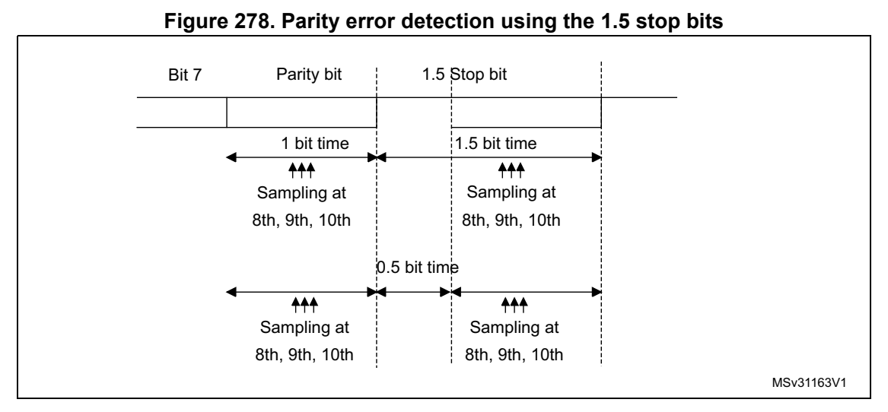
*Figure 278. Parity error detection using the 1.5 stop bits (p. 812)*

The USART can provide a clock to the Smartcard through the SCLK output. In Smartcard mode, SCLK is not associated to the communication but is simply derived from the internal peripheral input clock through a 5-bit prescaler. The division ratio is configured in the USART_GTPR register. SCLK frequen cy can be programmed from usart_ker_ck_pres/2 to usart_ker_ck_pres/62, where usart_ker_ck_pres is the peripheral input clock divided by a programmed prescaler.

Block mode (T = 1)

In T = 1 (block) mode, the parity error transmission can be deactivate d by clearing the NACK bit in the USART_CR3 register.

When requesting a read from the Smartcard, in block mode, the s oftware must program the RTOR register to the BWT (block wait time) - 11 value. If no an swer is received from the card before the expi ration of this period, a timeout interrupt is generated. If the first character is received before the expiration of the period, it i s signaled by the RXNE/RXFNE interrupt.

Note: The RXNE/RXFNE interrupt must be enabled even when using the USART in DMA mode to read from the Smartcard in block mode. In parallel, the DMA must be enabled only after the first received byte.

After the reception of the first character (RXNE/RXFNE interrupt), the RTO register must be programmed to the CWT (characte r wait time -11 value), in order to enable the automatic check of the max imum wait time between two consecutive characte rs. This time is expressed in baud time units. If the Smartcard does not send a new character in less than the CWT period after the end of the previous character, the USA RT signals it to the software through the RTOF flag and interrupt (when RTOIE bit is set).

Note: As in the Smartcard protocol definition, th e BWT/CWT values should be defined from the beginning (start bit) of the last character. The RTO register must be programmed to BWT - 11 or CWT -11, respectively, taking into a ccount the length of the last character itself.

A block length counter is used to count all the characters rece ived by the USART. This counter is reset when the USART is transmitting. The length of the block is communicated by the Smartcard in the third byte of the block (prologue field). This value must be programmed to the BLEN field in t he USART_RTOR register. When u sing DMA mode, before the start of th e block, this register field must be prog rammed to the minimum value

(0x0). With this value, an interrupt is generated after the 4th received character. The software must read the LEN field (third byte), its value must b e read from the receive buffer.

In interrupt driven receive mode, the length of the block may b e checked by software or by programming the BLEN value. However, before the start of the bl ock, the maximum value of BLEN (0xFF) may be programmed. The real value is programmed after the reception of the third character.

If the block is using the LRC l ongitudinal redundancy check (1 epilogue byte), the BLEN = LEN. If the block is using the CR C mechanism (2 e pilog bytes), BLEN = LEN+1 must be programmed. The total blo ck length (including prologue, epilogue and information fields) equals BLEN+4. The end of the block is signaled to the software through the EOBF flag and interrupt (when EOBIE bit is set).

In case of an error in the blo ck length, the end of the block i s signaled by the RTO interrupt (Character Wait Time overflow).

Note: The error checking code (LRC/CRC) must be computed/verified by software.

Direct and inverse convention

The Smartcard protocol defines two conventions: direct and inve rse.

The direct convention is defined as: LSB first, logical bit val ue of 1 corresponds to a H state of the line and parity is even. I n order to use this convention, the following control bits must be programmed: MSBFIRST = 0, DATAINV = 0 (default values).

The inverse convention is defined as: MSB first, logical bit va lue 1 corresponds to an L state on the signal line and parity is even. In order to use this con vention, the following control bits must be progra mmed: MSBFIRST = 1, DATAINV = 1.

Note: When logical data values are inverted (0 = H, 1 = L), the parity bit is also inverted in the same way.

In order to recognize the card convention, the card sends the i nitial character, TS, as the first character of the ATR (Answer To Reset) frame. The two pos sible patterns for the TS are: LHHL LLL LLH a nd LHHL HHH LLH.

- (H) LHHL LLL LLH sets up the inverse convention: state L encode s value 1 and moment 2 conveys the most significant bit (MSB first). When decoded by inverse convention, the conveyed byte is equal to '3F'.

- (H) LHHL HHH LLH sets up the direct convent ion: state H encodes value 1 and moment 2 conveys the least signi ficant bit (LSB first). When de coded by direct convention, the conveyed byte is equal to '3B'.

Character parity is correct whe n there is an even number of bits set to 1 in the nine moments 2 to 10.

As the USART does not know which convention is used by the card, it needs to be able to recognize either pattern and act accordingly. The pattern recog nition is not done in hardware, but through a software sequence. Moreover, assuming t hat the USART is configured in direct convention (default) and the card answers with the inverse convention, TS = LHHL LLL LLH results in a USART received character of 03 a nd an odd parity.

Therefore, two methods are availa ble for TS pattern recognition:

Method 1

The USART is programmed in standard Smartcard mode/direct conve ntion. In this case, the TS pattern reception generates a parity error in terrupt and error signal to the card.

- The parity error interrupt informs the software that the card d id not answer correctly in direct convention. Software then reprograms the USART for inverse convention

- In response to the error signal, the card retries the same TS c haracter, and it is correctly received this time, by the reprogrammed USART.

Alternatively, in answer to the parity error interrupt, the software may decide to reprogram the USART and to also generate a new reset command to the card, then wait a gain for the TS.

Method 2

The USART is programmed in 9-bit/no-parity mode, no bit inversi on. In this mode it receives any of the two TS patterns as: (H) LHHL LLL LLH = 0x103: inverse convention to be chosen (H) LHHL HHH LLH = 0x13B: direct convention to be chosen

The software checks the received character against these two pa tterns and, if any of them match, then programs the USART accordingly for the next character reception.

If none of the two is recognized, a card reset may be generated in order to restart the negotiation.

#### 26.5.18 USART IrDA SIR ENDEC block (p. 814)

This section is relevant only w hen IrDA mode is supported. Refe r to Section 26.4: USART implementation on page 777.

IrDA mode is selected by setting the IREN bit in the USART_CR3 register. In IrDA mode, the following bits must be kept cleared:

- LINEN, STOP and CLKEN bits in the USART_CR2 register,

- SCEN and HDSEL bits in the USART_CR3 register.

The IrDA SIR physical layer specifies use of a Return to Zero, Inverted (RZI) modulation scheme that represents logic 0 as an infrared light pulse (see Figure 279).

The SIR Transmit encoder modulates the Non Return to Zero (NRZ) transmit bit stream output from USART. The output pulse stream is transmitted to an external output driver and infrared LED. USART supports only bit rates up to 115.2 Kbps fo r the SIR ENDEC. In normal mode the transmitted puls e width is specified as 3/16 of a bit period.

The SIR receive decoder demodulate s the return-to-zero bit stre am from the infrared detector and outputs the received NRZ serial bit stream to the USART. The decoder input is normally high (marking state) in the Idle state. The transmit e ncoder output has the opposite polarity to the decoder input. A start bit is detected when the decoder input is low.

- IrDA is a half duplex communication protocol. If the Transmitte r is busy (when the USART is sending data to the IrDA encoder), any d ata on the IrDA receive line is ignored by the IrDA decoder and i f the Receiver is busy (when t he USART is receiving decoded data from the USART), da ta on the TX from the USART to IrDA is not

encoded. While receiving data, transmission should be avoided a s the data to be transmitted could be corrupted.

- A ‘0‘ is transmitted as a high pulse and a ‘1’ is transmitted a s a ‘0’. The width of the pulse is specified as 3/16th of t he selected bit period in norm al mode (see Figure 280).

- The SIR decoder converts the IrDA compliant receive signal into a bit stream for USART.

- The SIR receive logic interprets a high state as a logic one an d low pulses as logic zeros.

- The transmit encoder output ha s the opposite polarity to the de coder input. The SIR output is in low state when Idle.

- The IrDA specification requires the acceptance of pulses greate r than 1.41 µs. The acceptable pulse width is progra mmable. Glitch detection logic on the receiver end filters out pulses of width less than 2 PSC periods (PSC is the prescaler value programmed in the USART_GTPR). Pulses of width less than 1 PSC period are always rejected, but those of width greater than one and less than two periods may be accepted or rejected, those greater than two periods are accepted as a pulse. The IrDA encoder/decoder doesn’t work when PSC = 0.

- The receiver can communicate with a low-power transmitter.

- In IrDA mode, the stop bits in th e USART_CR2 register must be configured to ‘1 stop bit’.

IrDA low-power mode

- Transmitter In low-power mode, the pulse width is not maintained at 3/16 of the bit period. Instead, the width of the pulse i s 3 times the low-power baud rate which can be a minimum of 1.42 MHz. Generally, this value i s 1.8432 MHz (1.42 MHz < PSC < 2.1 2 MHz). A low-power mode programmable divisor divides the system clock to ach ieve this value.

- Receiver Receiving in low-power mode is similar to receiving in normal m ode. For glitch detection the USART should disca rd pulses of duration shorter t han 1/PSC. A valid low is accepted only if i ts duration is greater than 2 periods of t he IrDA low-power Baud clock (PSC value in the USART_GTPR).

Note: A pulse of width less than two and grea ter than one PSC period(s) may or may not be rejected. The receiver set up time should be managed by software. The IrDA physical layer specification specifies a minimum of 10 ms delay between transmission and reception (IrDA is a half duplex protocol).

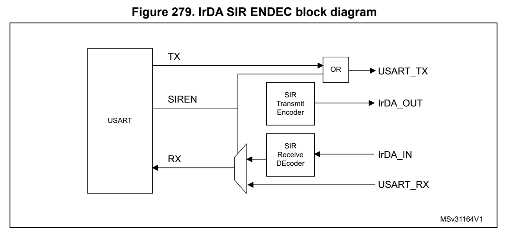
*Figure 279. IrDA SIR ENDEC block diagram (p. 816)*

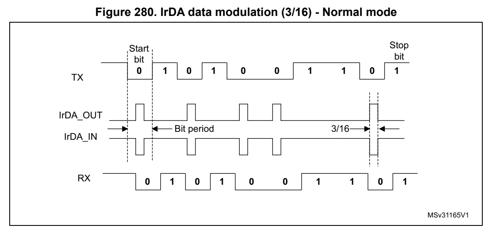
*Figure 280. IrDA data modulat ion (3/16) - Normal mode (p. 816)*

#### 26.5.19 Continuous communication using USART and DMA (p. 817)

The USART is capable of performing continuous communications us ing the DMA. The DMA requests for Rx buffer and Tx buffer are generated independentl y.

Note: Refer to Section 26.4: USART implementation on page 777 to determine if the DMA mode is supported. If DMA is not supported, use the USART as explained in Section 26.5.6. To perform continuous communications when the FIFO is disabled, clear the TXE/ RXNE flags in the USART_ISR register.

Transmission using DMA

DMA mode can be enabled for transmission by setting DMAT bit in the USART_CR3 register. Data are loaded from an SRAM area configured using th e DMA peripheral (refer to the corresponding Direct memory access controller section) to the USART_TDR register whenever the TXE flag (TXFNF flag if FIFO mode is enabled) is s et. To map a DMA channel for USART transmission, use the following procedure (x denotes the channel number): 1. Write the USART_TDR register address in the DMA control register to configure it as the destination of the transfer. The data is moved to this address from memory after each TXE (or TXFNF if FIFO mode is enabled) event. 2. Write the memory address in t he DMA control register to configure it as the source of the transfer. The data is loaded into the USART_TDR register from this memory area after each TXE (or TXFNF if F IFO mode is enabled) event. 3. Configure the total number of bytes to be transferred to the DMA control register. 4. Configure the channel priority in the DMA register 5. Configure DMA interrupt generation after half/ full transfer as required by the application. 6. Clear the TC flag in the USART_ISR register by setting the T CCF bit in the USART_ICR register. 7. Activate the channel in the DMA register.

When the number of data transfers programmed in the DMA Control ler is reached, the DMA controller generates an interrupt on the DMA channel interrupt vector.

In transmission mode, once the DMA has written all the data to be transmitted (the TCIF flag is set in the DMA_ISR register), the TC flag can be monitored to make sure that the USART communication is complete. This is required to avoid corrupting the last transmission before disabling the USART or before t he system enters a low-power mod e when the peripheral clock is disabled. Software must wait until TC = 1. The TC flag remains cleared during all data transfers and it is set by hardware at the end of transmis sion of the last frame.

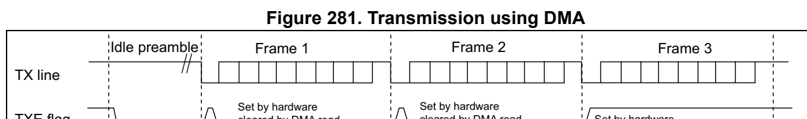
*Figure 281. Transmission using DMA (p. 818)*

DMA request Ignored by the DMA because the transfer is complete

USART_TDR F1 F2 F3

TC flag Set by DMA writes hardware USART_TDR Cleared DMA TCIF flag by Set by hardware software (transfer complete)

Software The DMA configures DMA DMA writes DMA writes DMA writes transfer is to send 3 data F1 into F2 into F3 into complete Software waits until TC=1 blocks and USART_TDR USART_TDR USART_TDR (TCIF=1 in enables USART DMA_ISR)

ai17192b

Note: When FIFO management is enabled, the DMA request is triggered by Transmit FIFO not full (i.e. TXFNF = 1).

Reception using DMA

DMA mode can be enabled for reception by setting the DMAR bit i n USART_CR3 register. Data are loaded from the USART_RDR register to an SRAM area con figured using the DMA peripheral (refer to the corresponding Direct memory access controller section) whenever a data byte is received. To map a DMA channel for USART reception, use the following procedure: 1. Write the USART_RDR register a ddress in the DMA control register to configure it as the source of the transfer. The data is moved from this address to the memory after each RXNE (RXFNE in case FIFO mode is enabled) event. 2. Write the memory address in the DMA control register to configure it as the destination of the transfer. The data is l oaded from USART_RDR to this memo ry area after each RXNE (RXFNE in case FIFO mode is enabled) event. 3. Configure the total number of bytes to be transferred to the DMA control register. 4. Configure the channel priority in the DMA control register 5. Configure interrupt generati on after half/ fu ll transfer as required by the application. 6. Activate the channel in the DMA control register.

When the number of data transfers programmed in the DMA Control ler is reached, the DMA controller generates an interrupt on the DMA channel interrupt vector.

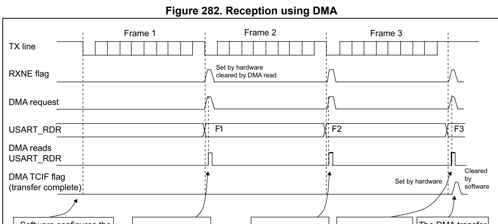
*Figure 282. Reception using DMA (p. 819)*

DMA to receive 3 data DMA reads F1 DMA reads F2 DMA reads F3 is complete blocks and enables from USART_RDR from USART_RDR from USART_RDR (TCIF=1 in the USART DMA_ISR) ai17193c

Note: When FIFO management is enabled, the DMA request is triggered by Receive FIFO not empty (i.e. RXFNE = 1).

Error flagging and interrupt generation in multibuffer communication

If any error occurs during a transaction in multibuffer communi cation mode, the error flag is asserted after the current byte. An interrupt is generated if t he interrupt enable flag is set. For framing error, overrun error and noise flag which are asserted with RXNE (RXFNE in case FIFO mode is enabled) in sin gle byte reception, there is a separate error flag interrupt enable bit (EIE bit in the USART_CR3 register), which, if set, enables an inte rrupt after the current byte if any of these errors occur.

#### 26.5.20 RS232 Hardware flow co ntrol and RS485 Driver Enable (p. 819)

It is possible to control the seri al data flow between 2 device s by using the nCTS input and the nRTS output. The Figure 283 shows how to connect 2 devices in this mode:

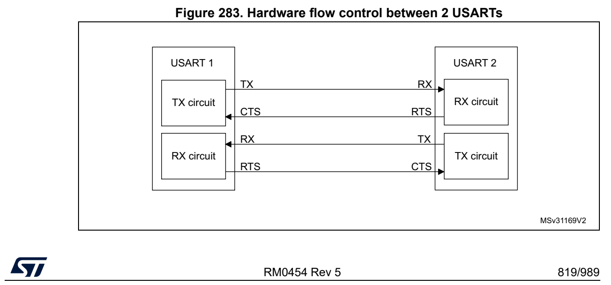
*Figure 283. Hardware flow control between 2 USARTs (p. 819)*

RS232 RTS and CTS flow control can be enabled independently by writing the RTSE and CTSE bits to ‘1’ in th e USART_CR3 register.

RS232 RTS flow control

If the RTS flow control is enabled (RTSE = 1), then nRTS is asserted (tied low) as long as the USART receiver is ready to receive a new data. When the receive register is full, nRTS is deasserted, indicating that t he transmission is expected to stop at the end of the current frame. Figure 284 shows an example of communication with RTS flow control enable d.

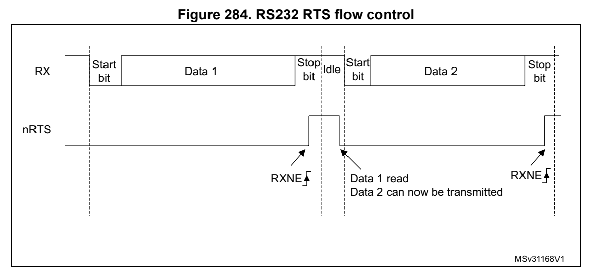
*Figure 284. RS232 RTS flow control (p. 820)*

Note: When FIFO mode is enabled, nRTS is deasserted only when RXFIFO is full.

RS232 CTS flow control

If the CTS flow control is enabled (CTSE = 1), then the transmitter checks the nCTS input before transmitting the next fram e. If nCTS is asserted (tied l ow), then the next data is transmitted (assuming that data is to be transmi tted, in other words, if TXE/TXFE = 0), else the transmission does not occur. When nCTS is deasserted during a transmission, the current transmission is completed before the transmitter stops.

When CTSE = 1, the CTSIF status bit is automatically set by hardware as soo n as the nCTS input toggles. It indicates when the receiver becomes ready or not ready for communication. An interrupt is generated if the CTSIE bit in the USART_CR3 reg ister is set. Figure 285 shows an example of communication with CTS flow control enabled.

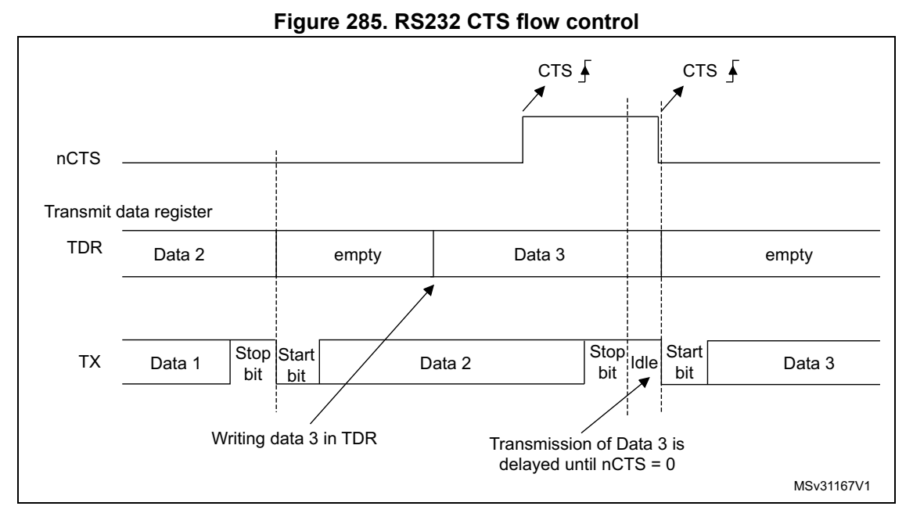
*Figure 285. RS232 CTS flow control (p. 821)*

Note: For correct behavior, nCTS must be asserted at least 3 USART clock source periods before the end of the current character. In addition it should be noted that the CTSCF flag may not be set for pulses shorter than 2 x PCLK periods.

RS485 driver enable

The driver enable feature is enab led by setting bit DEM in the USART_CR3 control register. This enables the user to activate the external transceiver cont rol, through the DE (Driver Enable) signal. The assertion time is the time between the acti vation of the DE signal and the beginning of the s tart bit. It is progra mmed using the DEAT [4:0] bitfields in the USART_CR1 control register. The d eassertion time is the time be tween the end of the last stop bit, in a transmitted mess age, and the de-activation of th e DE signal. It is programmed using the DEDT [4:0] bitfields i n the USART_CR1 control registe r. The polarity of the DE signal can be configured using t he DEP bit in the USART_CR3 con trol register.

In USART, the DEAT and DEDT are expressed in sample time units (1/8 or 1/16 bit time, depending on the oversampling rate).

#### 26.5.21 USART low-power management (p. 822)

The USART has advanced low-power mode functions, that enables t ransferring properly data even when the usart_pclk clock is disabled.

The USART is able to wake up the MCU from low-power mode when t he UESM bit is set.

When the usart_pclk is gated, the USART provides a wakeup interrupt ( usart_wkup) if a specific action requiring the activation of the usart_pclk clock is needed:

- If FIFO mode is disabled usart_pclk clock has to be activated to empty the USART data re gister. In this case, the usart_wkup interrupt so urce is RXNE set to ‘1 ’. The RXNEIE bit must be set before entering low-power mode.

- If FIFO mode is enabled usart_pclk clock has to be activated to: – to fill the TXFIFO – or to empty the RXFIFO In this case, the usart_wku p interrupt source can be: – RXFIFO not empty. In this case, the RXFNEIE bit must be set before entering low-power mode. – RXFIFO full. In this case, the RXFFIE bit must be set before e ntering low-power mode, the number of received data corresponds to the RXFIFO size, and the RXFF flag is not set. – TXFIFO empty. In this case, the TXFEIE bit must be set before entering low-power mode. This enables sending/receiving the data in the TXFIFO/RXFIFO du ring low-power mode. To avoid overrun/underrun errors and transmit/receive data in l ow-power mode, the usart_wkup interrupt source can be one of the following events: – TXFIFO threshold reac hed. In this case, the TXFTIE bit must be set before entering low-power mode. – RXFIFO threshold reached. In th is case, the RXFTIE bit must be set before entering low-power mode. For example, the application ca n set the threshold to the maxim um RXFIFO size if the wakeup time is less than the ti me required to receive a single byte across the line. Using the RXFIFO full, TXFIFO e mpty, RXFIFO not empty and RXFIF O/TXFIFO threshold interrupts to wakeup the MCU from low-power mode enab les doing as many USART transfers as possible duri ng low-power mode with the benefit of optimizing consumption.

Alternatively, a specific usart_wkup interrupt can be selected t hrough the WUS bitfields.

When the wakeup even t is detected, the WUF flag is set by hardware and a usart_wkup interrupt is generated if the WUFIE bit is set. In this case th e usart_wkup interrupt is not mandatory and setting the WUF be ing is sufficient to wake up th e MCU from low-power mode.

Note: Before entering low-power mode, make sure that no USART transfers are ongoing. Checking the BUSY flag cannot ensure that low-power mode is never entered when data reception is ongoing. The WUF flag is set when a wakeup event is de tected, independently of whether the MCU is in low-power or active mode. When entering low-power mode just after having initialized and enabled the receiver, the REACK bit must be checked to make sure the USART is enabled.

When DMA is used for reception, it must be disabled before entering low-power mode and re-enabled when exiting from low-power mode. When the FIFO is enabled, waking up from low-power mode on address match is only possible when Mute mode is enabled.

Using Mute mode with low-power mode

If the USART is put into Mute mod e before entering low-power mo de:

- Wakeup from Mute mode on idle detection must not be used, becau se idle detection cannot work in low-power mode.

- If the wakeup from Mute mode on address match is used, then the low-power mode wakeup source must also be the address match. If the RXNE flag was set when entering the low-power mode, the interface remains in Mute mode upon address match and wake up from low-power mode.

Note: When FIFO management is enabled, Mute mode can be used with wakeup from low-power mode without any constraints (i.e.the two points mentioned above about Mute and low-power mode are valid only when FIFO management is disabled).

Wakeup from low-power mode when USART kernel clock (usart_ker_c k) is OFF in low-power mode

If during low-power mod e, the usart_ker_ck clock is switched OF F when a fa lling edge on the USART receive line is detected, the USART interface requests the usart_ker_ck clock to be switched ON thanks to the usart_ker_ck_req signal. usart_ker_ck is then used for the frame reception.

If the wakeup event is verified, the MCU wakes up from low-powe r mode and data reception goes on normally.

If the wakeup event is not verifie d, usart_ker_ck is switched O FF again, the MCU is not woken up and remains in low-power mode, and the kernel clock re quest is released.

The example below shows the case of a wakeup event programmed to “address match detection” and FIFO management disabled.

Figure 286 shows the USART behavior when the wakeup event is verified.

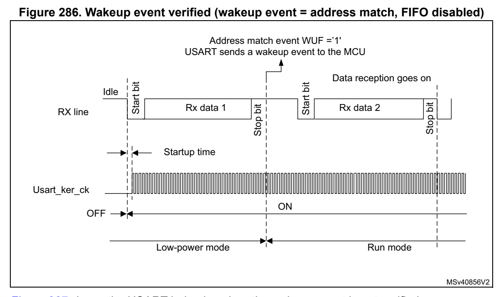
*Figure 286. Wakeup event verified (wakeup event = address match, FIFO disabled) (p. 824)*

Figure 287 shows the USART behavior when t he wakeup event is not verified.

Figure 287. Wakeup even t not verified (wakeup event = address m atch, FIFO disabled)

Address does not match

RX line Idle Start bit Rx data 1 Stop bit Idle

Startup time

Usart_ker_ck ON OFF OFF

Low-power mode

MSv40857V2

Note: The figures above are valid when address match or any received frame is used as wakeup event. If the wakeup event is the start bit de tection, the USART sends the wakeup event to the MCU at the end of the start bit.

Determining the maximum USART baud rate that enables to correct ly wake up the device from low-power mode

The maximum baud rate that enables to correctly wake up the dev ice from low-power mode depends on the wakeup time param eter (refer to the device datas heet) and on the USART receiver tolerance (see Section 26.5.8: Tolerance of the USART receiver to clock deviation).

Let us take the example of OVER8 = 0, M bits = ‘01’, ONEBIT = 0 and BRR [3:0] = 0000.

In these conditions, according to Table 123: Tolerance of the USART receiver when BRR [3:0] = 0000, the USART receiver tolerance equals 3.41%. DTRA + DQUANT + DREC + DTCL + DW U < USART receiver tolerance D WUmax = t WUUSART/ (11 x T bit Min) T bit Min = t WUUSART/ (11 x D WUmax) where t WUUSART is the wakeup time from low-power mode.

If we consider the ideal case where DTRA, DQUANT, DREC and DTCL parameters are at 0%, the maximum value of DWU i s 3.41%. In reality, we need to consider at least the usart_ker_ck inaccuracy.

For example, if HSI is used as usart_ker_ck, and the HSI inaccu racy is of 1%, then we obtain: t WUUSART = 3 µs (values provi ded only as examples; for correct values, refer to the device datasheet). D WUmax = 3.41% - 1% = 2.41% T bit min = 3 µs/ (11 x 2.41%) = 11.32 µs. As a result, the maximum baud rate that enables to wakeup corre ctly from low-power mode is: 1/11.32 µs = 88.36 Kbaud.

### 26.6 USART in low-power modes (p. 825)

**Table 126. Effect of low-power modes on the USART (p. 825)**

| Col 1 | Mode Description |
| --- | --- |
|  | Sleep No effect. USART interrupts cause the device to exit Sleep mode. |
| Stop (1) | The content of the USART registers is kept. The USART is able to wake up the microcontroller from Stop mode when the USART is clocked by an osci llator available in Stop mode. |
| Standby | The USART peripheral is powered down and must be reinitialized after exiting Standby mode. |

1. Refer to Section 26.4: USART implementation to know if the wakeup from Stop mode is supported for a given peripheral instance. If an instance is not functional in a given Stop mode, it must be disabled before entering this Stop mode.

### 26.7 USART interrupts (p. 826)

Refer to Table 127 for a detailed description of all USART interrupt requests.

**Table 127. USART interrupt requests (p. 826)**

| Interrupt vector | Interrupt event | Event flag | Enable Control bit | Interrupt clear method | Exit from Sleep mode | Exit from Stop (1) modes | Exit from Standby mode |
| --- | --- | --- | --- | --- | --- | --- | --- |
|  |  | Transmit data register empty TXE TXEIE Write TDR |  |  |  | NO |  |
|  |  |  | Transmit FIFO not Full TXFNF TXFNFIE TXFIFO full NO |  |  |  |  |
|  | Transmit FIFO Empty TXFE TXFEIE |  |  | Write TDR or write 1 in TXFRQ |  | YES |  |
| USART or UART | Transmit FIFO threshold reached |  |  | TXFT TXFTIE Write TDR YES | YES |  | NO |
|  |  |  | CTS interrupt CTSIF CTSIE Write 1 in CTSCF NO |  |  |  |  |
|  | Transmission Complete TC TCIE |  |  | Write TDR or write 1 in TCCF |  | NO |  |
|  | Transmission Complete Before Guard Time |  | TCBGT TCBGTIE | Write TDR or write 1 in TCBGT |  | NO |  |
|  | Receive data register not empty (data ready to be read) |  | RXNE RXNEIE | Read RDR or write 1 in RXFRQ |  | YES |  |
|  | Receive FIFO Not Empty RXFNE RXFNEIE |  |  | Read RDR until RXFIFO empty or write 1 in RXFRQ |  | YES |  |
|  | Receive FIFO Full RXFF | (2) |  | RXFFIE Read RDR YES |  |  |  |
|  | Receive FIFO threshold reached |  |  | RXFT RXFTIE Read RDR YES |  |  |  |
|  | Overrun error detected ORE |  | RXNEIE/ RXFNEIE | Write 1 in ORECF NO |  |  |  |
|  |  |  | Idle line detected IDLE IDLEIE Write 1 in IDLECF NO |  |  |  |  |
| USART |  |  | Parity error PE PEIE Write 1 in PECF NO |  |  |  |  |
| USART or UART | Noise error in multibuffer communication Overrun error in multibuffer communication Framing Error in multibuffer communication | NE ORE (3) | LIN break LBDF LBDIE Write 1 in LBDCF NO EIE Character match CMF CMIE Write 1 in CMCF NO | Write 1 in NFCF NO Write 1 in ORECF NO FE Write 1 in FECF NO | YES |  | NO |
|  |  |  | Receiver timeout RTOF RTOFIE Write 1 in RTOCCF NO |  |  |  |  |
|  |  |  | End of Block EOBF EOBIE Write 1 in EOBCF NO |  |  |  |  |
|  |  |  | Wakeup from low-power mode WUF WUFIE Write 1 in WUC YES |  |  |  |  |
|  |  |  | SPI slave underrun error UDR EIE Write 1 in UDRCF NO |  |  |  |  |

1. The USART can wake up the device from Stop mode only if the p eripheral instance supports the Wakeup from Stop mode feature. Refer to Section 26.4: USART implementation for the list of supported Stop modes.

2. RXFF flag is asserted if the USART receives n+1 data (n being the RXFIFO size): n data in the RXFIFO and 1 data in USART_RDR. In Stop mode, USART_RDR is not clocked. As a result, this register is not written and once n data are received and written in the RXFIFO, the RXFF interrupt is asserted (RXFF flag is not set). 3. When OVRDIS = 0.

### 26.8 USART registers (p. 827)

Refer to Section 1.2 on page 39 for a list of abbre viations used in register descriptions.

The peripheral registers have to be accessed by words (32 bits).

### 26.8.1 [USART.USART_CR1] Offset: 0x00 | Reset: 0x00000000 (p. 827)

Address offset: 0x00

Reset value: 0x0000 0000

The same register can be used in FIFO mode enabled (this sectio n) and FIFO mode disabled (next section).

FIFO mode enabled

Bit 31 RXFFIE: RXFIFO Full interrupt enable This bit is set and c leared by software. 0: Interrupt inhibited 1: USART interrupt generated when RXFF = 1 in the USART_ISR regis ter

Bit 30 TXFEIE: TXFIFO empty interrupt enable This bit is set and c leared by software. 0: Interrupt inhibited 1: USART interrupt generated when TXFE = 1 in the USART_ISR regis ter

Bit 29 FIFOEN: FIFO mode enable This bit is set and c leared by software. 0: FIFO mode is disabled. 1: FIFO mode is enabled. This bitfield can only be writte n when the USART is disabled (U E = 0). Note: FIFO mode can be used on standard UART communication, in SPI master/slave mode and in Smartcard modes only. It must not be enabled in IrDA and LIN modes.

Bit 28 M1: Word length This bit must be used in conjunction with bit 12 (M0) to determ ine the word length. It is set or cleared by software. M[1:0] = ‘00’: 1 start bit, 8 Data bits, n Stop bit M[1:0] = ‘01’: 1 start bit, 9 Data bits, n Stop bit M[1:0] = ‘10’: 1 start bit, 7 Data bits, n Stop bit This bit can only be written when the USART is disabled (UE = 0). Note: In 7-bits data length mode, the Smartcard mode, LIN master mode and Auto baud rate (0x7F and 0x55 frames detection) are not supported.

Bit 27 EOBIE: End of Block interrupt enable This bit is set and c leared by software. 0: Interrupt inhibited 1: USART interrupt generated when the EOBF flag is set in the U SART_ISR register Note: If the USART does not support Smartcard mode, this bit is reserved and must be kept at reset value. Refer to Section 26.4: USART implementation on page 777.

Bit 26 RTOIE: Receiver timeout interrupt enable This bit is set and c leared by software. 0: Interrupt inhibited 1: USART interrupt generated when the RTOF bit is set in the USART_ISR register. Note: If the USART does not support the Receiver timeout feature, this bit is reserved and must be kept at reset value. Section 26.4: USART implementation on page 777.

Bits 25:21 DEAT[4:0]: Driver Enable assertion time This 5-bit value defines the time between the activation of the DE (Driver Enable) signal and the beginning of the start bit. It is expressed in sample time units (1/8 or 1 /16 bit time, depending on the oversampling rate). This bitfield can only be writte n when the USART is disabled (U E = 0). Note: If the Driver Enable feature is not supported, this bit is reserved and must be kept at reset value. Refer to Section 26.4: USART implementation on page 777.

Bits 20:16 DEDT[4:0]: Driver Enable deassertion time This 5-bit value defines the ti me between the en d of the last stop bit, in a transmitted message, and the de-activation of the DE (Driver Enable) signal. It is expressed in sample time units (1/8 or 1/16 bit time, depending on the oversampling rate). If the USART_TDR register is written during the DEDT time, the new data is transmitted only when the DEDT and DEAT times have both elapsed. This bitfield can only be writte n when the USART is disabled (U E = 0). Note: If the Driver Enable feature is not supported, this bit is reserved and must be kept at reset value. Refer to Section 26.4: USART implementation on page 777.

Bit 15 OVER8: Oversampling mode 0: Oversampling by 16 1: Oversampling by 8 This bit can only be written when the USART is disabled (UE = 0). Note: In LIN, IrDA and Smartcard modes, this bit must be kept cleared.

Bit 14 CMIE: Character match interrupt enable This bit is set and c leared by software. 0: Interrupt inhibited 1: USART interrupt generated when the CMF bit is set in the USA RT_ISR register.

Bit 13 MME: Mute mode enable This bit enables the USART Mute mode function. When set, the USART can switch between active and Mute mode, as defined by the WAKE bit. It is set and cleared by software. 0: Receiver in active mode permanently 1: Receiver can switch between Mute mode and active mode.

Bit 12 M0: Word length This bit is used in conjunction w ith bit 28 (M1) to determine t he word length. It is set or cleared by software (refer to bit 28 (M1)description). This bit can only be written when the USART is disabled (UE = 0).

Bit 11 WAKE: Receiver wakeup method This bit determines the USART wa keup method from Mute mode. It is set or cleared by software. 0: Idle line 1: Address mark This bitfield can only be writte n when the USART is disabled (U E = 0).

Bit 10 PCE: Parity control enable This bit selects the hardware p arity control (g eneration and de tection). When the parity control is enabled, the computed parity is inserted at the MSB position (9th bit if M = 1; 8th bit if M = 0) and the parity is checked on the received data. This bi t is set and cleared by software. Once it is set, PCE is active after the current byte (in reception and in transmission). 0: Parity control disabled 1: Parity control enabled This bitfield can only be writte n when the USART is disabled (U E = 0).

Bit 9 PS: Parity selection This bit selects the odd or even parity when the parity generat ion/detection is enabled (PCE bit set). It is set an d cleared by software. The parity is sele cted after the current byte. 0: Even parity 1: Odd parity This bitfield can only be writte n when the USART is disabled (U E = 0).

Bit 8 PEIE: PE interrupt enable This bit is set and c leared by software. 0: Interrupt inhibited 1: USART interrupt generated whenever PE = 1 in the USART_ISR reg ister

Bit 7 TXFNFIE: TXFIFO not ful l interrupt enable This bit is set and c leared by software. 0: Interrupt inhibited 1: USART interrupt generated whe never TXFNF =1 in the USART_ISR register

Bit 6 TCIE: Transmission complete interrupt enable This bit is set and c leared by software. 0: Interrupt inhibited 1: USART interrupt generated whe never TC = 1 in the USART_ISR reg ister

Bit 5 RXFNEIE: RXFIFO not empty interrupt enable This bit is set and c leared by software. 0: Interrupt inhibited 1: USART interrupt generated whe never ORE = 1 or RXFNE = 1 in the U SART_ISR register

Bit 4 IDLEIE: IDLE interrupt enable This bit is set and c leared by software. 0: Interrupt inhibited 1: USART interrupt generated whe never IDLE = 1 in the USART_ISR register

Bit 3 TE: Transmitter enable This bit enables the transmitter. It is set and cleared by software. 0: Transmitter is disabled 1: Transmitter is enabled Note: During transmission, a low pulse on the TE bit (‘0’ followed by ‘1’) sends a preamble (idle line) after the current word, except in Smartcard mode. In order to generate an idle character, the TE must not be immediately written to ‘1’. To ensure the required duration, the software can poll the TEACK bit in the USART_ISR register. In Smartcard mode, when TE is set, there is a 1 bit-time delay before the transmission starts.

Bit 2 RE: Receiver enable This bit enables the receiver. It is set and cleared by software. 0: Receiver is disabled 1: Receiver is enabled and begi ns searching for a start bit

Bit 1 UESM: USART enable in low-power mode When this bit is cleared, the U SART cannot wake up the MCU from low-power mode. When this bit is set, the USART ca n wake up the MCU from low-power mode. This bit is set and c leared by software. 0: USART not able to wake up t he MCU from low-power mode. 1: USART able to wake up the MCU from low-power mode. Note: It is recommended to set the UESM bit just before entering low-power mode and clear it when exit from low-power mode. If the USART does not support the wakeup from Stop feature, this bit is reserved and must be kept at reset value. Refer to Section 26.4: USART implementation on page 777.

Bit 0 UE: USART enable When this bit is cleared, the USART prescalers and outputs are stopped immediately, and all current operations are discarded. The USART configuration is ke pt, but all the USART_ISR status flags are reset. This bit is set and cleared by software. 0: USART prescaler and outputs disabled, low-power mode 1: USART enabled Note: To enter low-power mode without generating errors on the line, the TE bit must be previously reset and the software must wait for the TC bit in the USART_ISR to be set before resetting the UE bit. The DMA requests are also reset when UE = 0 so the DMA channel must be disabled before resetting the UE bit. In Smartcard mode, (SCEN = 1), the SCLK is always available when CLKEN = 1, regardless of the UE bit value.

### 26.8.2 [USART.USART_CR1] Offset: 0x00 | Reset: 0x00000000 (p. 831)

Address offset: 0x00

Reset value: 0x0000 0000

The same register can be used in FIFO mode enabled (previous se ction) and FIFO mode disabled (this section).

FIFO mode disabled

Bits 31:30 Reserved, must be kept at reset value.

Bit 29 FIFOEN: FIFO mode enable This bit is set and c leared by software. 0: FIFO mode is disabled. 1: FIFO mode is enabled. This bitfield can only be writte n when the USART is disabled (U E = 0). Note: FIFO mode can be used on standard UART communication, in SPI master/slave mode and in Smartcard modes only. It must not be enabled in IrDA and LIN modes.

Bit 28 M1: Word length This bit must be used in conjunction with bit 12 (M0) to determ ine the word length. It is set or cleared by software. M[1:0] = ‘00’: 1 start bit, 8 Data bits, n Stop bit M[1:0] = ‘01’: 1 start bit, 9 Data bits, n Stop bit M[1:0] = ‘10’: 1 start bit, 7 Data bits, n Stop bit This bit can only be written when the USART is disabled (UE = 0). Note: In 7-bits data length mode, the Smartcard mode, LIN master mode and Auto baud rate (0x7F and 0x55 frames detection) are not supported.

Bit 27 EOBIE: End of Block interrupt enable This bit is set and c leared by software. 0: Interrupt inhibited 1: USART interrupt generated when the EOBF flag is set in the U SART_ISR register Note: If the USART does not support Smartcard mode, this bit is reserved and must be kept at reset value. Refer to Section 26.4: USART implementation on page 777.

Bit 26 RTOIE: Receiver timeout interrupt enable This bit is set and c leared by software. 0: Interrupt inhibited 1: USART interrupt generated when the RTOF bit is set in the USART_ISR register. Note: If the USART does not support the Receiver timeout feature, this bit is reserved and must be kept at reset value. Section 26.4: USART implementation on page 777.

Bits 25:21 DEAT[4:0]: Driver Enable assertion time This 5-bit value defines the time between the activation of the DE (Driver Enable) signal and the beginning of the start bit. It is expressed in sample time units (1/8 or 1 /16 bit time, depending on the oversampling rate). This bitfield can only be writte n when the USART is disabled (U E = 0). Note: If the Driver Enable feature is not supported, this bit is reserved and must be kept at reset value. Refer to Section 26.4: USART implementation on page 777.

Bits 20:16 DEDT[4:0]: Driver Enable deassertion time This 5-bit value defines the ti me between the en d of the last stop bit, in a transmitted message, and the de-activation of the DE (Driver Enable) signal. It is expressed in sample time units (1/8 or 1/16 bit time, depending on the oversampling rate). If the USART_TDR register is written during the DEDT time, the new data is transmitted only when the DEDT and DEAT times have both elapsed. This bitfield can only be writte n when the USART is disabled (U E = 0). Note: If the Driver Enable feature is not supported, this bit is reserved and must be kept at reset value. Refer to Section 26.4: USART implementation on page 777.

Bit 15 OVER8: Oversampling mode 0: Oversampling by 16 1: Oversampling by 8 This bit can only be written when the USART is disabled (UE = 0). Note: In LIN, IrDA and Smartcard modes, this bit must be kept cleared.

Bit 14 CMIE: Character match interrupt enable This bit is set and c leared by software. 0: Interrupt inhibited 1: USART interrupt generated when the CMF bit is set in the USA RT_ISR register.

Bit 13 MME: Mute mode enable This bit enables the USART Mute mode function. When set, the USART can switch between active and Mute mode, as defined by the WAKE bit. It is set and cleared by software. 0: Receiver in active mode permanently 1: Receiver can switch between Mute mode and active mode.

Bit 12 M0: Word length This bit is used in conjunction w ith bit 28 (M1) to determine t he word length. It is set or cleared by software (refer to bit 28 (M1)description). This bit can only be written when the USART is disabled (UE = 0).

Bit 11 WAKE: Receiver wakeup method This bit determines the USART wa keup method from Mute mode. It is set or cleared by software. 0: Idle line 1: Address mark This bitfield can only be writte n when the USART is disabled (U E = 0).

Bit 10 PCE: Parity control enable This bit selects the hardware p arity control (g eneration and de tection). When the parity control is enabled, the computed parity is inserted at the MSB position (9th bit if M = 1; 8th bit if M = 0) and the parity is checked on the received data. This bi t is set and cleared by software. Once it is set, PCE is active after the current byte (in reception and in transmission). 0: Parity control disabled 1: Parity control enabled This bitfield can only be writte n when the USART is disabled (U E = 0).

Bit 9 PS: Parity selection This bit selects the odd or even parity when the parity generat ion/detection is enabled (PCE bit set). It is set an d cleared by software. The parity is sele cted after the current byte. 0: Even parity 1: Odd parity This bitfield can only be writte n when the USART is disabled (U E = 0).

Bit 8 PEIE: PE interrupt enable This bit is set and c leared by software. 0: Interrupt inhibited 1: USART interrupt generated whenever PE = 1 in the USART_ISR reg ister

Bit 7 TXEIE: Transmit data register empty This bit is set and c leared by software. 0: Interrupt inhibited 1: USART interrupt generated whe never TXE =1 in the USART_ISR register

Bit 6 TCIE: Transmission complete interrupt enable This bit is set and c leared by software. 0: Interrupt inhibited 1: USART interrupt generated whe never TC = 1 in the USART_ISR reg ister

Bit 5 RXNEIE: Receive data register not empty This bit is set and c leared by software. 0: Interrupt inhibited 1: USART interrupt generated whe never ORE = 1 or RXNE = 1 in the USART_ISR register

Bit 4 IDLEIE: IDLE interrupt enable This bit is set and c leared by software. 0: Interrupt inhibited 1: USART interrupt generated whe never IDLE = 1 in the USART_ISR register

Bit 3 TE: Transmitter enable This bit enables the transmitter. It is set and cleared by software. 0: Transmitter is disabled 1: Transmitter is enabled Note: During transmission, a low pulse on the TE bit (‘0’ followed by ‘1’) sends a preamble (idle line) after the current word, except in Smartcard mode. In order to generate an idle character, the TE must not be immediately written to ‘1’. To ensure the required duration, the software can poll the TEACK bit in the USART_ISR register. In Smartcard mode, when TE is set, there is a 1 bit-time delay before the transmission starts.

Bit 2 RE: Receiver enable This bit enables the receiver. It is set and cleared by software. 0: Receiver is disabled 1: Receiver is enabled and begi ns searching for a start bit

Bit 1 UESM: USART enable in low-power mode When this bit is cleared, the U SART cannot wake up the MCU from low-power mode. When this bit is set, the USART ca n wake up the MCU from low-power mode. This bit is set and c leared by software. 0: USART not able to wake up t he MCU from low-power mode. 1: USART able to wake up the MCU from low-power mode. Note: It is recommended to set the UESM bit just before entering low-power mode and clear it when exit from low-power mode. If the USART does not support the wakeup from Stop feature, this bit is reserved and must be kept at reset value. Refer to Section 26.4: USART implementation on page 777.

Bit 0 UE: USART enable When this bit is cleared, the USART prescalers and outputs are stopped immediately, and all current operations are discarded. The USART configuration is ke pt, but all the USART_ISR status flags are reset. This bit is set and cleared by software. 0: USART prescaler and outputs disabled, low-power mode 1: USART enabled Note: To enter low-power mode without generating errors on the line, the TE bit must be previously reset and the software must wait for the TC bit in the USART_ISR to be set before resetting the UE bit. The DMA requests are also reset when UE = 0 so the DMA channel must be disabled before resetting the UE bit. In Smartcard mode, (SCEN = 1), the SCLK is always available when CLKEN = 1, regardless of the UE bit value.

### 26.8.3 [USART.USART_CR2] Offset: 0x04 | Reset: 0x00000000 (p. 834)

Address offset: 0x04

Reset value: 0x0000 0000

Bits 31:24 ADD[7:0]: Address of the USART node ADD[7:4]: These bits give the address of the USART n ode or a character co de to be recognized. They are used to wake up the MCU with 7-bit address mark detect ion in multiprocessor communication during Mute mode o r low-power mode. The MSB of th e character sent by the transmitter should be equal to 1. They can also be used for cha racter detection during normal reception, Mute mode in active (for example, end of block detect ion in ModBus protocol). In this case, the whole received character (8-bit) is compared to the A DD[7:0] value and CMF flag is set on match. These bits can only be written when receptio n is disabled (RE = 0) or the USART is disabled (UE = 0). ADD[3:0]: These bits give the address of the USART n ode or a character co de to be recognized. They are used for wakeup with add ress mark detection, in multip rocessor communication during Mute mode or low-power mode. These bits can only be written when receptio n is disabled (RE = 0) or the USART is disabled (UE = 0).

Bit 23 RTOEN: Receiver timeout enable This bit is set and cleared by software. 0: Receiver timeout feature disabled. 1: Receiver timeout feature enabled. When this feature is enabled, the RTOF flag in the USART_ISR re gister is set if the RX line is idle (no reception) for t he duration programmed in the RTOR (receive r timeout register). Note: If the USART does not support the Receiver timeout feature, this bit is reserved and must be kept at reset value. Refer to Section 26.4: USART implementation on page 777.

Bits 22:21 ABRMOD[1:0]: Auto baud rate mode These bits are set and cleared by software. 00: Measurement of th e start bit is used to detect the baud rate. 01: Falling edge to falling edge measurement (the received fram e must start with a single bit = 1 and Frame = Start10xxxxxx) 10: 0x7F frame detection. 11: 0x55 frame detection This bitfield can only be written when ABREN = 0 or the USART i s disabled (UE = 0). Note: If DATAINV = 1 and/or MSBFIRST = 1 the patterns must be the sa me on the line, for example 0xAA for MSBFIRST) If the USART does not support the auto baud rate fe ature, this bit is reserved and must be kept at reset value. Refer to Section 26.4: USART implementation on page 777.

Bit 20 ABREN: Auto baud rate enable This bit is set and cleared by software. 0: Auto baud rate detection is disabled. 1: Auto baud rate detection is enabled. Note: If the USART does not support the auto baud rate feature, this bit is reserved and must be kept at reset value. Refer to Section 26.4: USART implementation on page 777.

Bit 19 MSBFIRST: Most significant bit first This bit is set and cleared by software. 0: data is transmitted/received with data bit 0 first, followin g the start bit. 1: data is transmitted/ received with the MSB (bit 7/8) first, following the start bit. This bitfield can only be writte n when the USART is disabled (U E = 0).

Bit 18 DATAINV: Binary data inversion This bit is set and cleared by software. 0: Logical data from the data register are send/received in pos itive/direct logic. (1 = H, 0 = L) 1: Logical data from the data register are send/received in neg ative/inverse logic. (1 = L, 0 = H). The parity bit i s also inverted. This bitfield can only be writte n when the USART is disabled (U E = 0).

Bit 17 TXINV: TX pin active level inversion This bit is set and cleared by software. 0: TX pin signal works using the standard logic levels (V DD =1/idle, Gnd = 0/mark) 1: TX pin signal val ues are inverted (V DD =0/mark, Gnd = 1/idle). This enables the use of an exter nal inverter on the TX line. This bitfield can only be writte n when the USART is disabled (U E = 0).

Bit 16 RXINV: RX pin active level inversion This bit is set and cleared by software. 0: RX pin signal works using th e standard logic levels (V DD =1/idle, Gnd = 0/mark) 1: RX pin signal values are inverted (V DD =0/mark, Gnd = 1/idle). This enables the use of an exter nal inverter on the RX line. This bitfield can only be writte n when the USART is disabled (U E = 0).

Bit 15 SWAP: Swap TX/RX pins This bit is set and cleared by software. 0: TX/RX pins are used as defined in standard pinout 1: The TX and RX pins functions are swapped. This enables to wo rk in the case of a cross-wired connection to another UART. This bitfield can only be writte n when the USART is disabled (U E = 0).

Bit 14 LINEN: LIN mode enable This bit is set and cleared by software. 0: LIN mode disabled 1: LIN mode enabled The LIN mode enables the capability to send LIN synchronous bre aks (13 low bits) using the SBKRQ bit in the USART_CR1 register, and to detect LIN Sync bre aks. This bitfield can only be writte n when the USART is disabled (U E = 0). Note: If the USART does not support LIN mode, this bit is reserved and must be kept at reset value. Refer to Section 26.4: USART implementation on page 777.

Bits 13:12 STOP[1:0]: stop bits These bits are used for programming the stop bits. 00: 1 stop bit 01: 0.5 stop bit. 10: 2 stop bits 11: 1.5 stop bits This bitfield can only be writte n when the USART is disabled (U E = 0).

Bit 11 CLKEN: Clock enable This bit enables the user to enable the SCLK pin. 0: SCLK pin disabled 1: SCLK pin enabled This bit can only be written when the USART is disabled (UE = 0). Note: If neither synchronous mode nor Smartcard mo de is supported, this bit is reserved and must be kept at reset value. Refer to Section 26.4: USART implementation on page 777. In Smartcard mode, in order to provide correctly the SCLK clock to the smartcard, the steps below must be respected: UE = 0 SCEN = 1 GTPR configuration CLKEN= 1 UE = 1

Bit 10 CPOL: Clock polarity This bit enables the user to select the polarity of the clock o utput on the SCLK pin in synchronous mode. It works in conjunction with the CPHA bit to produce the desired clock/data relationship 0: Steady low value on SCLK pi n outside transmission window 1: Steady high value on SCLK p in outside transmission window This bit can only be written when the USART is disabled (UE = 0). Note: If synchronous mode is not supported, this bit is reserved and must be kept at reset value. Refer to Section 26.4: USART implementation on page 777.

Bit 9 CPHA: Clock phase This bit is used to select the phase of the clock output on the SCLK pin in synchronous mode. It works in conjunction with the CP OL bit to produce the desired c lock/data relationship (see Figure 267 and Figure 268) 0: The first clock transition is the first data capture edge 1: The second clock transition is the first data capture edge This bit can only be written when the USART is disabled (UE = 0). Note: If synchronous mode is not supported, this bit is reserved and must be kept at reset value. Refer to Section 26.4: USART implementation on page 777.

Bit 8 LBCL: Last bit clock pulse This bit is used to select whet her the clock pulse associated w ith the last data bit transmitted (MSB) has to be output on the SCLK pin in synchronous mode. 0: The clock pulse of the last data bit is not output to the SC LK pin 1: The clock pulse of t he last data bit is output to the SCLK p in Caution: The last bit is the 7th or 8th or 9th data bit t ransmitted depe nding on the 7 or 8 or 9 bit format selected by the M bit in the USART_CR1 register. This bit can only be written when the USART is disabled (UE = 0). Note: If synchronous mode is not supported, this bit is reserved and must be kept at reset value. Refer to Section 26.4: USART implementation on page 777.

Bit 7 Reserved, must be kept at reset value.

Bit 6 LBDIE: LIN break detection interrupt enable Break interrupt mask (break detection using break delimiter). 0: Interrupt is inhibited 1: An interrupt is generated whe never LBDF = 1 in the USART_ISR register Note: If LIN mode is not supported, this bit is re served and must be kept at reset value. Refer to Section 26.4: USART implementation on page 777.

Bit 5 LBDL: LIN break detection length This bit is for selection betwe en 11 bit or 10 bi t break detect ion. 0: 10-bit break detection 1: 11-bit break detection This bit can only be written when the USART is disabled (UE = 0). Note: If LIN mode is not supported, this bit is re served and must be kept at reset value. Refer to Section 26.4: USART implementation on page 777.

Bit 4 ADDM7: 7-bit Address Detection/4-bit Address Detection This bit is for selection betwe en 4-bit address detection or 7- bit address detection. 0: 4-bit address detection 1: 7-bit address detecti on (in 8-bit data mode) This bit can only be written when the USART is disabled (UE = 0) Note: In 7-bit and 9-bit data modes, the address detection is done on 6-bit and 8-bit address (ADD[5:0] and ADD[7:0]) respectively.

Bit 3 DIS_NSS: When the DIS_NSS bit is set, t he NSS pin input is ignored. 0: SPI slave selection d epends on NSS input pin. 1: SPI slave is always selected and NSS input pin is ignored. Note: When SPI slave mode is not supported, this bit is reserved and must be kept at reset value. Refer to Section 26.4: USART implementation on page 777.

Bits 2:1 Reserved, must be kept at reset value.

Bit 0 SLVEN: Synchronous Slave mode enable When the SLVEN bit is set, the synchronous slave mode is enable d. 0: Slave mode disabled. 1: Slave mode enabled. Note: When SPI slave mode is not supported, this bit is reserved and must be kept at reset value. Refer to Section 26.4: USART implementation on page 777.

Note: The CPOL, CPHA and LBCL bits should no t be written while the transmitter is enabled.

### 26.8.4 [USART.USART_CR3] Offset: 0x08 | Reset: 0x00000000 (p. 838)

Address offset: 0x08

Reset value: 0x0000 0000

Bits 31:29 TXFTCFG[2:0]: TXFIFO threshold configuration 000:TXFIFO reaches 1/8 of its depth 001:TXFIFO reaches 1/4 of its depth 010:TXFIFO reaches 1/2 of its depth 011:TXFIFO reaches 3/4 of its depth 100:TXFIFO reaches 7/8 of its depth 101:TXFIFO becomes empty Remaining combinations: Reserved

Bit 28 RXFTIE: RXFIFO threshold interrupt enable This bit is set and c leared by software. 0: Interrupt inhibited 1: USART interrupt generated when Receive FIFO reaches the thre shold programmed in RXFTCFG.

Bits 27:25 RXFTCFG[2:0]: Receive FIFO threshold configuration 000:Receive FIFO rea ches 1/8 of its depth 001:Receive FIFO rea ches 1/4 of its depth 010:Receive FIFO rea ches 1/2 of its depth 011:Receive FIFO reach es 3/4 of its depth 100:Receive FIFO rea ches 7/8 of its depth 101:Receive FIFO becomes full Remaining combinations: Reserved

Bit 24 TCBGTIE: Transmission Complete before guard time, interrupt enable This bit is set and c leared by software. 0: Interrupt inhibited 1: USART interrupt generated whe never TCBGT=1 in the USART_ISR register Note: If the USART does not support the Smartcard mode, this bit is reserved and must be kept at reset value. Refer to Section 26.4: USART implementation on page 777.

Bit 23 TXFTIE: TXFIFO threshold interrupt enable This bit is set and c leared by software. 0: Interrupt inhibited 1: USART interrupt generated when TXFIFO reaches the threshold programmed in TXFTCFG.

Bit 22 WUFIE: Wakeup from low-power mode interrupt enable This bit is set and c leared by software. 0: Interrupt inhibited 1: USART interrupt generated whe never WUF = 1 in the USART_ISR re gister Note: WUFIE must be set before entering in low-power mode.

If the USART does not support the wakeup from Stop feature, this bit is reserved and must be kept at reset value. Refer to Section 26.4: USART implementation on page 777.

Bits 21:20 WUS[1:0]: Wakeup from low-power mode interrupt flag selection This bitfield specifies the even t which activates the WUF (Wake up from low-power mode flag). 00: WUF active on address match (as defined by ADD[7:0] and ADD M7) 01: Reserved. 10: WUF active on start bit detection 11: WUF active on RXNE/RXFNE. This bitfield can only be written when the USART is disabled (U E = 0). If the USART does not support the wakeup from Stop feature, this bit is reserved and must be kept at reset value. Refer to Section 26.4: USART implementation on page 777.

Bits 19:17 SCARCNT[2:0]: Smartcard auto-retry count This bitfield specifies the num ber of retries for transmission and reception in Smartcard mode. In transmission mode, it specifies the number of automatic retransmission retries, before generating a transmissi on error (FE bit set). In reception mode, it specifies the number or erroneous recepti on trials, before generating a reception error (RXNE/ RXFNE and PE bits set). This bitfield must be programmed only when the USART is disable d (UE = 0). When the USART is enabled (UE = 1), this bitfield may only be wri tten to 0x0, in order to stop retransmission. 0x0: retransmission disabled - No automatic retransmission in t ransmit mode. 0x1 to 0x7: number of automatic retransmission attempts (before signaling error) Note: If Smartcard mode is not supported, this bit is reserved and must be kept at reset value. Refer to Section 26.4: USART implementation on page 777.

Bit 16 Reserved, must be kept at reset value.

Bit 15 DEP: Driver enable polarity selection 0: DE signal is active high. 1: DE signal is active low. This bit can only be written wh en the USART is disabled (UE = 0). Note: If the Driver Enable feature is not supported, this bit is reserved and must be kept at reset value. Refer to Section 26.4: USART implementation on page 777.

Bit 14 DEM: Driver enable mode This bit enables the user to acti vate the external transceiver control, through the DE signal. 0: DE function is disabled. 1: DE function is enabled. The DE signal is output on the RTS p in. This bit can only be written wh en the USART is disabled (UE = 0). Note: If the Driver Enable feature is not supported, this bit is reserved and must be kept at reset value. Section 26.4: USART implementation on page 777.

Bit 13 DDRE: DMA Disable on Reception Error 0: DMA is not disabled in case of reception error. The correspo nding error flag is set but RXNE is kept 0 preventing from overrun. As a consequence, the D MA request is not asserted, so the erroneous data is not transferred (no DMA requ est), but next correct received data is transferred (used for Smartcard mode). 1: DMA is disabled following a re ception error. The correspondi ng error flag is set, as well as RXNE. The DMA request is masked until the error flag is clea red. This means that the software must first disable the DMA request (DMAR = 0) or clear RXNE/RXFNE is case FIFO mode is enabled) before clearing the error flag. This bit can only be written wh en the USART is disabled (UE=0). Note: The reception errors are: parity error, framing error or noise error.

Bit 12 OVRDIS: Overrun Disable This bit is used to disable the receive overrun detection. 0: Overrun Error Flag, ORE, is set when received data is not re ad before receiving new data. 1: Overrun functionality is disabled. If new data is received w hile the RXNE flag is still set the ORE flag is not set and the new received data overwrites th e previous content of the USART_RDR register. When FIFO m ode is enabled, the RXFIFO is by passed and data is written directly in USART_RDR register. Even when FIFO manageme nt is enabled, the RXNE flag is to be used. This bit can only be written wh en the USART is disabled (UE = 0). Note: This control bit enables checking the communication flow w/o reading the data

Bit 11 ONEBIT: One sample bit method enable This bit enables the user to se lect the sample m ethod. When the one sample bit method is selected the noise detection flag (NE) is disabled. 0: Three sample bit method 1: One sample bit method This bit can only be written wh en the USART is disabled (UE = 0).

Bit 10 CTSIE: CTS interrupt enable 0: Interrupt is inhibited 1: An interrupt is generated whene ver CTSIF = 1 in the USART_ISR register Note: If the hardware flow control feature is not supported, this bit is reserved and must be kept at reset value. Refer to Section 26.4: USART implementation on page 777.

Bit 9 CTSE: CTS enable 0: CTS hardware flow control disabled 1: CTS mode enabled, d ata is only transmitte d when the nCTS inp ut is asserted (tied to 0). If the nCTS input is deasserted while data is being transmitted, then the transmission is completed before stopp ing. If data is written into the data reg ister while nCTS is asserted, the transmission is postpo ned until nCTS is asserted. This bit can only be written wh en the USART is disabled (UE = 0) Note: If the hardware flow control feature is not supported, this bit is reserved and must be kept at reset value. Refer to Section 26.4: USART implementation on page 777.

Bit 8 RTSE: RTS enable 0: RTS hardware flow control disabled 1: RTS output enabled, data is o nly requested when there is spa ce in the receive buffer. The transmission of data is expected to cease after the current cha racter has been transmitted. The nRTS output is asserted (pul led to 0) when data can be rece ived. This bit can only be written wh en the USART is disabled (UE = 0). Note: If the hardware flow control feature is not supported, this bit is reserved and must be kept at reset value. Refer to Section 26.4: USART implementation on page 777.

Bit 7 DMAT: DMA enable transmitter This bit is set/re set by software 1: DMA mode is enabled for transmission 0: DMA mode is disabled for transmission

Bit 6 DMAR: DMA enable receiver This bit is set/re set by software 1: DMA mode is enabled for reception 0: DMA mode is disabled for reception

Bit 5 SCEN: Smartcard mode enable This bit is used for e nabling Smartcard mode. 0: Smartcard Mode disabled 1: Smartcard Mode enabled This bitfield can only be written when the USART is disabled (U E = 0). Note: If the USART does not support Smartcard mode, this bit is reserved and must be kept at reset value. Refer to Section 26.4: USART implementation on page 777.

Bit 4 NACK: Smartcard NACK enable 0: NACK transmission in case of parity error is disabled 1: NACK transmission durin g parity error is enabled This bitfield can only be written when the USART is disabled (U E = 0). Note: If the USART does not support Smartcard mode, this bit is reserved and must be kept at reset value. Refer to Section 26.4: USART implementation on page 777.

Bit 3 HDSEL: Half-duplex selection Selection of Single-wire Half-duplex mode 0: Half duplex mode is not selected 1: Half duplex mode is selected This bit can only be written wh en the USART is disabled (UE = 0).

Bit 2 IRLP: IrDA low-power This bit is used for selecting be tween normal and low-power IrDA modes 0: Normal mode 1: Low-power mode This bit can only be written wh en the USART is disabled (UE = 0). Note: If IrDA mode is not supported, this bit is reserved and must be kept at reset value. Refer to Section 26.4: USART implementation on page 777.

Bit 1 IREN: IrDA mode enable This bit is set and c leared by software. 0: IrDA disabled 1: IrDA enabled This bit can only be written wh en the USART is disabled (UE = 0). Note: If IrDA mode is not supported, this bit is reserved and must be kept at reset value. Refer to Section 26.4: USART implementation on page 777.

Bit 0 EIE: Error interrupt enable Error Interrupt Enable Bit is re quired to enable interrupt gene ration in case of a framing error, overrun error noi se flag or SPI slave underrun error (FE = 1 or ORE = 1 or NE = 1 or UDR = 1 in the USART_ISR register). 0: Interrupt inhibited 1: interrupt generated when FE = 1 or ORE = 1 or NE = 1 or UDR = 1 (i n SPI slave mode) in the USART_ISR register.

### 26.8.5 [USART.USART_BRR] Offset: 0x0C | Reset: 0x00000000 (p. 843)

This register can only be written when the USART is disabled (U E = 0). It may be automatically updated by hardware in auto baud rate detection m ode.

Address offset: 0x0C

Reset value: 0x0000 0000

Bits 31:16 Reserved, must be kept at reset value.

Bits 15:0 BRR[15:0]: USART baud rate BRR[15:4] BRR[15:4] = USARTDIV[15:4] BRR[3:0] When OVER8 = 0, BRR[3:0] = USARTDIV[3:0]. When OVER8 = 1: BRR[2:0] = USARTDIV[3:0] shi fted 1 bit to the right. BRR[3] must be kept cleared.

### 26.8.6 [USART.USART_GTPR] Offset: 0x10 | Reset: 0x00000000 (p. 843)

Address offset: 0x10

Reset value: 0x0000 0000

Bits 31:16 Reserved, must be kept at reset value.

Bits 15:8 GT[7:0]: Guard time value This bitfield is used to program the Guard time value in terms of number of baud clock periods. This is used in Smartcard mode. The Transmission Complete flag is set after this guard time value. This bitfield can only be written w hen the USART is disabled (U E = 0). Note: If Smartcard mode is not supported, this bit is reserved and must be kept at reset value. Refer to Section 26.4: USART implementation on page 777.

Bits 7:0 PSC[7:0]: Prescaler value In IrDA low-power and normal IrDA mode: PSC[7:0] = IrDA Normal and Low-Power baud rate PSC[7:0] is used to pro gram the prescaler for dividing the USART source clock to achieve the low-power frequency: the s ource clock is divided by the val ue given in the register (8 significant bits): In Smartcard mode: PSC[4:0] = Prescaler value PSC[4:0] is used to pro gram the prescaler for dividing the USART source clock to provide the Smartcard clock. The value gi ven in the register (5 signifi cant bits) is multiplied by 2 to give the division factor of the source clock frequency:

00000: Reserved - do not program this value 00001: Divides the source clock by 1 (IrDA mode) / by 2 (Smarca rd mode) 00010: Divides the source clock by 2 (IrDA mode) / by 4 (Smartcard mode) 00011: Divides the source clock by 3 (IrDA mode) / by 6 (Smartcard mode)

... 11111: Divides the source clock by 31 (IrDA mode) / by 62 (Smartcard mode) 0010 0000: Divides the source clock by 32 (IrDA mode)

... 1111 1111: Divides the source clock by 255 (IrDA mode)

This bitfield can only be written w hen the USART is disabled (U E = 0). Note: Bits [7:5] must be kept cleared if Smartcard mode is used. This bitfield is reserved and forced by hardware to ‘0’ when the Smartcard and IrDA modes are not supported. Refer to Section 26.4: USART implementation on page 777.

### 26.8.7 [USART.USART_RTOR] Offset: 0x14 | Reset: 0x00000000 (p. 844)

Address offset: 0x14

Reset value: 0x0000 0000

Bits 31:24 BLEN[7:0]: Block Length This bitfield gives the Block le ngth in Smartcard T = 1 Reception. Its value equals the number of information characters + the length of the Epilogue F ield (1-LEC/2-CRC) - 1. Examples: BLEN = 0: 0 information characters + LEC BLEN = 1: 0 information characters + CRC BLEN = 255: 254 info rmation characters + CRC (total 256 characters)) In Smartcard mode, the Block length counter is reset when TXE = 0 (TXFE = 0 in case FIFO mode is enabled). This bitfield can be used also i n other modes. In this case, th e Block length counter is reset when RE = 0 (receiver disabled) and/or when the EOBCF bit is written to 1. Note: This value can be programmed after the start of the block reception (using the data from the LEN character in the Prologue Field). It must be programmed only once per received block.

Bits 23:0 RTO[23:0]: Receiver timeout value This bitfield gives the Receiver timeout value in terms of numb er of bits during which there is no activity on the RX line. In standard mode, the RTOF flag is set if, after the last recei ved character, no new start bit is detected for more t han the RTO value. In Smartcard mode, this value i s used to implement the CWT and BWT. See Smartcard chapter for more details. In th e standard, the CWT/BWT measurem ent is done starting from the start bit of the la st received character. Note: This value must only be programmed once per received character.

Note: RTOR can be written on-the-fly. If the new value is lower than or equal to the counter, the RTOF flag is set. This register is reserved and forced by hardware to “0x00000000” when the Receiver timeout feature is not supported. Refer to Section 26.4: USART implementation on page 777.

### 26.8.8 [USART.USART_RQR] Offset: 0x18 | Reset: 0x00000000 (p. 845)

Address offset: 0x18

Reset value: 0x0000 0000

Res. Res. Res. Res. Res. Re s. Res. Res. Res. Res. Res. TXFRQ RXFRQ MMRQ SBKRQ ABRRQ

wwww w

Bits 31:5 Reserved, must be kept at reset value.

Bit 4 TXFRQ: Transmit data flush request When FIFO mode is disabled, writing ‘1’ to this bit sets the TX E flag. This enables to discard the transmit data. This bit must be used only in Smartcard mode, when data have not been sent due to errors (NACK) and the FE flag is active in the USART_ISR register. If the USART does not support Smartcard mode, this bit is reserved and must be kept at reset value. When FIFO is enabled, TXFRQ bit is set to flush the whole FIFO. This sets the TXFE flag (Transmit FIFO empty, bit 23 in the USART_ISR register). Flushi ng the Transmit FIFO is supported in both UART and Smartcard modes. Note: In FIFO mode, the TXFNF flag is reset during the flush request until TxFIFO is empty in order to ensure that no data are written in the data register.

Bit 3 RXFRQ: Receive data flush request Writing 1 to this bit empties the entire re ceive FIFO i.e. clea rs the bit RXFNE. This enables to discard the received data without reading them, and avoid an overrun condition.

Bit 2 MMRQ: Mute mode request Writing 1 to this bit puts the USART in Mute mode and resets th e RWU flag.

Bit 1 SBKRQ: Send break request Writing 1 to this bit sets the SBKF flag and requ est to send a BREAK on the line, as soon as the transmit machine is available. Note: When the application needs to send th e break character following all previously inserted data, including the ones not yet transmitted, the software should wait for the TXE flag assertion before setting the SBKRQ bit.

Bit 0 ABRRQ: Auto baud rate request Writing 1 to this bit resets the ABRF and ABRE flags in the USA RT_ISR and requests an automatic baud rate measurement on the next received data frame. Note: If the USART does not support the auto baud rate feature, this bit is reserved and must be kept at reset value. Refer to Section 26.4: USART implementation on page 777.

26.8.9 USART interrupt and status register [alternate] (USART_I SR)

Address offset: 0x1C

Reset value: 0x0X80 00C0

X = 2 if FIFO/Smartcard mode is enabled

X = 0 if FIFO is enabled and Smartcard mode is disabled

The same register can be used in FIFO mode enabled (this sectio n) and FIFO mode disabled (next section).

FIFO mode enabled

Bits 31:28 Reserved, must be kept at reset value.

Bit 27 TXFT: TXFIFO threshold flag This bit is set by hardware when the TXFIFO reaches the thresho ld programmed in TXFTCFG of USART_CR3 register i.e. the TXFIFO contains TXFTCFG empty locations. An interrupt is generated if the TXF TIE bit = 1 (bit 31) in the USA RT_CR3 register. 0: TXFIFO does not reach t he programmed threshold. 1: TXFIFO reached the programmed threshold.

Bit 26 RXFT: RXFIFO threshold flag This bit is set by hardware when the threshold programmed in RX FTCFG in USART_CR3 register is reached. This means that there are (RXFTCFG - 1) data in the Receive FIFO and one data in the USART_RDR register. An interrupt is generated i f the RXFTIE bit = 1 (bit 27) in the USART_CR3 register. 0: Receive FIFO does not reach the programmed threshold. 1: Receive FIFO reached t he programmed threshold. Note: When the RXFTCFG threshold is configured to ‘101’, RXFT flag is set if 16 data are available i.e. 15 data in the RXFIFO and 1 data in the USART_RDR. Consequently, the 17th received data does not cause an overrun error. The overrun error occurs after receiving the 18th data.

Bit 25 TCBGT: Transmission complete before guard time flag This bit is set when t he last data written in the USART_TDR has been transmitted correctly out of the shift register. It is set by hardware in Smartca rd mode, if the transmission of a frame containing data is complete and if the smartcard did not send back any NACK. An in terrupt is generated if TCBGTIE = 1 in the USART_CR3 register. This bit is cleared by software, by writin g 1 to the TCBGTCF in the USART_ICR register or by a write to the USART_TDR register. 0: Transmission is not complete or transmission is complete uns uccessfully (i.e. a NACK is received from the card) 1: Transmission is complete su ccessfully (before Guard time com pletion and there is no NACK from the smart card). Note: If the USART does not support the Smartcard mode, this bit is reserved and kept at reset value. If the USART supports the Smartcard mode and the Smartcard mode is enabled, the TCBGT reset value is ‘1’. Refer to Section 26.4: USART implementation on page 777.

Bit 24 RXFF: RXFIFO full This bit is set by hardware when the number of re ceived data co rresponds to RXFIFO size + 1 (RXFIFO full + 1 data in the USART_RDR register. An interrupt is generated if the RXFFIE bit = 1 in the USART_CR1 register. 0: RXFIFO not full. 1: RXFIFO Full.

Bit 23 TXFE: TXFIFO empty This bit is set by hardware when TXFIFO is empty. When the TXFI FO contains at least one data, this flag is cleared. The TXFE flag can also be set by writing 1 to the bit TXFRQ (bit 4) in the USART_RQR register. An interrupt is generated if the TXFEIE bi t = 1 (bit 30) in the USART_CR1 register. 0: TXFIFO not empty. 1: TXFIFO empty.

Bit 22 REACK: Receive enable acknowledge flag This bit is set/reset by hardwa re, when the Receive Enable valu e is taken into account by the USART. It can be used to verify that the USART is ready for reception before entering low-power mode. Note: If the USART does not support the wakeup from Stop feature, this bit is reserved and kept at reset value. Refer to Section 26.4: USART implementation on page 777.

Bit 21 TEACK: Transmit enable acknowledge flag This bit is set/reset by hardwa re, when the Transmit Enable val ue is taken into account by the USART. It can be used when an idle fra me request is generated by writi ng TE = 0, followed by TE = 1 in the USART_CR1 register, in order to respect the TE = 0 mi nimum period.

Bit 20 WUF: Wakeup from low-power mode flag This bit is set by hardware, when a wakeup event i s detected. T he event is defined by the WUS bitfield. It is cleared by software, writing a 1 to the WUC F in the USART_ICR register. An interrupt is generated if WUF IE = 1 in the USART_CR3 register. Note: When UESM is cleared, WUF flag is also cleared. If the USART does not support the wakeup from Stop feature, this bit is reserved and kept at reset value. Refer to Section 26.4: USART implementation on page 777.

Bit 19 RWU: Receiver wakeup from Mute mode This bit indicates if the USART i s in Mute mode. It is cleared/set by hardware when a wakeup/mute sequence is recogniz ed. The Mute mode control seque nce (address or IDLE) is selected by the WAKE bit i n the USART_CR1 register. When wakeup on IDLE mode is selected, this bit can only be set by software, writing 1 to the MMRQ bit in the USART_RQR register. 0: Receiver in active mode 1: Receiver in Mute mode Note: If the USART does not support the wakeup from Stop feature, this bit is reserved and kept at reset value. Refer to Section 26.4: USART implementation on page 777.

Bit 18 SBKF: Send break flag This bit indicates that a send break character was requested. I t is set by software, by writing 1 to the SBKRQ bit in the USART_CR3 register. It is automatical ly reset by hardware during the stop bit of break transmission. 0: Break character transmitted 1: Break character requested by setting SBKRQ bit in USART_RQR register

Bit 17 CMF: Character match flag This bit is set by hardware, wh en a the characte r defined by AD D[7:0] is received. It is cleared by software, writing 1 to the CMCF in the USART_ICR reg ister. An interrupt is generated if CMI E = 1in the USART_CR1 register. 0: No Character match detected 1: Character Match detected

Bit 16 BUSY: Busy flag This bit is set and reset by hardware. It is active when a comm unication is ongoing on the RX line (successful start bit d etected). It is reset at the end of the reception (successful or not). 0: USART is idle (no reception) 1: Reception on going

Bit 15 ABRF: Auto baud rate flag This bit is set by hardware when the automatic baud rate has be en set (RXFNE is also set, generating an interrupt if RXFNEI E = 1) or when the auto baud rate operation was completed without success (ABRE = 1) (ABRE, RXFNE and FE are also set in this case) It is cleared by software, in order to request a new auto baud rate detection, by writing 1 to the ABRRQ in the U SART_RQR register. Note: If the USART does not support the auto baud rate feature, this bit is reserved and kept at reset value.

Bit 14 ABRE: Auto baud rate error This bit is set by hardware if t he baud rate measurement failed (baud rate out of range or character comparison failed) It is cleared by software, by writ ing 1 to the ABRRQ bit in the USART_RQR register. Note: If the USART does not support the auto baud rate feature, this bit is reserved and kept at reset value.

Bit 13 UDR: SPI slave underrun error flag In slave transmission mode, this flag is set when the first clo ck pulse for data transmission appears while the software has not yet loaded any value into US ART_TDR. This flag is reset by setting UDRCF bit i n the USART_ICR register. 0: No underrun error 1: underrun error Note: If the USART does not support the SPI slave mode, this bit is reserved and kept at reset value. Refer to Section 26.4: USART implementation on page 777.

Bit 12 EOBF: End of block flag This bit is set by hardware when a complete block has been rece ived (for example T = 1 Smartcard mode). The detection is done when the nu mber of recei ved bytes (from the start of the block, includi ng the prologue) is eq ual or greater than BLEN + 4. An interrupt is generated if the EOBIE = 1 i n the USART_CR1 register. It is cleared by software, writi ng 1 to the EOBCF in the USART_ ICR register. 0: End of Block not reached 1: End of Block (number of characters) reached Note: If Smartcard mode is not s upported, this bit is reserved and kept at reset value. Refer to Section 26.4: USART implementation on page 777.

Bit 11 RTOF: Receiver timeout This bit is set by hardware when the timeout value, programmed in the RTOR register has lapsed, without any communication. It is cleared by software, w riting 1 to the RTOCF bit in the USART_ICR register. An interrupt is generated if RTO IE = 1 in the USART_CR2 register. In Smartcard mode, the timeout co rresponds to the CWT or BWT ti mings. 0: Timeout value not reached 1: Timeout value reached wi thout any data reception Note: If a time equal to the value programmed in RTOR register separates 2 characters, RTOF is not set. If this time exceeds this value + 2 sample times (2/16 or 2/8, depending on the oversampling method), RTOF flag is set. The counter counts even if RE = 0 but RTOF is set only when RE = 1. If the timeout has already elapsed when RE is set, then RTOF is set. If the USART does not support the Receiver timeout feature, this bit is reserved and kept at reset value.

Bit 10 CTS: CTS flag This bit is set/reset by hardwa re. It is an inverted copy of th e status of the nCTS input pin. 0: nCTS line set 1: nCTS line reset Note: If the hardware flow control feature is not supported, this bit is reserved and kept at reset value.

Bit 9 CTSIF: CTS interrupt flag This bit is set by hardware when the nCTS input toggles, if the CTSE bit is set. It is cleared by software, by writing 1 to the CTSCF bit in the USART_ICR reg ister. An interrupt is generated if CTS IE = 1 in the USART_CR3 register. 0: No change occurred on the nCTS status line 1: A change occurred on the nCTS status line Note: If the hardware flow control feature is not supported, this bit is reserved and kept at reset value.

Bit 8 LBDF: LIN break detection flag This bit is set by hardware when the LIN break is detected. It is cleared by software, by writing 1 to the LBDCF in the USART_ICR. An interrupt is generated if LBDIE = 1 in the USART_CR2 registe r. 0: LIN Break not detected 1: LIN break detected Note: If the USART does not support LIN mode, this bit is reserved and kept at reset value. Refer to Section 26.4: USART implementation on page 777.

Bit 7 TXFNF: TXFIFO not full TXFNF is set by hardware when TX FIFO is not full meaning that d ata can be written in the USART_TDR. Every write operation to the USART_TDR places the da ta in the TXFIFO. This flag remains set until the TXFIFO is full. When the TXFIFO is full, this flag is cleared indicating that data can not be written in to the USART_TDR. An interrupt is generated if the TXFNFIE b it =1 in the USART_CR 1 register. 0: Transmit FIFO is full 1: Transmit FIFO is not full Note: The TXFNF is kept reset during the flush request until TXFIFO is empty. After sending the flush request (by setting TXFRQ bit), the flag TXFNF should be checked prior to writing in TXFIFO (TXFNF and TXFE are set at the same time). This bit is used during single buffer transmission.

Bit 6 TC: Transmission complete This bit indicates that the last data written in the USART_TDR has been transmitted out of the shift register. It is set by hardware when the transmission of a frame containi ng data is complete and when TXFE is set. An interrupt is generated if TCI E = 1 in the USART_CR1 register. TC bit is is cleared by software, by writing 1 to the TCCF in t he USART_ICR register or by a write to the USART_TDR register. 0: Transmission is not complete 1: Transmission is complete Note: If TE bit is reset and no transmission is on going, the TC bit is immediately set.

Bit 5 RXFNE: RXFIFO not empty RXFNE bit is set by hardware wh en the RXFIFO is not empty, mean ing that data can be read from the USART_RDR register. Every read operation from the USART_RDR frees a location in the RXFIFO. RXFNE is cleared when the RXFIFO is empty. The RXFNE flag can a lso be cleared by writing 1 to the RXFRQ in the USART_RQR register. An interrupt is generated if RXFNEIE = 1 in the USART_CR1 registe r. 0: Data is not received 1: Received data is ready to be read.

Bit 4 IDLE: Idle line detected This bit is set by hardware when an Idle Line is detected. An i nterrupt is generated if IDLEIE = 1 in the USART_CR1 register. It is cleared by software, writing 1 to the IDLECF in the USART_ICR register. 0: No Idle line is detected 1: Idle line is detected Note: The IDLE bit is not set again until the RXFNE bit has been set (i.e. a new idle line occurs). If Mute mode is enabled (MME = 1), IDLE is set if the USART is not mute (RWU = 0), whatever the Mute mode selected by the WAKE bit. If RWU = 1, IDLE is not set.

Bit 3 ORE: Overrun error This bit is set by hardware when the data currently being recei ved in the shift register is ready to be transferred into the USART_RDR register while RXFF = 1. It is cleared by a software, writing 1 to the OREC F, in the USART_ICR register. An interrupt is generated if RXFNEIE = 1 or EIE = 1 in the USART_CR1 register. 0: No overrun error 1: Overrun error is detected Note: When this bit is set, the USART_RDR register content is not lost but the shift register is overwritten. An interrupt is generated if the ORE flag is set during multi buffer communication if the EIE bit is set. This bit is permanently forced to 0 (no overrun detection) when the bit OVRDIS is set in the USART_CR3 register.

Bit 2 NE: Noise detection flag This bit is set by hardware when noise is detected on a receive d frame. It is cleared by software, writing 1 to the NECF bit in the USART_ICR register. 0: No noise is detected 1: Noise is detected Note: This bit does not generate an interrupt as it appears at the same time as the RXFNE bit which itself generates an interrupt. An interrupt is generated when the NE flag is set during multi buffer communication if the EIE bit is set. When the line is noise-free, the NE flag can be disabled by programming the ONEBIT bit to 1 to increase the USART tolerance to deviations (Refer to Section 26.5.8: Tolerance of the USART receiver to clock deviation on page 795). This error is associated with the character in the USART_RDR.

Bit 1 FE: Framing error This bit is set by hardware wh en a de-synchronization, excessive noise or a break character is detected. It is cleared by s oftware, writing 1 to the FECF b it in the USART_ICR register. When transmitting data in Smartca rd mode, this bi t is set when the maximum number of transmit attempts is reached without succe ss (the card NACKs th e data frame). An interrupt is generated if EIE = 1 in the USART_CR1 register. 0: No Framing error is detected 1: Framing error or break character is detected Note: This error is associated with the character in the USART_RDR.

Bit 0 PE: Parity error This bit is set by hardware when a parity error occurs in recei ver mode. It is cleared by software, writing 1 to the PEC F in the USART_ICR register. An interrupt is generated if PEI E = 1 in the USART_CR1 register. 0: No parity error 1: Parity error Note: This error is associated with the character in the USART_RDR.

26.8.10 USART interrupt and statu s register [alternate] (USART_ ISR)

Address offset: 0x1C

Reset value: 0x0000 00C0

The same register can be used in FIFO mode enabled (previous se ction) and FIFO mode disabled (this section).

FIFO mode disabled

Bits 31:26 Reserved, must be kept at reset value.

Bit 25 TCBGT: Transmission complete before guard time flag This bit is set when t he last data written in the USART_TDR has been transmitted correctly out of the shift register. It is set by hardware in Smartca rd mode, if the transmission of a frame containing data is complete and if the smartcard did not send back any NACK. An in terrupt is generated if TCBGTIE = 1 in the USART_CR3 register. This bit is cleared by software, by writin g 1 to the TCBGTCF in the USART_ICR register or by a write to the USART_TDR register. 0: Transmission is not complete or transmission is complete uns uccessfully (i.e. a NACK is received from the card) 1: Transmission is complete su ccessfully (before Guard time com pletion and there is no NACK from the smart card). Note: If the USART does not support the Smartcard mode, this bit is reserved and kept at reset value. If the USART supports the Smartcard mode and the Smartcard mode is enabled, the TCBGT reset value is ‘1’. Refer to Section 26.4: USART implementation on page 777.

Bits 24:23 Reserved, must be kept at reset value.

Bit 22 REACK: Receive enable acknowledge flag This bit is set/reset by hardwa re, when the Receive Enable valu e is taken into account by the USART. It can be used to verify that the USART is ready for reception before entering low-power mode. Note: If the USART does not support the wakeup from Stop feature, this bit is reserved and kept at reset value. Refer to Section 26.4: USART implementation on page 777.

Bit 21 TEACK: Transmit enable acknowledge flag This bit is set/reset by hardwa re, when the Transmit Enable val ue is taken into account by the USART. It can be used when an idle fra me request is generated by writi ng TE = 0, followed by TE = 1 in the USART_CR1 register, in order to respect the TE = 0 mi nimum period.

Bit 20 WUF: Wakeup from low-power mode flag This bit is set by hardware, when a wakeup event i s detected. T he event is defined by the WUS bitfield. It is cleared by software, writing a 1 to the WUC F in the USART_ICR register. An interrupt is generated if WUF IE = 1 in the USART_CR3 register. Note: When UESM is cleared, WUF flag is also cleared. If the USART does not support the wakeup from Stop feature, this bit is reserved and kept at reset value. Refer to Section 26.4: USART implementation on page 777.

Bit 19 RWU: Receiver wakeup from Mute mode This bit indicates if the USART i s in Mute mode. It is cleared/set by hardware when a wakeup/mute sequence is recogniz ed. The Mute mode control seque nce (address or IDLE) is selected by the WAKE bit i n the USART_CR1 register. When wakeup on IDLE mode is selected, this bit can only be set by software, writing 1 to the MMRQ bit in the USART_RQR register. 0: Receiver in active mode 1: Receiver in Mute mode Note: If the USART does not support the wakeup from Stop feature, this bit is reserved and kept at reset value. Refer to Section 26.4: USART implementation on page 777.

Bit 18 SBKF: Send break flag This bit indicates that a send break character was requested. I t is set by software, by writing 1 to the SBKRQ bit in the USART_CR3 register. It is automatical ly reset by hardware during the stop bit of break transmission. 0: Break character transmitted 1: Break character requested by setting SBKRQ bit in USART_RQR register

Bit 17 CMF: Character match flag This bit is set by hardware, wh en a the characte r defined by AD D[7:0] is received. It is cleared by software, writing 1 to the CMCF in the USART_ICR reg ister. An interrupt is generated if CMI E = 1in the USART_CR1 register. 0: No Character match detected 1: Character Match detected

Bit 16 BUSY: Busy flag This bit is set and reset by hardware. It is active when a comm unication is ongoing on the RX line (successful start bit d etected). It is reset at the end of the reception (successful or not). 0: USART is idle (no reception) 1: Reception on going

Bit 15 ABRF: Auto baud rate flag This bit is set by hardware when the automatic baud rate has be en set (RXNE is also set, generating an interrupt if RXNEIE = 1) or when the auto baud ra te operation was completed without success (ABRE = 1) (ABRE, RXNE and FE are also set in thi s case) It is cleared by software, in order to request a new auto baud rate detection, by writing 1 to the ABRRQ in the U SART_RQR register. Note: If the USART does not support the auto baud rate feature, this bit is reserved and kept at reset value.

Bit 14 ABRE: Auto baud rate error This bit is set by hardware if t he baud rate measurement failed (baud rate out of range or character comparison failed) It is cleared by software, by writ ing 1 to the ABRRQ bit in the USART_RQR register. Note: If the USART does not support the auto baud rate feature, this bit is reserved and kept at reset value.

Bit 13 UDR: SPI slave underrun error flag In slave transmission mode, this flag is set when the first clo ck pulse for data transmission appears while the software has not yet loaded any value into US ART_TDR. This flag is reset by setting UDRCF bit i n the USART_ICR register. 0: No underrun error 1: underrun error Note: If the USART does not support the SPI slave mode, this bit is reserved and kept at reset value. Refer to Section 26.4: USART implementation on page 777.

Bit 12 EOBF: End of block flag This bit is set by hardware when a complete block has been rece ived (for example T = 1 Smartcard mode). The detection is done when the nu mber of recei ved bytes (from the start of the block, includi ng the prologue) is eq ual or greater than BLEN + 4. An interrupt is generated if the EOBIE = 1 i n the USART_CR1 register. It is cleared by software, writi ng 1 to the EOBCF in the USART_ ICR register. 0: End of Block not reached 1: End of Block (number of characters) reached Note: If Smartcard mode is not s upported, this bit is reserved and kept at reset value. Refer to Section 26.4: USART implementation on page 777.

Bit 11 RTOF: Receiver timeout This bit is set by hardware when the timeout value, programmed in the RTOR register has lapsed, without any communication. It is cleared by software, w riting 1 to the RTOCF bit in the USART_ICR register. An interrupt is generated if RTO IE = 1 in the USART_CR2 register. In Smartcard mode, the timeout co rresponds to the CWT or BWT ti mings. 0: Timeout value not reached 1: Timeout value reached wi thout any data reception Note: If a time equal to the value programmed in RTOR register separates 2 characters, RTOF is not set. If this time exceeds this value + 2 sample times (2/16 or 2/8, depending on the oversampling method), RTOF flag is set. The counter counts even if RE = 0 but RTOF is set only when RE = 1. If the timeout has already elapsed when RE is set, then RTOF is set. If the USART does not support the Receiver timeout feature, this bit is reserved and kept at reset value.

Bit 10 CTS: CTS flag This bit is set/reset by hardwa re. It is an inverted copy of th e status of the nCTS input pin. 0: nCTS line set 1: nCTS line reset Note: If the hardware flow control feature is not supported, this bit is reserved and kept at reset value.

Bit 9 CTSIF: CTS interrupt flag This bit is set by hardware when the nCTS input toggles, if the CTSE bit is set. It is cleared by software, by writing 1 to the CTSCF bit in the USART_ICR reg ister. An interrupt is generated if CTS IE = 1 in the USART_CR3 register. 0: No change occurred on the nCTS status line 1: A change occurred on the nCTS status line Note: If the hardware flow control feature is not supported, this bit is reserved and kept at reset value.

Bit 8 LBDF: LIN break detection flag This bit is set by hardware when the LIN break is detected. It is cleared by software, by writing 1 to the LBDCF in the USART_ICR. An interrupt is generated if LBDIE = 1 in the USART_CR2 registe r. 0: LIN Break not detected 1: LIN break detected Note: If the USART does not support LIN mode, this bit is reserved and kept at reset value. Refer to Section 26.4: USART implementation on page 777.

Bit 7 TXE: Transmit data register empty TXE is set by hardware when the content of the USART_TDR register has been transferred into the shift register. It is cl eared by writin g to the USART_TDR register. The TXE flag can also be set by writing 1 to the TXFRQ in the USART_RQR register, in order to discard the data (only in Smartcard T = 0 mode, in case of transmission failu re). An interrupt is generated if the TXEI E bit = 1 in the USART_CR1 register. 0: Data register full 1: Data register not full

Bit 6 TC: Transmission complete This bit indicates that the last data written in the USART_TDR has been transmitted out of the shift register. It is set by hardware when the transmission of a frame containi ng data is complete and when TXE is set. An interrupt is generated if TCI E = 1 in the USART_CR1 register. TC bit is is cleared by software, by writing 1 to the TCCF in t he USART_ICR register or by a write to the USART_TDR register. 0: Transmission is not complete 1: Transmission is complete Note: If TE bit is reset and no transmission is on going, the TC bit is set immediately.

Bit 5 RXNE: Read data register not empty RXNE bit is set by hardware when the content of the USART_RDR s hift register has been transferred to the USART_RDR regi ster. It is cleared by reading from the USART_RDR register. The RXNE flag can also be cleared by writing 1 to the RXFRQ in the USART_RQR register. An interrupt is generated if RXNEIE = 1 in t he USART_CR1 register. 0: Data is not received 1: Received data is ready to be read.

Bit 4 IDLE: Idle line detected This bit is set by hardware when an Idle Line is detected. An i nterrupt is generated if IDLEIE = 1 in the USART_CR1 register. It is cleared by software, writing 1 to the IDLECF in the USART_ICR register. 0: No Idle line is detected 1: Idle line is detected Note: The IDLE bit is not set again until the RXNE bit has been set (i.e. a new idle line occurs). If Mute mode is enabled (MME = 1), IDLE is set if the USART is not mute (RWU = 0), whatever the Mute mode selected by the WAKE bit. If RWU = 1, IDLE is not set.

Bit 3 ORE: Overrun error This bit is set by hardware when the data currently being recei ved in the shift register is ready to be transferred into the USART_RDR register while RXNE = 1. It is cleared by a software, writing 1 to the OREC F, in the USART_ICR register. An interrupt is generated if RXNEIE = 1 or EIE = 1 in the USART_C R1 register. 0: No overrun error 1: Overrun error is detected Note: When this bit is set, the USART_RDR register content is not lost but the shift register is overwritten. An interrupt is generated if the ORE flag is set during multi buffer communication if the EIE bit is set. This bit is permanently forced to 0 (no overrun detection) when the bit OVRDIS is set in the USART_CR3 register.

Bit 2 NE: Noise detection flag This bit is set by hardware when noise is detected on a receive d frame. It is cleared by software, writing 1 to the NECF bit in the USART_ICR register. 0: No noise is detected 1: Noise is detected Note: This bit does not generate an interrupt as it appears at the same time as the RXNE bit which itself generates an interrupt. An interrupt is generated when the NE flag is set during multi buffer communication if the EIE bit is set. When the line is noise-free, the NE flag can be disabled by programming the ONEBIT bit to 1 to increase the USART tolerance to deviations (Refer to Section 26.5.8: Tolerance of the USART receiver to clock deviation on page 795).

Bit 1 FE: Framing error This bit is set by hardware wh en a de-synchronization, excessive noise or a break character is detected. It is cleared by s oftware, writing 1 to the FECF b it in the USART_ICR register. When transmitting data in Smartca rd mode, this bi t is set when the maximum number of transmit attempts is reached without succe ss (the card NACKs th e data frame). An interrupt is generated if EIE = 1 in the USART_CR1 register. 0: No Framing error is detected 1: Framing error or break character is detected

Bit 0 PE: Parity error This bit is set by hardware when a parity error occurs in recei ver mode. It is cleared by software, writing 1 to the PEC F in the USART_ICR register. An interrupt is generated if PEI E = 1 in the USART_CR1 register. 0: No parity error 1: Parity error

### 26.8.11 [USART.USART_ICR] Offset: 0x20 | Reset: 0x00000000 (p. 857)

Address offset: 0x20

Reset value: 0x0000 0000

Res. Res. Res. Res. Res. Re s. Res. Res. Res. Res. Res. WUCF Res. Res. CMCF Res.

ww

Bits 31:21 Reserved, must be kept at reset value.

Bit 20 WUCF: Wakeup from low-power mode clear flag Writing 1 to this bit clears t he WUF flag in the USART_ISR regi ster. Note: If the USART does not support the wakeup from Stop feature, this bit is reserved and must be kept at reset value. Refer to Section 26.4: USART implementation on page 777.

Bits 19:18 Reserved, must be kept at reset value.

Bit 17 CMCF: Character match clear flag Writing 1 to this bit clears the CMF flag in the USART_ISR regi ster.

Bits 16:14 Reserved, must be kept at reset value.

Bit 13 UDRCF:SPI slave underrun clear flag Writing 1 to this bit clears t he UDRF flag in the USART_ISR reg ister. Note: If the USART does not support SPI slave mode, this bit is reserved and must be kept at reset value. Refer to Section 26.4: USART implementation on page 777

Bit 12 EOBCF: End of block clear flag Writing 1 to this bit clears the EOBF flag in the USART_ISR reg ister. Note: If the USART does not support Smartcard m ode, this bit is reserved and must be kept at reset value. Refer to Section 26.4: USART implementation on page 777.

Bit 11 RTOCF: Receiver timeout clear flag Writing 1 to this bit clears t he RTOF flag in the USART_ISR reg ister. Note: If the USART does not support the Receiver timeout feature, this bit is reserved and must be kept at reset value. Refer to Section 26.4: USART implementation on page 777.

Bit 10 Reserved, must be kept at reset value.

Bit 9 CTSCF: CTS clear flag Writing 1 to this bit clears the CTSIF flag in the USART_ISR re gister. Note: If the hardware flow control feature is not supported, this bit is reserved and must be kept at reset value. Refer to Section 26.4: USART implementation on page 777.

Bit 8 LBDCF: LIN break detection clear flag Writing 1 to this bit clears the LBDF flag in the USART_ISR reg ister. Note: If LIN mode is not supported, this bit is reserved and must be kept at reset value. Refer to Section 26.4: USART implementation on page 777.

Bit 7 TCBGTCF: Transmission comp lete before Guard time clear flag Writing 1 to this bit clears t he TCBGT flag in the USART_ISR re gister.

Bit 6 TCCF: Transmission complete clear flag Writing 1 to this bit clears the TC flag in the USART_ISR regis ter.

Bit 5 TXFECF: TXFIFO empty clear flag Writing 1 to this bit clears the TXFE flag in the USART_ISR reg ister.

Bit 4 IDLECF: Idle line detected clear flag Writing 1 to this bit clears the IDLE flag in the USART_ISR reg ister.

Bit 3 ORECF: Overrun erro r clear flag Writing 1 to this bit clears the ORE flag in the USART_ISR regi ster.

Bit 2 NECF: Noise detected clear flag Writing 1 to this bit clears the NE flag in the USART_ISR register.

Bit 1 FECF: Framing erro r clear flag Writing 1 to this bit clears t he FE flag in the USART_ISR register.

Bit 0 PECF: Parity error clear flag Writing 1 to this bit clears the PE flag in the USART_ISR regis ter.

### 26.8.12 [USART.USART_RDR] Offset: 0x24 | Reset: 0x00000000 (p. 859)

Address offset: 0x24

Reset value: 0x0000 0000

Bits 31:9 Reserved, must be kept at reset value.

Bits 8:0 RDR[8:0]: Receive data value Contains the received data character. The RDR register provides the parallel interface between the in put shift register and the internal bus (see Figure 261). When receiving with th e parity enabled, the value read in the M SB bit is the received parity bit.

### 26.8.13 [USART.USART_TDR] Offset: 0x28 | Reset: 0x00000000 (p. 859)

Address offset: 0x28

Reset value: 0x0000 0000

Bits 31:9 Reserved, must be kept at reset value.

Bits 8:0 TDR[8:0]: Transmit data value Contains the data character to be transmitted. The USART_TDR register provides the parallel interface between the internal bus and the output shift register (see Figure 261). When transmitting with the parity enabled (PCE bit set to 1 in the USART_CR1 register), the value written in the MSB (bi t 7 or bit 8 depending on the d ata length) has no effect because it is replaced by the parity. Note: This register must be written only when TXE/TXFNF = 1.

### 26.8.14 [USART.USART_PRESC] Offset: 0x2C | Reset: 0x00000000 (p. 860)

This register can only be written when the USART is disabled (U E = 0).

Address offset: 0x2C

Reset value: 0x0000 0000

Bits 31:4 Reserved, must be kept at reset value.

Bits 3:0 PRESCALER[3:0]: Clock prescaler The USART input clock can be di vided by a prescaler factor: 0000: input clock not divided 0001: input clock divided by 2 0010: input clock divided by 4 0011: input clock divided by 6 0100: input clock divided by 8 0101: input clock divided by 10 0110: input clock divided by 12 0111: input clock divided by 16 1000: input clock divided by 32 1001: input clock divided by 64 1010: input clock divided by 128 1011: input clock divided by 256 Remaining combinations: Reserved Note: When PRESCALER is programmed with a value different of the allowed ones, programmed prescaler value is 1011 i.e. input clock divided by 256.

#### 26.8.15 USART register map (p. 861)

The table below gives the USART register map and reset values.

**Table 128. USART registe r map and reset values (p. 861)**

| Offset | Register name | 31 | 30 | 29 | 28 | 27 | 26 | 25 | 24 | 23 | 22 | 21 | 20 | 19 | 18 | 17 | 16 | 15 | 14 | 13 | 12 | 11 | 10 | 9 | 8 | 7 | 6 | 5 | 4 | 3 | 2 | 1 | 0 |
| --- | --- | --- | --- | --- | --- | --- | --- | --- | --- | --- | --- | --- | --- | --- | --- | --- | --- | --- | --- | --- | --- | --- | --- | --- | --- | --- | --- | --- | --- | --- | --- | --- | --- |
| 0x00 | USART_CR1 FIFO enabled | RXFFIE | TXFEIE | FIFOEN | M1 | EOBIE | RTOIE |  |  |  |  | DEAT[4:0] DEDT[4:0] | DEAT[4:0] DEDT[4:0] |  |  |  |  | OVER8 | CMIE | MME | M0 | WAKE | PCE | PS | PEIE | TXFNFIE | TCIE | RXFNEIE | IDLEIE | TE | RE | UESM | UE |

Reset value 0 0 0 0 0 0 0 0 0 0 0 0 0 0 0 0 0 0 0 0 0 0 0 0 00000000

USART_CR1 0x00 FIFO disabled Res. Res. FIFOEN M1 EOBIE RTOIE DEAT[4:0] DEDT[4:0] OVER8 CMIE MME M0 WAKE PCE PS PEIE TXEIE TCIE RXNEIE IDLEIE TE RE UESM UE Reset value 0 0 0 0 0 0 0 0 0 0 0 0 0 0 0 0 0 0 0 0 0 0 00000000

STOP 0x04 USART_CR2 ADD[7:0] RTOEN ABRMOD[1:0] ABREN MSBFIRST DATAINV TXINV RXINV SWAP LINEN [1:0] CLKEN CPOL CPHA LBCL Res. LBDIE LBDL ADDM7 DIS_NSS Res. Res. SLVEN Reset value 0 0 0 0 0 0 0 0 0 0 0 0 0 0 0 0 0 0 0 0 0 0 0 0 0000 0

WUS SCAR 0x08 USART_CR3 TXFTCFG[2:0] RXFTIE RXFTCFG[2:0] TCBGTIE TXFTIE WUFIE [1:0] CNT2:0] Res. DEP DEM DDRE OVRDIS ONEBIT CTSIE CTSE RTSE DMAT DMAR SCEN NACK HDSEL IRLP IREN EIE Reset value 0 0 0 0 0 0 0 0 0 0 0 0 0 0 0 0 0 0 0 0 0 0 0 00000000

0x0C USART_BRR Res. Res. Res. Res. Res. Res. Res. Res. Res. Res. Res. Res. Res. Res. Res. Res. BRR[15:0] Reset value 0 0 0 0 0 0 0 0 0 0 0 0 0 0 0 0

0x10 USART_GTPR Res. Res. Res. Res. Res. Res. Res. Res. Res. Res. Res. Res. Res. Res. Res. Res. GT[7:0] PSC[7:0] Reset value 0 0 0 0 0 0 0 0 0 0 0 0 0 0 0 0 USART_RTOR BLEN[7:0] RTO[23:0] 0x14 Reset value 0 0 0 0 0 0 0 0 0 0 0 0 0 0 0 0 0 0 0 0 0 0 0 0 00000000

0x18 USART_RQR Res. Res. Res. Res. Res. Res. Res. Res. Res. Res. Res. Res. Res. Res. Res. Res. Res. Res. Res. Res. Res. Res. Res. Res. Res. Res. Res. TXFRQ RXFRQ MMRQ SBKRQ ABRRQ Reset value 00000

USART_ISR 0x1C FIFO modeenabled Res. Res. Res. Res. TXFT RXFT TCBGT RXFF TXFE REACK TEACK WUF RWU SBKF CMF BUSY ABRF ABRE UDR EOBF RTOF CTS CTSIF LBDF TXFNF TC RXFNE IDLE ORE NE FE PE Reset value X X X X 10000000000 00000 11000000

USART_ISR 0x1C FIFO modedisabled Res. Res. Res. Res. Res. Res. TCBGT Res. Res. REACK TEACK WUF RWU SBKF CMF BUSY ABRF ABRE UDR EOBF RTOF CTS CTSIF LBDF TXE TC RXNE IDLE ORE NE FE PE Reset value 0 0 0 0 0 0 0 0 0 0 0 0 0 0 0 0 11000000

0x20 USART_ICR Res. Res. Res. Res. Res. Res. Res. Res. Res. Res. Res. WUCF Res. Res. CMCF Res. Res. Res. UDRCF EOBCF RTOCF Res. CTSCF LBDCF TCBGTCF TCCF TXFECF IDLECF ORECF NECF FECF PECF Reset value 0 0 0 0 0 0 0 0 0 0 0 0 0 0 0

**Table 128. USART register map and reset values (continued) (p. 862)**

| Offset | Register name | 31 | 30 | 29 | 28 | 27 | 26 | 25 | 24 | 23 | 22 | 21 | 20 | 19 | 18 | 17 | 16 | 15 | 14 | 13 | 12 | 11 | 10 | 9 | 8 | 7 | 6 | 5 | 4 | 3 | 2 | 1 | 0 |
| --- | --- | --- | --- | --- | --- | --- | --- | --- | --- | --- | --- | --- | --- | --- | --- | --- | --- | --- | --- | --- | --- | --- | --- | --- | --- | --- | --- | --- | --- | --- | --- | --- | --- |
| 0x24 | USART_RDR | Res. | Res. | Res. | Res. | Res. | Res. | Res. | Res. | Res. | Res. | Res. | Res. | Res. | Res. | Res. | Res. | Res. | Res. | Res. | Res. | Res. | Res. | Res. |  |  |  |  | RDR[8:0] |  |  |  |  |

Reset value 000000000

0x28 USART_TDR Res. Res. Res. Res. Res. Res. Res. Res. Res. Res. Res. Res. Res. Res. Res. Res. Res. Res. Res. Res. Res. Res. Res. TDR[8:0] Reset value 000000000 0x2C USART_PRESC Res. Res. Res. Res. Res. Res. Res. Res. Res. Res. Res. Res. Res. Res. Res. Res. Res. Res. Res. Res. Res. Res. Res. Res. Res. Res. Res. Res. PRESCALER[3:0] Reset value 0000

Refer to Section 2.2: Memory organization for the register boundary addresses.
