# 27 Serial peripheral interface / integrated interchip sound (SPI/I2S) (pp. 863-919)

## 27 Serial peripheral inte rface / integrated interchip (p. 863)

## sound (SPI/I2S) (p. 863)

### 27.1 Introduction (p. 863)

The SPI/I²S interface can be used2 to communicate with external2 devices using the SPI protocol or the I S audio protocol. SPI or I S mode is selectable by s oftware. SPI Motorola mode is selected by defau lt after a device reset.

The serial peripheral interface (SPI) protocol s upports half-du plex, full-duplex and simplex synchronous, serial communication with external devices. The in terface can be configured as master and in this case it p rovides the communication clock (SCK) to the external slave device. The interface is also ca pable of operating in multimaster configuration. 2 The integrated interchip sound (I S) protocol is also a synchronous serial communication interface.It can operate in slave or master mode with half-dupl2 ex communication. It can address four di fferent audio standards i ncluding the Philips I S standard, the MSB- and LSB-justified standards and the PCM standard.

### 27.2 SPI main features (p. 863)

- Master or slave operation

- Full-duplex synchronous transfers on three lines

- Half-duplex synchronous transfe r on two lines (with bidirection al data line)

- Simplex synchronous transfers on two lines (with unidirectional data line)

- 4 to 16-bit data size selection

- Multimaster mode capability

- 8 master mode baud rate prescalers up to f PCLK/2

- Slave mode frequency up to f PCLK/2.

- NSS management by hardware or software for both master and slave: dynamic change of master/slave operations

- Programmable clock polarity and phase

- Programmable data order with M SB-first or LSB-first shifting

- Dedicated transmission and reception flags with interrupt capab ility

- SPI bus busy status flag

- SPI Motorola support

- Hardware CRC feature for reliable communication: – CRC value can be transmitted as last byte in Tx mode – Automatic CRC error checking for last received byte

- Master mode fault, overrun flags with in terrupt capability

- CRC Error flag

- Two 32-bit embedded Rx and Tx FIFOs with DMA capability

- Enhanced TI and NSS pulse modes support

### 27.3 I2S main features (p. 864)

- Half-duplex communication (on ly transmitter or receiver)

- Master or slave operations

- 8-bit programmable linear prescaler to reach accurate audio sam ple frequencies (from 8 kHz to 192 kHz)

- Data format ma y be 16-bit, 24-bit or 32-bit

- Packet frame is fixed to 16-bit (16-bit data frame) or 32-bit ( 16-bit, 24-bit, 32-bit data frame) by audio channel

- Programmable clock polarity (steady state)

- Underrun flag in slave transmission mode, overrun flag in reception mode (master and slave) and Frame Error Flag in re ception and transmitter mode ( slave only)

- 16-bit register for transmission and reception with one data register for both channel sides 2

- Supported I S protocols: –I2S Philips standard – MSB-justified standa rd (left-justified) – LSB-justified standard (right-justified) – PCM standard (with short and long frame synchronization on 16- bit channel frame or 16-bit data fra me extended to 3 2-bit channel frame)

- Data direction is always MSB first

- DMA capability for transmission and reception (16-bit wide)

- Master clock can be output to d rive an external audio component. Ratio is fixed at 256 × F S (where F S is the audio sampling frequency)

### 27.4 SPI/I2S implementation (p. 864)

The following table describes a ll the SPI instances and their features embedded in the devices.

**Table 129. STM32G0x0 SPI and SPI/I2S implementation (p. 864)**

| SPI | Features SPI1 / I2S1 SPI2 / I2S2 | (1) | SPI3 (1) |
| --- | --- | --- | --- |
|  | Enhanced NSSP & TI modes Yes Yes Yes |  |  |
| I2S support Yes Yes |  | (1) | / No No |
|  | Hardware CRC calculation Yes Yes Yes |  |  |
| Data size configuration from 4 to |  | 16-bit from 4 to | 16-bit from 4 to 16-bit |
|  | Rx/Tx FIFO size 32-bit 32-bit 32-bit |  |  |
|  | Wakeup capability from Low-power Sleep Yes Yes Yes |  |  |
| 1. Applies to STM32G0B0xx only. |  |  |  |

### 27.5 SPI function al description (p. 865)

#### 27.5.1 General description (p. 865)

The SPI allows synchronous, serial communication between the MC U and external devices. Application software can manage the communication by polling th e status flag or using dedicated SPI interrupt. The main elements of SPI and their interactions are shown in the following block diagram Figure 288.

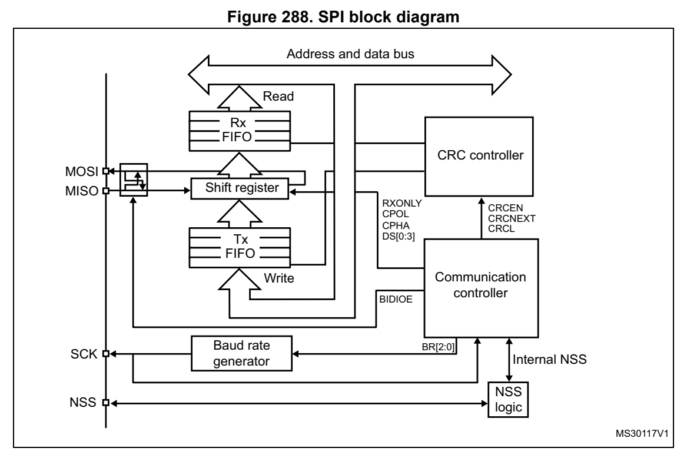
*Figure 288. SPI block diagram (p. 865)*

Four I/O pins are dedicated to SPI communication with external devices.

- MISO: Master In / Slave Out data. In the general case, this pin is u sed to transmit data in slave mode and receive data in master mode.

- MOSI: Master Out / Slave In data. In the general case, this pin is us ed to transmit data in master mode and receive data in slave mode.

- SCK: Serial Clock output pin for SPI m asters and input pin for SPI slaves.

- NSS: Slave select pin. Depending on the SPI and NSS settings, this pin can be used to either: – select an individual slave device for communication – synchronize the data frame or – detect a conflict between multiple masters See Section 27.5.5: Slave sele ct (NSS) pin management for details.

The SPI bus allows the communication betwee n one master device and one or more slave devices. The bus consists of at least two wires - one for the c lock signal and the other for synchronous data transfer. Othe r signals can be added depending on the data exchange between SPI nodes and their sl ave select signal management.

#### 27.5.2 Communications between one master and one slave (p. 866)

The SPI allows the MCU to communicate using different configurations, depending on the device targeted and the applicat ion requirements. These configu rations use 2 or 3 wires (with software NSS management) or 3 or 4 wires (with hardware N SS management). Communication is always initiated by the master.

Full-duplex communication

By default, the SPI is configured for full-duplex communication. In this configuration, the shift registers of the master an d slave are linked using two un idirectional lines between the MOSI and the MISO pins. During SPI communication, data is shifted synchronously on the SCK clock edges provided by the master. The master transmits th e data to be sent to the slave via the MOSI line and rece ives data from the slave via th e MISO line. When the data frame transfer is comp lete (all the bits are shifted) the information between the master and slave is exchanged.

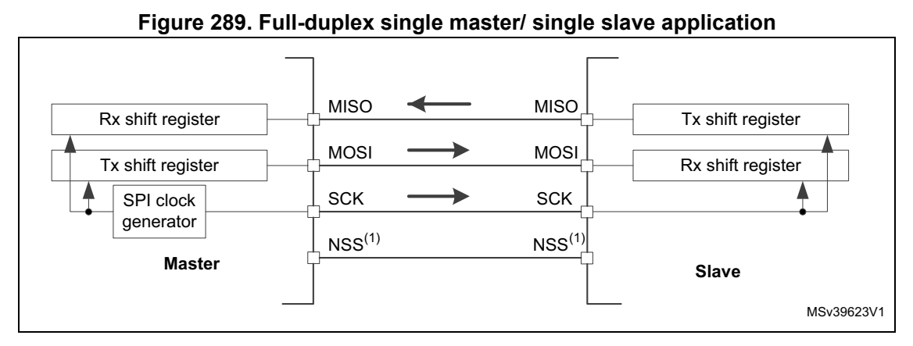
*Figure 289. Full-duplex single mas ter/ single slave application (p. 866)*

1. The NSS pins can be used to provide a hardware control flow b etween master and slave. Optionally, the pins can be left unused by the peripheral. Then the flow has to be handled internally for both master and slave. For more details see Section 27.5.5: Slave select (NSS) pin management.

Half-duplex communication

The SPI can communicate in half- duplex mode by setting the BIDI MODE bit in the SPIx_CR1 register. In this config uration, one single cross conn ection line is used to link the shift registers of the master an d slave together. During this communication, the data is synchronously shifted between th e shift registers on the SCK cl ock edge in the transfer direction selected rec iprocally by both master and slave with t he BDIOE bit in their SPIx_CR1 registers. In this configuration, the master’s MISO pi n and the slave’s MOSI pin are free for other application uses and act as GPIOs.

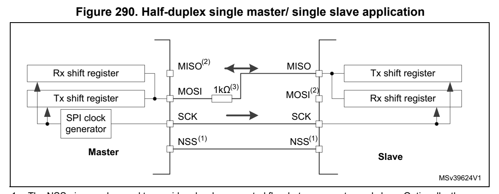
*Figure 290. Half-duplex single master/ sing le slave application (p. 867)*

1. The NSS pins can be used to provide a hardware control flow b etween master and slave. Optionally, the pins can be left unused by the peripheral. Then the flow has to be handled internally for both master and slave. For more details see Section 27.5.5: Slave select (NSS) pin management. 2. In this configuration, the master’s MISO pin and the slave’s MOSI pin can be used as GPIOs. 3. A critical situation can happen when communication direction is changed not synchronously between two nodes working at bidirectionnal mode and new transmitter access es the common data line while former transmitter still keeps an opposite value on the line (the valu e depends on SPI configuration and communication data). Both nodes then fight while providing oppo site output levels on the common line temporary till next node changes its direction settings corresp ondingly, too. It is suggested to insert a serial resistance between MISO and MOSI pins at this mode to protect t he outputs and limit the current blowing between them at this situation.

Simplex communications

The SPI can communicate in simplex mode by setting the SPI in t ransmit-only or in receive-only using the RXONLY bit in t he SPIx_CR2 register. In this con figuration, only one line is used for the transfer between the shift registers of the master and slave. T he remaining MISO and MOSI pins pair is not u sed for communication and can b e used as standard GPIOs.

- Transmit-only mode (RXONLY=0): The configuration settings are the same as for full-duplex. The application has to ignore the information captured on the unused input pin. This pin can be used as a standard GPIO.

- Receive-only mode (RXONLY=1): The application can disable the SPI output function by setting the RXONLY bit. In sla ve configuration, the MISO out put is disabled and the pin can be used as a GPIO. The sl ave continues to receive data from the MOSI pin while its slave select signal is active (see 27.5.5: Slave select (NSS) pin management). Received data events appear depending on the data buffer config uration. In the master configuration, the MOSI output is disabled and the pin can be u sed as a GPIO. The clock signal is gene rated continuously a s long as the SPI is en abled. The only way to stop the clock is to clear the RXONLY bit or the SPE bit and wa it until the incoming pattern from the MISO pin is fin ished and fills the data buffer structure, depending on its configuration.

Figure 291. Simplex single master/single slave application (mas ter in transmit-only/ slave in receive-only mode)

(2) MISO MISO Rx shift register Tx shift register

MOSI MOSI Tx shift register Rx shift register

SPI clock SCK SCK generator NSS (1) (1)NSS Master Slave

MSv39625V1

1. The NSS pins can be used to provide a hardware control flow b etween master and slave. Optionally, the pins can be left unused by the peripheral. Then the flow has to be handled internally for both master and slave. For more details see Section 27.5.5: Slave select (NSS) pin management. 2. An accidental input informati on is captured at the input of t ransmitter Rx shift regi ster. All the events associated with the transmitter receive flow must be ignored in standard transmit only mode (e.g. OVF flag). 3. In this configuration, both the MISO pins can be used as GPIO s. Note: Any simplex communication can be alternatively replaced by a variant of the half-duplex communication with a constant setting of the transaction direction (bidirectional mode is enabled while BDIO bit is not changed).

#### 27.5.3 Standard multi-slave communication (p. 868)

In a configuration with two or m ore independent slaves, the master uses GPIO pins to manage the chip select lin es for each s lave (see Figure 292.). The master must select one of the slaves individually by pu lling low the GP IO connected to the slave NSS input. When this is done, a standard master and dedicated slave communicati on is established.

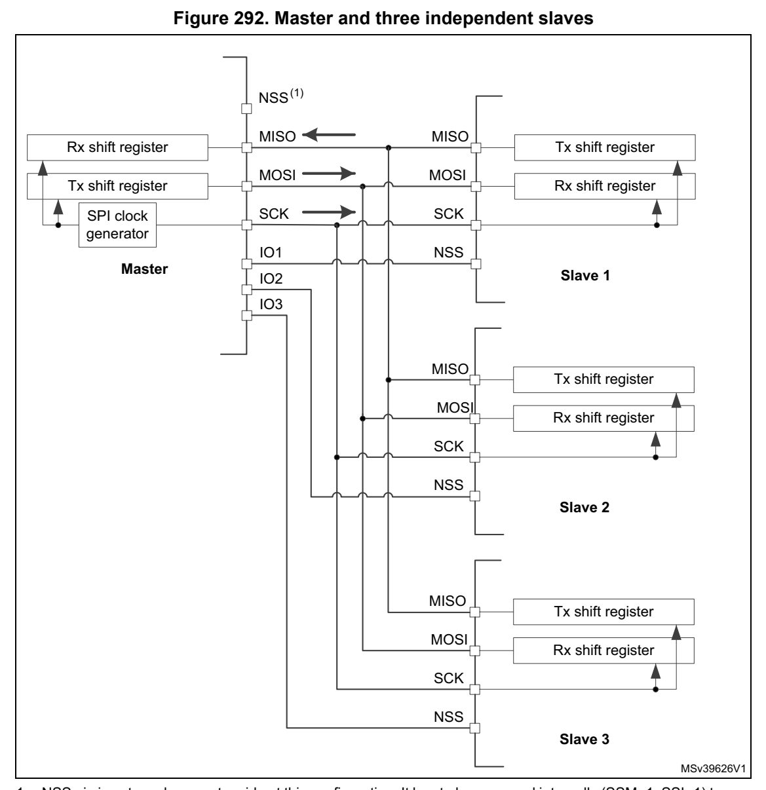
*Figure 292. Master and th ree independe nt slaves (p. 869)*

1. NSS pin is not used on master side at this configuration. It has to be managed internally (SSM=1, SSI=1) to prevent any MODF error. 2. As MISO pins of the slaves a re connected together, all slaves must have the GPIO configuration of their MISO pin set as alternate function open-drain (see I/O alternate function input/output section (GPIO)).

#### 27.5.4 Multi-master communication (p. 869)

Unless SPI bus is not designed for a multi-master capability pr imarily, the user can use build in feature which detects a potential conflict between two nodes trying to master the bus at the same time. For this detectio n, NSS pin is used configured a t hardware input mode.

The connection of more than two SPI nodes working at this mode is impossible as only one node can apply its output on a common data line at time.

When nodes are non act ive, both stay at slave mode by default. Once one node wants to overtake control on th e bus, it switches its elf into master mod e and applies active level on the slave select input of the other node via dedicated GPIO pin. After the session is completed, the active slave select signal is released and the n ode mastering the bus temporary returns back to passive slave mo de waiting for next s ession start.

If potentially both nodes raised their mastering request at the same time a bus conflict event appears (see mode fault MODF even t). Then the user can apply so me simple arbitration process (e.g. to postpone next attempt by predefined different time-outs applied at both nodes).

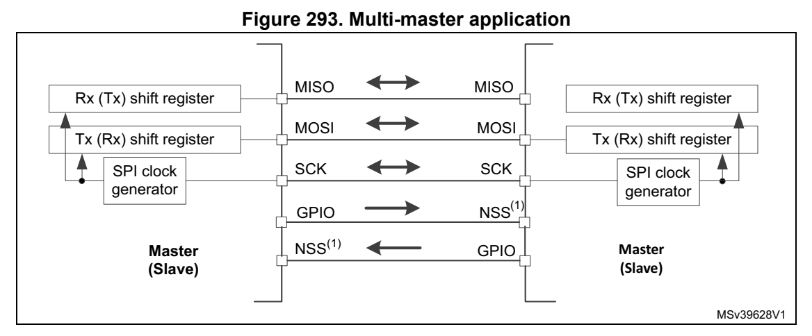
*Figure 293. Multi-master application (p. 870)*

1. The NSS pin is configured at hardware input mode at both node s. Its active level enables the MISO line output control as the passive no de is configured as a slave.

#### 27.5.5 Slave select (NSS) pin management (p. 870)

In slave mode, the NSS works as a standard “ chip select” input and lets the slave communicate with the master. In master mode, NSS can be used ei ther as output or input. As an input it can prevent multimaster bu s collision, and as an output it can drive a slave select signal of a single slave.

Hardware or software slave sel ect management can be set using t he SSM bit in the SPIx_CR1 register:

- Software NSS mana gement (SSM = 1): in this configuration, slave select information is driven internally by the SS I bit value in register SPIx_CR1. The external NSS pin is free for other application uses.

- Hardware NSS mana gement (SSM = 0): in this case, there are two possible configurations. The configurati on used depends on the NSS outpu t configuration (SSOE bit in register SPIx_CR1). – NSS output enable (SSM=0,SSOE = 1): this configuration is only used when the MCU is set as master. The NSS pin is managed by the hardware. T he NSS signal is driven low as soon as the SPI is enabled in master mode (SPE =1), and is kept low until the SPI is disabled ( SPE =0). A pulse can be generate d between continuous commu nications if NSS pulse m ode is activated (NSSP= 1). The SPI cannot work in multim aster configuration with this NSS setting. – NSS output disable ( SSM=0, SSOE = 0): if the microcontroller is acting as the master on the bus, this configuration allows multimaster capabi lity. If the NSS pin is pulled low in this mode, the SPI enters master mode fault state and the device is automatically reconfigured in slave mode. In slave mode, the NS S pin works as a standard “chip select” input and the slave is selected while NS S line is at low level.

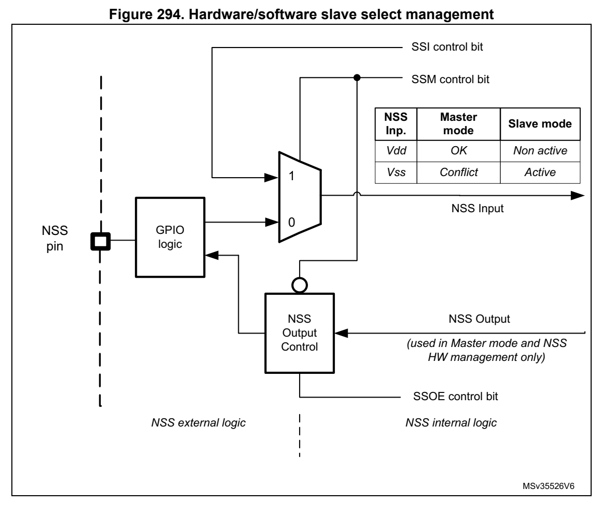
*Figure 294. Hardware/software slave select management (p. 871)*

#### 27.5.6 Communication formats (p. 871)

During SPI communication, recei ve and transmit operations are p erformed simultaneously. The serial clock (SCK) synchroni zes the shifting and sampling of the informatio n on the data lines. The communication format depends on the clock phase, the clock polarity and the data frame format. To be able to communicate together, the master and slaves devices must follow the same communication format.

Clock phase and polarity controls

Four possible timing relationshi ps may be chosen by software, u sing the CPOL and CPHA bits in the SPIx_CR1 register. Th e CPOL (clock polarity) bit co ntrols the idle state value of the clock when no data is being transferred. This bit affects b oth master and slave modes. If CPOL is reset, the SCK pin has a low-level idle state. If CPOL is set, the SCK pin has a high-level idle state.

If the CPHA bit is set, the second edge on the SCK pin captures the first data bit transacted (falling edge if the CPOL bit is reset, rising edge if the CPOL bit is set). Data are latched on each occurrence of th is clock transition ty pe. If the CPHA bit is reset, the first edge on the SCK pin captures the first data bit transacted (falling edge if the CPOL bit is set, rising edge if the CPOL bit is reset). Data are latched on each occurrence of this clock transition type.

The combination of CPOL (clock polarity) and CPHA (clock phase) bits selects the data capture clock edge.

Figure 295, shows an SPI full-duplex transfer with the four combinations of the CPHA and CPOL bits.

Note: Prior to changing the CPOL/CPHA bits th e SPI must be disabled by resetting the SPE bit. The idle state of SCK must correspond to the polarity selected in the SPIx_CR1 register (by pulling up SCK if CPOL=1 or pulling down SCK if CPOL=0).

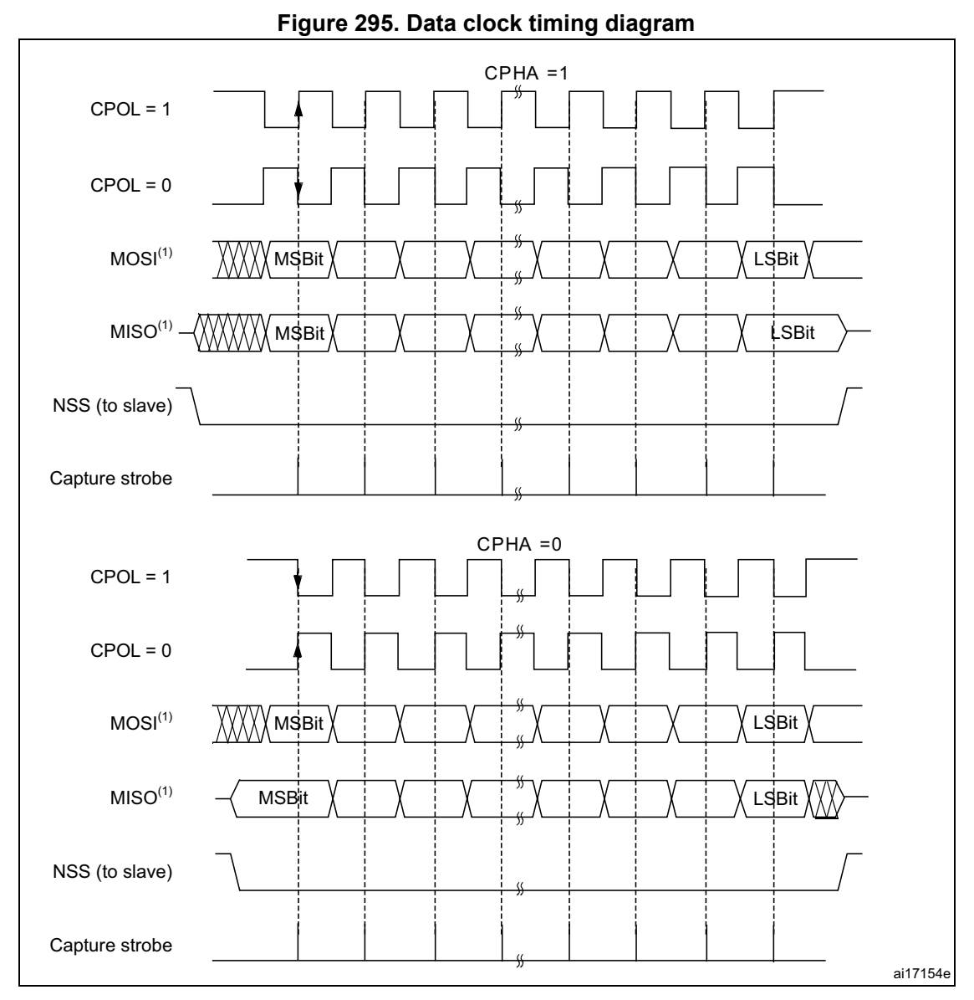
*Figure 295. Data clock timing diagram (p. 872)*

1. The order of data bits depends on LSBFIRST bit setting.

Data frame format

The SPI shift register can be se t up to shift out MSB-first or LSB-first, depending on the value of the LSBFIRST bit. The data frame size is chosen by usi ng the DS bits. It can be set from 4-bit up to 16-bit length and the setting applies for both transmission and reception. Whatever the selected data frame size, read acces s to the FIFO must be aligned with the FRXTH level. When the SPIx_DR register is accessed, data frames are always right-aligned into either a byte (if the data fits into a byte) or a half-word (see Figure 296). During communication, only bits within the data frame a re clocked and transferred.

Figure 296. Data alignment when data length is not equal to 8-b it or 16-bit

DS <= 8 bits: data is right-aligned on byte DS > 8 bits: data is right-aligned on 16 bit Example: DS = 5 bit Example: DS = 14 bit

7 5 4 0 15 14 13 0 XXX Data frame TX XX Data frame TX

7 5 4 0 15 14 13 0 000 Data frame RX 00 Data frame RX

MS19589V2

Note: The minimum data length is 4 bits. If a data length of less than 4 bits is selected, it is forced to an 8-bit data frame size.

#### 27.5.7 Configuration of SPI (p. 873)

The configuration procedure is a lmost the same for master and s lave. For specific mode setups, follow the dedi cated sections. When a standard communication is to be initialized, perform these steps: 1. Write proper GPIO registers: Configure GPIO for MOSI, MISO an d SCK pins. 2. Write to the SPI_CR1 register: a) Configure the serial clock baud rate using the BR[2:0] bits (Note: 4). b) Configure the CPOL and CPHA bi ts combination to define one of the four relationships between the data transfer and the serial clock (C PHA must be cleared in NSSP mode). (Note: 2 - except t he case when CRC is e nabled at TI mode). c) Select simplex or half-duplex mode by configuring RXONLY or BIDIMODE and BIDIOE (RXONLY and BIDIMODE can't be set at the same time). d) Configure the LSBFIRST bit to define the frame format (Note: 2). e) Configure the CRCL and CRCEN bits if CRC is needed (while SC K clock signal is at idle state). f) Configure SSM and SSI (Notes: 2 & 3). g) Configure the MSTR bit (in mul timaster NSS configuration, avoid conflict state on NSS if master is configured to prevent M ODF error). 3. Write to SPI_CR2 register: a) Configure the DS[3:0] bits to select the data length for the transfer. b) Configure SSOE (Notes: 1 & 2 & 3). c) Set the FRF bit if the TI pro tocol is required (keep NSSP bi t cleared in TI mode). d) Set the NSSP bit if the NSS pulse mode between two data units is required (keep CHPA and TI bits cleared in NSSP mode). e) Configure the FRXTH bit. The RXFIFO threshold must be aligne d to the read access size for the SPIx_DR register. f) Initialize LDMA_TX and LDMA_RX bits if DMA is used in packed mode. 4. Write to SPI_CRCPR register: Configure the CRC polynomial if needed. 5. Write proper DMA registers: C onfigure DMA streams dedicated for SPI Tx and Rx in DMA registers if the DMA streams are used.

Note: (1) Step is not required in slave mode.

(2) Step is not required in TI mode.

(3) Step is not required in NSSP mode.

(4) The step is not required in slave mode except slave working at TI mode

#### 27.5.8 Procedure for enabling SPI (p. 874)

It is recommended to enable the SPI slave before the master sen ds the clock. If not, undesired data transmission might occur. The data register of t he slave must already contain data to be sent before starting communication with the master (either on the first edge of the communication clock, or before the en d of the ongoi ng communication if the clock signal is continuous). The SCK signal must be settled at an idle state level corresponding to the selected polarity before the SPI slave is enabled.

The master at full-duplex (or in any transmit-only mode) starts to communicate when the SPI is enabled and TXFIFO is not empty, or with the next write to TXFIFO.

In any master receive only mode (RXONLY=1 or BID IMODE=1 & BIDIO E=0), master starts to communicate and the clock starts running immediately after S PI is enabled.

For handling DMA, follow the dedicated section.

#### 27.5.9 Data transmission and reception procedures (p. 874)

RXFIFO and TXFIFO

All SPI data transactions pass through the 32-bit embedded FIFO s. This enables the SPI to work in a continuous flow, and p revents overruns when the data frame size is short. Each direction has its own FIFO calle d TXFIFO and RXF IFO. These FIFO s are used in all SPI modes except for rece iver-only mode (slave or master) with CRC calculation enabled (see Section 27.5.14: CRC calculation).

The handling of FIFOs depends on the data exchange mode (duplex, simplex), data frame format (number of bits in the frame), access size performed on the FIFO data registers (8-bit or 16-bit), and whether or not d ata packing is used when access ing the FIFOs (see Section 27.5.13: TI mode).

A read access to the SPIx_DR regi ster returns the oldest value stored in RXFIFO that has not been read yet. A write access to the SPIx_DR stores the wri tten data in the TXFIFO at the end of a send queue. The read access must be always aligned with the RXFIFO threshold configured by the FRXT H bit in SPIx_CR2 register. FTLVL[1:0] and FRLVL[1:0] bits indicate the current occ upancy level of both FIFOs.

A read access to the SPIx_DR register must be managed by the RX NE event. This event is triggered when data is stored in RXFIFO and the threshold (defi ned by FRXTH bit) is reached. When RXNE is cleared, RXF IFO is considered to be empty. In a similar way, write access of a data frame to be tran smitted is managed by the TXE event. This event is triggered when the TXFIFO level i s less than or equal to half of its capacity. Otherwise TXE is cleared and the TXFIFO is considered as full. In this way, RXFIFO can store up to four data frames, whereas TXFIFO can only store up to three when the data frame format is not greater than 8 bits. This difference prevents possible corrupti on of 3x 8-bit data frames already stored in the TXFIFO when software tries to write more data in 16-bit mode into TXFIFO. Both TXE and RXNE events can be polled or handled by in terrupts. See Figure 298 through Figure 301.

Another way to manage the data exchange is to use DMA (see Communication using DMA (direct memory addressing)).

If the next data is received wh en the RXFIFO is full, an overru n event occurs (see description of OVR flag at Section 27.5.10: SPI status flags). An overrun event can be polled or handled by an interrupt.

The BSY bit being set indicates ongoing transaction of a curren t data frame. When the clock signal runs continuously, the BSY flag stays set between data frames at master but becomes low for a minimum durati on of one SPI clock at slave between each data frame transfer.

Sequence handling

A few data frames can be passed at single sequence to complete a message. When transmission is enabled, a seq uence begins and continues while any data is present in the TXFIFO of the master. The clock signal is provided continuously by the master until TXFIFO becomes empty, then it stops waiting for additional data.

In receive-only modes, half-dupl ex (BIDIMODE=1, BIDIOE=0) or si mplex (BIDIMODE=0, RXONLY=1) the master starts the sequence immediately when both SPI is enabled and receive-only mode is activated. The clock signal is provided by the master and it does not stop until either SPI or receive-only mode is dis abled by the m aster. The master receives data frames continuously up to this moment.

While the master can provide all the transactions in continuous mode (SCK signal is continuous) it has to respect s lave capability to handle data flow and its content at anytime. When necessary, the master must slow down the communication and provide either a slower clock or separate frames or data sessions with sufficien t delays. Be aware there is no underflow error signal for master or slave in SPI mode, and data from the slave is always transacted and processed by the master even if the slave could not prepare it correctly in time. It is preferable for the slave to use DMA, especially whe n data frames are shorter and bus rate is high.

Each sequence must be encased by the NSS pulse in parallel with the multislave system to select just one of the slaves fo r communication. In a single sl ave system it is not necessary to control the slave with NSS, b ut it is often be tter to provid e the pulse here too, to synchronize the slave with the be ginning of each data sequence. NSS can be managed by both software and hardware (see Section 27.5.5: Slave select (NSS) pin management).

When the BSY bit is set it signi fies an ongoing data frame tran saction. When the dedicated frame transaction is finished, the RXNE flag is raised. The last bit is just sampled and the complete data frame is s tored in the RXFIFO.

Procedure for disabling the SPI

When SPI is disabled, it is mand atory to follow the disable pro cedures described in this paragraph. It is important to do this before the system enters a low-power mode when the peripheral clock is stopped. Ongoi ng transactions can be corrupted in this case. In some modes the disable procedure is the only way to stop continuous communication running.

Master in full-duplex or transmit only mode can finish any tran saction when it stops providing data for transmission. In this case, the clock stops after the last data transaction. Special care must be taken in pa cking mode when an odd number of data frames are transacted to p revent some dummy byte exchange (refer to Data packing section). Before the SPI is disabled in these modes, the user must follow standa rd disable procedure. When

the SPI is disabled at the master transmitter wh ile a frame tra nsaction is ongoing or next data frame is stored in TXFIFO, the SPI behavior is not guaranteed.

When the master is in any receive only mode, the only way to stop the continuous clock is to disable the periphera l by SPE=0. This must occur in specific ti me window withi n last data frame transaction just between t he sampling time of its first b it and before its last bit transfer starts (in order to receive a complete number of expected data frames and to p revent any additional “dummy” data reading after the last valid data frame). Specific procedure must be followed when disabling SPI in this mode.

Data received but not read remains stored in RXFIFO when the SP I is disabled, and must be processed the next time the SPI is enabled, before starting a new sequence. To prevent having unread data, ensure that RXFIFO is empty when disabling the SPI, by using the correct disabling procedure, or by initializing all the SPI reg isters with a software reset via the control of a specific regis ter dedicated to p eripheral reset (see the SPIiRST bits in the RCC_APBiRSTR registers).

Standard disable procedure is based on pu lling BSY status toget her with FTLVL[1:0] to check if a transmission session is fully completed. This check can be done in specific cases, too, when it is necessary to ident ify the end of o ngoing transa ctions, for example:

- When NSS signal is managed by software and master has to provid e proper end of NSS pulse for slave, or

- When transactions’ streams from DMA or FIFO are completed while the last data frame or CRC frame tran saction is still ongoing in the peripheral bus.

The correct disable procedure is (except when receive only mode is used): 1. Wait until FTLVL[1:0] = 00 (no more data to transmit). 2. Wait until BSY=0 (the last data frame is processed). 3. Disable the SPI (SPE=0). 4. Read data until FRLVL[1:0] = 00 (read all the received data).

The correct disable procedure fo r certain receive only modes is: 1. Interrupt the receive flow by disabling SPI (SPE=0) in the sp ecific time window while the last data frame is ongoing. 2. Wait until BSY=0 (the last data frame is processed). 3. Read data until FRLVL[1:0] = 00 (read all the received data).

Note: If packing mode is used and an odd number of data frames with a format less than or equal to 8 bits (fitting into one byte) has to be received, FRXTH must be set when FRLVL[1:0] = 01, in order to generate the RXNE event to read the last odd data frame and to keep good FIFO pointer alignment.

Data packing

When the data frame size fits i nto one byte (le ss than or equal to 8 bits), da ta packing is used automatically when any read or write 16-bit access is performed on the SPIx_DR register. The double data frame pattern is handled in parallel in this case. At first, the SPI operates using the pattern stored in the LSB of the accessed wo rd, then with the other half stored in the MSB. Figure 297 provides an example of data packing mode sequence handling. Two data frames are sent after the single 16-bit acce ss the SPIx_DR register of the transmitter. This sequence can generate just o ne RXNE event in the receiver if the RXFIFO threshold is set to 16 bits (FRXTH=0). The receiver then has to access both data frames by a single 16-bit read of SPIx_DR as a response to this single RXNE event. The

RxFIFO threshold setting and th e following read access must be always kept aligned at the receiver side, as data can b e lost if it is not in line.

A specific problem appears if an odd number of such “fit into o ne byte” data frames must be handled. On the transmitter side, writing the last data frame of any odd sequence with an 8-bit access to SPIx_DR is enough. T he receiver has to change the Rx_FIFO threshold level for the last data frame received in the odd sequence of frames in order to generate the RXNE event.

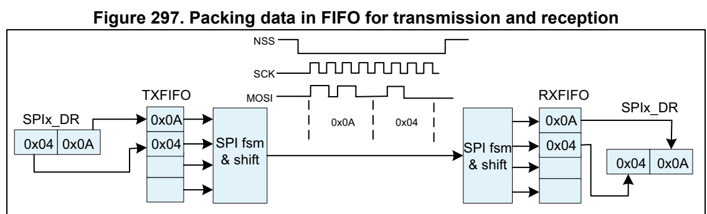
*Figure 297. Packing data in FIFO for transmission and reception (p. 877)*

16-bit access when write to data register 16-bit access when read from data register SPI_DR= 0x040A when TxE=1 SPI_DR= 0x040A when RxNE=1

MS19590V1

1. In this example: Data size DS[3:0] is 4-bit configured, CPOL= 0, CPHA=1 and LSBFIRST =0. The Data storage is always right aligned while the valid bits are performed on the bus only, the content of LSB byte goes first on the bus, the unused bits are not taken into accou nt on the transmitter side and padded by zeros at the receiver side.

Communication using DMA (direct memory addressing)

To operate at its maxim um speed and to fac ilitate the data regi ster read/write process required to avoid ove rrun, the SPI features a DMA capability, w hich implements a simple request/acknowledge protocol.

A DMA access is requested when t he TXE or RXNE enable bit in th e SPIx_CR2 reg ister is set. Separate requests must be i ssued to the Tx and Rx buffers.

- In transmission, a DMA request is issued eac h time TXE is set to 1. The DMA then writes to the SP Ix_DR register.

- In reception, a DMA request is issued each time RXNE is set to 1. The DMA then reads the SPIx_DR register.

See Figure 298 through Figure 301.

When the SPI is used only to tran smit data, it is possible to e nable only the SPI Tx DMA channel. In this case, the OVR flag is set because the data received is not read. When the SPI is used only to receive data, it is possible to enable only the SPI Rx DMA channel.

In transmission m ode, when the DMA has written all the data to be transmitted (the TCIF flag is set in the DMA_ISR regis ter), the BSY flag can be monitored to ensure that the SPI communication is complete. This is required to avoid corrupting the last transmission before disabling the SPI or entering the Stop mode. The software must first wait until FTLVL[1:0]=00 and t hen until BSY=0.

When starting communication using DMA, to prevent DMA channel m anagement raising error events, these steps m ust be followe d in order: 1. Enable DMA Rx buffer in the RXDMAEN bit in the SPI_CR2 register, if DMA Rx is used. 2. Enable DMA streams for Tx and Rx in DMA registers, if the st reams are used. 3. Enable DMA Tx buffer in the TXDMAEN bit in th e SPI_CR2 register, if DMA Tx is used. 4. Enable the SPI by setting the SPE bit.

To close communication it is m andatory to follow these steps in order: 1. Disable DMA streams for Tx and Rx in the DMA registers, if th e streams are used. 2. Disable the SP I by following the SPI disable procedure. 3. Disable DMA Tx and Rx buffers by clearing the TXDMAEN and RX DMAEN bits in the SPI_CR2 register, if DMA Tx and/or DMA Rx are used.

Packing with DMA

If the transfers are managed by DM A (TXDMAEN and RXDMAEN set in the SPIx_CR2 register) packing mode is enable d/disabled automatically depend ing on the PSIZE value configured for SPI TX and the SP I RX DMA channel. If the DMA ch annel PSIZE value is equal to 16-bit and SPI data size is less than or equal to 8-bi t, then packing mode is enabled. The DMA then automatica lly manages the write operation s to the SPIx_DR register.

If data packing mode is used an d the number of data to transfer is not a multiple of two, the LDMA_TX/LDMA_RX bits must be se t. The SPI then considers only o ne data for the transmission or reception to serve the last DMA transfer (for m ore details refer to Data packing on page 876.)

Communication diagrams

Some typical timing schemes are explained in this section. Thes e schemes are valid no matter if the SPI events are handled by polling, interrupts or DMA. For simplicity, the LSBFIRST=0, CPOL=0 and CPHA=1 setting is used as a common assum ption here. No complete configura tion of DMA streams is provided.

The following numbered notes are common for Figure 298 on page 880 through Figure 301 on page 883: 1. The slave starts to control MISO line as NSS is active and SP I is enabled, and is disconnected from the line when o ne of them is re leased. Suffic ient time must be provided for the slave to prepare data dedicated to the master in advance before its transaction starts. At the master, the SPI peripheral takes control at MOSI and SCK signals (occasionally at NSS signal as well) only if SPI is enabled. If SPI is disabl ed the SPI peripheral is disconnected from GPIO logic, so the levels at these lines depe nds on GPIO setting exclusively. 2. At the master, BSY stays active between frames if the commun ication (clock signal) is continuous. At the slave, BSY signal always goes down for at le ast one clock cycle between data frames. 3. The TXE signal is clea red only if TXFIFO is full. 4. The DMA arbitration process starts just after the TXDMAEN bi t is set. The TXE interrupt is generated just after the TXEIE is set. As the TXE signal is at an active level, data transfers to TxFIFO start, until TxFIFO becomes full or th e DMA transfer completes. 5. If all the data to be sent can fit into TxFIFO, the DMA Tx T CIF flag can be raised even before communication on the SPI bus starts. This flag always ri ses before the SPI transaction is completed. 6. The CRC value for a package i s calculated continuously frame by frame in the SPIx_TXCRCR and SPIx_RXCRCR regi sters. The CRC information is p rocessed after the entire data package has compl eted, either automatically by DMA (Tx channel must be set to the number of data frames to be p rocessed) or by SW (the user must handle CRCNEXT bit during the las t data frame processing). While the CRC value cal culated in SPIx_TXCRC R is simply sent ou t by transmitter, received CRC information is loade d into RxFIFO and then compare d with the SPIx_RXCRCR register content (CRC error flag can be raised here if any difference). This is why the user must take care to flush this information from the FIFO, either by software reading out all the stored content of RxFIFO, or by DM A when the proper number of data frames i s preset for Rx channel (number of data frames + number of CRC frames) (see the settings at the example assumption). 7. In data packed mode, TxE and RxNE events are paired and each read/write access to the FIFO is 16 bits wid e until the number of data frames are even. If the TxFIFO is ¾ full FTLVL status stays at FIFO full level. That is why the last odd data frame cannot be stored before the TxFIFO becomes ½ full. This frame is stored i nto TxFIFO with an 8-bit access either by software or automatica lly by DMA when LDMA_TX control is set. 8. To receive the last odd data frame in packed mode, the Rx th reshold must be changed to 8-bit when the last data frame is processed, either by software setting FRXTH=1 or automatically by a DM A internal signal when LDMA_RX is set.

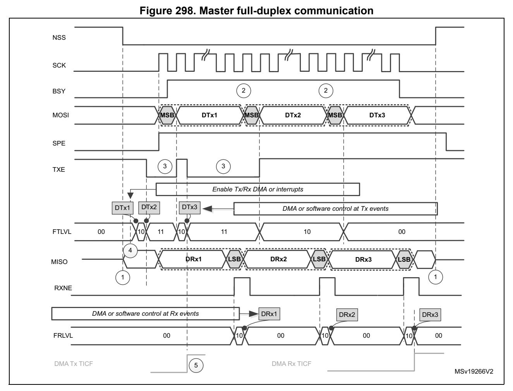
*Figure 298. Master full-duplex communication (p. 880)*

Assumptions for master full-du plex communication example:

- Data size > 8 bit

If DMA is used:

- Number of Tx frames transacted by DMA is set to 3

- Number of Rx frames transacted by DMA is set to 3

See also: Communication diagrams on page 879 for details about common assumptions and notes.

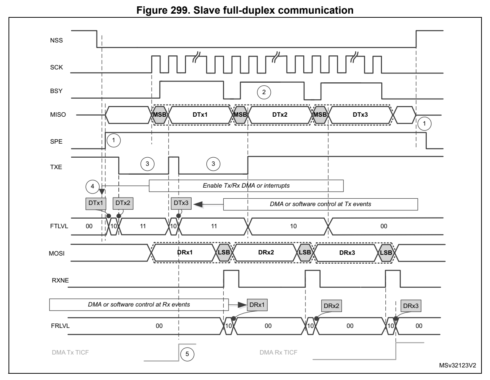
*Figure 299. Slave full-duplex communication (p. 881)*

Assumptions for slave full-duplex communication example:

- Data size > 8 bit

If DMA is used:

- Number of Tx frames transacted by DMA is set to 3

- Number of Rx frames transacted by DMA is set to 3

See also: Communication diagrams on page 879 for details about common assumptions and notes.

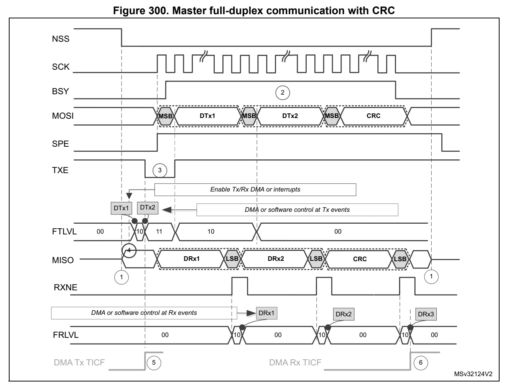
*Figure 300. Master full-dupl ex communication with CRC (p. 882)*

Assumptions for master full-dupl ex communication with CRC examp le:

- Data size = 16 bit

- CRC enabled

If DMA is used:

- Number of Tx frames transacted by DMA is set to 2

- Number of Rx frames transacted by DMA is set to 3

See also: Communication diagrams on page 879 for details about common assumptions and notes.

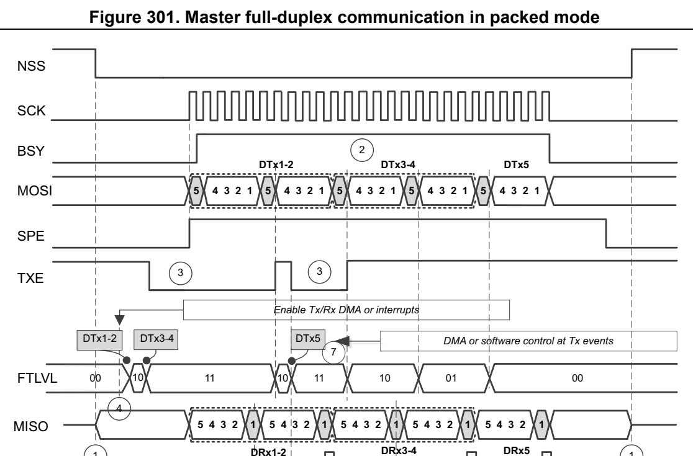
*Figure 301. Master full-duplex communication in packed mode (p. 883)*

RXNE

| Col 3 | DMA or software control at Rx events | Col 5 | Col 6 | Col 7 | DRx1-2 | Col 9 | DRx3-4 | FRTHX=1 | Col 12 | DRx5 | Col 14 | Col 15 |
| --- | --- | --- | --- | --- | --- | --- | --- | --- | --- | --- | --- | --- |
| FRLVL | 00 DMA Tx TICF | 01 | 01 5 | 10 | 00 | DMA Rx TICF | 01 | 8 00 | 01 |  | 00 | MSv32125V2 |
| • • • • • • • See also and notes. | Assumptions for master full-dupl Data size = 5 bit FRXTH=0 If DMA is used: Number of Tx frames to be tr Number of Rx frames to be tran PSIZE for both Tx and Rx DMA LDMA_TX=1 and LDMA_RX=1 | Read/write FIFO is performed mostly by 16-bit access : Communication diagrams on page 879 | Read/write FIFO is performed mostly by 16-bit access |  |  | ex communication in packed mode ansacted by DMA is set to 3 sacted by DMA is set to 3 channel is set to 16-bit |  |  |  | example: for details about common assumptions |  |  |

#### 27.5.10 SPI status flags (p. 884)

Three status flags are provided for the application to complete ly monitor the state of the SPI bus.

Tx buffer empty flag (TXE)

The TXE flag is set when transm ission TXFIFO has enough space to store data to send. TXE flag is linked to the TXFIFO level. The flag goes high and stays high until the TXFIFO level is lower or equa l to 1/2 of the FIFO depth. An interrupt can be generated if the TXEIE bit in the SPIx_CR2 register is set. The bit is cleared automat ically when the TXFIFO level becomes greater than 1/2.

Rx buffer not empty (RXNE)

The RXNE flag is set depending on the FRXTH bit value in the SP Ix_CR2 register:

- If FRXTH is set, RXNE goes high and stays high until the RXFIFO level is greater or equal to 1/4 (8-bit).

- If FRXTH is cleared, RXNE goes high and stays high until the RX FIFO level is greater than or equal to 1/2 (16-bit).

An interrupt can be generated if the RXNEIE bit in the SPIx_CR2 register is set.

The RXNE is cleared by hardware automatically when the above co nditions are no longer true.

Busy flag (BSY)

The BSY flag is set and cleared by hardware (writing to this fl ag has no effect).

When BSY is set, it indicates th at a data transfer is in progre ss on the SPI (the SPI bus is busy).

The BSY flag can be used in certain modes to detect the end of a transfer so that the software can disable the SPI or its peripheral clock before entering a low-power mode which does not provide a clock for the peripheral. This avoids corrup ting the last transfer.

The BSY flag is also useful for preventin g write collisions in a multimaster system.

The BSY flag is cleared under an y one of the following conditio ns:

- When the SPI is correctly disabled

- When a fault is detected in Ma ster mode (MODF bit set to 1)

- In Master mode, when it finishes a data transmission and no new data is ready to be sent

- In Slave mode, when the BSY flag is set to '0' for at least one SPI clock cycle between each data transfer.

Note: When the next transmission can be handled imme diately by the master (e.g. if the master is in Receive-only mode or its Transmit FIFO is not empty), communication is continuous and the BSY flag remains set to '1' be tween transfers on the master side. Although this is not the case with a slave, it is recommended to use always the TXE and RXNE flags (instead of the BSY flags) to handle data transmission or reception operations.

#### 27.5.11 SPI error flags (p. 885)

An SPI interrupt is generated if one of the following error fla gs is set and interrupt is enabled by setting the ERRIE bit.

Overrun flag (OVR)

An overrun condition occurs when data is received by a master o r slave and the RXFIFO has not enough space to store th is received data. This can happ en if the software or the DMA did not have enough time to read the previously received data (stored in the RXFIFO) or when space for data storage is limited e.g. the RXFIFO is no t available when CRC is enabled in receive only mode so in this case the reception buffer is limited into a single data frame buffer (see Section 27.5.14: CRC calculation).

When an overrun condition occurs, the newly received value does not overwrite the previous one in the RXFIFO. The newly received value is discard ed and all data transmitted subsequently is lost. Clearing th e OVR bit is don e by a read access to the SPI_DR register followed by a read access to the SPI_SR register.

Mode fault (MODF)

Mode fault occurs when the master device has its internal NSS s ignal (NSS pin in NSS hardware mode, or SSI bit in NSS software mode) pulled low. Thi s automatically sets the MODF bit. Master mode fault affects the SPI interface in the fo llowing ways:

- The MODF bit is set and an SPI i nterrupt is generated if the ER RIE bit is set.

- The SPE bit is cleared. This bloc ks all output fro m the device and disables the SPI interface.

- The MSTR bit is cleared, thus forcing the device into slave mod e.

Use the following software seq uence to clear the MODF bit: 1. Make a read or write access to the SPIx_SR register while the MODF bit is set. 2. Then write to the SPIx_CR1 register.

To avoid any multiple slave conflicts in a system comprising several MCUs, the NSS pin must be pulled high during the MODF bit clearing sequence. The SPE and MSTR bits can be restored to their original state after this clearing sequence. As a security, hardware does not allow the SPE and MSTR bits to be set while th e MODF bit is set. In a slave device the MODF bit cannot be set except as the result of a previous multi master conflict.

CRC error (CRCERR)

This flag is used to verify the validity of the value received when the CRCEN bit in the SPIx_CR1 register is set. The CRCERR flag in the SPIx_SR register is set if the value received in the shift register d oes not match the receiver SPIx_RXCRCR value. The flag is cleared by the software.

TI mode frame format error (FRE)

A TI mode frame format error is detected when an NSS pulse occu rs during an ongoing communication when the SPI is operating in slave mode and confi gured to conform to the TI mode protocol. When this error occurs, the FRE flag is set in t he SPIx_SR register. The SPI is not disabled when an error occurs, the NSS pulse is ignored, and the SPI waits for the next NSS pulse before starting a new transfer. The data may be corrupted since the error detection may result in th e loss of two data bytes.

The FRE flag is cleared when SPI x_SR register is read. If the E RRIE bit is set, an interrupt is generated on the NS S error detection. In this case, the SPI should be disabled because data consistency is no longer gua ranteed and communications sho uld be reinitiated by the master when the slave SPI is enabled again.

#### 27.5.12 NSS pulse mode (p. 886)

This mode is activated by the N SSP bit in the SPIx_CR2 register and it takes effect only if the SPI interface is configured a s Motorola SPI master (FRF=0) with capture on the first edge (SPIx_CR1 CPHA = 0, CPOL setting is ignored). When activated, an NSS pulse is generated between two consecutive data frame transfers when NSS stays at high level for the duration of one clock peri od at least. This mode allows the slave to latch data. NSSP pulse mode is designed for applications with a single master-sl ave pair.

Figure 302 illustrates NSS pin management when NSSP pulse mode is enabled.

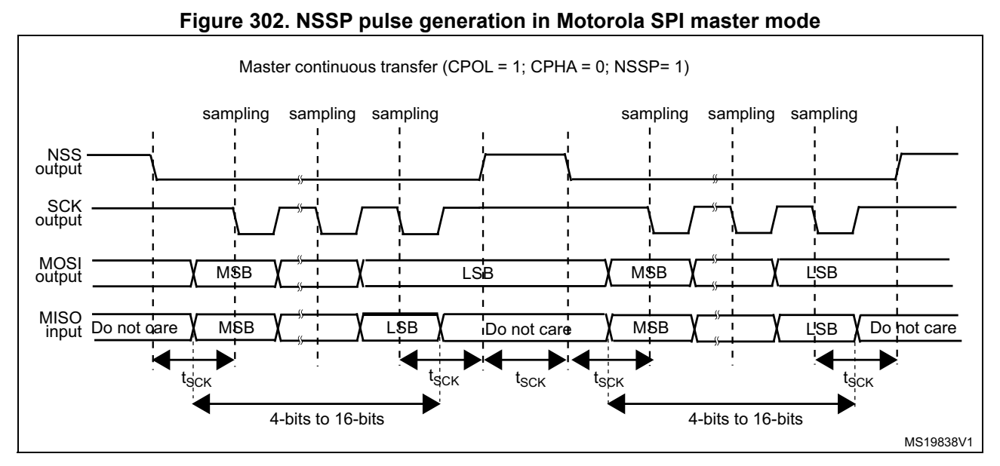
*Figure 302. NSSP pulse generati on in Motorola SPI master mode (p. 886)*

Note: Similar behavior is encountered when CPOL = 0. In this case the sampling edge is the rising edge of SCK, and NSS assertion an d deassertion refer to this sa mpling edge.

#### 27.5.13 TI mode (p. 886)

TI protocol in master mode

The SPI interface is compatible w ith the TI proto col. The FRF b it of the SPIx_CR2 register can be used to configure the SPI to be compliant with this protocol.

The clock polarity and phase are forced to conform to the TI protocol requirements whatever the values set in the SPIx_CR1 register. NSS management is also specific to the TI protocol which makes the configuration of NSS management th rough the SPI x_CR1 and SPIx_CR2 registers (SSM, SSI, SSOE) impossible in this case.

In slave mode, the SPI baud rate pre scaler is used to control t he moment when the MISO pin state changes to HiZ when the current transaction finishes (see Figure 303). Any baud rate can be used, makin g it possible to determine this moment w ith optimal flexibility. However, the baud rate is generally set to the external master clock baud rate. The delay for the MISO signal to become HiZ (t release) depends on internal resynchronization and on the

baud rate value set in through th e BR[2:0] bits in the SPIx_CR1 register. It is given by the formula:

t t -----------baud_rate---------- + 4t× <<t ---------------------baud_rate + 6t× 2 pclk release 2 pclk

If the slave detects a misplaced NSS pulse during a data frame transaction the TIFRE flag is set.

If the data size is e qual to 4-bits or 5-b its, the master in fu ll-duplex mode or transmit-only mode uses a protocol with one mo re dummy data bit added after L SB. TI NSS pulse is generated above this dummy bit c lock cycle instead of the LSB i n each period.

This feature is not available fo r Motorola SPI communications ( FRF bit set to 0).

Figure 303: TI mode transfer shows the SPI communication waveforms when TI mode is selected.

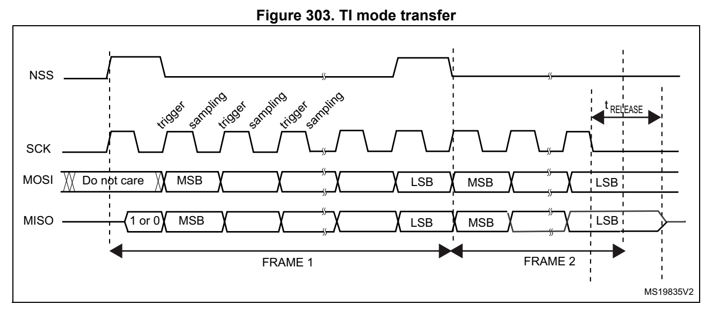
*Figure 303. TI mode transfer (p. 887)*

#### 27.5.14 CRC calculation (p. 887)

Two separate CRC calculators are implemented in order to check the reliability of transmitted and received data. The SPI offers CRC8 or CRC16 cal culation independently of the frame data length, which can be fixed to 8-bit or 16-bit. F or all the other data frame lengths, no CRC is available.

CRC principle

CRC calculation is enabled by s etting the CRCEN bit in the SPIx_CR1 register before the SPI is enabled (SPE = 1). The CRC value is ca lculated using an odd programmable polynomial on each bit. The calculation is processed on the sam pling clock edge defined by the CPHA and CPOL bits in the SPIx_CR1 register. The calculated CRC value is checked automatically at the end of the data block as well as for transfer managed by CPU or by the DMA. When a mismatch is detected between the CRC calculated internally on the received data and the CRC sent by the transmitter, a CRCERR flag is set to indicate a data corruption error. The right procedure for handling the CRC calculation dep ends on the SPI configuration and the chosen transfer management.

Note: The polynomial value should only be odd. No even values are supported.

CRC transfer managed by CPU

Communication starts and continues normally until the last data frame has to be sent or received in the SPIx_DR register. Then CRCNEXT bit has to be se t in the SPIx_CR1 register to indicate that the CRC frame transacti on follows after the transaction of the currently processed data frame. The CRCNEXT bit must be set before the end of the last data frame trans action. CRC calculation is frozen during CRC transaction.

The received CRC is stored in the RXFIFO like a data byte or wo rd. That is why in CRC mode only, the reception buffer has to be considered as a singl e 16-bit buffer used to receive only one data frame at a time.

A CRC-format transaction usually takes one more data frame to communicate at the end of data sequence. However, when setting an 8-bit data frame checke d by 16-bit CRC, two more frames are necessary to send the complete CRC.

When the last CRC data is received, an automatic check is perfo rmed comparing the received value and the value in t he SPIx_RXCRC register. Softwa re has to check the CRCERR flag in the SPIx_SR regis ter to determine if the data transfers were corrupted or not. Software clears the CRCE RR flag by writing '0' to it.

After the CRC recepti on, the CRC value is stored in the RXFIFO and must be read in the SPIx_DR register in order to clear the RXNE flag.

CRC transfer managed by DMA

When SPI communication is enab led with CRC communication and DM A mode, the transmission and reception of t he CRC at the end of communicati on is automatic (with the exception of reading CRC data in receive only mode). The CRCNEXT bit does not have to be handled by the software. The counter for the SPI transmissio n DMA channel has to be set to the number of data frames to transmit excluding the CRC frame. On the receiver side, the received CRC value is handled automatically by DMA at the e nd of the transaction but user must take care to flush out received CRC information from RXFIFO as it is always loaded into it. In full-duplex mode, the counter of the recepti on DMA channel can be set to the number of data frames to receive including the CRC, which m eans, for example, in the specific case of an 8-bit data frame checked by 16-bit CRC: DMA_RX = Numb_of_data + 2

In receive only mode, the DMA reception channel counter should contain only the amount of data transferred, excl uding the CRC calculation. Then based on the complete transfer from DMA, all the CRC values must be read back by software from FIFO as it works as a single buffer in this mode.

At the end of the data and CRC transfers, the CRCERR flag in th e SPIx_SR register is set if corruption occurred during the transfer.

If packing mode is used, the LDM A_RX bit needs managing if the number of data is odd.

Resetting the SPIx_TXCRC and SPIx_RXCRC values

The SPIx_TXCRC and SPI x_RXCRC values are cle ared automatically when new data is sampled after a CRC pha se. This allows the u se of DMA circular mode (not available in receive-only mode) in order to transfer data without any interruption, (several data blocks covered by intermediate CRC checking phases).

If the SPI is disabled during a communication the following seq uence must be followed: 1. Disable the SPI 2. Clear the CRCEN bit 3. Enable the CRCEN bit 4. Enable the SPI

Note: When the SPI interface is configured as a slave, the NSS internal signal needs to be kept low during transaction of the CRC phase once the CRCNEXT signal is released. That is why the CRC calculation cannot be used at NSS Pulse mode when NSS hardware mode should be applied at slave normally. At TI mode, despite the fact that clock ph ase and clock polarity setting is fixed and independent on SPIx_CR1 register, the corresponding setting CPOL=0 CPHA=1 has to be kept at the SPIx_CR1 register anyway if CRC is applied. In addition, the CRC calculation has to be reset between sessions by SPI disable sequence with re-enable the CRCEN bit described above at both master and slave side, else CRC calculation can be corrupted at this specific mode.

### 27.6 SPI interrupts (p. 889)

During SPI communication an interrupt can be generated by the following events:

- Transmit TXFIFO ready to be loaded

- Data received in Receive RXFIFO

- Master mode fault

- Overrun error

- TI frame format error

- CRC protocol error

Interrupts can be enabled and disabled separately.

**Table 130. SPI interrupt requests (p. 889)**

| Col 3 | Interrupt event Event flag Enable Control bit | Col 5 |
| --- | --- | --- |
| Transmit TXFIFO ready to be loaded TXE TXEIE |  |  |
| Data received in RXFIFO RXNE RXNEIE |  |  |
| Master Mode fault event MODF |  |  |
| Overrun error OVR |  | ERRIE |
| TI frame format error FRE |  | ERRIE |
| CRC protocol error CRCERR |  |  |

### 27.7 I2S functional description (p. 890)

#### 27.7.1 I2S general description (p. 890)

The block diagram of t he I2S is shown in Figure 304.

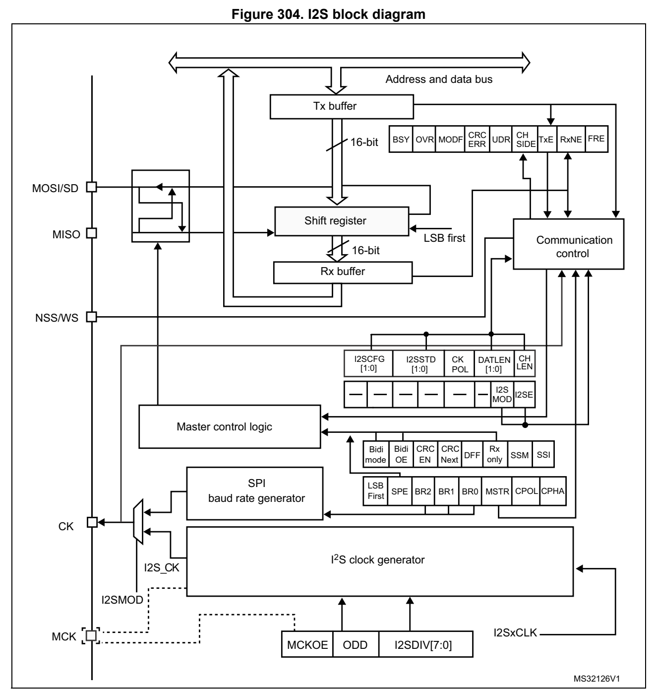
*Figure 304. I2S block diagram (p. 890)*

1. MCK is mapped on the MISO pin. The SPI can function as an audio I2S interface when the I2S cap ability is enabled (by setting the I2SMOD bit in the SPIx_I2SCFGR register). This inte rface mainly uses the same pins, flags and interrupts as the SPI.

The I2S shares three com mon pins with the SPI:

- SD: Serial Data (mapped on the M OSI pin) to transmit or receive the two time-multiplexed data channels (in half-duplex mode only).

- WS: Word Select (mapped on the N SS pin) is the data control sig nal output in master mode and input in slave mode.

- CK: Serial Clock (mapped on the SCK pin) is the serial clock ou tput in master mode and serial clock input in slave mode.

An additional pin can be used wh en a master clock output is nee ded for some external audio devices:

- MCK: Master Clock (mapped separately) is used, when the I2S is configured in master mode (and when the MC KOE bit in the SPIx_I2 SPR register is set), to output this additional clock generated at a preconfigured frequency rate eq ual to 256 × f S, where f S is the audio sampling frequency.

The I2S uses its own clock generator to produce the communicati on clock when it is set in master mode. This clock generator is also the source of the mas2 ter clock output. Two additional registers are available in I S mode. One is linked to the clock generator configuration SPIx_I2SPR and the other one is a generic I2S con figuration register SPIx_I2SCFGR (audio standard, s lave/master mode, data format, p acket frame, clock polarity, etc.). 2 The SPIx_CR1 register and all CRC registers are not used in the I S mode. Likewise, the SSOE bit in the SPIx_CR2 register and the MODF and CRCERR bits in the SPIx_SR are not used.

The I2S uses the same SPI register for data transfer (SPIx_DR) in 16-bit wide mode.

#### 27.7.2 Supported audio protocols (p. 891)

The three-line bus has to handle only audio data generally time -multiplexed on two channels: the right channel and the left channel. However there is only one 16-bit register for transmission or reception. S o, it is up to the software to write into the da ta register the appropriate value corresponding to each channel side, or to rea d the data from the data register and to identify the corresponding channel by checking the CHSIDE bit in the SPIx_SR register. Channel left i s always sent first followed by the channel right (CHSIDE has no meaning for the PCM protocol).

Four data and packet frames are available. Data may be sent wit h a format of:

- 16-bit data packed in a 16-bit frame

- 16-bit data packed in a 32-bit frame

- 24-bit data packed in a 32-bit frame

- 32-bit data packed in a 32-bit frame

When using 16-bit data extended on 32-bit packet, the first 16 bits (MSB) are the significant bits, the 16-bit LSB is forced to 0 without any need for softwa re action or DMA request (only one read/write operation).

The 24-bit and 32-bit data frames need two CPU read or write op erations to/from the SPIx_DR register or two DMA operat ions if the DMA is preferred for the application. For 24-bit data frame specifically, the 8 non-significant bits are extended to 32 bits with 0-bits (by hardware).

For all data formats a nd communication stan dards, the most sign ificant bit is always sent first (MSB first). 2 The I S interface supports four audio standards, configurable using t he I2SSTD[1:0] and PCMSYNC bits in the SPI x_I2SCFGR register.

2 I S Philips standard

For this standard, the WS signal is used to indicate which chan nel is being transmitted. It is activated one CK clock cycle befo re the first bit (MSB) is avai lable.

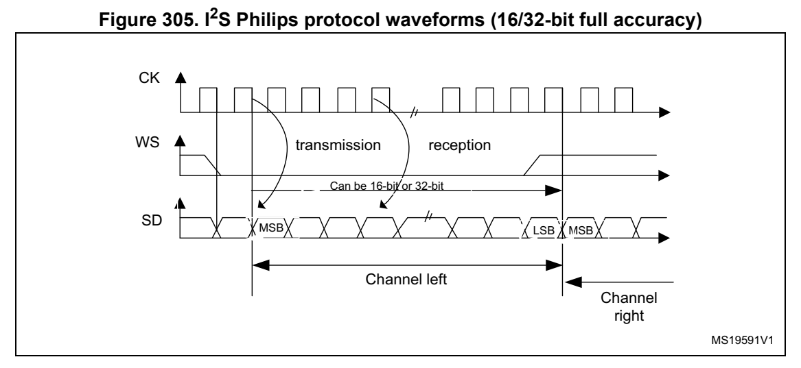
*Figure 305. I S Philips protocol waveforms (16/32-bit full accuracy) (p. 892)*

Data are latched on the falling edge of CK (for the transmitter) and are read on the rising edge (for the receiver). The WS signal is also latched on the falling edge of CK.

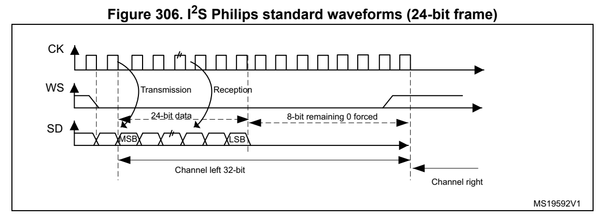
*Figure 306. I S Philips standard waveforms (24-b it frame) (p. 892)*

This mode needs two write or rea d operations to/from the SPIx_D R register.

- In transmission mode: If 0x8EAA33 has to be sent (24-bit):

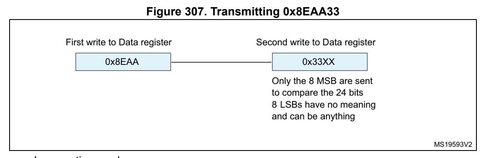
*Figure 307. Transmitting 0x8EAA33 (p. 893)*

- In reception mode: If data 0x8EAA33 is received:

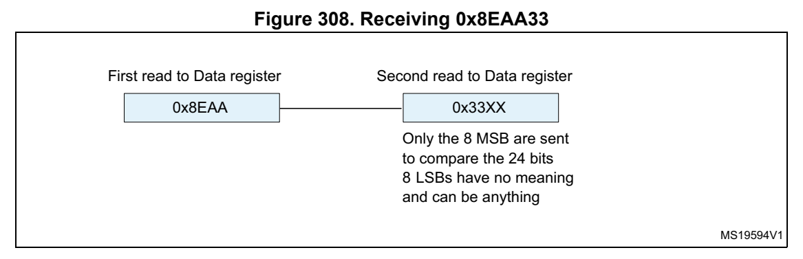
*Figure 308. Receiving 0x8EAA33 (p. 893)*

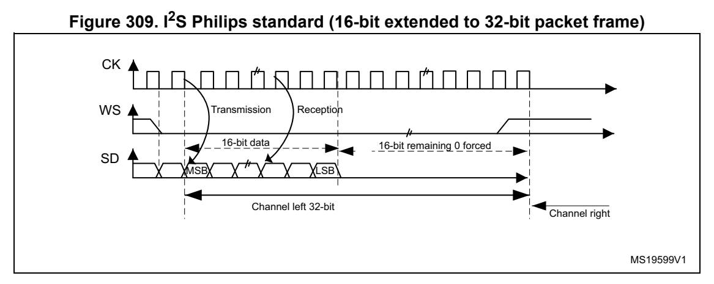
*Figure 309. I2S Philips standard (16-bit extended to 32-bit packet frame) (p. 893)*

When 16-bit data frame extended to 32-bit channel frame is sele cted during the I2S configuration phase, only one access to the SPIx_DR register is required. The 16 remaining bits are forced by hardware to 0x0000 to extend the data to 32- bit format.

If the data to transmit or the received data are 0x76A3 (0x76A3 0000 extended to 32-bit), the operation shown in Figure 310 is required.

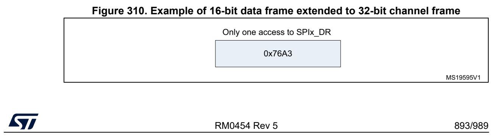
*Figure 310. Example of 16-bit data frame extended to 32-bit cha nnel frame (p. 893)*

For transmission, each time an MSB is written to SPIx_DR, the TXE flag is set and its interrupt, if allowed, is generated to load the SPIx_DR registe r with the new value to send. This takes place even if 0x0000 have not yet been sent because it is done by hardware.

For reception, the RXN E flag is set and its interrupt, if allowed, is generated when the first 16 MSB half-word is received.

In this way, more time is provi ded between two write or read op erations, which prevents underrun or overrun conditions ( depending on the direction of t he data transfer).

MSB justified standard

For this standard, the WS signal is generated at the same time as the first data bit, which is the MSBit.

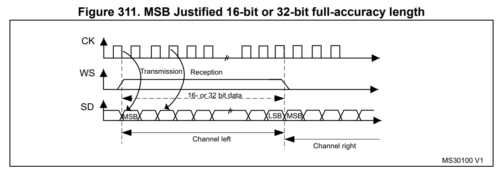
*Figure 311. MSB Justifi ed 16-bit or 32-bit full-accuracy length (p. 894)*

Data are latched on the falling edge of CK (for transmitter) an d are read on the rising edge (for the receiver).

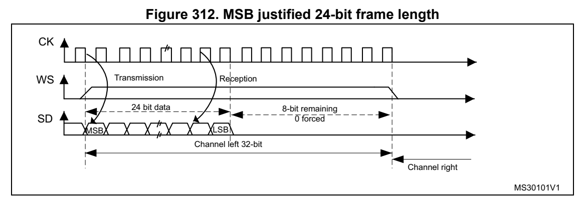
*Figure 312. MSB justifi ed 24-bit frame length (p. 894)*

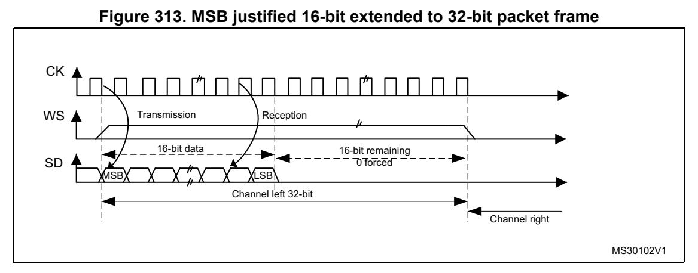
*Figure 313. MSB justified 16-bi t extended to 32-bit packet fram e (p. 895)*

LSB justified standard

This standard is similar to the MSB justified standard (no difference for the 16-bit and 32-bit full-accuracy frame formats). 2 The sampling of the input and out put signals is the same as for the I S Philips standard.

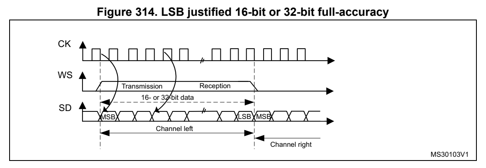
*Figure 314. LSB justified 16- bit or 32-bit full-accuracy (p. 895)*

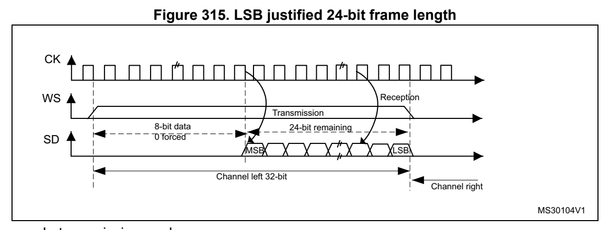
*Figure 315. LSB justifie d 24-bit fra me length (p. 895)*

- In transmission mode: If data 0x3478AE have to be tran smitted, two write operations to the SPIx_DR register are required by software or by DM A. The operations are shown be low.

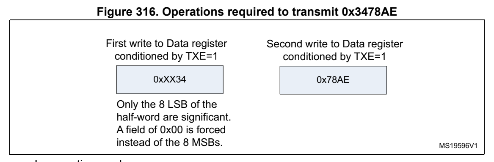
*Figure 316. Operations required to transmit 0x3478AE (p. 896)*

- In reception mode: If data 0x3478AE are received, two successive read operations from the SPIx_DR register are required on each RXNE event.

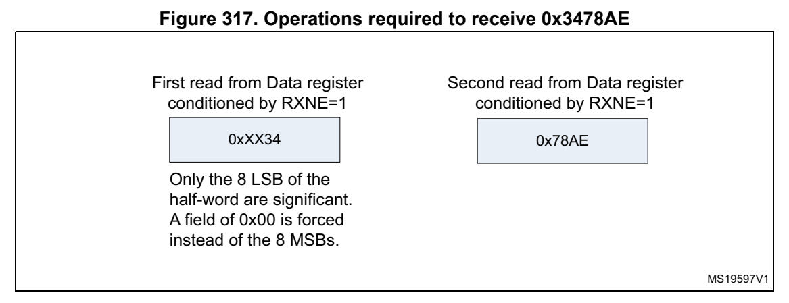
*Figure 317. Operations required to receive 0x3478AE (p. 896)*

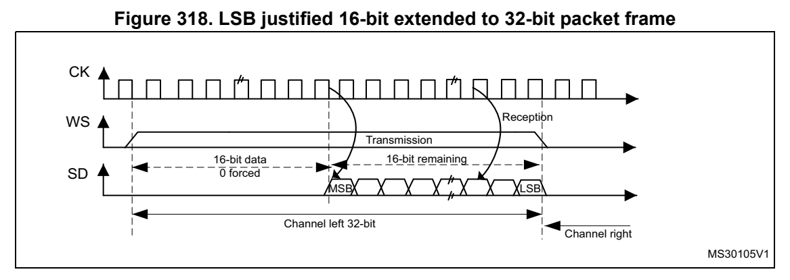
*Figure 318. LSB justified 16-bit extended to 32-bit packet fram e (p. 896)*

When 16-bit data frame extended to 32-bit channel frame is sele cted during the I2S configuration phase, Only one access to the SPIx_DR register is required. The 16 remaining bits are forced by hardware to 0x0000 to extend the data to 32- bit format. In this case it corresponds to the half-word MSB.

If the data to tra nsmit or the received data are 0x76A3 (0x0000 76A3 extended to 32-bit), the operation shown in Figure 319 is required.

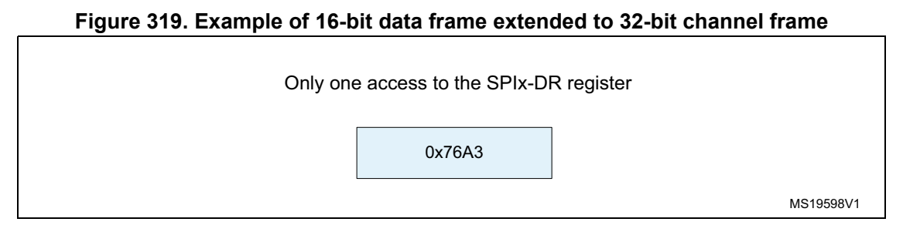
*Figure 319. Example of 16-bit data frame extended to 32-bit cha nnel frame (p. 897)*

In transmission mode, when a TXE event occurs, the application has to write th e data to be transmitted (in this case 0x76A3). The 0x000 fie ld is transmitted first (extension on 32-bit). The TXE flag is set again as soon as the effective data (0x76A3) is sent on SD.

In reception mode, RXNE is asserted as soon as the significant half-word is received (and not the 0x0000 field).

In this way, more time is provided between two write or read op erations to prevent underrun or overrun conditions.

PCM standard

For the PCM standard, there is n o need to use channel-side info rmation. The two PCM modes (short and long frame) are available and configurable usi ng the PCMSYNC bit in SPIx_I2SCFGR register.

In PCM mode, the output signals (WS, SD) are sam pled on the ris ing edge of CK signal. The input signals (WS, SD) are captured on the falling edge of CK.

Note that CK and WS are configured as output in MASTER mode.

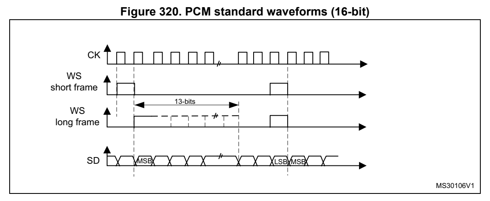
*Figure 320. PCM standard waveforms (16-bit) (p. 897)*

For long frame synchronization, the WS signal assertion time is fixed to 13 bits in master mode.

For short frame synchronization, the WS synchronization signal is only one cycle long.

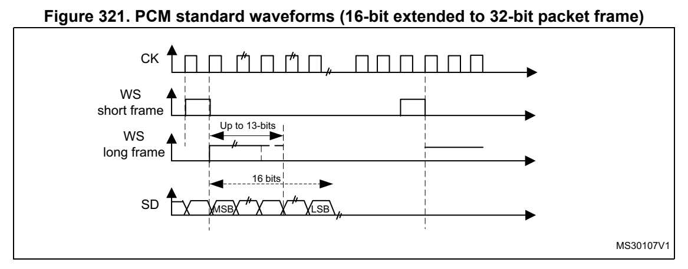
*Figure 321. PCM standard waveforms (16-bit extended to 32-bit p acket frame) (p. 898)*

Note: For both modes (master and slave) and for both synchronizations (short and long), the number of bits between two consecutive pieces of data (and so two synchronization signals) needs to be specified (DATLEN and CHLEN bits in the SPIx_I2SCFGR register) even in slave mode.

#### 27.7.3 Start-up description (p. 898)

The Figure 322 shows how the serial interface is handled in MASTER mode, when the SPI/I2S is enabled (via I2SE bit). It shows as well the effect of CKPOL on the generated signals.

Figure 322. Start sequence in master mode

Master I2S Philips Standard

WS (O)

CK (O), CKPOL = 0

CK (O), CKPOL = 1

dum Left sample Right sample SD (O)

I2SE

Master I2S MSB or LSB justified WS (O)

CK (O), CKPOL = 0

CK (O), CKPOL = 1

dum Left sample Right sample SD (O)

I2SE

Master PCM short frame

WS (O)

CK (O), CKPOL = 0

CK (O), CKPOL = 1

dum Sample1 Sample 2 SD (O)

I2SE

Master PCM long frame WS (O)

CK (O), CKPOL = 0

CK (O), CKPOL = 1

dum Sample1 Sample 2 SD (O)

I2SE

dum: not significant data MSv37520V2

In slave mode, the way the frame synchronization is detected, d epends on the value of ASTRTEN bit.

If ASTRTEN = 0, when the audio interface is enabled (I2SE = 1), then the hardware waits for the appropriate transition on t he incoming WS signal, using the CK signal.

2 The appropriate transition is a falling edge on WS signal when I S Philips Standard is used, or a rising edge for other stand ards. The falling edge is detected by sampling first WS to 1 and then to 0, and vice-versa for the rising edge detection.

If ASTRTEN = 1, the user has to enable the audio interface befo2 re the WS becomes active. This means that the I2SE bit must be set to 1 when WS = 1 for I S Philips standard, or when WS = 0 for other standards.

#### 27.7.4 Clock generator (p. 900)

The I2S bit rate determines the data flow on the I2S data line and the I2S clock signal frequency. I2S bit rate = number of bits per channel × number of channels × sampling audio frequency For a 16-bit audio, left and right channel, the I2S bit rate is calculated as follows: I2S bit rate = 16 × 2 × f S It is: I2S bit rate = 32 x 2 x f S if the packet lengt h is 32-bit wide.

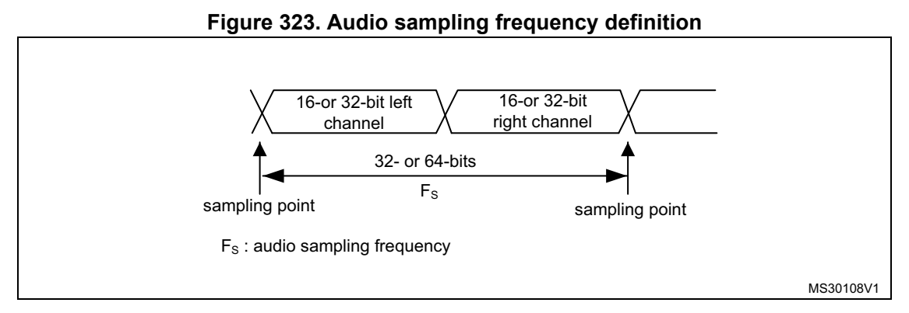
*Figure 323. Audio sampli ng frequency definition (p. 900)*

When the master mode is configured, a specific action needs to be taken to properly program the linear divider in ord er to communicate with the des ired audio frequency.

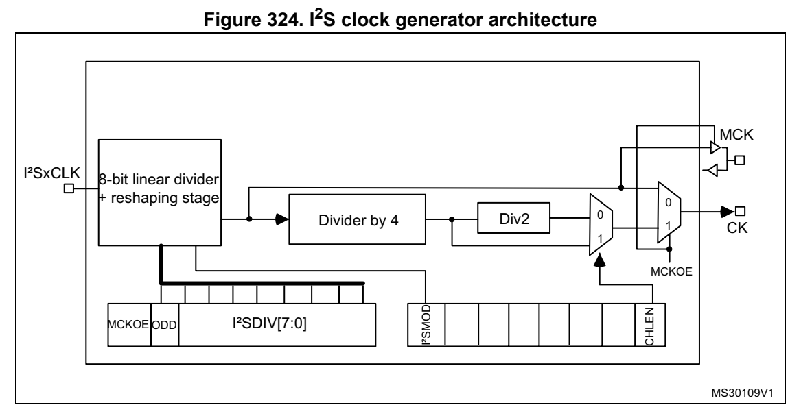
*Figure 324. I S clock generator architecture (p. 900)*

1. Where x can be 2 or 3.

Figure 324 presents the communication clock architecture. The I2SxCLK cloc k is provided by the reset and clock controller (RCC) of the product. The I2S xCLK clock can be asynchronous with respect to the SPI/I2S APB clock.

Warning: In addition, it is mandatory to keep the I2SxCLK freque ncy higher or equal to the APB clock used by the SPI/I2S block. If this condition is not respecte d, the SPI/I2S does not work properly.

The audio sampling frequency may be 192 kHz, 96 kHz, 48 kHz, 44. 1 kHz, 32 kHz, 22.05 kHz, 16 kHz, 11.025 kHz or 8 k Hz (or any other value within this range).

In order to rea ch the desired frequency, the linear divider nee ds to be programmed according to the formulas below:

For I2S modes:

When the master clock is generated (MCKOE in the SPIx_I2SPR reg ister is set):

F I2SxCLK Fs = -------------------------------------------------------------------------------------------------------- 256 2× ( ( × I2SDIV) + ODD)

When the master clock is di sabled (MCKOE bit cleared):

F I2SxCLK Fs = -------------------------------------------------------------------------------------------------------------------------------------------------------------- 32 CHLEN 1× ( +) × ( ( 2 × I2SDIV) + ODD)

CHLEN = 0 when the channel frame is 16-bit wide and, CHLEN = 1 when the channel frame is 32-bit wide.

For PCM modes:

When the master clock is generated (MCKOE in the SPIx_I2SPR reg ister is set):

F I2SxCLK Fs = -------------------------------------------------------------------------------------------------------- 128 2× ( ( × I2SDIV) + ODD)

When the master clock is di sabled (MCKOE bit cleared):

F I2SxCLK Fs = -------------------------------------------------------------------------------------------------------------------------------------------------------------- 16 CHLEN 1× ( +) × ( ( 2 × I2SDIV) + ODD)

CHLEN = 0 when the channel frame is 16-bit wide and, CHLEN = 1 when the channel frame is 32-bit wide.

Where F S is the audio sampling frequency, and F I2SxCLK is the frequency of the kernel clock provided to the SPI/I2S block.

Note: Note that I2SDIV must be strictly higher than 1.

Table 131 provides example precision valu es for different clock configurations.

Note: Other configurations are possible that allow optimum clock precision.

**Table 131. Audio-frequency prec ision using standard 8 MHz HSE (1) (p. 902)**

| SYSCLK (MHz) | Data length | I2SDIV I2SODD MCLK | Col 6 | Target fs (Hz) | Real fs (kHz) Error |
| --- | --- | --- | --- | --- | --- |
|  |  |  | 48 16 8 0 No 96000 93750 2.3438% |  |  |
|  |  |  | 48 32 4 0 No 96000 93750 2.3438% |  |  |
|  |  |  | 48 16 15 1 No 48000 48387.0968 0.8065% |  |  |
|  |  |  | 48 32 8 0 No 48000 46875 2.3438% |  |  |
|  |  |  | 48 16 17 0 No 44100 44117.647 0.0400% |  |  |
|  |  |  | 48 32 8 1 No 44100 44117.647 0.0400% |  |  |
|  |  |  | 48 16 23 1 No 32000 31914.8936 0.2660% |  |  |
|  |  |  | 48 32 11 1 No 32000 32608.696 1.9022% |  |  |
|  |  |  | 48 16 34 0 No 22050 22058.8235 0.0400% |  |  |
|  |  |  | 48 32 17 0 No 22050 22058.8235 0.0400% |  |  |
|  |  |  | 48 16 47 0 No 16000 15957.4468 0.2660% |  |  |
|  |  |  | 48 32 23 1 No 16000 15957.447 0.2660% |  |  |
|  |  |  | 48 16 68 0 No 11025 11029.4118 0.0400% |  |  |
|  |  |  | 48 32 34 0 No 11025 11029.412 0.0400% |  |  |
|  |  |  | 48 16 94 0 No 8000 7978.7234 0.2660% |  |  |
|  |  |  | 48 32 47 0 No 8000 7978.7234 0.2660% |  |  |
|  |  |  | 48 16 2 0 Yes 48000 46875 2.3430% |  |  |
|  |  |  | 48 32 2 0 Yes 48000 46875 2.3430% |  |  |
|  |  |  | 48 16 2 0 Yes 44100 46875 6.2925% |  |  |
|  |  |  | 48 32 2 0 Yes 44100 46875 6.2925% |  |  |
|  |  |  | 48 16 3 0 Yes 32000 31250 2.3438% |  |  |
|  |  |  | 48 32 3 0 Yes 32000 31250 2.3438% |  |  |
|  |  |  | 48 16 4 1 Yes 22050 20833.333 5.5178% |  |  |
|  |  |  | 48 32 4 1 Yes 22050 20833.333 5.5178% |  |  |
|  |  |  | 48 16 6 0 Yes 16000 15625 2.3438% |  |  |
|  |  |  | 48 32 6 0 Yes 16000 15625 2.3438% |  |  |
|  |  |  | 48 16 8 1 Yes 11025 11029.4118 0.0400% |  |  |
|  |  |  | 48 32 8 1 Yes 11025 11029.4118 0.0400% |  |  |
|  |  |  | 48 16 11 1 Yes 8000 8152.17391 1.9022% |  |  |
|  |  |  | 48 32 11 1 Yes 8000 8152.17391 1.9022% |  |  |

1. This table gives only example values for different clock configurations. Other con figurations allowing optimum clock preci sion are possible.

#### 27.7.5 I2S master mode (p. 903)

The I2S can be configured in master mode. This means that the s erial clock is generated on the CK pin as well as the Word Se lect signal WS. Master clock ( MCK) may be output or not, controlled by the MCKOE bit i n the SPIx_I2SPR register.

Procedure

1. Select the I2SDIV[7:0] bits in the SPIx_I2SPR register to define the serial clock baud rate to reach the proper audio sample frequency. The ODD bit in the SPIx_I2SPR register also has to be defined. 2. Select the CKPOL bit to define the steady level for the comm unication clock. Set the MCKOE bit in the SPIx_I2SPR register if the master clock MCK ne eds to be provided to the external DAC/ADC audio co mponent (the I2SDIV and ODD val ues should be computed depending on the state of the MCK output, for more details refer to Section 27.7.4: Clock generator). 3. Set the I2SMOD bit in the SPI2 x_I2SCFGR register to activate the I2S functions and choose the I S standard through the I2SSTD[1: 0] and PCMSYNC bits, the data l ength through the DATLEN[1:0] bits and2 the number of bits per channel by configuring the CHLEN bit. Select also the I S master mode and direction (Transmitter or Receiver) through the I2SCFG[1:0] bits in the SPIx_I2SCFGR register. 4. If needed, select all the potential interrupt sources and th e DMA capabilities by writing the SPIx_CR2 register. 5. The I2SE bit in SPIx_I2SCFGR register must be set.

WS and CK are configured in output mode. MC K is also an output, if the MCKOE bit in SPIx_I2SPR is set.

Transmission sequence

The transmission sequence begins when a half-word is written in to the Tx buffer.

Lets assume the first data written into the Tx buffer correspon ds to the left channel data. When data are transferred from th e Tx buffer to the shift regis ter, TXE is set and data corresponding to the right channel have to be written into the Tx buffer. The CHSIDE flag indicates which channel is to b e transmitted. It has a meaning when the TXE flag is set because the CHSIDE flag is updated when TXE goes high.

A full frame has to be considered as a left chan nel data transm ission followed by a right channel data transmission. It is not possible to have a partial frame where only the left channel is sent.

The data half-word i s parallel loaded into the 16-bit shift reg ister during the first bit transmission, and then shifted out, serially, to the MOSI/SD pi n, MSB first. The TXE flag is set after each transfer from the Tx buffer to the shift registe r and an interrupt is generated if the TXEIE bit in the SPI x_CR2 register is set. 2 For more details abo ut the write operations depending on the I S standard mode selected, refer to Section 27.7.2: Supported audio protocols).

To ensure a continuous audio data transmission, it is mandatory to write the SPIx_DR register with the next data to t ransmit before the end of the c urrent transmission.

To switch off the I2S, by clea ring I2SE, it is mandatory to wai t for TXE = 1 and BSY = 0.

Reception sequence

The operating mode is the same as for transmission mode except2 for the point 3 (refer to the procedure described in Section 27.7.5: I S master mode), where the configuration should set the master reception mode through the I2SCFG[1:0] bits.

Whatever the data or channel length, the audio data are receive d by 16-bit packets. This means that each time the Rx buffer is full, the RXNE flag is set and an interrupt is generated if the RXNEIE bit is set in SPIx_CR2 register. Depending on the data and channel length configuration, the audio value received for a right or left cha nnel may result from one or two receptions into the Rx buffer.

Clearing the RXNE bit i s performed by readi ng the SPIx_DR regis ter.

CHSIDE is updated after each rece ption. It is sensitive to the WS signal generated by the I2S cell.

2 For more details about the read operations depending on the I S standard mode selected, refer to Section 27.7.2: Supported audio protocols.

If data are received while the previously received data have not been read yet, an overrun is generated and the OVR flag is set. If the ERRIE bit is set in t he SPIx_CR2 register, an interrupt is generated to indicate the error.

To switch off the I2S, specific actions are required to ensure that the I2S completes the transfer cycle properly without i nitiating a new data transfer. The sequence depends on the configuration of the data and ch annel lengths, a nd on the audio protocol mode selected. In the case of:

- 16-bit data length extended on 32-bit channel length (DATLEN = 00 and CHLEN = 1) using the LSB justifie d mode (I2SSTD = 10) a) Wait for the second to last RXNE = 1 (n – 1) b) Then wait 17 I2S clock cycles (using a software loop) c) Disable the I2S (I2SE = 0)

- 16-bit data length extended on 32-bit channel length (DATLEN =2 00 and CHLEN = 1) in MSB justified, I S or PCM modes (I2SSTD = 00, I2SSTD = 01 or I2SSTD = 11, respectively) a) Wait for the last RXNE b) Then wait 1 I2S clock cycl e (using a software loop) c) Disable the I2S (I2SE = 0)

- For all other combinations of DATLEN and CHLEN, whatever the au dio mode selected through the I2SSTD bits, carry o ut the following sequence to sw itch off the I2S: a) Wait for the second to last RXNE = 1 (n – 1) b) Then wait one I2S clock cycle (using a software loop) c) Disable the I2S (I2SE = 0)

Note: The BSY flag is kept low during transfers.

#### 27.7.6 I2S slave mode (p. 904)

For the slave configuration, t he I2S can be configured in trans mission or reception mode.2 The operating mode is following ma inly the same ru les as descri bed for the I S master

configuration. In slave mode, t here is no clock to be generated by the I2S interface. The clock and WS signals are input from the external master connected to the I2S interface. There is then no need, for the user, to configure the clock.

The configuration steps to follow are listed below: 1. Set the I2SMOD bit in the SPI2 x_I2SCFGR register to select I2S mode and choose the I S standard through the I2SSTD[1: 0] bits, the data length throug h the DATLEN[1:0] bits and the number of bits per channel for the frame configuri ng the CHLEN bit. Select also the mode (transmission or reception) for the slave through the I2SCFG[1:0] bits in SPIx_I2SCFGR register. 2. If needed, select all the potential interrupt sources and th e DMA capabilities by writing the SPIx_CR2 register. 3. The I2SE bit in SPIx_I2SCFGR register must be set.

Transmission sequence

The transmission sequence begins when the external master device sends the clock and when the NSS_WS signal requests the transfer of data. The slave has to be enabled before the external master starts the communication. The I2S data regi ster has to be loaded before the master initiates the communication.

For the I2S, MSB justified and L SB justified modes, the first d ata item to be written into the data register corres ponds to the data for the left channel. Whe n the communication starts, the data are tran sferred from the Tx bu ffer to the shift register. The TXE flag is then set in order to request the right channel data to be written into the I2S data register.

The CHSIDE flag indicates which channel is to be transmitted. C ompared to the master transmission mode, in slave mode, CHSIDE is sensitive to the WS signal coming from the external master. This means that the slave needs to be ready to transmit the first data before the clock is ge nerated by the master. WS assertion corre sponds to left channel transmitted first.

Note: The I2SE has to be written at least two PCLK cycles before the first clock of the master comes on the CK line.

The data half-word is parallel- loaded into the 16-bit shift reg ister (from the internal bus) during the first bit transmission, and then shifted out seriall y to the MOSI/SD pin MSB first. The TXE flag is set after each transfer from the Tx buffer to the shift register and an interrupt is generated if the TXEIE bit in the SPIx_CR2 register is set.

Note that the TXE flag should be checked to be at 1 before atte mpting to write the Tx buffer. 2 For more details abo ut the write operations depending on the I S standard mode selected, refer to Section 27.7.2: Supported audio protocols.

To secure a continuous audio data transmission, it is mandatory to write the SPIx_DR register with the next data to t ransmit before the end of the c urrent transmission. An underrun flag is set and an interrupt may be generated if the d ata are not written into the SPIx_DR register before the first clock edge of the next data communication. This indicates to the software that the transferred data are wrong. If the ERR IE bit is set into the SPIx_CR2 register, an interrupt is generated when the UDR flag in the SP Ix_SR register goes high. In this case, it is mandatory to switch off the I2S and to restart a data transfer starting from the left channel.

To switch off the I2S, by clea ring the I2SE bit, it is mandatory to wait for TXE = 1 and BSY = 0.

Reception sequence

The operating mode is the same as for the transmission mode exc2 ept for the point 1 (refer to the procedure described in Section 27.7.6: I S slave mode), where the configuration should set the master reception mode us ing the I2SCFG[1:0] bits in the SPIx_I2SCFGR register.

Whatever the data length or the c hannel length, the audio data are received by 16-bit packets. This means that each time the RX buffer is full, the RXNE flag in the SPIx_SR register is set and an interrupt is generated if the RXNEIE bit is set in the SPIx_CR2 register. Depending on the data length and channel length confi guration, the audio value received for a right or left chann el may result from one or two receptions into the RX buffer.

The CHSIDE flag is updated each time data are received to be re ad from the SPIx_DR register. It is sensitive to the external WS line managed by th e external master component.

Clearing the RXNE bit i s performed by readi ng the SPIx_DR regis ter. For more details about the read operations depending the I2S standard mode selected, refer to Section 27.7.2: Supported audio protocols.

If data are received while the preceding received data have not yet been read, an overrun is generated and the OVR flag is set. If the bit ERRIE is set in t he SPIx_CR2 register, an interrupt is generated to indicate the error.

To switch off the I2S in recepti on mode, I2SE ha s to be cleared immediately after receiving the last RXNE = 1.

Note: The external master compon ents should have the capability of sending/receiving data in 16-bit or 32-bit packets via an audio channel.

#### 27.7.7 I2S status flags (p. 906)

Three status flags are provided for the application to fully mo nitor the state of the I2S bus.

Busy flag (BSY)

The BSY flag is set and cleared by hardware (writing to this fl ag has no effect). It indicates the state of the communi cation layer of the I2S.

When BSY is set, it indicates that the I2S is busy communicatin g. There is one exception in master receive mode (I2SCFG = 11) where the BSY flag is kept low during reception.

The BSY flag is useful to detect the end of a tra nsfer if the s oftware needs to disable the I2S. This avoids corrupting the last transfer. For this, the procedure described below must be strictly respected.

The BSY flag is set when a tran sfer starts, except when the I2S is in master receiver mode.

The BSY flag is cleared:

- When a transfer completes (excep t in master transmit mode, in w hich the communication is suppos ed to be continuous)

- When the I2S is disabled

When communication is continuous:

- In master transmit m ode, the BSY flag is kept high during all t he transfers

- In slave mode, the BSY flag goes low for one I2S clock cycle be tween each transfer

Note: Do not use the BSY flag to handle each data tran smission or reception. It is better to use the TXE and RXNE flags instead.

Tx buffer empty flag (TXE)

When set, this flag indicates t hat the Tx buffer is empty and t he next data to be transmitted can then be loaded into it. The TXE flag is reset when the Tx b uffer already contains data to be transmitted. It is also reset when the I2S is d isabled (I2SE bit is reset).

RX buffer not empty (RXNE)

When set, this flag indicates t hat there are valid received data in the RX Buffer. It is reset when SPIx_DR register is read.

Channel Side flag (CHSIDE)

In transmission m ode, this flag is refres hed when TXE goes high. It indicates the channel side to which the data to transfer on SD has to belong. In case of an underrun error event in slave transmission mode, this fl ag is not reliable and I2S need s to be switched off and switched on before resuming the communication.

In reception mode, this flag is refreshed when data are receive d into SPIx_DR. It indicates from which channel side data have been received. Note that in case of error (like OVR) this flag becomes meaningless and the I2S should be reset by disabli ng and then enabling it (with configuration if it needs changing).

This flag has no meaning in the PC M standard (for both Short an d Long frame modes).

When the OVR or UDR flag in the SPIx_SR is set and the ERRIE bi t in SPIx_CR2 is also set, an interrupt is generated. This interrupt can be cleared by reading the SPIx_SR status register (once the interrupt source has been cleared).

#### 27.7.8 I2S error flags (p. 907)

There are three error flags for the I2S cell.

Underrun flag (UDR)

In slave transmission mode this flag is set when the first cloc k for data transmission appears while the software has not yet l oaded any value into SPIx_DR. I t is available when the I2SMOD bit in the SPIx_I2SCFGR re gister is set. An interrupt may be generated if the ERRIE bit in the SPIx_CR2 registe r is set. The UDR bit is cleared by a read operation on the SPIx_SR regis ter.

Overrun flag (OVR)

This flag is set when data are received and the previous data h ave not yet been read from the SPIx_DR register. As a result, the incoming data are lost. An interrupt may be generated if the ERRIE bit is set in the SPIx_CR2 register.

In this case, the receive buffer contents are not updated with the newly received data from the transmitter device. A read ope ration to the SPIx_DR registe r returns the previous correctly received data. All othe r subsequently transmitted hal f-words are lost.

Clearing the OVR bit is done by a read operation on the SPIx_DR register followed by a read access to the SPIx_SR register.

Frame error flag (FRE)

This flag can be set by hardware only if the I2S is configured in Slave mode. It is set if the external master is changing the WS line while the slave is not expecting this change. If the

synchronization is los t, the following steps are required to re cover from this state and resynchronize the external master device with the I2S slave dev ice: 1. Disable the I2S. 2. Enable it again when the correct level is detected on the WS line (WS line is high in I2S mode or low for MSB- or LSB-justified or PCM modes.

Desynchronization between master and slave devices may be due to noisy environment on the CK communication clock or on the WS frame synchronization l ine. An error interrupt can be generated if the ERRIE bit is set. The desynchronization fla g (FRE) is cleared by software when the status register is read.

#### 27.7.9 DMA features (p. 908)

In I2S mode, the DMA works in exact ly the same way as it does in SPI2 mode. There is no difference except that the CRC feature is not available in I S mode since there is no data transfer protection system.

### 27.8 I2S interrupts (p. 908)

Table 132 provides the list of I2S interrupts.

**Table 132. I2S interrupt requests (p. 908)**

| Interrupt event Event fl | ag Enable control bit |
| --- | --- |
| Transmit buffer empty flag TXE TXEIE |  |
| Receive buffer not empty flag RXNE RXNEIE |  |
| Overrun error OVR |  |
| Underrun error UDR | ERRIE |
| Frame error flag FRE |  |

### 27.9 SPI and I2S registers (p. 909)

The peripheral registers can be a ccessed by half-words (16-bit) or words (32-bit). SPI_DR in addition can be accessed by 8-bit access.

### 27.9.1 [I2S.SPIx_CR1] Offset: 0x00 | Reset: 0x0000 (p. 909)

Address offset: 0x00

Reset value: 0x0000

Bit 15 BIDIMODE: Bidirectional data mode enable. This bit enables half-duplex comm unication using common single bidirectional data line. Keep RXONLY bit clear when bi directional mode is active. 0: 2-line unidirectional data mode selected 1: 1-line bidirectional data mode selected Note: This bit is not used in I2S mode.

Bit 14 BIDIOE: Output enable in bidirectional mode This bit combined with the BIDIMO DE bit selects t he direction of transfer in bidirectional mode. 0: Output disabled (receive-only mode) 1: Output enabled (transmit-only mode) Note: In master mode, the MOSI pin is used and in slave mode, the MISO pin is used. This bit is not used in I2S mode.

Bit 13 CRCEN: Hardware CRC calculation enable 0: CRC calculation disabled 1: CRC calculation enabled Note: This bit should be written only when SPI is disabled (SPE = ‘0’) for correct operation. This bit is not used in I2S mode.

Bit 12 CRCNEXT: Transmit CRC next 0: Next transmit value is from Tx buffer. 1: Next transmit value is from Tx CRC register. Note: This bit has to be written as soon as the last data is written in the SPIx_DR register. This bit is not used in I2S mode.

Bit 11 CRCL: CRC length This bit is set and cl eared by software to select the CRC lengt h. 0: 8-bit CRC length 1: 16-bit CRC length Note: This bit should be written only when SPI is disabled (SPE = ‘0’) for correct operation. This bit is not used in I2S mode.

Bit 10 RXONLY: Receive only mode enabled. This bit enables simplex communi cation using a single unidirect ional line to receive data exclusively. Keep BIDIMODE bit c lear when receive only mode is active.This bit is also useful in a multislave system in which this particular slave is not accessed, t he output from the accessed slave is not corrupted. 0: Full-duplex (Transmit and receive) 1: Output disabled ( Receive-only mode) Note: This bit is not used in I2S mode.

Bit 9 SSM: Software slave management When the SSM bit is set, the NSS pin input is replaced with the value from the SSI bit. 0: Software slave management disabled 1: Software slave management enabled Note: This bit is not used in I2S mode and SPI TI mode.

Bit 8 SSI: Internal slave select This bit has an effect only w hen the SSM bit is set. The value of this bit is fo rced onto the NSS pin and the I/O value of the NSS pin is ignored. Note: This bit is not used in I2S mode and SPI TI mode.

Bit 7 LSBFIRST: Frame format 0: data is transmitted / re ceived with the MSB first 1: data is transmitted / re ceived with the LSB first Note: 1. This bit should not be changed when communication is ongoing. 2. This bit is not used in I2S mode and SPI TI mode.

Bit 6 SPE: SPI enable 0: Peripheral disabled 1: Peripheral enabled Note: When disabling the SPI, follow the procedure described in Procedure for disabling the SPI on page 875. This bit is not used in I2S mode.

Bits 5:3 BR[2:0]: Baud rate control 000: f PCLK/2 001: f PCLK/4 010: f PCLK/8 011: f PCLK/16 100: f PCLK/32 101: f PCLK/64 110: f PCLK/128 111: f PCLK/256 Note: These bits should not be changed when communication is ongoing. These bits are not used in I2S mode.

Bit 2 MSTR: Master selection 0: Slave configuration 1: Master configuration Note: This bit should not be changed when communication is ongoing. This bit is not used in I2S mode.

Bit 1 CPOL: Clock polarity 0: CK to 0 when idle 1: CK to 1 when idle Note: This bit should not be changed when communication is ongoing. This bit is not used in I2S mode and SPI TI mode except the case when CRC is applied at TI mode.

Bit 0 CPHA: Clock phase 0: The first clock transition is the first data capture edge 1: The second clock transition is the first data capture edge Note: This bit should not be changed when communication is ongoing. This bit is not used in I2S mode and SPI TI mode except the case when CRC is applied at TI mode.

### 27.9.2 [I2S.SPIx_CR2] Offset: 0x04 | Reset: 0x0700 (p. 911)

Address offset: 0x04

Reset value: 0x0700

Bit 15 Reserved, must be kept at reset value.

Bit 14 LDMA_TX: Last DMA transfer for transmission This bit is used in data packing mode, to define if the total n umber of data to transmit by DMA is odd or even. It has significa nce only if the TXDMAEN bit in the SPIx_CR2 register is set and if packing mode is used (data length =< 8-bit and write access to SPIx_DR is 16-bit wide). It has to be wri tten when the SPI is disabled (SPE = 0 i n the SPIx_CR1 register). 0: Number of data to transfer is even 1: Number of data to transfer is odd Note: Refer to Procedure for disabling the SPI on page 875 if the CRCEN bit is set. This bit is not used in I²S mode.

Bit 13 LDMA_RX: Last DMA transfer for reception Th is bit is used in data packing mode, to define if the total num ber of data to receive by DMA is odd or even. It has significa nce only if the RXDMAEN bit in the SPIx_CR2 register is set and if packing mode is used (data length =< 8-bit and write access to SPIx_DR is 16-bit wide). It has to be wri tten when the SPI is disabled (SPE = 0 i n the SPIx_CR1 register). 0: Number of data to transfer is even 1: Number of data to transfer is odd Note: Refer to Procedure for disabling the SPI on page 875 if the CRCEN bit is set. This bit is not used in I²S mode.

Bit 12 FRXTH: FIFO reception threshold This bit is used to set the threshold of the RXFIFO that trigge rs an RXNE event 0: RXNE event is generated if the FIFO leve l is greater than or equal to 1/2 (16-bit) 1: RXNE event is generated if the FIFO leve l is greater than or equal to 1/4 (8-bit) Note: This bit is not used in I2S mode.

Bits 11:8 DS[3:0]: Data size These bits configure the data length for SPI transfers. 0000: Not used 0001: Not used 0010: Not used 0011: 4-bit 0100: 5-bit 0101: 6-bit 0110: 7-bit 0111: 8-bit 1000: 9-bit 1001: 10-bit 1010: 11-bit 1011: 12-bit 1100: 13-bit 1101: 14-bit 1110: 15-bit 1111: 16-bit If software attempts to write one of the “Not use d” values, they are forced to the value “0111” (8-bit) Note: These bits are not used in I2S mode.

Bit 7 TXEIE: Tx buffer empty interrupt enable 0: TXE interrupt masked 1: TXE interrupt not masked. Us ed to generate an interrupt requ est when the TXE flag is set.

Bit 6 RXNEIE: RX buffer not empty interrupt enable 0: RXNE interrupt masked 1: RXNE interrupt not masked. Used to generate an interrupt req uest when the RXNE flag is set.

Bit 5 ERRIE: Error interrupt enable This bit controls the generation of an interrupt when an error condition occurs (CRCERR,2 OVR, MODF in SPI mod e, FRE at TI mode and UDR, OVR, and FRE in I S mode). 0: Error interrupt is masked 1: Error interrupt is enabled

Bit 4 FRF: Frame format 0: SPI Motorola mode 1 SPI TI mode Note: This bit must be written only when the SPI is disabled (SPE=0). This bit is not used in I2S mode.

Bit 3 NSSP: NSS pulse management This bit is used in master mode only. it allows the SPI to gene rate an NSS pulse between two consecutive data wh en doing continuous tran sfers. In the case of a single data transfer, it forces the NSS pin high level after the transfer. It has no meaning if CPH A = ’1’, or FRF = ’1’. 0: No NSS pulse 1: NSS pulse generated Note: 1. This bit must be written only when the SPI is disabled (SPE=0). 2. This bit is not used in I2S mode and SPI TI mode.

Bit 2 SSOE: SS output enable 0: SS output is disabled in mas ter mode and the SPI interface can work in multimaster configuration 1: SS output is enabled in mas ter mode and when the SPI interfa ce is enabled. The SPI interface cannot work in a multimaster environment. Note: This bit is not used in I2S mode and SPI TI mode.

Bit 1 TXDMAEN: Tx buffer DMA enable When this bit is set, a DMA request is ge nerated whenever the TXE flag is set. 0: Tx buffer DMA disabled 1: Tx buffer DMA enabled

Bit 0 RXDMAEN: Rx buffer DMA enable When this bit is set, a DMA request is ge nerated whenever the RXNE flag is set. 0: Rx buffer DMA disabled 1: Rx buffer DMA enabled

### 27.9.3 [I2S.SPIx_SR] Offset: 0x08 | Reset: 0x0002 (p. 913)

Address offset: 0x08

Reset value: 0x0002

Bits 15:13 Reserved, must be kept at reset value.

Bits 12:11 FTLVL[1:0]: FIFO transmission level These bits are set and cleared by hardware. 00: FIFO empty 01: 1/4 FIFO 10: 1/2 FIFO 11: FIFO full (considered as FULL when the FIFO threshold is greater than 1/2) Note: This bit is not used in I2S mode.

Bits 10:9 FRLVL[1:0]: FIFO reception level These bits are set and cleared by hardware. 00: FIFO empty 01: 1/4 FIFO 10: 1/2 FIFO 11: FIFO full Note: These bits are not used in I²S mode and in SPI receive-only mode while CRC calculation is enabled.

Bit 8 FRE: Frame format error This flag is used for SPI in TI slave mode and I2S slave mode. Refer to Section 27.5.11: SPI error flags and Section 27.7.8: I2S error flags. This flag is set by hardware and reset when SPIx_SR is read by software. 0: No frame format error 1: A frame format error occurred

Bit 7 BSY: Busy flag 0: SPI (or I2S) not busy 1: SPI (or I2S) is busy in comm unication or Tx buffer is not em pty This flag is set and cleared by hardware. Note: The BSY flag must be used with caution: refer to Section 27.5.10: SPI status flags and Procedure for disabling the SPI on page 875.

Bit 6 OVR: Overrun flag 0: No overrun occurred 1: Overrun occurred This flag is set by hardware and reset by a software sequence. Refer to I2S error flags on page 907 for the software sequence.

Bit 5 MODF: Mode fault 0: No mode fault occurred 1: Mode fault occurred This flag is set by hardware and reset by a software sequence. Refer to Section : Mode fault (MODF) on page 885 for the software sequence. Note: This bit is not used in I2S mode.

Bit 4 CRCERR: CRC error flag 0: CRC value received matches the SPIx_RXCRCR value 1: CRC value received does not match the SPIx_RXCRCR value Note: This flag is set by hardware and cleared by s oftware writi ng 0. This bit is not used in I2S mode.

Bit 3 UDR: Underrun flag 0: No underrun occurred 1: Underrun occurred This flag is set by hardware and reset by a software sequence. Refer to I2S error flags on page 907 for the software sequence. Note: This bit is not used in SPI mode.

Bit 2 CHSIDE: Channel side 0: Channel Left has to be transmitted or has been received 1: Channel Right has to be tra nsmitted or has been received Note: This bit is not used in SPI mode. It has no significance in PCM mode.

Bit 1 TXE: Transmit buffer empty 0: Tx buffer not empty 1: Tx buffer empty

Bit 0 RXNE: Receive buffer not empty 0: Rx buffer empty 1: Rx buffer not empty

### 27.9.4 [I2S.SPIx_DR] Offset: 0x0C | Reset: 0x0000 (p. 914)

Address offset: 0x0C

Reset value: 0x0000

Bits 15:0 DR[15:0]: Data register Data received or to be transmitted The data register serves as an interface between the Rx and Tx FIFOs. When the data register is read, RxFIFO is acce ssed while the write to data re gister accesses TxFIFO (See Section 27.5.9: Data transmission and reception procedures). Note: Data is always right-aligned. Unused bits are ignored when writing to the register, and read as zero when the register is read. The Rx threshold setting must always correspond with the read access currently used.

### 27.9.5 [I2S.SPIx_CRCPR] Offset: 0x10 | Reset: 0x0007 (p. 915)

Address offset: 0x10

Reset value: 0x0007

Bits 15:0 CRCPOLY[15:0]: CRC polynomial register This register contains the polyn omial for the CRC calculation. The CRC polynomial (0x0007) is the reset value of this register. Another poly nomial can be configured as required.

Note: The polynomial value should be odd only. No even value is supported.

### 27.9.6 [I2S.SPIx_RXCRCR] Offset: 0x14 | Reset: 0x0000 (p. 915)

Address offset: 0x14

Reset value: 0x0000

Bits 15:0 RXCRC[15:0]: Rx CRC register When CRC calculation is enabled, the RXCRC[15:0] bits contain t he computed CRC value of the subsequently received bytes. This register is reset when th e CRCEN bit in SPIx_CR1 register is written to 1. The C RC is calculated serially using the polynomial programmed in the SPIx_CRCPR register. Only the 8 LSB bits are considered when the CRC frame format is set to be 8 -bit length (CRCL bit in the SPIx_CR1 is clea red). CRC calculation is done based on any CRC8 standard. The entire 16-bits of this register are considered when a 16-bi t CRC frame format is selected (CRCL bit in the SPIx_CR1 registe r is set). CRC calculation is done based on any CRC16 standard. Note: A read to this register when the BSY Flag is set could return an incorrect value. These bits are not used in I2S mode.

### 27.9.7 [I2S.SPIx_TXCRCR] Offset: 0x18 | Reset: N/A (p. 915)

Address offset: 0x18

Reset value: 0x0000

Bits 15:0 TXCRC[15:0]: Tx CRC register When CRC calculation is enabled, the TXCRC[7:0] bits contain th e computed CRC value of the subsequently transmitted bytes. This register is reset when the CRCEN bit of SPIx_CR1 is written to 1. The CRC is calcu lated serially u sing the polyn omial programmed in the SPIx_CRCPR register. Only the 8 LSB bits are conside red when the CRC frame format is set to be 8-bit length (CRCL bit in the SPIx_CR1 is cleared). CRC calculation is done based on any CRC8 standard. The entire 16-bits of this register are considered when a 16-bi t CRC frame format is selected (CRCL bit in the SPIx_CR1 register is set). CRC calculation is done based on any CRC16 standard. Note: A read to this register when the BSY flag is set could return an incorrect value. These bits are not used in I2S mode.

### 27.9.8 [I2S.SPIx_I2SCFGR] Offset: 0x1C | Reset: 0x0000 (p. 916)

Address offset: 0x1C

Reset value: 0x0000

Bits 15:13 Reserved, must be kept at reset value.

Bit 12 ASTRTEN: Asynchronous start enable. 0: The Asynchronous start is disabled. When the I2S is enabled in slave mode, the hardware starts the transfer when the I2S clock is received and an appropriate tran sition is detected on the WS si gnal. 1: The Asynchronous start is enabled. When the I2S is enabled in slave mode, the hardware starts the transfer when the I2S clock is received and the appropriate level is detected on the WS signal. Note: The appropriate transition is a falling edge on WS signal when I2S Philips Standard is used, or a rising edge for other standards. The appropriate level is a low level on WS signal when I2S Philips Standard is used, or a high level for other standards. Please refer to Section 27.7.3: Start-up description for additional information.

Bit 11 I2SMOD: I2S mode selection 0: SPI mode is selected 1: I2S mode is selected Note: This bit should be configured when the SPI is disabled.

Bit 10 I2SE: I2S enable 0: I2S peripheral is disabled 1: I2S peripheral is enabled Note: This bit is not used in SPI mode.

Bits 9:8 I2SCFG[1:0]: I2S configuration mode 00: Slave - transmit 01: Slave - receive 10: Master - transmit 11: Master - receive Note: These bits should be configured when the I2S is disabled. They are not used in SPI mode.

Bit 7 PCMSYNC: PCM frame synchronization 0: Short frame synchronization 1: Long frame synchronization Note: This bit has a meaning only if I2SSTD = 11 (PCM standard is used). It is not used in SPI mode.

Bit 6 Reserved, must be kept at reset value.

Bits 5:4 I2SSTD[1:0]: I2S standard selection 00: I2S Philips standard 01: MSB justified standard (left justified) 10: LSB justified standard (right justified) 11: PCM standard For more details on I2S standards, refer to Section 27.7.2 on page 891 Note: For correct operation, these bits should be configured when the I2S is disabled. They are not used in SPI mode.

Bit 3 CKPOL: Inactive state clock polarity 0: I2S clock inactive state is low level 1: I2S clock inactive state is high level Note: For correct operation, this bit should be configured when the I2S is disabled. It is not used in SPI mode. The bit CKPOL does not affect the CK edge sensitivity used to receive or transmit the SD and WS signals.

Bits 2:1 DATLEN[1:0]: Data length to be transferred 00: 16-bit data length 01: 24-bit data length 10: 32-bit data length 11: Not allowed Note: For correct operation, these bits should be configured when the I2S is disabled. They are not used in SPI mode.

Bit 0 CHLEN: Channel length (number of bits per audio channel) 0: 16-bit wide 1: 32-bit wide The bit write operation has a meaning only if DATLEN = 00 otherwise the channel length is fixed to 32-bit by hardware whatever the value filled in. Note: For correct operation, this bit should be configured when the I2S is disabled. It is not used in SPI mode.

### 27.9.9 [I2S.SPIx_I2SPR] Offset: 0x20 | Reset: 0x0002 (p. 918)

Address offset: 0x20

Reset value: 0x0002

Bits 15:10 Reserved, must be kept at reset value.

Bit 9 MCKOE: Master clock output enable 0: Master clock output is disabled 1: Master clock output is enabled Note: This bit should be configured when the I2S is disabled. It is used only when the I2S is in master mode. It is not used in SPI mode.

Bit 8 ODD: Odd factor for the prescaler 0: Real divider value is = I2SDIV *2 1: Real divider value is = (I2SDIV * 2) + 1 Refer to Section 27.7.3 on page 898. Note: This bit should be configured when the I2S is disabled. It is used only when the I2S is in master mode. It is not used in SPI mode.

Bits 7:0 I2SDIV[7:0]: I2S linear prescaler I2SDIV [7:0] = 0 or I2SDIV [7:0] = 1 a re forbidden values. Refer to Section 27.7.3 on page 898. Note: These bits should be configured when the I2 S is disabled. They are used only when the I2S is in master mode. They are not used in SPI mode.

#### 27.9.10 SPI/I2S register map (p. 919)

Table 133 shows the SPI/I2S register map and reset values.

**Table 133. SPI/I2S registe r map and reset values (p. 919)**

| Col 1 | Offset Register | 31 | 30 | 29 | 28 | 27 | 26 | 25 | 24 | 23 | 22 | 21 | 20 | 19 | 18 | 17 | 16 | 15 | 14 | 13 | 12 | 11 | 10 | 9 | 8 | 7 | 6 | 5 | 4 | 3 | 2 | 1 | 0 |
| --- | --- | --- | --- | --- | --- | --- | --- | --- | --- | --- | --- | --- | --- | --- | --- | --- | --- | --- | --- | --- | --- | --- | --- | --- | --- | --- | --- | --- | --- | --- | --- | --- | --- |
| 0x00 | SPIx_CR1 | Res. | Res. | Res. | Res. | Res. | Res. | Res. | Res. | Res. | Res. | Res. | Res. | Res. | Res. | Res. | Res. | BIDIMODE | BIDIOE | CRCEN | CRCNEXT | CRCL | RXONLY | SSM | SSI | LSBFIRST | SPE |  | BR [2:0] |  | MSTR | CPOL | CPHA |

Reset value 0 0 0 0 0 0 0 0 0 0 0 0 0 0 0 0

0x04 SPIx_CR2 Res. Res. Res. Res. Res. Res. Res. Res. Res. Res. Res. Res. Res. Res. Res. Res. Res. LDMA_TX LDMA_RX FRXTH DS[3:0] TXEIE RXNEIE ERRIE FRF NSSP SSOE TXDMAEN RXDMAEN

Reset value 0 0 0 0 1 1 1 0 0 0 0 0 0 0 0

0x08 SPIx_SR Res. Res. Res. Res. Res. Res. Res. Res. Res. Res. Res. Res. Res. Res. Res. Res. Res. Res. Res. FTLVL[1:0] FRLVL[1:0] FRE BSY OVR MODF CRCERR UDR CHSIDE TXE RXNE

Reset value 0000000000010

SPIx_DR Res. Res. Res. Res. Res. Res. Res. Res. Res. Res. Res. Res. Res. Res. Res. Res. DR[15:0] 0x0C Reset value 0 0 0 0 0 0 0 0 0 0 0 0 0 0 0 0

SPIx_CRCPR Res. Res. Res. Res. Res. Res. Res. Res. Res. Res. Res. Res. Res. Res. Res. Res. CRCPOLY[15:0] 0x10 Reset value 0 0 0 0 0 0 0 0 0 0 0 0 0 1 1 1

SPIx_RXCRCR Res. Res. Res. Res. Res. Res. Res. Res. Res. Res. Res. Res. Res. Res. Res. Res. RXCRC[15:0] 0x14 Reset value 0 0 0 0 0 0 0 0 0 0 0 0 0 0 0 0

SPIx_TXCRCR Res. Res. Res. Res. Res. Res. Res. Res. Res. Res. Res. Res. Res. Res. Res. Res. TXCRC[15:0] 0x18 Reset value 0 0 0 0 0 0 0 0 0 0 0 0 0 0 0 0

0x1C SPIx_I2SCFGR Res. Res. Res. Res. Res. Res. Res. Res. Res. Res. Res. Res. Res. Res. Res. Res. Res. Res. Res. ASTRTEN I2SMOD I2SE I2SCFG[1:0] PCMSYNC Res. I2SSTD CKPOL DATLEN[1:0] CHLEN

Reset value 000000 000000

0x20 SPIx_I2SPR Res. Res. Res. Res. Res. Res. Res. Res. Res. Res. Res. Res. Res. Res. Res. Res. Res. Res. Res. Res. Res. Res. MCKOE ODD I2SDIV[7:0]

Reset value 0000000010

Refer to Section 2.2 on page 44 for the register boundary addresses.
