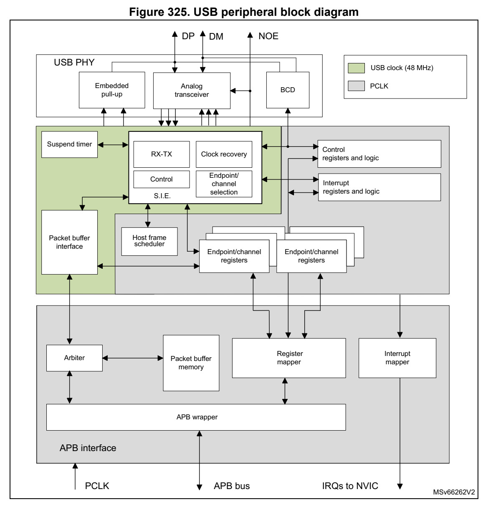
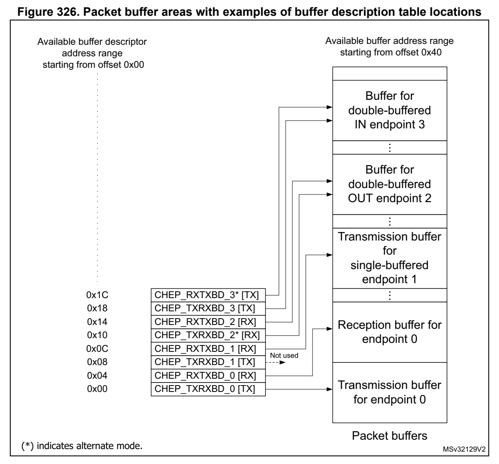

# 28 Universal serial bus full-speed host/device interface (USB) (pp. 920-965)

## 28 Universal serial bus full-speed host/device interface (p. 920)

## (USB) (p. 920)

### 28.1 Introduction (p. 920)

The USB peripheral implements an interface between a full-speed USB 2.0 bus and the APB1 bus.

USB suspend/resume are supported, which permits to stop the dev ice clocks for low-power consumption.

### 28.2 USB main features (p. 920)

- USB specification versi on 2.0 full-speed compliant

- Supports both Host and Device modes

- Configurable number of endpoints from 1 to 8

- Dedicated packet buffer memo ry (SRAM) of 2048 bytes

- Cyclic redundancy check (CRC) g eneration/checking, Non-return-to-zero Inverted (NRZI) encoding/decoding and bit-stuffing

- Isochronous transfers support

- Double-buffered bulk/isochronous endpoint/channel support

- USB Suspend/Resume operations

- Frame locked clock pulse generation

- USB 2.0 Link Power Management support (Device mode only)

- Battery Charging Specification Revision 1.2 support (Device mod e only)

- USB connect / disconnect capab ility (controllable embedded pull -up resistor on USB_DP line)

### 28.3 USB implementation (p. 920)

Table 134 describes the USB implem entation in the devices.

**Table 134. STM32G0x0 USB implementation (p. 920)**

| USB features (1) | USB |
| --- | --- |
| Host mode | X |
| Number of endpoints 8 |  |
| Size of dedicated packet buffer memory SRAM 2048 bytes |  |
| Dedicated packet buffer memo ry SRAM access scheme 32 bits |  |
| USB 2.0 Link Power Managemen t (LPM) support in device X |  |
| Battery Charging Detection (BCD) support for device X |  |
| Embedded pull-up resis tor on USB_DP line X |  |
| 1. X= supported |  |

### 28.4 USB functional description (p. 921)

Figure 325 shows the block diagram of the USB peripheral.

*Figure 325. USB peri pheral block diagram (p. 921)*

General description and Device mode functionality

The USB peripheral provides a U SB-compliant connection between the function implemented by the microcontroller and an external USB function which could be a host PC but also a USB Device. Data transfer betwe en the external USB h ost or device and the system memory occurs through a dedicated packet buffer memory a ccessed directly by the USB peripheral. This dedicated me mory size is 2048 bytes, and u p to 16 mono-directional or 8 bidirectional endpoints can be used. The US B peripheral in terfaces with the external USB Host or Device, detecting token packets, handling data tran smission/reception, and processing handshake packets as required by the USB standard. Transaction formatting is performed by the hardware, inc luding CRC generation and checkin g.

Each endpoint/channel is associ ated with a buffer description b lock indicating where the endpoint/channel-related memory area is located, how large it i s or how many bytes must be transmitted. When a token for a valid function/endpoint pair is recognized by the USB peripheral, the related data tran sfer (if required and if the e ndpoint/channel is configured) takes place. The data buffered b y the USB peripheral are loaded in an internal 16-bit register and memory access to the dedicated buffer is performed. When all the data have been transferred, if needed, the proper handshake packet over t he USB is generated or expected according to the d irection of the transfer.

At the end of the transaction, an endpoint/channel-specific interrupt is generated, reading status registers and/o r using different interrupt response rout ines. The microcontroller can determine:

- which endpoint/channel has to be served,

- which type of transaction took place, if errors occurred (bit stuffing, format, CRC, protocol, missing ACK, over/underrun, etc.).

Special support is offered to iso chronous transfers and high th roughput bulk transfers, implementing a double buffer usage, which permits to always have an available buffer for the USB peripheral while the microcontroller uses the other one.

A special bit THR512 in register USB_ISTR allows notification of 512 bytes being received in (or transmitted from) the buffer. This bit must be used for long ISO packets (from 512 to 1023 bytes) as it facilitates early start or read/write of data. In this way, the first 512 bytes can be handled by software while avoiding use of double buffer mode. This bit works when only one ISO endpoint is configured.

The unit can be placed in low-power mode (SUSPEND mode), by wri ting in the control register, whenever required. At this time, all static power dis sipation is avoided, and the USB clock can be slowed down or stop ped. The detectio n of activity at the USB inputs, while in low-power mode, wakes the device up asynchronously. A special i nterrupt source can be connected directly to a wakeup line to permit th e system to imm ediately restart the normal clock generation and/or suppo rt direct clock start/stop.

Host mode and specific functionality

A single bit, HOST, in register USB_CNTR permits Host mode to b e activated. Host mode functionality permits the USB to talk to a remote peripheral. S upported funct ionality is aligned to Device mode and uses t he same register structures to manage the buffers. The same number of endpoints can be s upported in Host mode, however in Host mode the terminology “channel” is preferred, as each channel is in reali ty a combination of the connected device and the endpoint on that device. The basic mec hanisms for packet transmission and reception are th e same as those supported in D evice mode.

When operating in Host mode, the USB is in charge of the bus an d in order to do this must issue transaction requests corre sponding to active periodic and non-periodic endpoints. A host frame scheduler assures efficient use of the frame. Connection to hubs is supported. Connection to low speed devices is supported, both with a direct connection and through a hub.

Double-buffered mode, as previously described in Device mode, i s also supported in Host mode, in both bulk and isochronou s channels. The THR512 functio nality is also supported (but as in Device mode) only for ISO traffic.

Note: Unlike in Device mode, where there is a detection of battery charging capability (in order to facilitate fast charging), there is no integrated support in Host mode to present battery

charging capability (CDP or DCP cases in the standard), th e host port is always presented as a default standard data port (SDP).

Note: For LPM (link power management) this feature is not supported in Host mode.

#### 28.4.1 Description of USB blocks used in both Device and Host m odes (p. 923)

The USB peripheral implements a ll the features related to USB i nterfacing, which include the following blocks:

- USB physical interface (USB PHY): this block is maintaining the electrical interface to an external USB host. It contains the differential analog trans ceiver itself, controllable embedded pull-up resistor (connected to USB_DP line) and support for battery charging detection (BCD), mult iplexed on same USB_DP and USB_DM lines. The output enable control signal of the analog transceiver (active low) is provided externally on USB_NOE. It can be used to drive some activity LED or to provide information about the actual communication direction to some other circuitry.

- Serial interface engine (SIE): the functions of this block incl ude: synchronization pattern recognition, bit-stuffin g, CRC generation and checking, PID verification/generation, and han dshake evaluation. It must inte rface with the USB transceivers and uses the virtual buffers provided by the packet buffer interface for local data storage. This unit also generates signals according to USB peripheral events, such as start of frame (SO F), USB_Reset, data errors etc. and to endpoint related events like end of transmission or correct reception of a packet; these signals are then used to generate interrupts.

- Timer: this block generates a start-of-frame locked clock pulse and detects a global suspend (from the host) when no t raffic has been received for 3 ms.

- Packet buffer interfa ce: this block manages the local memory im plementing a set of buffers in a flexible way, both for transmission and reception. It can choose the proper buffer according to requests coming from the SIE and locate the m in the memory addresses pointed by the endpoi nt/channel registers. It increme nts the address after each exchanged byte until the end of packet, keeping track of t he number of exchanged bytes and preventing t he buffer to overrun the maximu m capacity.

- Endpoint/channel-related registers: each endpoint/channel has a n associated register containing the endpoint/channel type and its current status. Fo r mono-directional/single-buffer endpoin ts, a single register can be u sed to implement two distinct endpoints. The number of registers is 8, allowing up to 16 mono-directional/single-buffer or up to 7 double-buffer endpoints in any combination. For example the USB peripheral can be programmed to h ave 4 double b uffer endpoints and 8 single-buffer/mono-directional endpoints.

- Control registers: these are the registers containing informati on about the status of the whole USB peripheral and used to force some USB events, such as resume and power-down.

- Interrupt registers: these contai n the interrupt m asks and a re cord of the events. They can be used to inquire an interrupt reason, the interrupt statu s or to clear the status of a pending interrupt.

Note: * Endpoint/channel 0 is always used for control transfer in single-buffer mode.

The USB peripheral is connected to the APB1 bus through an APB1 interface, containing the following blocks:

- Packet memory: this is the loca l memory that ph ysically contain s the packet buffers. It can be used by the packet buffer interface, which creates the d ata structure and can be

accessed directly by the applicat ion software. The size of the packet memory is 2048 bytes, structured as 512 words of 32 bits.

- Arbiter: this block accepts memory requests coming from the APB 1 bus and from the USB interface. It resolves the co nflicts by giving priority to APB1 accesses, while always reserving half of the memory bandwidth to complete all U SB transfers. This time-duplex scheme implements a virtual dual-port SRAM that all ows memory access, while an USB transaction is hap pening. Multiword APB1 transfers of any length are also allowed by this scheme.

- Register mapper: this block colle cts the various byte-wide and bit-wide registers of the USB peripheral in a structured 3 2-bit wide word set addressed by the APB1.

- APB1 wrapper: this provides an interface to the APB1 for the me mory and register. It also maps the whole USB peripheral in the APB1 address space.

- Interrupt mapper: this block is u sed to select how the possible USB events can generate interrupts and map them to the NVIC.

#### 28.4.2 Description of h ost frame scheduler (HFS) specific to Ho st mode (p. 924)

The host frame scheduler is the hardware machine in charge to s ubmit host channel requests on the bus according to the USB priority order and ban dwidth access rules.

Host channels are divided in two categories: – Periodic channels: isochronous a nd interrupt traffic types. Wi th guaranteed bandwith access. – Non-periodic channels: bulk and control traffic types. With be st effort service.

The host frame scheduler organizes the full-speed frame in 3 se quential windows – Periodic service window – Non-periodic service window – Black security window

At the start of a new frame the host scheduler: 1. First considers all periodic c hannels which were active (STAT bits VALID) at the start of frame 2. Executes single round of service of periodic channels, the p eriodic service window, in hardware priority order from CH# 1 to CH#8. For bidirectional ch annels it executes the OUT direction first 3. When the periodic round is finished, HFS closes the periodic service window and stops servicing periodic traffic even if some periodic channel was re -enabled or some new channel was enabled after the SOF. 4. Starts servicing all non-peri odic channels which are current ly active (STAT bits VALID) in hardware priority order from CH#1 to CH#8. For bidirectional channels it executes the OUT direction first. 5. Executes multiple round-robin service cycles of non-periodic channels until almost the end of frame 6. Non periodic traffic can be req uested at any time and is serviced by HFS with best effort latency, with the exceptio n of a black security window at the end of the frame where new injected requests are directly postponed to the next frame to avoid babbles. This is also true for pending transactions which have not been serviced ahead of the security window.

### 28.5 Programming considerati ons for Device and Host modes (p. 925)

In the following secti ons, the expected interactions between th e USB peripheral and the application program are described, in order to ease application software development.

#### 28.5.1 Generic USB Device programming (p. 925)

This part describes the main tas ks required of the application software in order to obtain USB compliant behavior. The actions related to the most general USB events are taken into account and paragraphs are dedicated to the special cases of do uble-buffered endpoints and isochronous transfers. Apart from system reset, an action i s always initiated by the USB peripheral, driven by one of th e USB events described below.

#### 28.5.2 System and power-on reset (p. 925)

Upon system and power-on reset, the first operation the application software should perform is to provide all required clock signals to the USB peripheral and subsequently de-assert its reset signal so to be able to access its regi sters. The whole i nitialization sequence is hereafter described.

As a first step application software needs to activate register macrocell clock and de-assert macrocell specific reset signal using related control bits prov ided by device clock management logic.

After that, the analog part of the device related to the USB transceiver must be switched on using the PDWN bit in CNTR register, which requires a special h andling. This bit is intended to switch on the internal voltage references that supply the po rt transceiver. This circuit has a defined startup time (t STARTUP specified in the datasheet) during which the behavior of the USB transceiver is not defined. I t is thus necessary to wait th is time, after setting the PDWN bit in the CNTR register, before removing the reset condition o n the USB part (by clearing the USBRST bit in the CNTR register). Clearing the ISTR registe r removes any spurious pending interrupt before any ot her macrocell operation is enabl ed.

At system reset, the microcontroller must initialize all required registers and the packet buffer description table, to make the USB peripheral able to properly generate interrupts and data transfers. All registers not specific to any endpoint/chan nel must be initialized according to the needs of application software (choice of enabl ed interrupts, chosen address of packet buffers, etc.). Then the process continues as for the USB reset case (see further paragraph).

USB bus reset (RST_DCON interrupt) in Device mode

When this event occurs, the USB peripheral is put in the same conditions it is left by the system reset after the initialization desc ribed in the previous paragraph: communication is disabled in all endpoint registers (the USB peripheral does not respond to any packet). As a response to the USB reset event, the USB function must be enabl ed, having as USB address 0, implementing only the default control endpoint (endp oint address is 0 too). This is accomplished by setting the e nable function (EF) bit of the USB_DADDR register and initializing the CHEP0R register and its related packet buffers accordingly. During USB enumeration process, t he host assigns a unique address to this device, which must be written in the ADD[6:0] bits of the USB_DA DDR register, and con figures any other necessary endpoint.

When a RST_DCON interrupt is received, the application software is responsible to enable again the default endpoint of USB function 0 withi n 10 ms from t he end of the reset sequence which triggered the interrupt.

USB bus reset in Host mode

In Host mode a bus reset is activated by setting the USBRST bit of the USB_CNTR register. It should subsequently be cleared by software once the minimum active reset time from the standard has been respected.

Structure and usage of packet buffers

Each bidirectional endpoint may receive or transmit data over t he bus. The received data is stored in a dedicated memory buffer reserved for that endpoint, while another memory buffer contains the data to be transmitted by the endpoint. Access to this memory is performed by the packet buffer in terface block, which delivers a memory access request and waits for its acknowledgment. Since the packet buffer memory has also to be accessed by the microcontroller, an arbitration logic takes care of the access conflicts, using half APB1 cycle for microcontroller access and the remaining half fo r the USB peripheral access. In this way, both agents can operate as if the packet m emory would be a dual-port SRAM, without being aware of an y conflict even when the microco ntroller is performing back-to-back accesses. The USB peripheral logic uses a dedicate d clock. The frequency of this dedicated clock is fixed by the requirements of the USB standard at 48 MHz, and this can be differen t from the clock used for the interface to the A PB1 bus. Different clock configurations are possible w here the APB1 clock frequency can be higher or lower than the USB peripheral one.

Note: Due to USB data rate and packet memory interface requirements, the APB1 clock must have a minimum frequency of 12 MHz to avoid data overrun/underrun problems.

Each endpoint is associated with two packet buffers (usually on e for transmission and the other one for reception). Buffers can be placed anywhere inside the packet memory because their location and size is specified in a buffer descri ption table, which is also located in the packet memory. Each table entry is associated to an endpoint register and it is composed of two 32-bit words so that table start address must a lways be aligned to an 8-byte boundary. Buffer descriptor table entries are described in Section 28.6.2: Buffer descriptor table. If an endpoint is unidirectional and it is neith er an isochro nous nor a double-buffered bulk, only one packet buffer is required (the o ne related to the supported transfer direction). Other table locations related to unsupported transfer directions or unused endpoints, are available to the user. Isochronous and do uble-buffered bulk endpoints have special handling of packet buffers (Refer to Section 28.5.5: Isochronous transfers in Device mode and Section 28.5.3: Double-buffered endpoints and usage in Device mode respectively). The relationship between buffer description tab le entries and packet buffer areas is depicted in Figure 326.

For Host mode different sections explain the buffer usage model, notably Section 28.5.6: Isochronous transfers in Host mode and Section 28.5.4: Double buffered channels: usage in Host mode.

*Figure 326. Packet buffer areas wi th examples of buffer description table locations (p. 927)*

Each packet buffer is used either during reception or transmiss ion starting from the bottom. The USB peripheral never changes the contents of memory locatio ns adjacent to the allocated memory buffers; if a pa cket bigger than the allocated buffer length is received (buffer overrun condition) the data is copied to the memory onl y up to the last available location.

Endpoint initialization

The first step to initialize an endpoint is to write appropriate values to the ADDRn_TX/ADDRn_RX fields in the CHEP_TXBD_n and C HEP_RXBD_n reg isters (in SRAM) so that the USB peripheral finds the data to be transmitted already available and the data to be received can be buffered. The UTYPE bits in the USB_CHEPnR register must be set according to the endpoint type, eventually using the EPKIND bit to enable any special required feature. On the transmit side, the endpoint must be en abled using the STATTX bits in the USB_CHEPnR register and C OUNTn_TX must be initialized. F or reception, STATRX bits must be set to enable reception and COUNTn_RX must be written with the allocated buffer size using the BLSIZE and NUM_BLOCK fields. Unidirection al endpoints, except isochronous and double-buffered bulk endpoints, need to initial ize only bits and registers related to the supported directi on. Once the tran smission and/o r reception are enabled, register USB_CHEPnR and locations ADDRn_TX/ADDRn_RX, COUNTn_TX/COUNTn_RX (respectively), should not be modified by the application software, as the hardware can

change their value on the fly. W hen the data transfer operation is completed, notified by a CTR interrupt event, they can be accessed again to re-enable a new operation.

Data transmission in Device mode (IN packets)

When receiving an IN token packet, if the received address matc hes a configured and valid endpoint, the USB peripheral acce sses the contents of CHEP_TXBD_n (fields ADDRn_TX and COUNTn_TX) inside the buffer descriptor table entry related to the addressed endpoint. The content of these locations is stored in its internal 16-bit registers ADDR and COUNT (not accessible by software). The packet memory is accessed aga in to read the first byte to be transmitted (refer to Structure and usage of packet buffers on page 926) and the USB peripheral starts sending a DATA0 or DATA1 PID according to USB_CHEPnR bit DTOGTX. When the PID is completed, the first byte, read from buffer mem ory, is loaded into the output shift register to be transmitte d on the USB bus. After the last data byte is transmitted, the computed CRC is sent. If the addressed end point is not valid, a NAK or STALL handshake packet is sent instead of the data packet, according to STATTX bits in the USB_CHEPnR register.

The ADDRn_TX field in the intern al register CHEP_TXBD_n is used as a pointer to the current buffer memory location while COUNT is used to count the number of remaining bytes to be transmitted. Each half-word read from the packet bu ffer memory is transmitted over the USB bus starting from the least significant byte. Tran smission buffer memory is read starting from the address pointed by ADDRn_TX for COUNTn_TX/4 words. If a transmitted packet is composed of an odd number of bytes, only the lower half of the last half-word accessed is used.

On receiving the ACK receipt by the host, the USB_CHEPnR register is updated in the following way: DTOGTX bit is toggled, the endpoint is made inva lid by setting STATTX = 10 (NAK) and bit VTTX is set. The application software mu st first identify the endpoint, which is requesting mic rocontroller attention by exam ining the IDN and DIR bits in the USB_ISTR register. Servicing of the VTTX event starts, clea ring the interrupt bit; the application software then prepares another buffer full of data to be sent, updates the COUNTn_TX table location with the number of byte to be transmitted during the next transfer, and finally sets STATTX to 11 (VALID) to re-enable transmission. While the STATTX bits are equal to 10 (NAK), any IN request addressed to that endpoint is NAKed, indicating a flow control condition: the USB host retries the t ransaction until it succeeds. It is mandatory to execute th e sequence of operations in the above me ntioned order to avoid losing the notification of a second IN transaction addressed to the same endpoint immediately following the one wh ich triggered the CTR interrupt.

Data transmission in Host mode (OUT packets)

Data transmission in Host mode follows the same general princip les as Device mode. The main differences are due to the protocol. For example the host initiates the transmission whereas the device responds to the incoming token.

ADDRn_TX should be set to the lo cation in the packet memory res erved for the packet for transmission. The contents of a n OUT packet are then written to that address i n the packet memory and COUNTn_TX should be updated (when necessary) to indi cate the number of bytes in the packet.

DEVADDR should be written for the correct endpoint and then STATTX should be set to 11 (VALID) in order to trigger the t ransmit. The transmission is t hen scheduled by the HFS.

After a successful tran smission the CTR interrupt (correct tran sfer) is triggered. By examining IDN and DIR bits, the corresponding channel and direction is understood. On the

indicated channel, the STATTX field now has transitioned to DISABLE. In the case of a NAK being received (when the peripheral is not ready) STATTX is now in NAK. In the case of a STALL response, STATTX is in STA LL. In this last case, the bus should be reset.

On receiving the ACK receipt by the device, the USB_CHEPnR regi ster is updated in the following way: DTOGTX bit is toggled.

An error condition is signaled vi a the bits VTTX and ERR_TX in the case of:

- No handshake being received in time

- False EOP

- Bit stuffing error

- Invalid handshake PID

Data reception in Device mode (OUT and SETUP packets)

These two tokens are handled by the USB peripheral more or less in the same way; the differences in the handling of SETUP packets are detailed in th e following paragraph about control transfers. Wh en receiving an OUT/SETUP PID, if the address matches a valid endpoint, the USB peripheral a ccesses the contents of the ADDRn _RX and COUNTn_RX fields inside the buffer descrip tor table entry related to the addressed endpoint. The content of the ADDRn_RX field i s stored directly in its internal register ADDR. Internal register COUNT is now reset and the values of BLSIZE and NUM_BLOCK bit fields, which are read within USB_CHEP_RXBD_n content, are used to initialize BUF_COUN T, an internal 16-bit counter, which is used to check the buffer overrun condition (a ll these internal registers are not accessible by software). Data bytes subsequently received by the USB peripheral are packed in half-words (the first byte received is stored as least significant byte) and then transferred to the packet buffer starting from the address contained in the internal ADDR register while BUF_COUNT is decremented and COUNT is incremente d at each byte transfer. When the end of DATA packet is detected, the correctn ess of the rece ived CRC is tested and only if no errors occurred during the reception, an ACK handshake packet is sent back to the tran smitting host.

In case of wrong CRC or other kin ds of errors (bit-stuff violat ions, frame errors, etc.), data bytes are still copied in the packet memory buffer, at least un til the error detection point, but the ACK packet is not sent and the ERR bit in USB_ISTR register is set. However, there is usually no software action requ ired in this case: the USB perip heral recovers from reception errors and remains ready for the next transaction to come. If t he addressed endpoint is not valid, a NAK or STALL handshake packet is sent instead of the A CK, according to bits STATRX in the USB_CHEPnR register, and no data is written in th e reception memory buffers.

Reception memory buffer location s are written starting from the address contained in the ADDRn_RX for a number of bytes corresponding to the received data packet length, or up to the last allocated memory location, as defined by BLSIZE and NUM_BLOCK, whichever comes first. In this way, the USB peripheral never writes beyon d the end of the allocated reception memory buffe r area. If the length of the data packet payload (actual number of bytes used by the application) i s greater than the allocated bu ffer, the USB peripheral detects a buffer overrun conditi on. In this case, a STALL hands hake is sent instead of the usual ACK to notify the problem to the host, no interrupt is ge nerated and the transaction is considered failed.

When the transaction is completed correctly, by sending the ACK handshake packet, the internal COUNT register is copi ed back in the COUNTn_RX locatio n inside the buffer description table entry, leaving unaffected BLSIZE and NUM_BLOC K fields, which normally

do not require to be re-written, and the USB_CHEPnR register is updated in the following way: DTOGRX bit is toggled, the e ndpoint is made invalid by setting STATRX = 10 (NAK) and bit VTRX is set. If the transa ction has failed due to errors or buffer overrun condition, none of the previously listed actions take place. The applicati on software must first identify the endpoint, which is requesti ng microcontroller attention by examining the IDN and DIR bits in the USB_ISTR register. The VTRX event is serviced by fi rst determining the transaction type (SETUP bit in th e USB_CHEPnR register); the ap plication software must clear the interrupt flag bit and get the number of received bytes reading the COUNTn_RX location inside the buffer description table ent ry related to t he endpoint being processed. After the received data is processed, the application software should set the STATRX bits to 11 (VALID) in the USB_CHEPnR, ena bling further transactions. Wh ile the STATRX bits are equal to 10 (NAK), any OUT request addressed to that endpoint i s NAKed, indicating a flow control condition: the USB host retries the transaction until i t succeeds. It is mandatory to execute the sequence of operations in the above me ntioned order to avoid losing the notification of a seco nd OUT transaction ad dressed to the same endpoint following immediately the one which triggered the CTR interrupt.

Data reception in Host mode (IN packets)

Data reception in Host mode follows the same general principles as Device mode. The main differences are again due to the protocol. In the device, data can be received or not, depending on readiness after prev ious operations, whereas the h ost only requests receive data when it is ready and able to store them.

ADDRn_TX should be set to the lo cation in the packet memory res erved for the packet for transmission. The contents received in the data phase response to the IN token packet are then written to t hat address in the packet memory and COUNTn_TX gets updated by hardware during this process to indicate the number of bytes in the packet.

DEVADDR should be written for the correct endpoint and then STATRX should be set to VALID in order to trigg er the reception. The reception is then scheduled by the HFS.

After a successful reception the interrupt CTR (co rrect transfe r) is triggered. By examining IDN and DIR bits, the correspond ing channel and direction is un derstood. On the indicated channel, the STATRX field now has transi tioned to DI SABLE. In t he case of a NAK being received (when the peripheral is not ready) STATRX now is in NA K. In the case of a STALL response, STATRX is in STALL. In this last case, the bus should be reset. During an IN packet an error condition is signaled via the bits VTRX and ERR_RX in case of:

- False EOP

- Bit stuffing error

- Wrong CRC

Control transfers in Device mode

Control transfers are made of a SETUP transa ction, fo llowed by zero or more data stages, all of the same direction, followed by a status stage (a zero-b yte transfer in the opposite direction). SETUP transactions are handled by control endpoints only and are very similar to OUT ones (data reception) excep t that the values of DTOGTX and DTOGRX bits of the addressed endpoint registers are set to 1 and 0 respectively, to initialize the control transfer, and both STATTX and STATRX are s et to 10 (NAK) to let software decide if subsequent transactions must be IN or OUT depending on the SETUP contents. A control endpoint must check SETUP bit in the USB_CHEPnR register at each VTRX event to distinguish normal OUT transactions from SETUP ones. A USB Device can determine th e number and direction of data stages by inte rpreting the data transferred i n the SETUP stage, and is

required to STALL the transaction in the case of errors. To do so, at all data stages before the last, the unused direction sh ould be set to STALL, so that, if the host reverses the transfer direction too soon, it gets a STALL as a status stage.

While enabling the last data stag e, the opposite direction shou ld be set to NAK, so that, if the host reverses the transfer di rection (to perform the status stage) immediately, it is kept waiting for the comple tion of the control operation. If the con trol operation completes successfully, the software change s NAK to VALID, otherwise to S TALL. At the same time, if the status stage is an OUT, the STATUS_OUT (EPKI ND in the USB_C HEPnR register) bit should be set, so that an error is generated if a status transa ction is performed with non-zero data. When the status trans action is serviced, the applica tion clears the STATUS_OUT bit and sets STATRX to VALID (to accept a new command) and STATTX to NAK (to delay a possible status stage immediate ly following th e next setup).

Since the USB specification states that a SETUP packet cannot b e answered with a handshake different from ACK, eventually aborting a previously issued command to start the new one, the USB logic does not permit a control endpoint to answer with a NAK or STALL packet to a SETUP token received from the host.

When the STATRX bits are set to 0 1 (STALL) or 10 (NAK) and a SE TUP token is received, the USB accepts the data, perform ing the required data transfers and sends back an ACK handshake. If that endpoint has a previously issued VTRX request not yet acknowledged by the application (for example VTRX bit is still set from a previ ously completed reception), the USB discards the SETUP transacti on and does not answer with any handshake packet regardless of its state, simulating a reception error and forci ng the host to send the SETUP token again. This is done to avoid losing the no tification of a SETUP transaction addressed to the same endpoint immediately following the transaction, whi ch triggered the VTRX interrupt.

Control transfers in Host mode

Control transfers are made of a SETUP transa ction, fo llowed by zero or more data stages, all of the same direction, followed by a status stage (a zero-b yte transfer in the opposite direction). SETUP transactions are handled by control endpoints only. A control endpoint must set the SETUP bit in the US B_CHEPnR register. The values of DTOGTX and DTOGRX bits of the addressed endpoint registers are set to 0. D epending on whether it is a control write or control read th en STATTX or STATRX are set to 11 (ACTIVE) in order to trigger the control transfer v ia the host frame scheduler.

On receiving a CTR interrupt the channel (device address and en dpoint) can be determined by examining IDN and DIR bits. Devices are expected to NAK every control unless the packet is corrupted in which case they do not acknowledge. The situation is reflected in the value of STATTX.

In the case of an error condition the ERR bit gets set. One pos sible case is where a CRC error is seen at the device, in this case no ACK is returned to the host. The host sees no ACK and after an appropriate de lay this generates a timeout error with ERR_TX set (which can generate an interrupt).

#### 28.5.3 Double-buffered endpoi nts and usage in Device mode (p. 932)

All different endpoint types defined by the USB standard repres ent different traffic models, and describe the typical requirements of different kind of data transfer operations. When large portions of data are to be transferred between the host P C and the USB function, the bulk endpoint type is the most suited model. This is because th e host schedules bulk transactions so as to fill all th e available bandwidth in the frame, maximizing the actual transfer rate as long as the USB function is ready to handle a bulk transaction addressed to it. If the USB function is still busy with the previous transaction when the next one arrives, it answers with a NAK handshake and the host PC issues the same transaction again until the USB function is ready to handle it, reducing the actual transfe r rate due to the bandwidth occupied by re-transmissions. For this reason, a dedicated feat ure called ‘double-buffering’ can be used with bulk endpoints.

When ‘double-buffering’ is activated, data toggle sequencing is used to select, which buffer is to be used by the USB peripheral to perform the required data transfers, using both ‘transmission’ and ‘reception’ pa cket memory areas to manage bu ffer swapping on each successful transaction in order to always have a complete buffe r to be used by the application, while the USB peri pheral fills the ot her one. For example, during an OUT transaction directed to a ‘reception’ double-buffered bulk endp oint, while one buffer is being filled with new data coming from the USB host, the other one is available for the microcontroller software usage (the same would happen with a ‘t ransmission’ double-buffered bulk endpoint and an IN transaction).

Since the swapped buffer managem ent requires the usage of all 4 buffer description table locations hosting the address poi nter and the len gth of the all ocated memory buffers, the USB_CHEPnR registers used to implement double-buffered bulk end points are forced to be used as unidirectional ones. Th erefore, only one STAT bit pair must be set at a value different from 00 (DI SABLED): STATRX if the double-buffered bul k endpoint is enabled for reception, STATTX if the double-buffered bulk endpoint is enabl ed for transmission. In case it is required to have double-buffered bulk endpoints enabled b oth for reception and transmission, two USB_CHEPnR registers must be used.

To exploit the double-buffering feature and reach the highest p ossible transfer rate, the endpoint flow control structure, described in previous chapters, has to be modified, in order to switch the endpoint status to NAK only when a buffer conflict occurs between the USB peripheral and application softwa re, instead of doing it at the end of each successful transaction. The memory buffer wh ich is currently being used by the USB peripheral is defined by the DTOG bit related to the endpoint direction: DTOG RX (bit 14 of USB_CHEPnR register) for ‘reception’ double-buffered bulk endpo ints or DTOGTX (bit 6 of USB_CHEPnR register) for ‘transmission’ double-buffered bulk en dpoints. To implement the new flow control scheme, the USB peripheral should know which p acket buffer is currently in use by the applicat ion software, so to be aware of any confl ict. Since in the USB_CHEPnR register, there are two DTOG bits but only one is us ed by USB peripheral for data and buffer sequencing (due to the unidirectional constrain t required by double-buffering feature) the other one can be us ed by the application software to show which buffer it is currently using. This new buffe r flag is called SW_BUF. In the following table the correspondence between USB_CHEPnR register bits and DTOG/SW_BUF definition is explained, for the cases of ‘transmission’ and ‘reception’ doub le-buffered bulk endpoints.

**Table 135. Double-buffering buffer flag definition (p. 933)**

| Col 1 | Buffer flag ‘Transmission’ endpoint ‘Reception’ endpoint | Col 3 |
| --- | --- | --- |
|  | DTOG DTOGTX (USB_CHEPnR bit 6 | ) DTOGRX (USB_CHEPnR bit 14) |
| SW_BUF USB_CHEPnR bi | SW_BUF USB_CHEPnR bi | t 14 USB_CHEPnR bit 6 |

The memory buffer which is currently being used by the USB peri pheral is defined by DTOG buffer flag, while the buffer currently in use by application s oftware is identified by SW_BUF buffer flag. The relationship between the buffer flag value and the used packet buffer is the same in both cases, and it is listed in the following table.

**Table 136. Bulk double-buffering memory buffers usage (Device mo de) (p. 933)**

| Endpoint type | Col 4 | DTOG SW_BUF | Packet buffer used by USB peripheral | Packet buffer used by Application Software |
| --- | --- | --- | --- | --- |
|  |  | 01 | USB_CHEP_TXRXBD_0 (ADDRn_TX_0 / COUNTn_TX_0) Buffer description table locations. | USB_CHEP_RXTXBD_0 (ADDRn_TX_1 / COUNTn_TX_1) Buffer description table locations |
| Transmit |  | 10 | USB_CHEP_RXTXBD_0 (ADDRn_TX_0 / COUNTn_TX_0) Buffer description table locations | USB_CHEP_TXRXBD_0 (ADDRn_TX_0 / COUNTn_TX_0) Buffer description table locations. |
| (IN) |  |  | 0 0 None (1) | USB_CHEP_TXRXBD_0 (ADDRn_TX_0 / COUNTn_TX_0) Buffer description table locations. |
|  |  |  | 1 1 None (1) | USB_CHEP_RXTXBD_0 (ADDRn_TX_0 / COUNTn_TX_0) Buffer description table locations. |
|  |  | 01 | USB_CHEP_RXTXBD_0 (ADDRn_RX_0 / COUNTn_RX_0) Buffer description table locations. | USB_CHEP_TXRXBD_0 (ADDRn_RX_0 / COUNTn_RX_0) Buffer description table locations. |
| Receive |  | 10 | USB_CHEP_TXRXBD_0 (ADDRn_RX_0 / COUNTn_RX_0) Buffer description table locations | USB_CHEP_RXTXBD_0 (ADDRn_RX_0 / COUNTn_RX_0) Buffer description table locations. |
| (OUT) |  |  | 0 0 None (1) | USB_CHEP_RXTXBD_0 (ADDRn_RX_0 / COUNTn_RX_0) Buffer description table locations. |
|  |  |  | 1 1 None (1) | USB_CHEP_TXRXBD_0 (ADDRn_RX_0 / COUNTn_RX_0) Buffer description table locations. |
|  | 1. Endpoint in NAK Status. |  |  |  |

Double-buffering featu re for a bulk endpoi nt is activated by:

- Writing UTYPE bit field at 00 in its USB_CHEPnR register, to define the endpoint as a bulk, and

- Setting EPKIND bit at 1 (DBL_BU F), in the same register.

The application software is respon sible for DTOG and SW_BUF bits initialization according to the first buffer to be used; this has to be done considering the special toggle-only property that these two bits have. The e nd of the first transaction occu rring after having set DBL_BUF, triggers the special flow control of double-buffered b ulk endpoints, which is used for all other transactions addressed to this endpoint until DBL_BUF remain set. At the end of each transaction the VTRX or VTTX bit of the addressed endpoint USB_CHEPnR register is set, depending on the enabled direction. At the same time, the affected DTOG bit in the USB_CHEPnR register is hardware toggled making the USB peripheral buffer swapping completely software independen t. Unlike common transactions, an d the first one after DBL_BUF setting, STAT bit pair i s not affected by the transacti on termination and its value remains 11 (VALID). However, as t he token packet of a new trans action is received, the actual endpoint status is maske d as 10 (NAK) when a buffer conflict between the USB peripheral and the application software is detected (this condi tion is identified by DTOG and SW_BUF having the same value, see Table 136 on page 933). The application software responds to the CTR event notifi cation by clearing the interrupt flag and starting any required handling of the completed transaction. When the application packet buffer usage is over, the software toggles the SW_BUF bit, writing 1 to it, to notify the USB peripheral about the availability of that buffer. I n this way, the number of NAKed transactions is limited only by the application elaboration time of a transaction data: if the elaboration time is shorter than the time required to complete a transaction on the USB bus, no re-transmissions due to flow control takes place and the actu al transfer rate is limited onl y by the host PC.

The application software can always override the special flow control implemented for double-buffered bulk endpoints, w riting an explicit status different from 11 (VALID) into the STAT bit pair of the related USB_CHEPnR register. In this case, the USB peripheral always uses the programmed endpoint status, regardless of the buffer u sage condition.

#### 28.5.4 Double buffered chan nels: usage in Host mode (p. 934)

In Host mode the underlying transmit and receive methods for do uble buffered channels are the same as those desc ribed for Device mode.

Similar to the Device mode table, a new table below Table 137: Bulk double-buffering memory buffers usage (Host mode) shows the programming s ettings for OUT and IN tokens.

**Table 137. Bulk double-buffering memory buffers usage (Host mod e) (p. 935)**

| Endpoint type | DTOG SW_BUF | Packet buffer used by USB peripheral | Packet buffer used by Application Software |
| --- | --- | --- | --- |
|  | 01 | USB_CHEP_TXRXBD_0 (ADDRn_TX_0 / COUNTn_TX_0) Buffer description table locations. | USB_CHEP_RXTXBD_0 (ADDRn_TX_1 / COUNTn_TX_1) Buffer description table locations |
| Transmit | 10 | USB_CHEP_RXTXBD_0 (ADDRn_TX_0 / COUNTn_TX_0) Buffer description table locations | USB_CHEP_TXRXBD_0 (ADDRn_TX_0 / COUNTn_TX_0) Buffer description table locations. |
| (OUT) |  | 0 0 None (1) | USB_CHEP_TXRXBD_0 (ADDRn_TX_0 / COUNTn_TX_0) Buffer description table locations. |
|  |  | 1 1 None (1) | USB_CHEP_RXTXBD_0 (ADDRn_TX_0 / COUNTn_TX_0) Buffer description table locations. |
|  | 01 | USB_CHEP_RXTXBD_0 (ADDRn_RX_0 / COUNTn_RX_0) Buffer description table locations. | USB_CHEP_TXRXBD_0 (ADDRn_RX_0 / COUNTn_RX_0) Buffer description table locations. |
| Receive | 10 | USB_CHEP_TXRXBD_0 (ADDRn_RX_0 / COUNTn_RX_0) Buffer description table locations | USB_CHEP_RXTXBD_0 (ADDRn_RX_0 / COUNTn_RX_0) Buffer description table locations. |
| (IN) |  | 0 0 None (1) | USB_CHEP_RXTXBD_0 (ADDRn_RX_0 / COUNTn_RX_0) Buffer description table locations. |
|  |  | 1 1 None (1) | USB_CHEP_TXRXBD_0 (ADDRn_RX_0 / COUNTn_RX_0) Buffer description table locations. |

1. Endpoint in NAK Status.

#### 28.5.5 Isochronous transfers in Device mode (p. 935)

The USB standard supports full sp eed peripherals requiring a fi xed and accurate data production/consume frequency, defining this kind of traffic as ‘isochronous’. Typical examples of this data are: audio samples, compressed video stre ams, and in general any sort of sampled data having stri ct requirements for the accuracy of delivered frequency. When an endpoint is defined to be ‘isochronous’ during the enum eration phase, the host allocates in the frame the required bandwidth and delivers exactly one IN or OUT packet each frame, depending on endpoint direction. To limit the bandw idth requirements, no re-transmission of failed transaction s is possible for isochronous traffic; this leads to the fact that an isochronous transaction does not have a handshake phase and no ACK packet is expected or sent after the data packet. For the same reason, is ochronous transfers do not support data toggle sequencing and always use DATA0 PID to start any data packet.

The isochronous behavior for an endpoint is selected by setting the UTYPE bits at 10 in its USB_CHEPnR register; since there is no handshake phase the only legal values for the STATRX/STATTX bit pairs are 00 (DISABLED) and 11 (VALID), any o ther value produces results not compliant to USB stand ard. Isochronous endpoints im plement double-buffering to ease application software development, using both ‘transmiss ion’ and ‘reception’ packet memory areas to manage buffer swa pping on each successful trans action in order to have always a complete buffer to be used by the application, while t he USB peripheral fills the other.

The memory buffer which is curre ntly used by the USB peripheral is defined by the DTOG bit related to the endpoint direction (DTOGRX for ‘reception’ i sochronous endpoints, DTOGTX for ‘transmission’ isochronous endpoints, both in the re lated USB_CHEPnR register) according to Table 138.

**Table 138. Isochronous memory buffers usage (p. 936)**

| Endpoint Type | DTOG bit value | Packet buffer used by the USB peripheral | Packet buffer used by the application software |
| --- | --- | --- | --- |
| Transmit | 0 | USB_CHEP_TXRXBD_0 (ADDRn_TX_0 / COUNTn_TX_0) Buffer description table locations. | USB_CHEP_RXTXBD_0 (ADDRn_TX_1 / COUNTn_TX_1) Buffer description table locations |
| (IN) | 1 | USB_CHEP_RXTXBD_0 (ADDRn_TX_0 / COUNTn_TX_0) Buffer description table locations | USB_CHEP_TXRXBD_0 (ADDRn_TX_0 / COUNTn_TX_0) Buffer description table locations. |
| Receive | 0 | USB_CHEP_RXTXBD_0 (ADDRn_RX_0 / COUNTn_RX_0) Buffer description table locations. | USB_CHEP_TXRXBD_0 (ADDRn_RX_0 / COUNTn_RX_0) Buffer description table locations. |
| (OUT) | 1 | USB_CHEP_TXRXBD_0 (ADDRn_RX_0 / COUNTn_RX_0) Buffer description table locations | USB_CHEP_RXTXBD_0 (ADDRn_RX_0 / COUNTn_RX_0) Buffer description table locations. |

As it happens with double-buffe red bulk endpoints, the USB_CHEP nR registers used to implement isochronous endpoints are forced to be used as unidirectional ones. In case it is required to have isochronous endpoints enabled both for recepti on and transmission, two USB_CHEPnR registers must be used.

The application software is respon sible for the DTOG bit initia lization accordin g to the first buffer to be used; this has to be done considering the special toggle-only property that these two bits have. At the end of each transact ion, the VTRX or VTTX bit of the addressed endpoint USB_CHEPnR register is set, depending o n the enabled d irection. At the same time, the affected DTOG bit in the USB_CHEPnR register is hardware toggled making buffer swapping completely software inde pendent. STAT bit pair is not affected by transaction completion; since no flow contro l is possible for isochronous t ransfers due to the lack of handshake phase, the endpoint remains always 11 (VALID). CRC errors or buffer-overrun conditions occurring during isochronous OUT transfers are anyway considered as correct transactions and they always trigger a VTRX event. However, CRC errors set the ERR bit in the USB_ISTR register anyway, in order to notify the software of the possible data corruption.

#### 28.5.6 Isochronous tra nsfers in Host mode (p. 937)

From the host point of view isoc hronous packets are issued or requested one by frame by the host frame scheduler. There is no NAK/ACK protocol and no resend of data or token.

The mechanism is based on a tabl e very similar to that for Devi ce mode. See Table 139 below to understand the relation ship between the DTOG bit buffe rs and the buffer usage.

**Table 139. Isochronous memory buffers usage (p. 937)**

| Endpoint Type | DTOG bit value | Packet buffer used by the USB peripheral | Packet buffer used by the application software |
| --- | --- | --- | --- |
| Transmit | 0 | USB_CHEP_TXRXBD_0 (ADDRn_TX_0 / COUNTn_TX_0) Buffer description table locations. | USB_CHEP_RXTXBD_0 (ADDRn_TX_1 / COUNTn_TX_1) Buffer description table locations |
| (OUT) | 1 | USB_CHEP_RXTXBD_0 (ADDRn_TX_0 / COUNTn_TX_0) Buffer description table locations | USB_CHEP_TXRXBD_0 (ADDRn_TX_0 / COUNTn_TX_0) Buffer description table locations. |
| Receive | 0 | USB_CHEP_RXTXBD_0 (ADDRn_RX_0 / COUNTn_RX_0) Buffer description table locations. | USB_CHEP_TXRXBD_0 (ADDRn_RX_0 / COUNTn_RX_0) Buffer description table locations. |
| (IN) | 1 | USB_CHEP_TXRXBD_0 (ADDRn_RX_0 / COUNTn_RX_0) Buffer description table locations | USB_CHEP_RXTXBD_0 (ADDRn_RX_0 / COUNTn_RX_0) Buffer description table locations. |

The isochronous behavior for an endpoint is selected by setting the UTYPE bits at 10 in its USB_CHEPnR register; since there is no handshake phase the only legal values for the STATRX/STATTX bit pairs are 00 (DISABLED) an d 11 (VALID),

Just as in Device mode, the mechanism allows automatic toggle of the DTOG bit. Note that in Host mode, at the same time as this toggle, the STATTX or STATRX of the completed buffer is automatically set to DISABLED, permitting the future buffer to be accessed before re-enabling it by sett ing it to 11 (VALID).

#### 28.5.7 Suspend/resume events (p. 937)

The USB standard defines a special periphera l state, called SUS PEND, in which the average current drawn from the USB bus must not be greater than 2.5 mA. This requirement is of fundamental importance for bus-powered device s, while self-powered devices are not required to comply to this strict power consump tion constrain t. In suspend mode, the host PC sends the notification by not sending any traffic on the USB bus for more than 3 ms: since a SOF packet must be sent every 1 ms during norm al operations, the USB peripheral detects the lack of 3 consecutive SOF p ackets as a s uspend request from the host PC and set the SUSP bit to 1 in USB_ISTR register, causing an interrupt if enabled. Once the device is suspended, its normal operation can be resto red by a so called RESUME sequence, which can be started from the host PC or directly from the peripheral itself, but it is always terminated by the host PC. The suspend ed USB peripheral must be anyway able to detect a RESET seq uence, reacting to this event as a normal USB reset event.

The actual procedure used to susp end the USB peripheral is devi ce dependent since according to the device composit ion, different actions may be required to reduce the total consumption.

A brief description of a typical suspend procedure is provided below, focused on the USB-related aspects of the applicatio n software routine responding to the SUSP notification of the USB peripheral: 1. Set the SUSPEN bit in the USB_CNTR register to 1. This action activates the suspend mode within the USB peripheral. As soon as the suspend mode is activated, the check on SOF reception is disabled to a void any further SUSP interrup ts being issued while the USB is suspended. 2. Remove or reduce any static power consumption in blocks different from the USB peripheral. 3. Set SUSPRDY bit in USB_CNTR register to 1 to remove static p ower consumption in the analog USB transceivers but keeping them able to detect res ume activity. 4. Optionally turn off external oscillator and device PLL to stop any activity inside the device.

When an USB event occurs while t he device is in SUSPEND mode, t he RESUME procedure must be invoked to restore nominal clocks and regain normal USB behavior. Particular care must be taken to insure that this process does not take more than 10 ms when the wakening event is an U SB reset sequence (see “Universa l Serial Bus Specification” for more details). The start of a resume or rese t sequence, while the USB peripheral is suspended, clears t he SUSPRDY bit in USB_CNTR reg ister asynchronously. Even if this event can trigger a WKUP interrupt if enabled, the use of an interrupt response routine must be carefully evaluated because of the long latency due to system clock restart; to have the shorter latency befo re re-activating the nominal cl ock it is suggested to put the resume procedure jus t after the end of the suspend one, so its code is immediately executed as soon as the system clock restarts. To prevent ESD d ischarges or any other kind of noise from waking-up the system (the exit from suspend mode is an asynchronous event), a suitable analog filter on data line status is activated during suspend; the filter width is about 70 ns.

The following is a list of actions a resume procedure should ad dress: 1. Optionally turn on external oscillator and/or device PLL. 2. Clear SUSPEN bit of USB_CNTR register. 3. If the resume triggering event has to be identified, bits RX DP and RXDM in the USB_FNR register can be used according to Table 140, which also lists the intended software action in a ll the cases. If required, the end of resum e or reset sequence can be detected monitoring the status of the above mentioned bits b y checking when they reach the “10” configuration, which represent the idle bus state; moreover at the end of a reset sequence the RST_DCON bi t in USB_ISTR register is set to 1, issuing an interrupt if enabled, which should be handled as usual.

**Table 140. Resume event detection (p. 939)**

| [RXDP,RXDM] status Wakeup event Required resume software action | Col 3 |
| --- | --- |
| “00” Root reset None |  |
| “10” None (noise on bus) G | o back in Suspend mode |
| “01” Root resume None |  |
| “11” Not allowed (noise on bus) Go back in Suspend mode |  |

A device may require to exit from suspend mode as an answer to particular events not directly related to the USB protocol (for example a mouse movem ent wakes up the whole system). In this case, the resum e sequence can be started by setting the L2RES bit in the USB_CNTR register to 1 and resett ing it to 0 after an interval between 1 ms and 15 ms (this interval can be timed using ESOF interrupts, occurring with a 1 ms period when the system clock is running at nominal frequency). Once the L2RES bit is c lear, the resume sequence is completed by the host PC and its end can be monitored again usi ng the RXDP and RXDM bits in the USB_FNR register.

Note: The L2RES bit must be anyway used only after the USB peripheral has been put in suspend mode, setting the SUSPEN bit in USB_CNTR register to 1.

Suspend and resume in Host mode

The basics of the susp end and resume mechanism has been describ ed in the previous section.

From the host stand-point, suspe nd is entered by writing the SU SPEN bit in USB_CNTR. When suspend entry is confirmed, S USPRDY (also in USB_CNTR) is set.

Once in suspend, and when the a pplication want to resume the bu s, this can be done by setting the L2RES bi t in USB_CNTR to 1.

Below in Table 141, the different actions recommend ed after a wakeup event are in dicated. According to the different line states after a wa keup event, th e interpretation of the event and the suggested behavior are s hown. Note that, this table here is somewhat expanded when compared to the previously shown device table, as the host may encounter both full speed and low speed devices which use different line states for both suspend and resume.

**Table 141. Resume even t detection for host (p. 940)**

| Col 1 | [RXDP,RXDM] status Wakeup event Required resume software action | Col 3 |
| --- | --- | --- |
|  | “00” Not allowed (noise on | bus) Go back in Suspend mode |
| “10” | Full speed capable device: Not allowed (noise on bus) Low speed device: Device remote wakeup resume | None |
| “01” | Full speed capable device: Device remote wakeup resume Low speed device: Not allowed (noise on bus) | None |
|  | “11” Not allowed (noise on bus) Go back in Suspend mode |  |

### 28.6 USB and USB SRAM registers (p. 941)

The USB peripheral registers can be divided into the following groups:

- Common registers: interru pt and control registers

- endpoint/channel registers: endpo int/channel configuration and status

The USB SRAM registers cover:

- Buffer descriptor table: locatio n of packet memory used to loca te data buffers (see Section 2.2: Memory organization to find USB SRAM base address).

All register addresses are expre ssed as offsets with respect to the USB peripheral registers base address, except t he buffer descriptor table locations, whi ch starts at the USB SRAM base address.

Refer to Section 1.2 on page 39 for a list of abbre viations used in register descriptions.

The peripheral registers can be accessed by words (32-bit).

#### 28.6.1 Common registers (p. 941)

These registers affect the general behavior of the USB peripheral defining op erating mode, interrupt handling, device addres s and giving access to the current frame number updated by the host PC.

### [SRAM.USB_CNTR] Offset: 0x40 | Reset: 0x00000003 (p. 941)

Address offset: 0x40

Reset value: 0x0000 0003

Bit 31 HOST: HOST mode HOST bit selects betweens host o r device USB mo de of operation. It must be set before enabling the USB peripheral b y the function enable bit. 0: USB Device function 1: USB host function

Bits 30:17 Reserved, must be kept at reset value.

Bit 16 THR512M: 512 byte threshold interrupt mask 0: 512 byte threshold interrupt disabled 1: 512 byte threshold interrupt enabled

Bit 15 CTRM: Correct transfe r interrupt mask 0: Correct transfer (CTR) interrupt disabled. 1: CTR interrupt enabled, an in terrupt request is generated whe n the corresponding bit in the USB_ISTR register is set.

Bit 14 PMAOVRM: Packet memory area over / underrun interrupt mask 0: PMAOVR interrupt disabled. 1: PMAOVR interrupt enabled, an interrupt request is generated when the corresponding bit in the USB_ISTR register is set.

Bit 13 ERRM: Error interrupt mask 0: ERR interrupt disabled. 1: ERR interrupt enabled, an interrupt request is generated whe n the corresponding bit in the USB_ISTR register is set.

Bit 12 WKUPM: Wakeup interrupt mask 0: WKUP interrupt disabled. 1: WKUP interrupt enabled, an in terrupt request is generated wh en the corresponding bit in the USB_ISTR register is set.

Bit 11 SUSPM: Suspend mode interrupt mask 0: Suspend mode request (SUSP) interrupt disabled. 1: SUSP interrupt enabled, an i nterrupt request is generated wh en the corresponding bit in the USB_ISTR register is set.

Bit 10 RST_DCONM: USB reset request (Device mode) or device connect/disconnect ( Host mode) interrupt mask 0: RESET inte rrupt disabled. 1: RESET interrupt enabled, an interrupt request is generated w hen the corresponding bit in the USB_ISTR register is set.

Bit 9 SOFM: Start of frame interrupt mask 0: SOF interrupt disabled. 1: SOF interrupt enabled, an in terrupt request is generated whe n the corresponding bit in the USB_ISTR register is set.

Bit 8 ESOFM: Expected start of frame interrupt mask 0: Expected start of frame (ESOF) interrupt disabled. 1: ESOF interrupt enabled, an in terrupt request is generated wh en the corresponding bit in the USB_ISTR register is set.

Bit 7 L1REQM: LPM L1 state request interrupt mask 0: LPM L1 state request (L 1REQ) interrupt disabled. 1: L1REQ interrupt enabled, an interrupt request is generated w hen the corresponding bit in the USB_ISTR register is set.

Bit 6 Reserved, must be kept at reset value.

Bit 5 L1RES: L1 remote wakeup / resume driver – Device mode Software sets this bit to send a LPM L1 50 μs remote wakeup sign aling to the host. After the signaling ends, this bit is cleared by hardware. 0: No effect 1: Send 50 μs remote-wakeup signaling to host

Bit 4 L2RES: L2 remote wakeup / resume driver – Device mode The microcontroller can set th is bit to send remote wake-up sig naling to the host. It must be activated, according to USB specifications, for no less than 1 m s and no more than 15 ms after which the host PC is ready to drive the resume sequence u p to its end. – Host mode Software sets this bit to send re sume signaling to the device. Software clears this bit to se nd end of resume to device and re start SOF generation. In the context of remote wake u p, this bit is to be set followi ng the WAKEUP interrupt. 0: No effect 1: Send L2 resume signaling to device

Bit 3 SUSPEN: Suspend state enable – Condition: Device mode Software can set this bit when the SUSP interrupt is received, which is issued when no traffic is received by the USB peripheral for 3 ms. Software can also se t this bit when the L1REQ interrupt is received with positive acknowledge sent. As soon as the suspend state is propagated internally all device activity is stopped, USB clock is gated, USB transceiver is set into low power mode and the SUSPRDY bit is set by hardware. In the case that device application wants to pursue m ore aggressive power saving by stopping the USB clock source and by moving the microcontrol ler to stop mode, as in the case of bus powered device application, it must first wait few cycles to see the SUSPRDY = 1 acknowledge the suspend request. This bit is cleared by hardware simultaneo us with the WAKEUP fl ag set. 0: No effect. 1: Enter L1/L2 suspend – Condition: Host mode Software can set this bit when host application has nothing sch eduled for the next frames and wants to enter long term power saving. When set, it stops i mmediately SOF generation and any other host activity, gates the USB clock and sets the t ransceiver in low power mode. If any USB transaction is on-going at the time SUSPEN is set, s uspend is entered at the end of the current transaction. As soon as suspend state is propag ated internally and gets effe ctive the SUSPRDY bit is set. In the case that host application wants to pursue more agg ressive power saving by stopping the USB clock source and by moving the micro-controlle r to STOP mode, it must first wait few cycles to see SUS PRDY=1 acknowledge to the suspe nd request. This bit is cleared by hardware simultaneo us with the WAKEUP fl ag set. 0: No effect. 1: Enter L1/L2 suspend

Bit 2 SUSPRDY: Suspend state effective This bit is set by hardware as soon as the suspend state entere d through the SUSPEN control gets internally effective. In this state USB activity i s suspended, USB clock is gated, transceiver is set in low power mode by disabling the different ial receiver. Only asynchronous wakeup logic and single ended receiver is kept ali ve to detect remote wakeup or resume events. Software must poll this bit to co nfirm it to be set before any STOP mode entry. This bit is cleared by hardware simultaneo usly to the WAKEUP fl ag being set. 0: Normal operation 1: Suspend state

Bit 1 PDWN: Power down This bit is used to completely switch off all USB-related analo g parts if it i s required to completely disable the USB perip heral for any reason. When this bit is set, the USB peripheral is disconnected from t he transceivers and it cannot be used. 0: Exit power down. 1: Enter power down mode.

Bit 0 USBRST: USB Reset – Condition: Device mode Software can set this bit to res et the USB core, exactly as it happens when receiving a RESET signaling on the USB.The USB peripheral, in response to a RESET, resets its internal protocol state machine. Reception and transmission are disabled until the RST_DCON bit is cleared. All configuration registers do not res et: the microcontroller must explicitly clear these registers (this is to ensure that the RS T_DCON interrupt can be safely delivered, and any transaction immediately followed by a RESET can be completed). The function address and endpoint regi sters are reset by an USB res et event. 0: No effect 1: USB core is under reset – Condition: Host mode Software sets this bit to drive USB reset state on the bus and initialize the device. USB reset terminates as soon as this bi t is cleared by software. 0: No effect 1: USB reset driven

### [USB_ISTR.USB_ISTR] Offset: 0x44 | Reset: 0x00000000 (p. 944)

Address offset: 0x44

Reset value: 0x0000 0000

This register contains the status of all the interrupt sources permitting application software to determine which events caused an interrupt request.

The upper part of this register contains single bits, each of t hem representing a specific event. These bits are set by the hardware when the related even t occurs; if the corresponding bit in the USB_CNTR register is set, a generic in terrupt request is generated. The interrupt routine, examining each bit, performs all necessa ry actions, and finally it clears the serviced bits. If any of them is not cleared, the interrupt is considered to be still pending, and the interrupt line is kept high again. If several bits are set simultaneously, only a single interrupt is generated.

Endpoint/channel transaction compl etion can be han dled in a different way to reduce interrupt response latency. The CT R bit is set by the hardware as soon as an endpoint/channel successfully com pletes a transaction, generati ng a generic interrupt request if the corresponding bi t in USB_CNTR is set. An endpoin t/channel dedicated interrupt condition is activated independently from the CTRM bi t in the USB_CNTR register. Both interrupt conditions remain active until software clears t he pending bit in the corresponding USB_CHEPnR register (the CTR bit is actually a re ad only bit). For endpoint- /channel-related interrupts, the software can use the direction of transaction (DIR) and IDN read-only bits to identify whic h endpoint/channel made the last interrupt request and called the corresponding interrupt service routine.

The user can choose the relative priority of simultaneously pen ding USB_ISTR events by specifying the order in which software checks USB_ISTR bits in an interrupt service routine. Only the bits related to events, which are servi ced, are cleare d. At the end of the service routine, another interrupt is re quested, to servi ce the remaini ng conditions.

To avoid spurious clearing of som e bits, it is recommended to c lear them with a load instruction where all bits which must not be altered are writte n with 1, and all bits to be cleared are written wit h 0 (these bits can only be cleared by s oftware). Read-modify-write cycles should be avoided because between the read and the write operations another bit could be set by the hardware a nd the next write clears it before the micropro cessor has the time to service the event.

Bit 31 Reserved, must be kept at reset value.

Bit 30 LS_DCON: Low speed device connected – Host mode: This bit is set by hardware when an LS device connection is detected. Device connection is signaled after LS J-state is sam pled for 22 consecutive cycles of the USB clock (48 MHz) from the unconn ected state.

Bit 29 DCON_STAT: Device connection status – Host mode: This bit contains information about device connection status. I t is set by hardware when a LS/FS device is attached to the host while it is reset when the device is disconnected. 0: No device connected 1: FS or LS device connected to the host

Bits 28:17 Reserved, must be kept at reset value.

Bit 16 THR512: 512 byte threshold interrupt This bit is set to 1 by the hardware when 512 bytes have been t ransmitted or received during isochronous transfers. This bit is read/write but only 0 can be written and writing 1 has no effect. Note that no information is available to indicate the a ssociated channel/endpoint, however in practice only one IS O endpoint/channel with such large packets can be supported, so that channel.

Bit 15 CTR: Completed transfer in host mode This bit is set by the hardware to indicate that an endpoint/ch annel has successfully completed a transaction; using D IR and IDN bits s oftware can determine which endpoint/channel requested the interrupt. This bit is read-only.

Bit 14 PMAOVR: Packet memory area over / underrun This bit is set if the microco ntroller has not been able to res pond in time to an USB memory request. The USB peripheral handles this event in the following way: During reception an ACK handshake packet is not sent, during transmission a bit-stu ff error is forced on the transmitted stream; in both case s the host retries the transact ion. The PMAOVR interrupt should never occur during normal operations. Since the failed t ransaction is retried by the host, the application software has the chance to speed-up device operations during this interrupt handling, to be ready for the next transaction retry; however this does not happen during isochronous transfers (no isochronous transaction is anyway retried) leading to a loss of data in this case. This bit is read/write but only 0 can be written and writing 1 has no effect.

Bit 13 ERR: Error This flag is set whenever one of the errors listed below has occurred: NANS: No ANSwer. The timeout for a host response has expired. CRC: Cyclic redundancy check error. One of the received CRCs, ei ther in the token or in the data, was wrong. BST: Bit stuffing error. A bit stu ffing error was detected anywh ere in the PID, data, and/or CRC. FVIO: Framing format violation. A non-standard frame was receive d (EOP not in the right place, wrong token sequence, etc.). The USB software can usually ig nore errors, since the USB perip heral and the PC host manage retransmission in case of errors in a fully transparent way. This interrupt can be useful during the software development phase, or to monitor the quality of transmission over the USB bus, to flag possible pro blems to the user (for example loose connector, too noisy environment, broken conductor in the USB cable and so on). This bit is read/write but only 0 can be written and writ ing 1 has no effect.

Bit 12 WKUP: Wakeup This bit is set to 1 by the hard ware when, during suspend mode, activity is detected that wakes up the USB peripheral. Thi s event asynchronously clears t he SUSPRDY bit in the CTLR register and activates the USB_WAKEUP line, which can be u sed to notify the rest of the device (for example wakeup u nit) about the start of the res ume process. This bit is read/write but only 0 can be written and wri ting 1 has no effect.

Bit 11 SUSP: Suspend mode request – Device mode This bit is set by the hardware when no traffic has been received for 3 ms, indicating a suspend mode request from the U SB bus. The suspend condition ch eck is enabled immediately after any USB reset and it is disabled by the hardware when the suspend mode is active (SUSPEN=1) until the end of resume sequence. This bit is read/write but only 0 can be written and writi ng 1 has no effect.

Bit 10 RST_DCON: USB reset request (Device mode) or device connect/disconnect ( Host mode) – Device mode This bit is set by hardware when an USB reset is released by th e host and the bus returns to idle. USB reset state is interna lly detected after the sampling of 60 consecutive SE0 cycles. – Host mode This bit is set by hardware when device connecti on or device di sconnection is detected. Device connection is signaled after J state is sampled for 22 cycles consecutively from unconnected state. Device disco nnection is signaled after SE0 s tate is seen for 22 bit times consecutively from connected state.

Bit 9 SOF: Start of frame This bit signals the beginning of a new USB frame and it is set when a SOF packet arrives through the USB bus. The interru pt service routine may monitor the SOF events to have a 1 ms synchronization event to the USB host and to safely read th e USB_FNR register which is updated at the SOF p acket reception (thi s could be useful fo r isochronous applications). This bit is read/write but only 0 can be written and writing 1 has no effect.

Bit 8 ESOF: Expected start of frame – Device mode This bit is set by the hardware when an SOF packet is expected but not received. The host sends an SOF packet ea ch 1 ms, but if the dev ice does not receive it properly, the suspend timer issues this interrupt. If three consecutive ESOF interrupts are generated (for example three SOF packets are lost) without any traffic occurring in be tween, a SUSP interrupt is generated. This bit is set even when the missing SOF packets occur while the suspend timer is not yet locked. This bit is read/write but only 0 can be wri tten and writing 1 has no effect.

Bit 7 L1REQ: LPM L1 state request – Device mode This bit is set by the hardware when LPM command to enter the L 1 state is successfully received and acknowledged. This bit is read/write but only 0 ca n be written and writing 1 has no effect.

Bits 6:5 Reserved, must be kept at reset value.

Bit 4 DIR: Direction of transaction This bit is written by the hardware according to the direction of the successful transaction, which generated the interrupt request. If DIR bit = 0, VTTX bit is set in the USB_CHEPnR register relate d to the interrupting endpoint. The interrupting transa ction is of IN type (data tran smitted by the USB peripheral to the host PC). If DIR bit = 1, VTRX bit or both VTTX/VTRX are set in the USB_CHE PnR register related to the interrupting endpoint. The in terrupting transaction is of O UT type (data received by the USB peripheral from th e host PC) or two pending transactions are waiting to be processed. This information can be used by the application software to access the USB_CHEPnR bits related to the triggering transaction since it represents the d irection having the interrupt pending. This bit is read-only.

Bits 3:0 IDN[3:0]: Device Endpoint / host channel identification number These bits are written by the hardware according to the host ch annel or device endpoint number, which generated the in terrupt request. If several endpo int/channel transactions are pending, the hardware writes the identification number related to the endpoint/channel having the highest priority defin ed in the following way: two l evels are defined, in order of priority: isochronous and double -buffered bulk channels/endpoin ts are considered first and then the others are examined. If more than one endpoint/channel from the same set is requesting an interrupt, the IDN bits in USB_ISTR register are assigned according to the lowest requesting register, CHEP0 R having the highest priority followed by CHEP1R and so on. The application software can assign a register to each endp oint/channel according to this priority scheme, so as to orde r the concurring endpoint/channel requests in a suitable way. These bits are read only.

### [USB_FNR.USB_FNR] Offset: 0x48 | Reset: 0x00000XXX (p. 947)

Address offset: 0x48

Reset value: 0x0000 0XXX (where X is undefined)

Bits 31:16 Reserved, must be kept at reset value.

Bit 15 RXDP: Receive data + line status This bit can be used to observe the status of received data plu s upstream port data line. It can be used during end-of-suspend routines to help determining the wakeup event.

Bit 14 RXDM: Receive data - line status This bit can be used to observe the status of received data min us upstream port data line. It can be used during end-of-suspend routines to help determining the wakeup event.

Bit 13 LCK: Locked – Device mode This bit is set by the hardware when at least two consecutive S OF packets have been received after the end of an USB reset condition or after the e nd of an USB resume sequence. Once l ocked, the frame timer re mains in this state un til an USB reset or USB suspend event occurs.

Bits 12:11 LSOF[1:0]: Lost SOF – Device mode These bits are written by the hardware when an ESOF interrupt i s generated, counting the number of consecutive SOF packets lost. At the reception of an SOF packet, these bits are cleared.

Bits 10:0 FN[10:0]: Frame number This bit field contains the 11-b its frame number contained in t he last received SOF packet. The frame number is incremented for every frame sent by the host and it is useful for isochronous transfers. This bit field is updated on the generat ion of an SOF interrupt.

### [USB_DADDR.USB_DADDR] Offset: 0x4C | Reset: 0x00000000 (p. 948)

Address offset: 0x4C

Reset value: 0x0000 0000

Bits 31:8 Reserved, must be kept at reset value.

Bit 7 EF: Enable function This bit is set by the software to enable the USB Device. The a ddress of thi s device is contained in the following ADD[6: 0] bits. If this bit is at 0 n o transactions are handled, irrespective of the settin gs of USB_CHEPnR registers.

Bits 6:0 ADD[6:0]: Device address – Device mode These bits contain the USB function address assigned by the hos t PC during the enumeration process. Both this field and the en dpoint/channel a ddress (EA) field in the associated USB_CHEPnR register must match with the information contained in a USB token in order to handle a trans action to the required endpoint. – Host mode These bits contain the address transmitted with t he LPM transaction

### [USB_BCDR.USB_LPMCSR] Offset: 0x54 | Reset: 0x00000000 (p. 949)

Address offset: 0x54

Reset value: 0x0000 0000

Bits 31:8 Reserved, must be kept at reset value.

Bits 7:4 BESL[3:0]: BESL value – Device mode These bits contain th e BESL value received with last ACKed LPM Token

Bit 3 REMWAKE: bRemoteWake value – Device mode This bit contains the bRemoteWake value received with last ACKe d LPM Token

Bit 2 Reserved, must be kept at reset value.

Bit 1 LPMACK: LPM token acknowledge enable – Condition: Device mode: 0: the valid LPM token is NYET. 1: the valid LPM token is ACK. The NYET/ACK is returned only o n a successful LPM transaction: No errors in both the EXT token and the LPM toke n (else ERROR) A valid bLinkState = 0001B (L1) is received (else STALL)

Bit 0 LPMEN: LPM support enable – Device mode This bit is set by the software to enable the LP M support withi n the USB Device. If this bit is at 0 no LPM transactions are handled.

### [USB_BCDR.USB_BCDR] Offset: 0x58 | Reset: 0x00000000 (p. 949)

Address offset: 0x58

Reset value: 0x0000 0000

Bits 31:16 Reserved, must be kept at reset value.

Bit 15 DPPU_DPD: DP pull-up / DPDM pull-down – Device mode This bit is set by software to enable the embedded pull-up on D P line. Clearing it to 0 can be used to signal disconnect to th e host when needed by the user s oftware. – Host mode This bit is set by software to enable the embedded pull-down on DP and DM lines.

Bits 14:8 Reserved, must be kept at reset value.

Bit 7 PS2DET: DM pull-up detection status – Device mode This bit is active only during PD and gives the re sult of compa rison between DM voltage level and V LGC threshold. In normal situation, the DM level should be below t his threshold. If it is above, it means that the D M is externally pulled high. Th is can be caused by connection to a PS2 port (which pulls-up bot h DP and DM lines) or to some proprietary charger not following the BCD specification. 0: Normal port detected (connected to SDP, ACA, CDP or DCP). 1: PS2 port or proprietary charger detected.

Bit 6 SDET: Secondary detection (SD) status – Device mode This bit gives the result of SD. 0: CDP detected. 1: DCP detected.

Bit 5 PDET: Primary detection (PD) status – Device mode This bit gives the result of PD. 0: no BCD support dete cted (connected to SDP or proprietary dev ice). 1: BCD support detected (connected to ACA, CDP or DCP).

Bit 4 DCDET: Data contact detection (DCD) status – Device mode This bit gives the result of DCD. 0: data lines contact not detected. 1: data lines contact detected.

Bit 3 SDEN: Secondary detection (SD) mode enable – Device mode This bit is set by the software to put the BCD into SD mode. On ly one detection mode (DCD, PD, SD or OFF) should be selected to work correctly.

Bit 2 PDEN: Primary detection (PD) mode enable – Device mode This bit is set by the software to put the BCD into PD mode. On ly one detection mode (DCD, PD, SD or OFF) should be selected to work correctly.

Bit 1 DCDEN: Data contact detect ion (DCD) mode enable – Device mode This bit is set by the software to put the BCD into DCD mode. O nly one detection mode (DCD, PD, SD or OFF) should be selected to work correctly.

Bit 0 BCDEN: Battery charging detector (BCD) enable – Device mode This bit is set by the software to enable the BCD support withi n the USB Device. When enabled, the USB PHY is fully cont rolled by BCD and cannot be u sed for normal communication. Once the BCD discovery is finished, the BCD shou ld be placed in OFF mode by clearing this bit to 0 in order to allow the normal USB operation.

Host channel-specific/device endpoint-specific registers

The number of these registers varies according to the number of endpoints or host channels that the USB peripheral is designed to handle. The USB peripheral supports up to 8 bidirectional endpoints or host channels. Each USB Device must support a control endpoint/channel whose address (EA bits) must be set to 0. The USB peripheral behaves in an undefined way if multiple end points are enabled having the s ame endpoint/channel number value. For each endpoint, an USB_CHEPnR register is avai lable to store the endpoint/channel specific information.

### [USB_BCDR.USB_CHEPnR] Offset: 0x00 | Reset: 0x00000000 (p. 951)

Address offset: 0x00 + 0x4 * n, (n = 0 to 7)

Reset value: 0x0000 0000

They are also reset when an USB reset is received from the USB bus or forced through bit USBRST in the CTLR register, exce pt the VTRX and VTTX bits, whi ch are kept unchanged to avoid missing a correct packet notifi cation immediately foll owed by an USB reset event. Each endpoint/channel has its USB_CHEPnR register where n is the endpoint/channel identifier.

Read-modify-write cycles on thes e registers should be avoided b ecause between the read and the write operations some bi ts could be set b y the hardware and the next w rite would modify them before the CPU has th e time to detect the change. F or this purpose, all bits affected by this problem have an ‘invariant’ value that must be used whenever their modification is not required. It is recommended to modify these registers with a load instruction where all the bits, which can be modified only by t he hardware, are written with their ‘invariant’ value.

Bits 31:27 Reserved, must be kept at reset value.

Bit 26 ERR_RX: Received error for an IN transaction – Host mode This bit is set by the hardware when an error (for example no a nswer by the device, CRC error, bit stuffing error, frami ng format violation, etc.) has occurred during an IN transaction on this channel. The software ca n only clear this bit. If the E RRM bit in USB_CNTR register is set, a generic interrupt condition is generated together wit h the channel related flag, which is always activated.

Bit 25 ERR_TX: Received error for an OUT/SETUP transaction – Host mode This bit is set by the hardware when an error (for example no a nswer by the device, CRC error, bit stuffing error, framing format violation, etc.) has occurred during an OUT or SETUP transaction on this channel. The s oftware can only clear this b it. If the ERRM bit in USB_CNTR register is set, a gen eric interrupt condition is gene rated togethe r with the channel related flag, which is always activated.

Bit 24 LS_EP: Low speed endpoint – host with HUB only – Host mode This bit is set by the software to send an LS transaction to th e corresponding endpoint. 0: Full speed endpoint 1: Low speed endpoint

Bit 23 NAK: – Host mode This bit is set by the hardware when a device responds with a N AK. Software can use this bit to monitor the number of NAKs received from a device.

Bits 22:16 DEVADDR[6:0]: – Host mode Device address assigned to the e ndpoint during the enumeration process.

Bit 15 VTRX: USB valid transa ction received – Device mode This bit is set by the hardware when an OUT/SETUP transaction i s successfully completed on this endpoint; the software can only clear thi s bit. If the CTRM bit in USB_CNTR register is set accordingly, a generic i nterrupt condition is generated together with the endpoint related interrupt condition, which is always activated. The typ e of occurred transaction, OUT or SETUP, can be determined from the SETUP bit described below. A transaction ended with a NAK or STALL handshake does not set this bit, since no data is actually transferred, as in the case of protocol errors or data toggle mismatches. This bit is read/write but onl y 0 can be written, writing 1 has no effect. – Host mode This bit is set by the hardware when an IN transa ction is succe ssfully completed on this channel. The software can only clear this bit. If the CTRM bit in USB_CNTR register is set a generic interrupt condition is generated together with the chan nel related flag, which is always activated.

- A transaction ended with a NAK sets this bit and NAK answer i s reported to application reading the NAK state from the STATRX field of this register. O ne NAKed transaction keeps pending and is automat ically retried by the host at the next frame, or the host can immediately retry by resetting STATRX state to VALID.

- A transaction ended by STALL handshake sets this bit and the STALL answer is reported to application reading the STALL state from the STATRX field of this register. Host application should consequently d isable the channel and re-enum erate.

- A transaction ended with AC K handshake sets this bit If double buffering is disabled, ACK answer is reported by appl ication readi ng the DISABLE state from the STATRX field of this register. Host application should read received data from USBRAM and re-arm the channel by writing VALID to the STATRX fi eld of this register. If double buffering is enabled, ACK answer is reported by appli cation reading VALID state from the STATRX field of this reg ister. Host application should read received data from USBRAM and toggle the DTOG TX bit of this register.

- A transaction ended wit h error sets this bit

This bit is read/write but onl y 0 can be written, writing 1 has no effect.

Bit 14 DTOGRX: Data Toggle, for reception transfers If the endpoint/channel i s not isochronous, this bit contains t he expected value of the data toggle bit (0 = DATA0, 1 = DATA1) for the next data packet to be re ceived. Hardware toggles this bit, when the ACK handshake is sent following a data packet reception having a matching data PID value; if the endpoint is defined as a contro l one, hardware clears this bit at the reception of a SETUP PID received from host (in device) or acknowledged by device (in host). If the endpoint/channel is using the double-buffering feature t his bit is used to support packet buffer swapping too (Refer to Section 28.5.3: Double-buffered endpoints and usage in Device mode). If the endpoint/channel is isochronous, this bit is used only to support packet buffer swapping for data transmission s ince no data toggling is used for this kind of channels/endpoints and only DATA0 packet are transmitted (Refer to Section 28.5.5: Isochronous transfers in Device mode). Hardware toggles this bit just after the end of data packet reception, since no hands hake is used for isochronous transfers. This bit can also be toggled by t he software to initialize its value (mandatory when the endpoint is not a control one) or to force specific data toggle/packet buffer usage. When the application software writes 0, t he value of DTOGRX remains unch anged, while writing 1 makes the bit value toggle. This bit is read/write but it can b e only toggled by writing 1.

Bits 13:12 STATRX[1:0]: Status bits, for reception transfers – Device mode These bits contain information about the endpoint status, which are listed in Table 142: Reception status encoding on page 958. These bits can be toggled by software to initialize their value. When the ap plication software writes 0, the value remains unchanged, while writing 1 makes the bit value to toggle. Hardware sets the STAT RX bits to NAK when a correct transfer has o ccurred (VTRX = 1) corre sponding to a OUT o r SETUP (control only) transaction addressed to this endp oint, so the software has the time to elaborate the received data before it acknow ledges a new transaction. Double-buffered bulk endpoints im plement a specia l transaction flow control, which control the status based upon buffer availability condition (Refer to Section 28.5.3: Double-buffered endpoints and usage in Device mode). If the endpoint is defined as isoch ronous, its status can be on ly “VALID” or “DISABLED”, so that the hardware cannot change the status of the endpoint afte r a successful transaction. If the software sets the STATRX bits to ‘STALL’ or ‘NAK’ for an is ochronous endpoint, the USB peripheral behavior is not defi ned. These bits are read/write b ut they can be only toggled by writing 1. – Host mode These bits are the host applicat ion controls to start, retry, o r abort host transactions driven by the channel. These bits also contain informati on about the device answer to the last IN channel transaction and report the current status of the channel accord ing to the following STATRX table of states:

- DISABLE DISABLE value is reported in case of ACK a cknowledge is receive d on a single-buffer channel. When in DISABLE state th e channel is unused or not act ive waiting for application to restart it by writing VALID. Application can reset a VALID c hannel to DISABLE to abort a transaction. In this case the transaction is immediately remove d from the host execution list. If the aborted transaction was already under execution it is regularly terminated on the USB but the relative VTRX interrupt is not generated.

- VALID A host channel is actively trying to submit USB transaction to device only when in VALID state.VALID state can be set by software o r automatically by ha rdware on a NAKED channel at the start of a new frame. When set to VALID, an host channel enters the host execution queue and waits permissi on from the host frame schedu ler to submit its configured transaction. VALID value is also reported in case of ACK acknowledge is rece ived on a double-buffered channel. In this case the channel remains active on the alterna te buffer while application needs to read the current buffer and toggle DTOGTX. In case software is late in reading and the alternate buffer is not ready, the host channel is auto matically suspended transparently to the application. The suspended double buffered channel is re-activated as soon as delay is recovered and DTOGTX is toggled.

- NAK NAK value is reported in case of NAK acknowledge received. When in NAK state the channel is suspended and does no t try to transmit. NAK state is moved to VALID by hardware at the start of the next frame, or software can change it to immediately retry transmission by writing it to VA LID, or can disable it and abort the transaction by writing DISABLE

- STALL STALL value is reported in case of STALL acknowledge received. When in STALL state the channel behaves as disabled. App lication should not retry trans mission but reset the USB and re-enumerate.

Bit 11 SETUP: Setup transaction completed – Device mode This bit is read-only and it is set by the hardware when the la st completed transaction is a SETUP. This bit changes its value only for control endpoints. I t must be examined, in the case of a successful receive transaction (VTRX event), to determine the type of transaction occurred. To protect the interrupt service routine from the cha nges in SETUP bits due to next incoming tokens, this bit i s kept frozen wh ile VTRX bit is at 1; its state changes when VTRX is at 0. This bit is read-only. – Host mode This bit is set by the software to send a SETUP transaction on a control endpoi nt. This bit changes its value only for cont rol endpoints. It is cleared by hardware when the SETUP transaction is acknowledged a nd VTTX interrupt generated.

Bits 10:9 UTYPE[1:0]: USB type of transaction These bits configure the behavio r of this endpoint/channel as d escribed in Table 143: Endpoint/channel type encoding. Channel0/Endpoint0 mu st always be a control endpoint/channel and each USB function must have at least one control endpoint/channel which has address 0, but there m ay be other control channels/en dpoints if required. Only control channels/endpoints handle SETUP transactions, which are ignored by endpoints of other kinds. SETUP transactions cannot be answered with NAK or STALL. If a control endpoint/channel is defined as NAK, the USB peripheral does not answer, simulating a receive error, in the receive di rection when a SETUP transactio n is received. If the control endpoint/channel is defined as STALL in the receive direction, then the SETUP packet is accepted anyway, transferring data and issuing the CTR interrup t. The reception of OUT transactions is handled in the normal way, even if the endpoint/channel is a control one. Bulk and interrupt endpoints have very similar behavior and the y differ only in the special feature available using th e EPKIND configuration bit. The usage of isochronous channe ls/endpoints is explained in Section 28.5.5: Isochronous transfers in Device mode

Bit 8 EPKIND: endpoint/channel kind The meaning of this bi t depends on the endpoint/channel type co nfigured by the UTYPE bits. Table 144 summarizes the different meanings. DBL_BUF: This bit is set by the software to enabl e the double-b uffering feature for this bulk endpoint. The usage of double-buffered bulk endpoints is explai ned in Section 28.5.3: Double-buffered endpoints and usage in Device mode. STATUS_OUT: This bit is set by t he software to indicate that a status out transaction is expected: in this case all OUT t ransactions containing more tha n zero data bytes are answered ‘STALL’ instead of ‘ACK’. This bit may be used to improve the robustness of the application to protocol errors d uring control transfers and its usage is intended for control endpoints only. When STATUS_OUT i s reset, OUT transactions can have any number of bytes, as required.

Bit 7 VTTX: Valid USB transaction transmitted – Device mode This bit is set by the hardware when an IN transa ction is succe ssfully completed on this endpoint; the software can only clear this bit. If the CTRM bit in the USB_CNTR register is set accordingly, a generic interrupt condition is generated tog ether with the endpoint related interrupt condition, which is always activated. A transaction ended with a NAK or STALL handshake does not set this bit, since no data is actually transferred, as in the case of protocol errors or data toggle mismatches. This bit is read/write b ut only 0 can be written. – Host mode Same as VTRX behavior but for USB OUT and SETUP transactions.

Bit 6 DTOGTX: Data toggle, for transmission transfers If the endpoint/channel is non-is ochronous, this bit contains t he required value of the data toggle bit (0 = DATA0, 1 = DATA1) fo r the next data packet to be transmitted. Hardware toggles this bit when the ACK ha ndshake is received from the US B host, following a data packet transmission. If the endpoint/channel is defined as a co ntrol one, hardware sets this bit to 1 at the recept ion of a SETUP PID addressed to this endp oint. If the endpoint/channel is using the double buffer feature, thi s bit is used to support packet buffer swapping too (Refer to Section 28.5.3: Double-buffered endpoints and usage in Device mode) If the endpoint/channel is isochronous, this bit is used to sup port packet buffer swapping since no data toggling is used for this sort of endpoints and o nly DATA0 packet are transmitted (refer to Section 28.5.5: Isochronous transfers in Device mode). Hardware toggles this bit just after the end of data packet transmission, since no handshake is used for isochronous transfers. This bit can also be toggled by t he software to initialize its value (mandatory when the endpoint/channel is not a control one) or to force a specific d ata toggle/packet buffer usage. When the application software wri tes 0, the value of DTOGTX rem ains unchanged, while writing 1 makes the bit value to toggle. This bit is read/write but it can only be toggled by writing 1.

Bits 5:4 STATTX[1:0]: Status bits, for transmission transfers – Device mode These bits contain t he information about t he endpoint status, l isted in Table 145. These bits can be toggled by the software to initialize their value. When the application software writes 0, the value remains unchanged, while writing 1 makes the bit value to toggle. Hardware sets the STATTX bits to NAK, when a correct transfer has occurred (VTTX = 1) corresponding to a IN or SETUP ( control only) transaction addre ssed to this channel/endpoint. It then waits fo r the software to prepare the next set of data to be transmitted. Double-buffered bulk endpoints implement a special transaction flow control, which controls the status based on buffer ava ilability condition (Refer to Section 28.5.3: Double-buffered endpoints and usage in Device mode). If the endpoint is defined as isoch ronous, its status can only be “VALID” or “DISABLED”. Therefore, the hardware cannot change the status of the channel /endpoint/channel after a successful transaction. If the software sets the STATTX bits to ‘STALL’ or ‘NAK’ for an isochronous channel/endpoint, the USB peripheral behavior is no t defined. These bits are read/write but they can be o nly toggled by writing 1. – Host mode The STATTX bits contain the information about the channel statu s. Refer to Table 145 for the full descriptions (“Host mode” descriptions). Whereas in Device mode, these bits contain the status that are given out on the following transaction, in Host mode they capture the status last received from the device. I f a NAK is received, STATTX con tains the value indicating NAK.

Bits 3:0 EA[3:0]: endpoint/channel address – Device mode Software must write in this field the 4-bit address used to ide ntify the transactions directed to this endpoint. A value must be written before en abling the corresponding endpoint. – Host mode Software must write in this fie ld the 4-bit address used to ide ntify the channel addressed by the host transaction.

**Table 142. Reception status encoding (p. 958)**

| Col 1 | STATRX[1:0] Meaning |
| --- | --- |
| 00 | DISABLED: all reception requests addressed to this endpoint/channel are i gnored. |
| 01 | STALL: Device mode: the endpoint is stal led and all reception requests result in a STALL handshake. Host mode: this indicates that t he device has STALLed the chann el. |
| 10 | NAK: Device mode: the endpoint is NAKed and all recept ion requests result in a NAK handshake. Host mode: this indicates that t he device has NAKed the recepti on request. |
| 11 | VALID: this endpoint/channel is enabled for reception. |

Table 143. Endpoint/channel type encoding

UTYPE[1:0] Meaning

00 BULK

01 CONTROL

10 ISO

11 INTERRUPT

**Table 144. Endpoint/channel kind meaning (p. 958)**

| Col 1 | Col 2 | UTYPE[1:0] EPKIND meaning |
| --- | --- | --- |
|  | 00 BULK DBL_BUF |  |
|  | 01 CONTROL STATUS_OUT |  |
| 10 ISO |  | SBUF_ISO: This bit is set by t he software to enable the single-buffering feature for isochronous endpoint |
|  | 11 INTERRUPT Not used |  |

**Table 145. Transmission status encoding (pp. 958-959)**

| Col 2 | STATTX[1:0] Meaning | Col 4 |
| --- | --- | --- |
| 00 | DISABLED: all transmission requests address ed to this endpoint/channel ar ignored. | e |
| 01 | STALL: Device mode: the endpoint is stalled and all transmission reque sts result in a STALL handshake. Host mode: this indi cates that the device has STALLed the chann el. |  |
| 10 | NAK: Device mode: the endpoint is NAKe d and all transmission requests result in a NAK handshake. Host mode: this indicates that the device has NAKed the transmi ssion request. |  |
| 11 | VALID: this endpoint/channel is enabled for transmission. |  |

#### 28.6.2 Buffer descriptor table (p. 960)

Note: The buffer descriptor table is located inside the packet buffer memory in the separate "USB SRAM" address space.

Although the buffer descriptor table is located inside the packet buffer memory ("USB SRAM" area), its entries can be considered as additional registers used to configure the location and size of the packet b uffers used to exchange data b etween the USB macro cell and the device.

The first packet memory location is located at USB SRAM base ad dress. The buffer descriptor table entry associated with the USB_CHEPnR registers is described below. The memory should be addressed using Word (32-bit) accesses.

A thorough explanation of packet buffers and the buffer descrip tor table usage can be found in Structure and usage of packet buffers on page 926.

### [USB_BCDR.USB_CHEP_TXRXBD_n] Offset: n*8 | Reset: N/A (p. 960)

Address offset: n*8

This register descripti on applies when corresponding CHEPnR reg ister does not program the use of double buffering (otherwise refer to following register description)

Bits 31:26 Reserved, must be kept at reset value.

Bits 25:16 COUNTn_TX[9:0]: Transmission byte count These bits contain the number of bytes to be transmitted by the endpoint/channel associated with the USB_CHEPnR register at t he next IN token addressed to it.

Bits 15:0 ADDRn_TX[15:0]: Transmission buffer address These bits point to the starting address of the packet buffer containing data to be transmitted by the endpoint/channel associated with the USB_CHEPnR register at the next IN token addressed to it. Bits 1 and 0 mus t always be written as “00” si nce packet memory is word wide and all packet buffers must be word aligned.

Channel/endpoint receive buffer descriptor n [alternate] (USB_CHEP_TXRXBD_n)

Address offset: n*8

This register description applie s when corresponding CHEPnR reg ister programs the use of double buffering and activates receive buffers (otherwise refer to previous register description). This table location is used to store two different values, both required during packet reception. The most significant b its contains the definition of allocated buffer size, to allow buffer overflow detection, while the least significant part of this location is written back by the USB peripheral at the end of reception to give the actual numbe r of received bytes. Due to

the restrictions on the number of available bits, buffer size i s represented using the number of allocated memory blocks, whe re block size can be selected to choose the trade-off between fine-granularity/small-buffer and coarse-granularity/la rge-buffer. The size of allocated buffer is a part of the endpoint/channel descriptor a nd it is normally defined during the enumeration process according to its maxPacketSize paramete r value (see “Universal Serial Bus Specification”).

Bit 31 BLSIZE: Block size This bit selects the size of mem ory block used to define the al located buffer area. – If BLSIZE = 0, the memory block is 2-byte large, w hich is the mi nimum block allowed in a half-word wide memo ry. With this bl ock size the al located buffer size ranges from 2 to 62 bytes. – If BLSIZE = 1, the memory block is 32-byte large, which permits to reach the maximum packet length defined by USB specificatio ns. With this block size the allocated buffer size theoretically ranges from 32 to 1024 byte s, which is the longest packet size allowed by USB standard specifications. However, th e applicable size is limited by the available buffer memory.

Bits 30:26 NUM_BLOCK[4:0]: Number of blocks These bits define the number of memory blocks al located to this packet buffer. The actual amount of allocated me mory depends on the BL SIZE value as illus trated in Table 146.

Bits 25:16 COUNTn_RX[9:0]: Reception byte count These bits contain the number of bytes received by the endpoint/channel associated with the USB_CHEPnR register during the last OUT/SETUP transaction addre ssed to it.

Bits 15:0 ADDRn_RX[15:0]: Reception buffer address These bits point to the starting address of the packet buffer, which contains the data received by the endpoint/channel associated with the USB_CHEPnR register at the next OUT/SETUP token addressed to it. Bits 1 an d 0 must always be written as “ 00” since packet memory is word wide and all packet buffers must be word aligned.

**Table 146. Definition of allocated buffer memory (pp. 961-962)**

| Value of NUM_BLOCK[4:0] | Memory allocated when BLSIZE=0 | Memory allocated when BLSIZE=1 |
| --- | --- | --- |
|  | 0 (00000) Not allowed 32 bytes |  |
|  | 1 (00001) 2 bytes 64 bytes |  |
|  | 2 (00010) 4 bytes 96 bytes |  |
|  | 3 (00011) 6 bytes 128 bytes |  |
|  | 14 (01110) 28 bytes 480 bytes |  |
| 15 (01111) 30 bytes |  |  |
| 16 (10000) 32 bytes |  |  |
|  | 29 (11101) 58 bytes ... |  |
|  | 30 (11110) 60 bytes 992 bytes |  |
|  | 31 (11111) 62 bytes 1023 bytes |  |

Channel/endpoint receive buffer descriptor n (USB_CHEP_RXTXBD_n)

Address offset: n*8 + 4

This register descripti on applies when corresponding CHEPnR reg ister does not program use of double buffering (otherwise refer to following register description). This table location is used to store two different values, both required during packet reception. The most significant b its contains the definition of allocated buffer size, to allow buffer overflow detection, while the least significant part of this location is written back by the USB peripheral at the end of reception to give the actual numbe r of received bytes. Due to the restrictions on the number of available bits, buffer size i s represented using the number of allocated memory blocks, whe re block size can be selected to choose the trade-off between fine-granularity/small-buffer and coarse-granularity/la rge-buffer. The size of allocated buffer is a part of the endpoint/channel descriptor a nd it is normally defined during the enumeration process according to its maxPacketSize paramete r value (see “Universal Serial Bus Specification”).

Bit 31 BLSIZE: Block size This bit selects the size of mem ory block used to define the al located buffer area. – If BLSIZE = 0, the memory block is 2-byte large, w hich is the mi nimum block allowed in a half-word wide memo ry. With this bl ock size the al located buffer size ranges from 2 to 62 bytes. – If BLSIZE = 1, the memory block is 32-byte large, which permits to reach the maximum packet length defined by USB specificatio ns. With this block size the allocated buffer size theoretically ranges from 32 to 1024 byte s, which is the longest packet size allowed by USB standard specifications. However, th e applicable size is limited by the available buffer memory.

Bits 30:26 NUM_BLOCK[4:0]: Number of blocks These bits define the number of memory blocks al located to this packet buffer. The actual amount of allocated me mory depends on the BL SIZE value as illus trated in Table 146.

Bits 25:16 COUNTn_RX[9:0]: Reception byte count These bits contain the number of bytes received by the endpoint/channel associated with the USB_CHEPnR register during the last OUT/SETUP transaction addre ssed to it.

Bits 15:0 ADDRn_RX[15:0]: Reception buffer address These bits point to the starting address of the packet buffer, which contains the data received by the endpoint/channel associated with the USB_CHEPnR register at the next OUT/SETUP token addressed to it. Bits 1 an d 0 must always be written as “ 00” since packet memory is word wide and all packet buffers must be word aligned.

Channel/endpoint transmit buffer descriptor n [alternate] (USB_CHEP_RXTXBD_n)

Address offset: n*8 + 4

This register descripti on applies when corresponding CHEPnR reg ister programs use of double buffering and activates t ransmit buffers (otherwise refe r to previous register description).

Bits 31:26 Reserved, must be kept at reset value.

Bits 25:16 COUNTn_TX[9:0]: Transmission byte count These bits contain the number of bytes to be transmitted by the endpoint/channel associated with the USB_CHEPnR register at t he next IN token addressed to it.

Bits 15:0 ADDRn_TX[15:0]: Transmission buffer address These bits point to the starting address of the packet buffer containing data to be transmitted by the endpoint/channel associated with the USB_CHEPnR register at the next IN token addressed to it. Bits 1 and 0 mus t always be written as “00” si nce packet memory is word wide and all packet buffers must be word aligned.

#### 28.6.3 USB register map (p. 964)

The table below provides the USB register map and reset values.

**Table 147. USB registe r map and reset values (p. 964)**

| Col 1 | Offset Register | 31 | 30 | 29 | 28 | 27 | 26 | 25 | 24 | 23 | 22 | 21 | 20 | 19 | 18 | 17 | 16 | 15 | 14 | 13 | 12 | 11 | 10 | 9 | 8 | 7 | 6 | 5 | 4 | 3 | 2 | 1 | 0 |
| --- | --- | --- | --- | --- | --- | --- | --- | --- | --- | --- | --- | --- | --- | --- | --- | --- | --- | --- | --- | --- | --- | --- | --- | --- | --- | --- | --- | --- | --- | --- | --- | --- | --- |
| 0x00 | USB_CHEP0R | Res. | Res. | Res. | Res. | Res. | ERR_RX | ERR_TX | LS_EP | NAK |  |  |  | DEVADDR[6:0] |  |  |  | VTRX | DTOGRX | STAT RX [1:0] | STAT RX [1:0] | SETUP | UTYP E [1:0] | UTYP E [1:0] | EPKIND | VTTX | DTOGTX | STATT X [1:0] | STATT X [1:0] |  | EA[3:0] | EA[3:0] |  |

Reset value 0 0 0 0 0 0 0 0 0 0 0 0 0 0 0 0 0 0 0 0 0 0 0 0 0 0 0 STAT UTYP STATT 0x04 USB_CHEP1R Res. Res. Res. Res. Res. ERR_RX ERR_TX LS_EP NAK DEVADDR[6:0] VTRX DTOGRX [1:0]RX SETUP [1:0]E EPKIND VTTX DTOGTX [1:0]X EA[3:0] Reset value 0 0 0 0 0 0 0 0 0 0 0 0 0 0 0 0 0 0 0 0 0 0 0 0 0 0 0 STAT UTYP STATT 0x08 USB_CHEP2R Res. Res. Res. Res. Res. ERR_RX ERR_TX LS_EP NAK DEVADDR[6:0] VTRX DTOGRX [1:0]RX SETUP [1:0]E EPKIND VTTX DTOGTX [1:0]X EA[3:0] Reset value 0 0 0 0 0 0 0 0 0 0 0 0 0 0 0 0 0 0 0 0 0 0 0 0 0 0 0 STAT UTYP STATT 0x0C USB_CHEP3R Res. Res. Res. Res. Res. ERR_RX ERR_TX LS_EP NAK DEVADDR[6:0] VTRX DTOGRX [1:0]RX SETUP [1:0]E EPKIND VTTX DTOGTX [1:0]X EA[3:0] Reset value 0 0 0 0 0 0 0 0 0 0 0 0 0 0 0 0 0 0 0 0 0 0 0 0 0 0 0 STAT UTYP STATT 0x10 USB_CHEP4R Res. Res. Res. Res. Res. ERR_RX ERR_TX LS_EP NAK DEVADDR[6:0] VTRX DTOGRX [1:0]RX SETUP [1:0]E EPKIND VTTX DTOGTX [1:0]X EA[3:0] Reset value 0 0 0 0 0 0 0 0 0 0 0 0 0 0 0 0 0 0 0 0 0 0 0 0 0 0 0 STAT UTYP STATT 0x14 USB_CHEP5R Res. Res. Res. Res. Res. ERR_RX ERR_TX LS_EP NAK DEVADDR[6:0] VTRX DTOGRX [1:0]RX SETUP [1:0]E EPKIND VTTX DTOGTX [1:0]X EA[3:0] Reset value 0 0 0 0 0 0 0 0 0 0 0 0 0 0 0 0 0 0 0 0 0 0 0 0 0 0 0 STAT UTYP STATT 0x18 USB_CHEP6R Res. Res. Res. Res. Res. ERR_RX ERR_TX LS_EP NAK DEVADDR[6:0] VTRX DTOGRX [1:0]RX SETUP [1:0]E EPKIND VTTX DTOGTX [1:0]X EA[3:0] Reset value 0 0 0 0 0 0 0 0 0 0 0 0 0 0 0 0 0 0 0 0 0 0 0 0 0 0 0 STAT UTYP STATT 0x1C USB_CHEP7R Res. Res. Res. Res. Res. ERR_RX ERR_TX LS_EP NAK DEVADDR[6:0] VTRX DTOGRX [1:0]RX SETUP [1:0]E EPKIND VTTX DTOGTX [1:0]X EA[3:0] Reset value 0 0 0 0 0 0 0 0 0 0 0 0 0 0 0 0 0 0 0 0 0 0 0 0 0 0 0

| 0x20-0x3F | Col 2 | Col 3 | Col 4 | Col 5 | Col 6 | Col 7 | Col 8 | Col 9 | Col 10 | Col 11 | Col 12 | Col 13 | Col 14 | Col 15 | Reserved | Col 17 | Col 18 | Col 19 | Col 20 | Col 21 | Col 22 | Col 23 | Col 24 | Col 25 | Col 26 | Col 27 | Col 28 | Col 29 | Col 30 | Col 31 | Col 32 | Col 33 | Col 34 |
| --- | --- | --- | --- | --- | --- | --- | --- | --- | --- | --- | --- | --- | --- | --- | --- | --- | --- | --- | --- | --- | --- | --- | --- | --- | --- | --- | --- | --- | --- | --- | --- | --- | --- |
| 0x40 | USB_CNTR | HOST | Res. | Res. | Res. | Res. | Res. | Res. | Res. | Res. | Res. | Res. | Res. | Res. | Res. | Res. | THR512M | CTRM | PMAOVRM | ERRM | WKUPM | SUSPM | RST_DCONM | SOFM | ESOFM | L1REQM | Res. | L1RES | L2RES | SUSPEN | SUSPRDY | PDWN | USBRST |

Reset value 0 0 0 0 0 0 0 0 0 0 0 0 0 0 0 1 1 0x44 USB_ISTR Res. LS_DCON DCON_STAT Res. Res. Res. Res. Res. Res. Res. Res. Res. Res. Res. Res. THR512 CTR PMAOVR ERR WKUP SUSP RST_DCON SOF ESOF L1REQ Res. Res. DIR IDN[3:0] Reset value 0 0 0 0 0 0 0 0 0 0 0 0 0 0 0 0 0 LSOF 0x48 USB_FNR Res. Res. Res. Res. Res. Res. Res. Res. Res. Res. Res. Res. Res. Res. Res. Res. RXDP RXDM LCK [1:0] FN[10:0] Reset value 0 0 0 0 0 x x x x x x x x x x x

0x4C USB_DADDR Res. Res. Res. Res. Res. Res. Res. Res. Res. Res. Res. Res. Res. Res. Res. Res. Res. Res. Res. Res. Res. Res. Res. Res. EF ADD[6:0] Reset value 00000000

**Table 147. USB register map and reset values (continued) (p. 965)**

| Col 1 | Offset Register | 31 | 30 | 29 | 28 | 27 | 26 | 25 | 24 | 23 | 22 | 21 | 20 | 19 | 18 | 17 | 16 | 15 | 14 | 13 | 12 | 11 | 10 | 9 | 8 | 7 | 6 | 5 | 4 | 3 | 2 | 1 | 0 |
| --- | --- | --- | --- | --- | --- | --- | --- | --- | --- | --- | --- | --- | --- | --- | --- | --- | --- | --- | --- | --- | --- | --- | --- | --- | --- | --- | --- | --- | --- | --- | --- | --- | --- |
| 0x54 | USB_LPMCSR | Res. | Res. | Res. | Res. | Res. | Res. | Res. | Res. | Res. | Res. | Res. | Res. | Res. | Res. | Res. | Res. | Res. | Res. | Res. | Res. | Res. | Res. | Res. | Res. |  | BESL[3:0] | BESL[3:0] |  | REMWAKE | Res. | LPMACK | LPMEN |

Reset value 00000 00 0x58 USB_BCDR Res. Res. Res. Res. Res. Res. Res. Res. Res. Res. Res. Res. Res. Res. Res. Res. DPPU_DPD Res. Res. Res. Res. Res. Res. Res. PS2DET SDET PDET DCDET SDEN PDEN DCDEN BCDEN Reset value 0 0 0 0 0 0 0 0 0

Refer to Section 2.2 on page 44 for the register boundary addresses.
