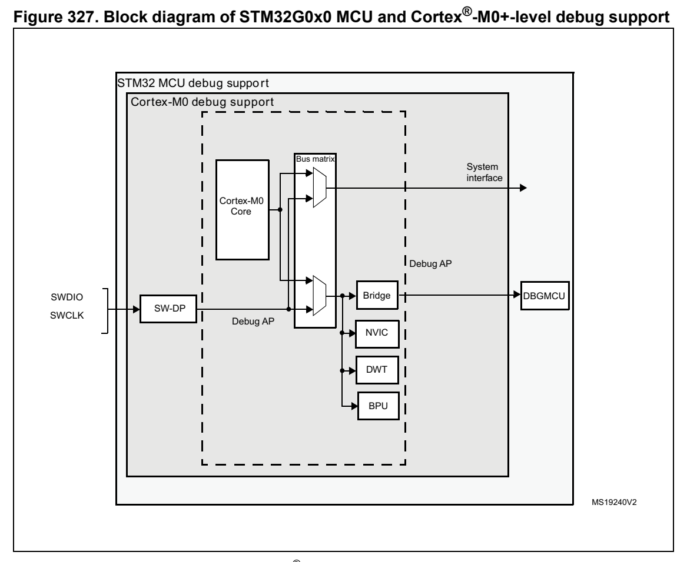

# 29 Debug support (DBG) (pp. 966-979)

## 29 Debug support (DBG) (p. 966)

### 29.1 Overview (p. 966)

The STM32G0x0 devices are built around a Cortex®-M0+ core which contains hardware extensions for advanced debugging features. The debug extension s allow the core to be stopped either on a given instruction fetch (breakpoint) or data access (watchpoint). When stopped, the core’s internal state and the system’s external state may be examined. Once examination is complete, the core and the system may be restore d and program execution resumed.

The debug features are used by the debugger host when connectin g to and debugging the STM32G0x0 MCUs.

One interface for debug is available:

- Serial wire

*Figure 327. Block diagram of STM32G0x0 MCU and Cortex -M0+-level debug support (p. 966)*

1. The debug features embedded in the Cortex -M0+ core are a subset of the Arm CoreSight Design Kit. The Arm Cortex®-M0+ core provides in tegrated on-chip deb ug support. It is comp rised of:

- SW-DP: Serial wire

- BPU: Break point unit

- DWT: Data watchpoint trigger

It also includes debug features dedicated to the STM32G0x0:

- Flexible debug pinout assignment

- MCU debug box (support for low- power modes, control over periph eral clocks, etc.) ® Note: For further information on debug fu® nctionality supported by the Arm Cortex -M0+ core, refer to the Cortex -M0+ Technical Reference Manual (see Section 29.2: Reference Arm documentation).

### 29.2 Reference A rm documentation (p. 967)

- Cortex®-M0+ Technical Reference Manu al (TRM), available from http://infocen ter.arm.com

- Arm Debug Interface V5

- Arm CoreSight Design K it revision r1p1 Technical Reference Manu al

### 29.3 Pinout and debug port pins (p. 967)

The STM32G0x0 MCUs are available in various packa ges with diffe rent numbers of available pins.

#### 29.3.1 SWD port pins (p. 967)

Two pins are used as outputs for the SW-DP as alternate functio ns of general purpose I/Os. These pins are available on all packages.

**Table 148. SW debug port pins (p. 967)**

| SW-DP pin name | SW debug port | Pin |
| --- | --- | --- |
| SW-DP pin name | Type Debug assignment | assignment |
|  | SWDIO I/O Serial Wire Data Input/Output PA13 |  |
|  | SWCLK I Serial Wire Clock PA14 |  |

#### 29.3.2 SW-DP pin assignment (p. 967)

After reset (SYSRESETn or PORESETn), the pins used for the SW-D P are assigned as dedicated pins which are immedi ately usable by the debugger host. However, the MCU offers the possibility to disable t he SWD port and can then release the associated pins for general-purp ose I/O (GPIO) usage. For more details on how to disable SW-DP port pins, refer to Section 6.3.2: I/O pin alternate function multiplexer and mapping on page 175.

#### 29.3.3 Internal pull-up & pull-down on SWD pins (p. 968)

Once the SW I/O is released by the user software, the GPIO cont roller takes control of these pins. The reset states of the GP IO control registers put the I/Os in the equivalent states:

- SWDIO: input pull-up

- SWCLK: input pull-down Having embedded pull-up and pull-down resistors removes the need to add external resistors.

### 29.4 ID codes and locking mechanism (p. 968)

There are several ID codes insid e the MCU. ST strongly recommen ds the tool manufacturers (for example Keil, IAR, Raisonance) to lock their debugger using the MCU device ID located at address 0x40015800.

Only the DEV_ID[15:0] should be us ed for identification by the debugger/programmer tools (the revision ID must not be taken into account).

### 29.5 SWD port (p. 968)

#### 29.5.1 SWD protocol introduction (p. 968)

This synchronous serial protocol uses two pins:

- SWCLK: clock from host to target

- SWDIO: bidirectional

The protocol allows two banks of registers (DPACC registers and APACC registers) to be read and written to.

Bits are transferred LSB-first on the wire.

For SWDIO bidirectional managem ent, the line must be pulled-up on the board (100 kΩ recommended by Arm).

Each time the direction of SWDI O changes in the protocol, a turnaround time is inserted where the line is not driven by the host nor the target. By default, this turnaround time is one bit time, however this can be adjusted by configuring the SWCLK frequency.

#### 29.5.2 SWD protocol sequence (p. 968)

Each sequence consist of three phases: 1. Packet request (8 bits) transmitted by the host 2. Acknowledge response (3 bits) transmitted by the target 3. Data transfer phase (33 bits) transmitted by the host or the target

**Table 149. Packet request (8-bits) (p. 969)**

| Col 1 | Col 2 | Bit Name Description |
| --- | --- | --- |
|  | 0 Start Must be “1” |  |
| 1 APnDP | 1 APnDP | 0: DP Access 1: AP Access |
| 2 RnW |  | 0: Write Request 1: Read Request |
| 4:3 A[3:2] |  | Address field of the DP or AP registers (refer to Table 153 on page 971) |
|  | 5 Parity Single bit parit | y of preceding bits |
|  | 6 Stop 0 |  |
| 7 Park |  | Not driven by the host. Must b e read as “1” by the target because of the pull-up |

Refer to the Cortex®-M0+ TRM for a detailed description of DPACC and APACC registers.

The packet request is always followed by the turnaround time (d efault 1 bit) where neither the host nor target drive the line.

**Table 150. ACK response (3 bits) (p. 969)**

| Col 1 | Col 2 | Bit Name Description |
| --- | --- | --- |
|  |  | 001: FAULT |
| 0..2 | ACK | 010: WAIT |
|  |  | 100: OK |

The ACK Response must be followed by a turnaround time only if it is a READ transaction or if a WAIT or FAULT acknowledge has been received.

**Table 151. DATA transfer (33 bits) (p. 969)**

| Col 1 | Col 2 | Bit Name Description |
| --- | --- | --- |
| 0..31 | WDATA or RDATA | Write or Read data |

32 Parity Single parity of the 32 data bits

The DATA transfer mus t be followed by a tur naround time only if it is a READ transaction.

#### 29.5.3 SW-DP state machine (reset, idle states, ID code) (p. 969)

The State Machine of the SW-DP h as an internal ID code which id entifies the SW-DP. It follows the JEP-106 standard. Th is ID code is the default Arm o ne and is set to 0x0BB11477 (corresponding to Cortex®-M0+).

Note: Note that the SW-DP state machine is in active until the target reads this ID code.

- The SW-DP state machine is in RESET STATE either after power-on reset, or after the line is high for mo re than 50 cycles

- The SW-DP state machine is in ID LE STATE if the line is low for at least two cycles after RESET state.

- After RESET state, it is mandatory to first enter into an ID LE state AND to perform a READ access of the DP-SW ID CODE register. Otherwise, the targe t issues a FAULT acknowledge response on another transactions. Further details of the SW-DP state machine can be found in the Cortex®-M0+ TRM and the CoreSight Design Kit r1p0 TRM.

#### 29.5.4 DP and AP read/write accesses (p. 970)

- Read accesses to the DP are not posted: the target response can be immediate (if ACK=OK) or can be de layed (if ACK=WAIT).

- Read accesses to the AP are posted. This means that the result of the access is returned on the next transfer. If the next access to be done is NOT an AP access, then the DP-RDBUFF register must be read to obtain the result. The READOK flag of the DP-CTRL/S TAT register is updated on every AP read access or RDBUFF read request to know i f the AP read access was succes sful.

- The SW-DP implements a write buffer (for both DP or AP writes), that enables it to accept a write operation even wh en other transactions are still outstanding. If the write buffer is full, the target acknowledge response i s “WAIT”. With the exception of IDCODE read or CTRL/STAT read or ABORT write which are accepted even if the write buffer is full.

- Because of the asynchronous clock domains SWCLK and HCLK, two extra SWCLK cycles are needed after a write transaction (after the parity b it) to make the write effective internally. These cyc les should be applied while driv ing the line low (IDLE state) This is particularly important when writing the CTRL/STAT for a power-up request. If the next transaction (requiring a power-up) occurs immediately, it fails.

#### 29.5.5 SW-DP registers (p. 970)

Access to these registers are initiated when APnDP=0

**Table 152. SW-DP registers (pp. 970-971)**

| A[3:2] R/W | CTRLSEL bit of SELECT register | Register Notes |
| --- | --- | --- |
|  | 00 Read IDCODE | The manufacturer code is set to the default Arm code for Cortex®-M0+: 0x0BC11477 (identifies the SW-DP) |
|  | 00 Write ABORT |  |
|  | 01 Read/Write 0 DP-CTRL/STAT |  |
| 01 Read/Write 1 |  | WIRE CONTROL |
| 10 Read |  | READ RESEND |
|  | 10 Write SELECT |  |
|  | 11 Read/Write READ BUFFER |  |

#### 29.5.6 SW-AP registers (p. 971)

Access to these registers are initiated when APnDP=1

There are many AP Registers ad dressed as the combination of:

- The shifted value A[3:2]

- The current value of the DP SELECT register.

**Table 153. 32-bit de bug port registers addressed through the sh ifted value A[3:2] (pp. 971-972)**

| Col 3 | Col 4 | Address A[3:2] value Description |
| --- | --- | --- |
|  |  | 0x0 00 Reserved, must be kept at reset value. |
| 0x4 01 | 0x4 01 | DP CTRL/STAT register. Used to: – Request a system or debug power-up – Configure the transfer operation for AP accesses – Control the pushed compare and pushed verify operations. – Read some status flags (ove rrun, power-up acknowledges) |
|  | 0x8 10 | DP SELECT register: Used to s elect the current access port and the active 4-words register window. – Bits 31:24: APSEL: se lect the current AP – Bits 23:8: reserved – Bits 7:4: APBANKSEL: select the active 4-words register window on the current AP – Bits 3:0: reserved |
| 0xC 11 | 0xC 11 | DP RDBUFF register: Used to al low the debugger to get the final result after a sequence of o perations (without re questing new JTAG-DP operation) |

### 29.6 Core debug (p. 972)

Core debug is accessed through the core debug registers. Debug access to these registers is by means of the debug access port. It consists of four registers:

**Table 154. Core debug registers (p. 972)**

| Col 1 | Register Description |
| --- | --- |
| DHCSR | The 32-bit Debug Halting Control and Status Register This provides status information about the state of the process or enable core debug halt and step the processor |
| DCRSR | The 17-bit Debug Core Register Selector Register: This selects the processor register to transfer data to or from. |
| DCRDR | The 32-bit Debug Core Register Data Register: This holds data for reading and w riting registers to and from t he processor selected by the DCRSR (Selector) register. |
| DEMCR | The 32-bit Debug Exception an d Monitor Control Register: This provides Vector Catchin g and Debug Monitor Control. |

These registers are not reset b® y a system reset. They are only reset by a power-on reset. Refer to the Cortex -M0+ TRM for further details.

To Halt on reset, it is necessary to:

- enable the bit0 (VC_C ORRESET) of the Debug and Exception Monito r Control Register

- enable the bit0 (C_DEBUGEN) of t he Debug Halting Control and Status Register

### 29.7 BPU (Break Point Unit) (p. 972)

The Cortex®-M0+ BPU implementation provides four breakpoint registers. The BPU is a subset of the Flash Patch and Breakpoint (FPB) block available in Armv7-M (Cortex-M3 & Cortex-M4).

#### 29.7.1 BPU functionality (p. 973)

The processor breakpoints implem ent PC based breakpoint functio nality.

Refer the Armv6-M Arm and the Arm CoreSight Components Technical Reference Manual for more information about the BPU CoreSight identification reg isters, and their addresses and access types.

### 29.8 DWT (Data Watchpoint) (p. 973)

The Cortex®-M0+ DWT implementation provides two watchpoint register sets.

#### 29.8.1 DWT functionality (p. 973)

The processor watchpoints implem ent both data address and PC ba sed watchpoint functionality, a PC sampling regi ster, and support comparator a ddress masking, as described in the Armv6-M Arm.

#### 29.8.2 DWT Program Co unter Sample Register (p. 973)

A processor that implements the data watchpoint unit also imple ments the Armv6-M optional DWT Program Counter Sample Register (DWT_PCSR). This register permits a debugger to periodically sample the PC without halting the processor. This provides coarse grained profiling. See the Armv6-M Arm for more information. The Cortex®-M0+ DWT_PCSR records both instructions that pass their conditi on codes and those that fail.

### 29.9 MCU debug component (DBG) (p. 973)

The MCU debug component helps th e debugger provide support for:

- Low-power modes

- Clock control for timers, watchdo g and I2C during a breakpoint

#### 29.9.1 Debug support for low-power modes (p. 973)

To enter low-power mode, the instruction WFI or WFE must be exe cuted.

The MCU implements several low-power modes which can either dea ctivate the CPU clock or reduce the power of the CPU.

The core does not allow FCLK or HCLK to be turned off during a debug session. As these are required for the debugger connection, during a debug, they must remain active. The MCU integrates special means to allow the user to debug software in low-power modes.

For this, the debugger host mus t first set some debug configura tion registers to change the low-power mode behavior:

- In Sleep mode: FCLK and HCLK are still active. Consequently, th is mode does not impose any restrictions on the standard debug features.

- In Stop/Standby mode, the DBG_STOP bit must be previously set b y the debugger.

This enables the inte rnal RC oscillator cl ock to feed FCLK and HCLK in Stop mode.

#### 29.9.2 Debug support for timers, watchdog and I2C (p. 974)

During a breakpoint, it is neces sary to choose h ow the counter of timers and watchdog should behave:

- They can continue to count inside a breakpoint. This is usually required when a PWM is controlling a moto r, for example.

- They can stop to count inside a breakpoint. This is required fo r watchdog purposes. For the I2C, the user can choose to block th e SMBUS timeout during a brea kpoint.

### 29.10 DBG registers (p. 974)

### 29.10.1 [DBG.DBG_IDCODE] Offset: 0x00 | Reset: N/A (p. 974)

The STM32G0x0 products integrate a device ID code identifying t he device and its die revision.

This code is accessible by the software debug port (two pins) o r by the user software.

DBG_IDCODE

Address offset: 0x00

Only 32-bit access supported. Read-only

Bits 31:16 REV_ID[15:0] Revision identifier This field indicates the revis ion of the device. Refer to Table 155.

Bits 15:12 Reserved: read 0b0110.

Bits 11:0 DEV_ID[11:0]: Device identifier This field indicates the device ID. Refer to Table 155.

**Table 155. DEV_ID and REV_ID field values (p. 974)**

| Col 1 | Device DEV_ID Revision code Revision number REV_ID | Col 4 |
| --- | --- | --- |
|  | STM32G0B0xx 0x467 A 1.0 0x1000 |  |
|  |  | A 1.0 0x1000 |
| STM32G070xx 0x460 |  | Z 1.1 0x1000 |
|  |  | B 2.0 0x2000 |
|  | STM32G050xx 0x456 A 1.0 0x1000 |  |
| STM32G030xx 0x466 |  | A 1.0 0x1000 |
| STM32G030xx 0x466 |  | Z 1.1 0x1001 |

### 29.10.2 [DBG.DBG_CR] Offset: 0x04 | Reset: 0x00000000 (p. 975)

This register configures the low-power modes of the MCU under d ebug.

It is asynchronously reset by the POR (and not the system reset). It can be written by the debugger under system reset.

If the debugger host does not s upport this feature, it is still possible for the user software to write to this register.

Address offset: 0x04

POR Reset: 0x0000 0000 (not reset by system reset)

Only 32-bit access supported

STOP BY

rw rw

Bits 31:3 Reserved, must be kept at reset value.

Bit 2 DBG_STANDBY: Debug Standby mode Debug options in Standby modemode. 0: Digital part powered. From software point of view, exiting Standby mode is identical as fetching reset vector (except for status bits indicating that t he MCU exits Standby) 1: Digital part powered and FCLK and HCLK running, derived from the internal RC oscillator remaining active. The MCU generates a system reset so that exit ing Standby mode has the same effect as starting from reset.

Bit 1 DBG_STOP: Debug Stop mode Debug options in Stop mode. 0: All clocks disabled, including FCLK and HCLK. Upon Stop mode exit, the CPU is clocked by the HSI internal RC oscillator. 1: FCLK and HCLK running, derived from the internal RC oscillator remaining active. If Systick is enabled, it may generate periodic interrupt and wake up events.

Upon Stop mode exit, the software must re-establish the desired clock configuration.

### 29.10.3 [DBG.DBG_APB_FZ1] Offset: 0x08 | Reset: N/A (p. 975)

This register configures the clo cking of timers, RTC, IWDG, WWD G, and I2C SMBUS peripherals of the MCU under debug:

The register is asynchronously reset by the POR (and not the system reset). It can be written by the debugger under system reset.

Address offset: 0x08

Power on reset (POR): 0x0000 0000 (not reset b y system reset)

Only 32-bit access are supported.

1. Only significant on devices i ntegrating I2C2, otherwise reserved. Refer to Section 1.4: Availability of peripherals.

Bit 31 Reserved, must be kept at reset value.

Bit 30 Reserved, must be kept at reset value.

Bits 29:23 Reserved, must be kept at reset value.

Bit 22 DBG_I2C2_SMBUS_TIMEOUT: SMBUS timeout when core is halted 0: Same behavior as in normal mode 1: The SMBUS timeout is frozen

Bit 21 DBG_I2C1_SMBUS_TIMEOUT: SMBUS timeout when core is halted 0: Same behavior as in normal mode 1: The SMBUS timeout is frozen

Bits 20:13 Reserved, must be kept at reset value.

Bit 12 DBG_IWDG_STOP: Clocking of IWDG counter when the core is halted This bit enables/disables the c lock to the counter of IWDG when the core is halted: 0: Enable 1: Disable

Bit 11 DBG_WWDG_STOP: Clocking of WWDG counter w hen the core is halted This bit enables/disables the c lock to the counter of WWDG when the core is halted: 0: Enable 1: Disable

Bit 10 DBG_RTC_STOP: Clocking of RTC counter when the core is halted This bit enables/disables the c lock to the counter of RTC when the core is halted: 0: Enable 1: Disable

Bits 9:6 Reserved, must be kept at reset value.

Bit 5 DBG_TIM7_STOP: Clocking of TIM7 counter when the core is halted. This bit enables/disables the c lock to the counter of ITIM7 whe n the core is halted: 0: Enable 1: Disable

Bit 4 DBG_TIM6_STOP: Clocking of TIM6 counter when the core is halted This bit enables/disables the c lock to the counte r of TIM6 when the core is halted: 0: Enable 1: Disable

Bits 3:2 Reserved, must be kept at reset value.

Bit 1 DBG_TIM3_STOP: Clocking of TIM3 counter when the core is halted This bit enables/disables the c lock to the counte r of TIM3 when the core is halted: 0: Enable 1: Disable

Bit 0 Reserved, must be kept at reset value.

### 29.10.4 [DBG.DBG_APB_FZ2] Offset: 0x0C | Reset: 0x00000000 (p. 977)

This register configures the clo cking of timer counters when th e MCU is under debug.

It is asynchronously reset by the POR (and not the system reset). It can be written by the debugger under system reset.

Address offset: 0x0C

POR: 0x0000 0000 (not reset by system reset)

Only 32-bit access is supported.

1. Only significant on devices integrating TIM15, otherwise rese rved. Refer to Section 1.4: Availability of peripherals

Bits 31:19 Reserved, must be kept at reset value.

Bit 18 DBG_TIM17_STOP: Clocking of TIM17 counter when the core is halted This bit enables/disables the c lock to the counter of TIM17 whe n the core is halted: 0: Enable 1: Disable

Bit 17 DBG_TIM16_STOP: Clocking of TIM16 counter when the core is halted This bit enables/disables the c lock to the counter of TIM16 whe n the core is halted: 0: Enable 1: Disable

Bit 16 DBG_TIM15_STOP: Clocking of TIM15 counter when the core is halted This bit enables/disables the c lock to the counter of TIM15 whe n the core is halted: 0: Enable 1: Disable

Bit 15 DBG_TIM14_STOP: Clocking of TIM14 counter when the core is halted This bit enables/disables the c lock to the counter of TIM14 whe n the core is halted: 0: Enable 1: Disable

Bits 14:12 Reserved, must be kept at reset value.

Bit 11 DBG_TIM1_STOP: Clocking of TIM1 counter when the core is halted This bit enables/disables the c lock to the counte r of TIM1 when the core is halted: 0: Enable 1: Disable

Bits 10:0 Reserved, must be kept at reset value.

#### 29.10.5 DBG register map (p. 978)

The following table summarizes the Debug registers.

. Table 156. DBG register map and reset values

Offset Register 31 30 29 28 27 26 25 24 23 22 21 20 19 18 17 16 15 14 13 12 11 10 9 8 7 6 5 4 3 2 1 0

DBG_ 0x00 IDCODE REV_ID Res. Res. Res. Res. DEV_ID

Reset value (1) XXXXXXXXXXXXXXXX0 1 1 0XXXXXXXXXXXX 0x04 DBG_CR Res. Res. Res. Res. Res. Res. Res. Res. Res. Res. Res. Res. Res. Res. Res. Res. Res. Res. Res. Res. Res. Res. Res. Res. Res. Res. Res. Res. Res. DBG_STANDBY DBG_STOP Res. Reset value 00

**Table 156. DBG register map and reset values (continued) (p. 979)**

| Col 1 | Offset Register | 31 | 30 | 29 | 28 | 27 | 26 | 25 | 24 | 23 | 22 | 21 | 20 | 19 | 18 | 17 | 16 | 15 | 14 | 13 | 12 | 11 | 10 | 9 | 8 | 7 | 6 | 5 | 4 | 3 | 2 | 1 | 0 |
| --- | --- | --- | --- | --- | --- | --- | --- | --- | --- | --- | --- | --- | --- | --- | --- | --- | --- | --- | --- | --- | --- | --- | --- | --- | --- | --- | --- | --- | --- | --- | --- | --- | --- |
| 0x08 | DBG_APB_FZ1 | Res. | Res. | Res. | Res. | Res. | Res. | Res. | Res. | Res. | DBG_I2C2_SMBUS_TIMEOUT | DBG_I2C1_SMBUS_TIMEOUT | Res. | Res. | Res. | Res. | Res. | Res. | Res. | Res. | DBG_IWDG_STOP | DBG_WWDG_STOP | DBG_RTC_STOP | Res. | Res. | Res. | Res. | DBG_TIM7_STOP | DBG_TIM6_STOP | Res. | Res. | DBG_TIM3_STOP | Res. |

Reset value 0 0 0 0 0 0 0 0 0x0C APB_FZ2DBG_ Res. Res. Res. Res. Res. Res. Res. Res. Res. Res. Res. Res. Res. DBG_TIM17_STOP DBG_TIM16_STOP DBG_TIM15_STOP DBG_TIM14_STOP Res. Res. Res. DBG_TIM1_STOP Res. Res. Res. Res. Res. Res. Res. Res. Res. Res. Res. Reset value 0 0 0 0 0

1. The reset value is product dependent. For more information, refer to Section 29.10.1: DBG device ID code register (DBG_IDCODE).

Refer to Section 2.2 on page 44 for the register boundary addresses.
